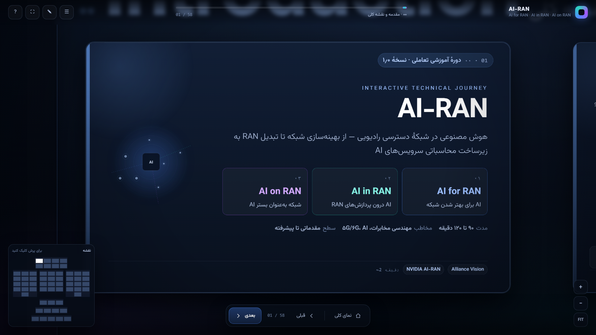
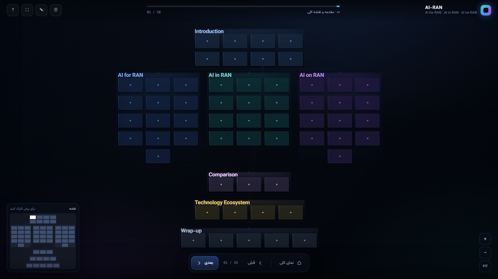
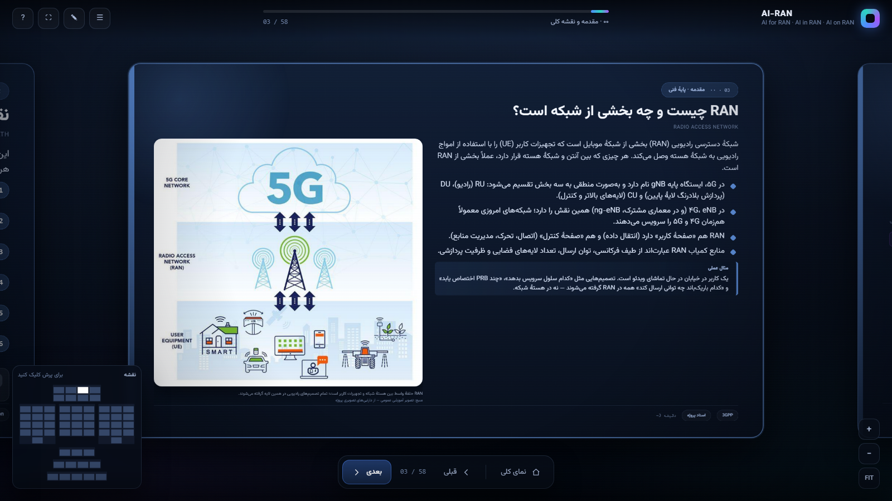
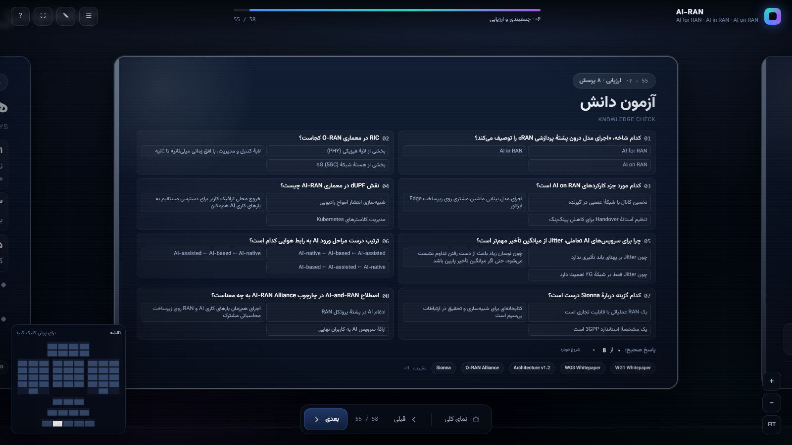
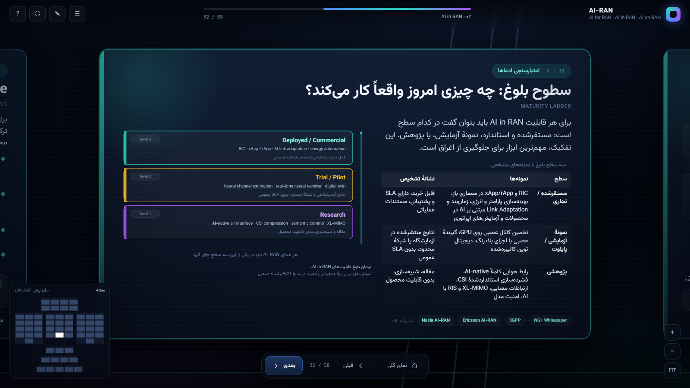
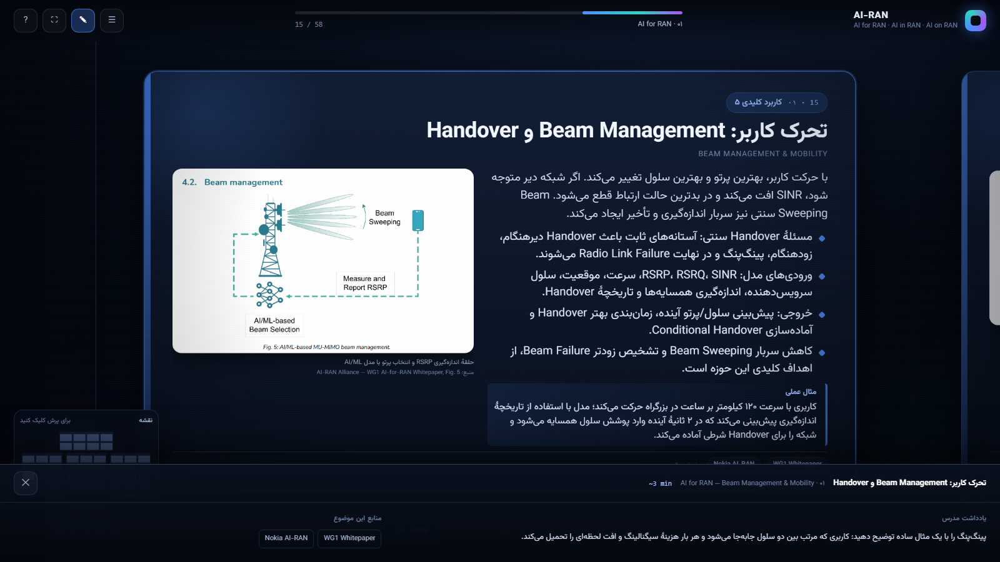
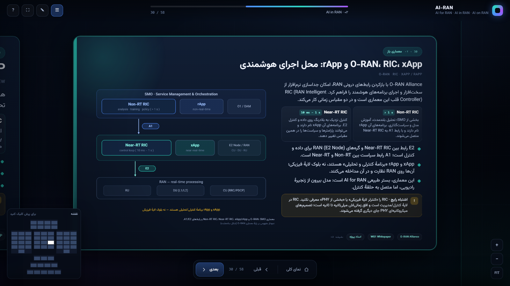

# AI-RAN Interactive Presentation

**ارائهٔ تعاملی Prezi-style دربارهٔ AI-RAN: هوش مصنوعی در شبکهٔ دسترسی رادیویی**

نسخهٔ ۱٫۰٫۰ · زبان: فارسی (RTL) با اصطلاحات فنی انگلیسی · مدت: ۹۰ تا ۱۲۰ دقیقه

---

## ۱. اجرا

هیچ سرور و هیچ نصبی لازم نیست. فایل را با یک مرورگر مدرن باز کنید:

```
AI-RAN-Presentation/index.html
```

- **روش ساده:** روی `index.html` دوبار کلیک کنید.
- **روش پیشنهادی (برای اطمینان از بارگذاری فونت‌ها و تصاویر):**

```powershell
# از داخل پوشهٔ پروژه
Start-Process "msedge.exe" "file:///$((Resolve-Path .\AI-RAN-Presentation\index.html).Path -replace '\\','/')"
```

```bash
# یا یک سرور محلی ساده
python -m http.server 8000 --directory AI-RAN-Presentation
# سپس http://localhost:8000
```

مرورگرهای تست‌شده: Chrome / Edge (Chromium). ارائه کاملاً **آفلاین** است؛ هیچ درخواست شبکه‌ای، CDN یا فونت آنلاین وجود ندارد.

---

## ۲. ناوبری

| کلید | کار |
|---|---|
| `→` / `Space` / `PageDown` | موضوع بعدی |
| `←` / `PageUp` | موضوع قبلی |
| `Home` | نمای کلی نقشه |
| `Esc` | بستن پنجره‌ها / بازگشت به نمای کلی / خروج از تمام‌صفحه |
| `+` / `−` | بزرگ‌نمایی و کوچک‌نمایی |
| `F` | حالت تمام‌صفحه (ارائه) |
| `N` | یادداشت مدرس |
| `T` | فهرست موضوع‌ها |
| `Q` | پرش به آزمون دانش |
| `M` | نمایش/پنهان‌کردن نقشهٔ کوچک |
| `1` … `7` | پرش به بخش |
| `?` | راهنما |

**ماوس/لمس:** درگ برای جابه‌جایی نقشه، اسکرول برای بزرگ‌نمایی حول نشانگر، کلیک روی هر کارت برای پرواز به آن، کلیک روی نقشهٔ کوچک برای پرش، دابل‌کلیک برای بزرگ‌نمایی.

**پیوند مستقیم به هر موضوع:** `index.html#f07` یا `index.html#overview` برای نمای کلی.

---

## ۳. ساختار ارائه (۵۸ موضوع، ۷ بخش)

| بخش | عنوان | موضوع‌ها | زمان |
|---|---|---|---|
| ۰۰ | مقدمه و نقشهٔ کلی | ۸ | ۱۴ دقیقه |
| ۰۱ | **AI for RAN** | ۱۳ | ۲۶ دقیقه |
| ۰۲ | **AI in RAN** | ۱۲ | ۲۴ دقیقه |
| ۰۳ | **AI on RAN** | ۱۳ | ۲۴ دقیقه |
| ۰۴ | مقایسهٔ سه شاخه | ۳ | ۸ دقیقه |
| ۰۵ | اکوسیستم فناوری | ۴ | ۱۰ دقیقه |
| ۰۶ | جمع‌بندی و ارزیابی | ۵ | ۶ دقیقه |

ترتیب آموزشی دقیقاً همان ترتیب درخواستی است: **AI for RAN ← AI in RAN ← AI on RAN**.

### نقشهٔ دانش
هر بخش یک «پلاک» روی یک بوم بزرگ است؛ کارت‌ها با رنگ بخش رنگ‌آمیزی شده‌اند (آبی = for، فیروزه‌ای = in، بنفش = on، سرمه‌ای = مقدمه). در نمای کلی، عنوان بخش‌ها و شبکهٔ کارت‌ها دیده می‌شود؛ با پرواز به هر کارت، متن کامل باز می‌شود.

### هر کارت شامل
عنوان فارسی + معادل انگلیسی · هدف/پیام اصلی · متن آموزشی · نمودار یا تصویر فنی · مثال عملی · هشدار/نکتهٔ فنی · پرسش تعاملی (اختیاری) · منبع در پایین کارت · یادداشت مدرس (کلید `N`).

---

## ۴. ساختار فایل‌ها

```
AI-RAN-Presentation/
├── index.html                  # تنها صفحهٔ ورودی
├── css/
│   ├── main.css                # توکن‌های طراحی، فونت‌ها، پایهٔ RTL
│   ├── presentation.css        # بوم، کارت‌ها، HUD، فهرست، یادداشت، آزمون
│   └── animations.css          # حرکت‌های ظاهری + prefers-reduced-motion
├── js/
│   ├── visualizations.js       # ۱۸ نمودار SVG درون‌خطی (بدون کتابخانه)
│   ├── navigation.js           # دوربین Prezi: چیدمان، پرواز، زوم، درگ، مینی‌مپ
│   ├── presentation.js         # رندر کارت‌ها، HUD، فهرست، یادداشت، آزمون، self-test
│   └── app.js                  # راه‌اندازی، خطایابی، اجرای QA
├── content/
│   ├── 00-core.js              # فراداده، رجیستری منابع، تعریف بخش‌ها
│   ├── 10-intro.js             # بخش ۰۰
│   ├── 20-for.js               # بخش ۰۱ — AI for RAN
│   ├── 30-in.js                # بخش ۰۲ — AI in RAN
│   ├── 40-on.js                # بخش ۰۳ — AI on RAN
│   ├── 50-compare.js           # بخش ۰۴ — مقایسه
│   ├── 60-eco.js               # بخش ۰۵ — اکوسیستم
│   └── 70-wrap.js              # بخش ۰۶ — جمع‌بندی، آزمون، منابع، راهنمای مدرس
├── assets/
│   ├── images/                 # ۲۵ تصویر آماده‌شده (۲۲ تصویر استفاده‌شده)
│   └── fonts/                  # Vazirmatn (SIL OFL) — Light/Regular/Medium/Bold
├── references/
│   └── sources.md              # فهرست کامل منابع، دسته‌بندی و انتساب تصاویر
├── docs/
│   └── screenshots/            # تصاویر نمونهٔ گرفته‌شده از اجرای واقعی
├── tools/
│   └── prepare_assets.py       # بازتولید دارایی‌های تصویری از پوشهٔ images پروژه
└── README.md
```

**افزودن/ویرایش محتوا:** فقط فایل‌های `content/*.js` را تغییر دهید. هر موضوع یک شیء در `A.push({...})` است. ساختار فیلدها در `content/00-core.js` و در سرآغاز هر فایل توضیح داده شده است. چیدمان کارت‌ها خودکار است (ستون‌ها در `A.sections[].cols`)، پس افزودن موضوع، نقشه را به‌طور خودکار بازچینش می‌کند.

---

## ۵. کیفیت، تست و صحت

### آزمون خودکار
یک آزمون درون‌مرورگری وجود دارد که ساختار، تصاویر، دیاگرام‌ها، دوربین، ناوبری کلیدی، فهرست، یادداشت، آزمون و منابع را بررسی می‌کند:

```
index.html?selftest=1
```

نتیجه در `#selftest-output` و `window.__SELFTEST__` ذخیره می‌شود. آخرین اجرا:

```
ok: true · problems: [] · scenes: 58 · zones: 7 · images: 22/22 loaded
tocItems: 58 · quizItems: 8 · refLinks: 18
```

### تست دستی انجام‌شده
تمام موارد زیر در Chrome/Edge (headless و معمولی) بررسی شدند: بارگذاری کامل تصاویر، رندر RTL، نبود خطای JavaScript، درستی متن‌های ترکیبی فارسی/انگلیسی، پرواز دوربین، نمای کلی، زوم و درگ، تمام‌شماره‌های کلیدی، باز/بست فهرست و یادداشت و راهنما، پاسخ‌دهی آزمون و شمارش امتیاز، و آستانهٔ چیدمان کارت‌ها.

### دسترس‌پذیری و کارایی
- `prefers-reduced-motion` پشتیبانی می‌شود (حرکت‌ها خاموش می‌شوند).
- ناوبری کامل با کیبورد و `aria-label` روی کنترل‌ها.
- بدون کتابخانهٔ خارجی؛ تنها ۴ فایل JS محلی + یک SVG درون‌خطی برای هر نمودار.
- زوم/پن با `transform: translate3d(...) scale(...)` روی یک لایه انجام می‌شود (بدون reflow در هر فریم).

---

## ۶. محدودیت‌ها و نکات صداقت فنی

1. **تفکیک سطوح بلوغ:** در سراسر ارائه، بین «مستقرشده/تجاری»، «نمونهٔ آزمایشی» و «پژوهشی» تفکیک شده است (کارت `n11`). اعداد عملکردی فقط با انتساب به سازنده و با هشدار دربارهٔ شرایط آزمون آمده‌اند.
2. **نام‌گذاری:** AI-RAN Alliance محورهای رسمی را `AI-for-RAN`، `AI-and-RAN` و `AI-on-RAN` می‌نامد. اصطلاح درخواستی `AI in RAN` (ادغام در پشتهٔ RAN) در ادبیات صنعتی — از جمله اریکسون — به کار می‌رود و در ارائه به‌صراحت از `AI-and-RAN` تفکیک شده است.
3. **وضعیت استانداردسازی:** مطالعهٔ 3GPP (Release 18/19) با «قابلیت تجاری» یکی نیست؛ این نکته در کارت‌های `n05`، `n11` و منابع ذکر شده است.
4. **تصاویر:** شکل‌های ۱ تا ۷ وایت‌پیپر WG1، شکل ۲٫۱ سند معماری و شکل‌های ۱/۲/۳/۵/۶ سند P&I Orchestrator از اسناد رسمی AI-RAN Alliance هستند. تصاویر Sionna RT از دارایی‌های تصویری پروژه‌اند. سایر تصویرسازی‌ها (مجموعهٔ «AI-Grade») بر پایهٔ محتوای WG3 هستند و در زیرنویس، «تصویرسازی آموزشی — نه نمودار رسمی» علامت خورده‌اند.
5. **نمودارهای مفهومی:** ۱۸ نمودار SVG برای این ارائه ساخته شده‌اند و ادعای رسمی بودن ندارند (در زیرنویس هر نمودار ذکر شده).
6. **ادعاهای تجاری:** اعداد «۲ تا ۳ برابر بهره‌وری منابع» (NVIDIA) و نتایج آزمایشی اپراتورها، ادعاهای سازندگان در شرایط مشخص‌اند و به‌عنوان تضمین عمومی ارائه نشده‌اند.
7. **بدون KPI:** محتوای پوشهٔ `KPI` پروژه طبق درخواست، بررسی و استفاده نشده است.

---

## ۷. منابع اصلی

- AI-RAN Alliance — WG1: *AI-for-RAN Whitepaper* · WG3: *AI-on-RAN Whitepaper* · *Vision and Mission* · *AI-RAN Architecture v1.2* · *Platform & Infrastructure Orchestrator (WG2)*
- NVIDIA — AI-RAN، Aerial CUDA-Accelerated RAN، Aerial Framework، Aerial Omniverse Digital Twin، Sionna
- O-RAN Alliance · 3GPP (Rel-18/19/20 AI/ML studies)
- OpenAirInterface (OSA/EURECOM) · FlexRIC (Mosaic5G)
- Ericsson AI RAN · Nokia AI-RAN

فهرست کامل با پیوندها: [`references/sources.md`](references/sources.md)

---

## ۸. بازتولید دارایی‌ها

برای بازساخت نسخه‌های آمادهٔ تصاویر از پوشهٔ `images` پروژه (بدون تغییر فایل‌های اصلی):

```bash
python tools/prepare_assets.py
```

اسکریپت فقط نسخه‌های جدید را در `assets/images/` می‌نویسد؛ فایل‌های منبع دست‌نخورده می‌مانند.

---

## 9. English summary

A dependency-free, offline, Prezi-style interactive presentation that teaches AI-RAN in the requested order — **AI for RAN → AI in RAN → AI on RAN** — with a Persian RTL UI and English technical terminology. It contains 58 scenes across 7 sections, 18 hand-authored inline SVG diagrams, 22 attributed technical images, a knowledge-map camera (zoom/pan/fly-to), overview mode, a minimap, a TOC drawer, presenter notes with timing and discussion prompts, an 8-question interactive knowledge check, a categorised reference list, and a built-in self-test (`index.html?selftest=1`). Content is data-driven (`content/*.js`), so topics can be edited or reordered without touching the engine.

---

## ۱۰. تصاویر نمونه از اجرای واقعی

| | |
|---|---|
|  |  |
| **جلد ارائه** — سه شاخه و زمان‌بندی | **نمای کلی** — نقشهٔ دانش با پلاک بخش‌ها |
|  |  |
| **کارت محتوایی** — متن، تصویر فنی، مثال | **آزمون دانش** — ۸ پرسش با بازخورد فوری |
|  |  |
| **نمودار مفهومی** — سطح بلوغ قابلیت‌ها | **یادداشت مدرس** — نکات تدریس و منابع |
|  | |

این تصاویر با Chrome در اندازهٔ ۱۶۰۰×۹۰۰ گرفته شده‌اند.
