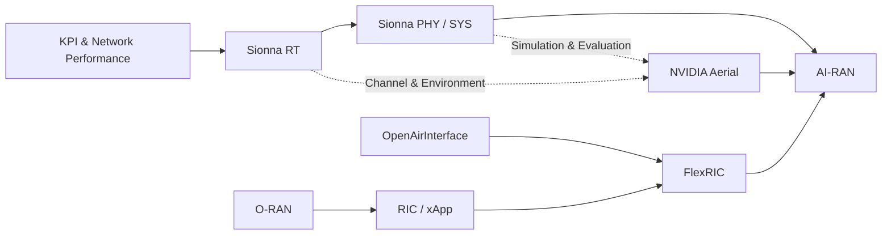

**از شناخت شبکه → شبیه‌سازی شبکه → هوشمندسازی شبکه → کنترل و اتوماسیون → پیاده‌سازی عملی AI-RAN**

## ۱. نمودار اصلی مسیر تدریس (Mermaid)

این نمودار را می‌توانی مستقیماً در Obsidian قرار بدهی.

```mermaid

flowchart TD
    A["🎯 شروع دوره: AI-RAN"] 

    A --> B["مفهوم AI-RAN و کاربردهای آن"]
    B --> C["KPI های شبکه رادیویی"]
    
    C --> D["بخش اول: NVIDIA Sionna"]
    
    D --> E["Sionna RT"]
    E --> F["Introduction"]
    F --> G["Mobility"]
    G --> H["Radio Maps"]
    
    D --> I["Sionna PHY"]
    D --> J["Sionna SYS"]
    H --> I
    I --> J
    
    J --> K["بخش دوم: O-RAN و شبکه هوشمند"]
    
    K --> L["O-RAN Architecture"]
    L --> M["RIC و xApp"]
    M --> N["OpenAirInterface"]
    N --> O["FlexRIC"]
    
    O --> P["بخش سوم: NVIDIA AI-RAN"]
    
    P --> Q["NVIDIA Aerial"]
    Q --> R["cuPHY"]
    R --> S["cuMAC"]
    S --> T["pyAerial"]
    T --> U["5GModel"]
    
    U --> V["🎓 جمع‌بندی: AI در شبیه‌سازی، کنترل و اجرای RAN"]

    classDef start fill:#164e63,color:#fff,stroke:#0891b2
    classDef sionna fill:#1e3a8a,color:#fff,stroke:#3b82f6
    classDef oran fill:#713f12,color:#fff,stroke:#f59e0b
    classDef aerial fill:#14532d,color:#fff,stroke:#22c55e
    classDef end fill:#581c87,color:#fff,stroke:#a855f7

    class A,V start
    class D,E,F,G,H,I,J sionna
    class K,L,M,N,O oran
    class P,Q,R,S,T,U aerial

```

## ۲. ترتیب دقیق تدریس فایل‌های تو

پیشنهاد من برای ترتیب باز کردن فایل‌ها به این شکل است:

**مرحله اول: مبانی و چرایی AI-RAN** · (شروع دوره)

1. `nvdia-ai-ran.md` — مفهوم AI-RAN، کاربردها و چشم‌انداز NVIDIA
2. معرفی KPIهای شبکه رادیویی (فایل یا اسلاید مستقل)

---

**مرحله دوم: شبیه‌سازی و تحلیل شبکه** · (Sionna)

1. `Introduction-sionna.md` — معرفی Sionna RT و مفهوم Ray Tracing
2. `nvidia-sionna-rt-MOBILITY.md` — حرکت کاربران و تغییرات کانال
3. `nvidia-sionna-rt-radio-map.md` — تولید Radio Map و پوشش رادیویی
4. `nvidia-sionna-PHY.md` — شبیه‌سازی لایه فیزیکی
5. `nvidia-sionna-SYS.md` — شبیه‌سازی سطح سیستم و عملکرد شبکه

---

**مرحله سوم: معماری و اتوماسیون RAN** · (O-RAN)

1. `ORAN.md` — معماری O-RAN و اجزای آن
2. `RIC-xApp.md` — RIC، xApp و کنترل هوشمند شبکه
3. `OpenAirInterface.md` — پیاده‌سازی عملی شبکه 5G
4. `FlexRIC.md` — پیاده‌سازی RIC و توسعه xApp

---

**مرحله چهارم: اجرای AI-RAN با NVIDIA** · (NVIDIA Aerial)

1. `nvidia-Aerial.md` — معرفی پلتفرم Aerial و معماری آن
2. `nvidia-cuPHY.md` — معرفی cuPHY، cuMAC، pyAerial و 5GModel

## ۳. ارتباط مفهومی بین مباحث

این نمودار نشان می‌دهد هر فناوری چه مسئله‌ای را حل می‌کند و چرا باید آن را تدریس کنی.



توضیحی که هنگام نمایش این نمودار می‌توانی به مخاطب بدهی:

- **Sionna:** قبل از اجرای شبکه، محیط انتشار امواج و رفتار شبکه را شبیه‌سازی می‌کنیم.
- **O-RAN:** معماری باز و استانداردی برای کنترل و هوشمندسازی شبکه معرفی می‌کنیم.
- **RIC و xApp:** تصمیم‌گیری هوشمند و بهینه‌سازی شبکه را به صورت نرم‌افزاری انجام می‌دهیم.
- **OpenAirInterface و FlexRIC:** امکان تجربه عملی و توسعه این معماری را فراهم می‌کنیم.
- **NVIDIA Aerial:** وارد پیاده‌سازی شتاب‌یافته و پردازش واقعی‌تر RAN می‌شویم.
