---
tags:
  - nvidia
  - ai-ran
---

## 🔗 Knowledge Graph

### Next Steps
- [[nvidia-cuPHY]]

----

# NVIDIA AI Aerial؛ پلتفرم شتاب‌دهی و توسعه شبکه‌های AI-RAN

**منبع اصلی:** [NVIDIA AI Aerial Documentation](https://docs.nvidia.com/aerial/index.html)

## اسلاید ۱ – معرفی NVIDIA AI Aerial

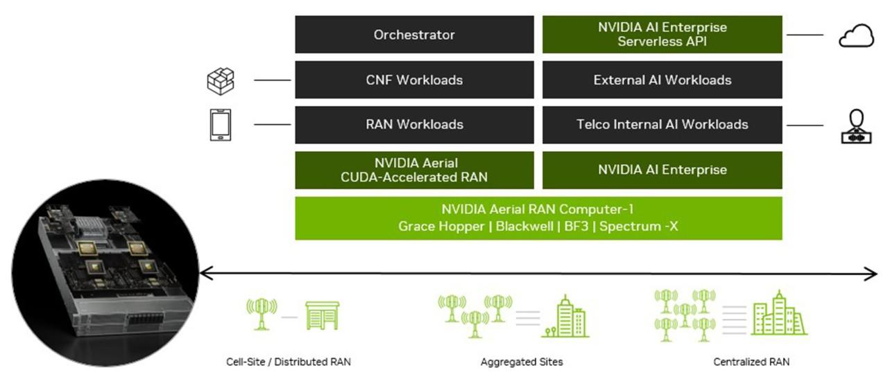

**‏
‏NVIDIA AI Aerial چیست؟**

یک مجموعه سخت‌افزاری و نرم‌افزاری برای توسعه نسل جدید شبکه‌های رادیویی مبتنی بر هوش مصنوعی است.

این پلتفرم به ما کمک می‌کند:

- شبکه‌های 5G و 6G را شبیه‌سازی کنیم.
- الگوریتم‌های مخابراتی را توسعه دهیم.
- پردازش‌های رادیویی را با GPU شتاب دهیم.
- قابلیت‌های AI را وارد عملکرد شبکه کنیم.
- راهکارها را از محیط آزمایشگاهی به شبکه واقعی منتقل کنیم.

**پیام اصلی:** هدف، ترکیب مخابرات، محاسبات GPU و هوش مصنوعی در یک بستر یکپارچه است.

## اسلاید ۲ – نیاز اصلی چیست؟

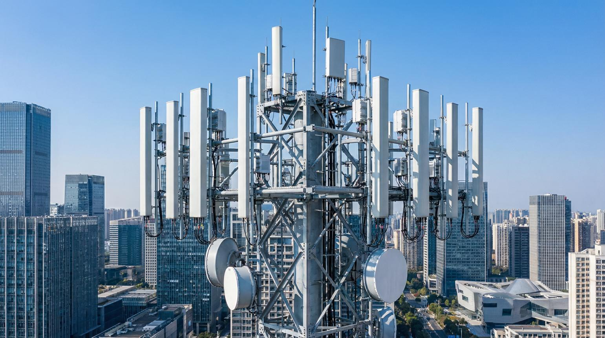

شبکه‌های نسل جدید با چند چالش مهم روبه‌رو هستند:

- افزایش حجم ترافیک و تعداد کاربران
- پیچیده‌تر شدن پردازش سیگنال
- نیاز به تأخیر کمتر
- افزایش بهره‌وری طیف فرکانسی
- نیاز به بهینه‌سازی هوشمند شبکه
- دشوارتر شدن آزمایش قابلیت‌های جدید روی شبکه واقعی

**سؤال:** چگونه می‌توانیم قبل از پیاده‌سازی در شبکه واقعی، این قابلیت‌ها را سریع‌تر توسعه داده و آزمایش کنیم؟

## اسلاید ۳ – راهکار NVIDIA چیست؟

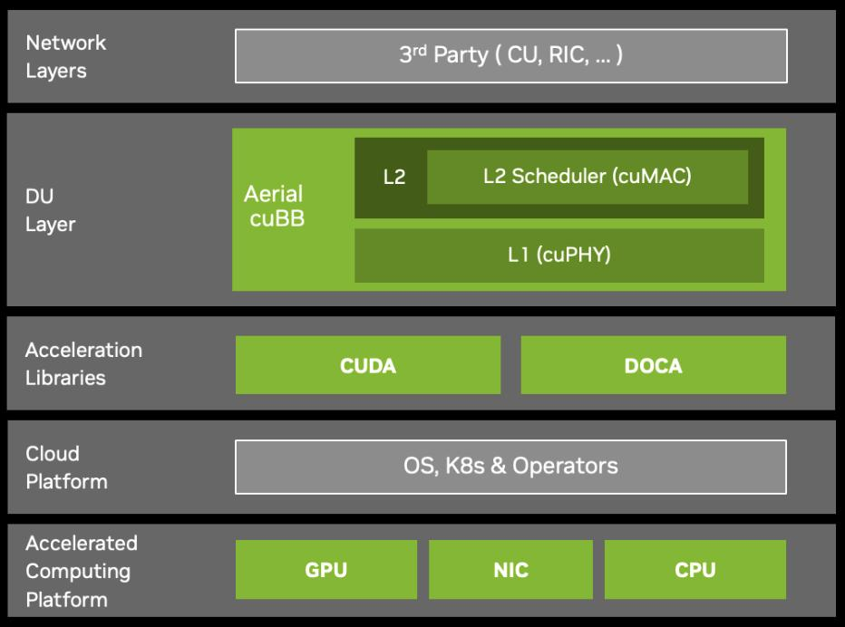

‏NVIDIA با معرفی AI Aerial یک اکوسیستم برای توسعه شبکه‌های رادیویی ارائه کرده است.

این اکوسیستم سه حوزه اصلی را پوشش می‌دهد:

1. **‏Simulation:** شبیه‌سازی محیط و رفتار شبکه
2. **‏Development:** توسعه و آزمایش الگوریتم‌های رادیویی
3. **‏Deployment:** اجرای شبکه روی سخت‌افزار شتاب‌یافته

در نتیجه، مسیر توسعه از ایده و شبیه‌سازی تا اجرای عملی کوتاه‌تر می‌شود.

## اسلاید ۴ – اجزای اصلی پروژه

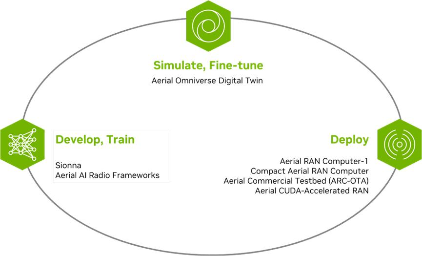

در مستندات NVIDIA، چند زیرمجموعه اصلی برای AI Aerial معرفی شده‌اند:

| زیرمجموعه | وظیفه |
| --- | --- |
| Aerial CUDA-Accelerated RAN | پردازش رادیویی شتاب‌یافته با GPU |
| Aerial Omniverse Digital Twin | شبیه‌سازی دیجیتال محیط شبکه |
| Aerial Framework | ساخت و اجرای زنجیره پردازش مخابراتی |
| Aerial Hardware Platforms | سخت‌افزار اجرای شبکه |
| Aerial Testbed | محیط آزمایش یکپارچه شبکه |

در اسلایدهای بعدی هرکدام را جداگانه معرفی می‌کنیم.

## اسلاید ۵ – Aerial CUDA-Accelerated RAN

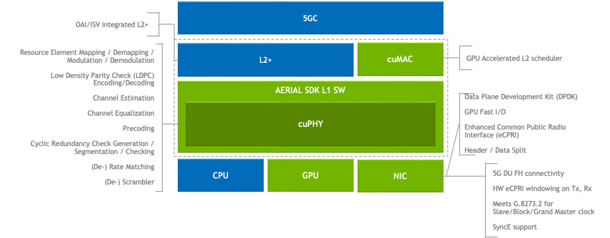

**نیاز:** پردازش سیگنال در شبکه 5G و 6G بسیار سنگین و زمان‌بر است.

**راه‌حل:** استفاده از GPU و کتابخانه‌های CUDA برای شتاب‌دهی پردازش‌های مخابراتی.

قابلیت‌های مهم:

- پردازش لایه فیزیکی (L1)
- پشتیبانی از بخش‌هایی از لایه دوم (L2)
- پردازش سریع‌تر سیگنال
- توسعه شبکه‌های نرم‌افزارمحور 5G و 6G

**نتیجه:** امکان پیاده‌سازی RAN با پردازش شتاب‌یافته و قابلیت توسعه برای شبکه‌های نسل آینده.

منبع: NVIDIA Aerial CUDA-Accelerated RAN

## اسلاید ۶ – Aerial Omniverse Digital Twin

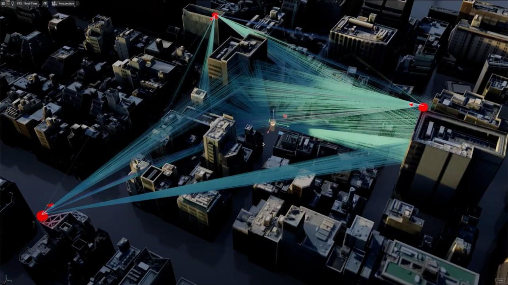

**نیاز:** آزمایش شبکه در محیط واقعی پرهزینه است. تغییر موقعیت آنتن‌ها، ساختمان‌ها و کاربران نیز می‌تواند رفتار انتشار امواج را تغییر دهد.

**راه‌حل:** ساخت یک نسخه دیجیتال از محیط مخابراتی.

در این محیط می‌توان:

- ساختمان‌ها و محیط شهری را سه‌بعدی نمایش داد.
- ایستگاه‌های رادیویی را جانمایی کرد.
- انتشار امواج را با Ray Tracing شبیه‌سازی کرد.
- شرایط مختلف شبکه را آزمایش کرد.
- سناریوهای حرکتی کاربران را بررسی کرد.

**نتیجه:** قبل از اجرای تغییرات در شبکه واقعی، اثر آن‌ها را در محیط دیجیتال بررسی می‌کنیم.

نکته: این بخش ارتباط نزدیکی با موضوع Sionna RT و Radio Maps دارد.

## اسلاید ۷ – Aerial Framework

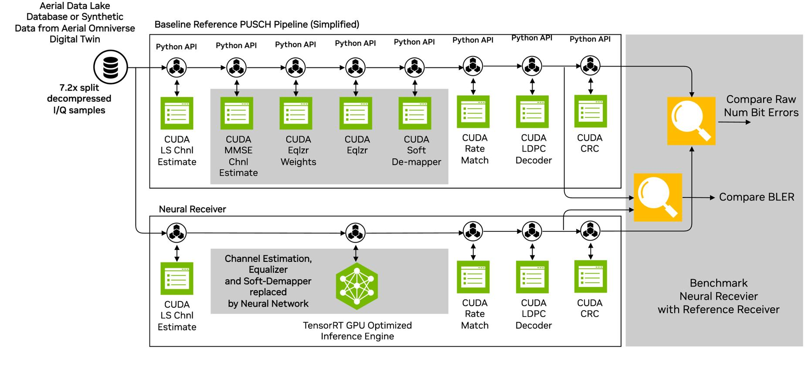

**نیاز:** توسعه زنجیره پردازش مخابراتی نیازمند اتصال چندین الگوریتم و بخش نرم‌افزاری است.

**راه‌حل:** استفاده از Aerial Framework.

ویژگی‌ها:

- ساخت زنجیره پردازش 5G و 6G
- استفاده از Python یا MATLAB
- تولید Pipelineهای شتاب‌یافته با CUDA
- اجرای Pipeline روی سخت‌افزارهای Aerial

**نتیجه:** توسعه و اجرای الگوریتم‌های مخابراتی در یک چارچوب منسجم و قابل اجرا.

## اسلاید ۸ – Aerial Hardware Platforms

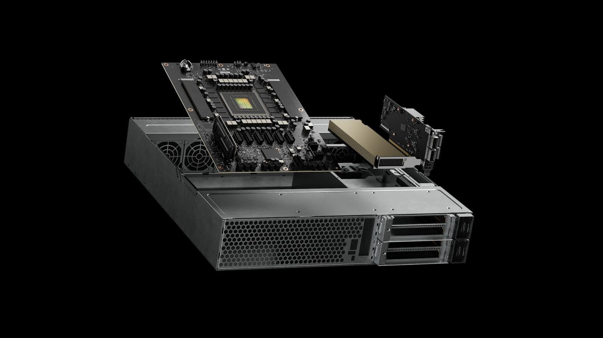

**نیاز:** اجرای AI-RAN به سخت‌افزار مناسب برای پردازش هم‌زمان مخابرات و هوش مصنوعی نیاز دارد.

**راه‌حل:** خانواده Aerial RAN Computer یا ARC.

چند نمونه:

- **ARC-1:** برای استقرارهای پرتراکم و پردازش‌های AI-centric
- **ARC-Compact:** مناسب سایت‌های رادیویی و استقرار توزیع‌شده
- **ARC-Pro:** پلتفرم پرقدرت مبتنی بر GPUهای نسل جدید

**نتیجه:** فراهم شدن بستر سخت‌افزاری برای اجرای AI-RAN در مقیاس‌های مختلف.

## اسلاید ۹ – Aerial Testbed

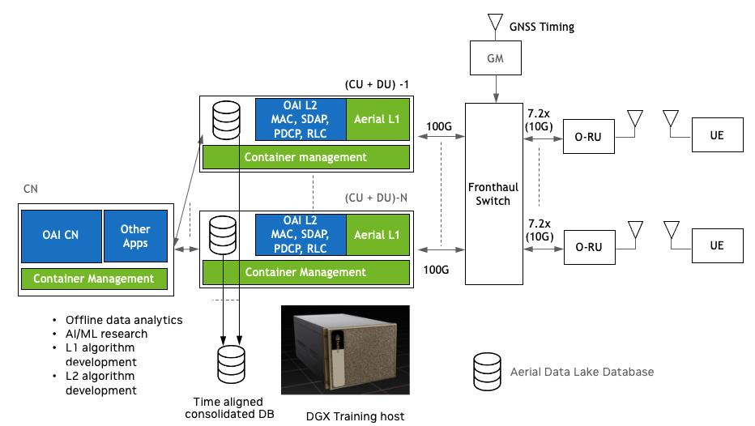

**نیاز:** شبیه‌سازی به‌تنهایی برای ارزیابی یک شبکه کافی نیست؛ باید اجزای واقعی شبکه نیز آزمایش شوند.

**راه‌حل:** استفاده از Aerial Testbed.

این محیط شامل ترکیبی از:

- Aerial CUDA-Accelerated RAN
- نرم‌افزار OpenAirInterface برای بخش‌های L2 و بالاتر
- 5G Core
- سخت‌افزار NVIDIA GH200 یا DGX Spark
- ارتباط رادیویی واقعی (Over The Air)

**نتیجه:** امکان آزمایش یک سیستم یکپارچه 5G و ارزیابی عملکرد آن در شرایط عملی.

## اسلاید ۱۰ – NVIDIA 6G Developer Program

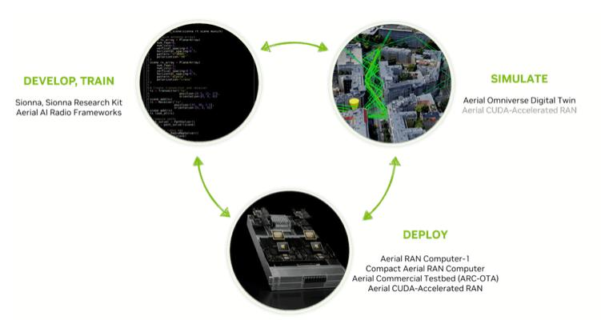

**نیاز:** توسعه 6G به محیطی برای تحقیق، آزمایش و توسعه فناوری‌های جدید نیاز دارد.

**راه‌حل:** برنامه توسعه‌دهندگان 6G انویدیا.

این برنامه دسترسی به مجموعه‌ای از امکانات را فراهم می‌کند:

- پلتفرم RAN نرم‌افزارمحور و شتاب‌یافته
- ابزارهای AI و Machine Learning
- ‏Digital Twin شبکه
- مدل انتشار امواج مبتنی بر Ray Tracing
- ابزارهای توسعه و آزمایش فناوری‌های 6G

**نتیجه:** ایجاد بستری برای پژوهش و توسعه فناوری‌های آینده شبکه موبایل.

## اسلاید ۱۱ – ارتباط اجزای مختلف با یکدیگر

این نمودار نشان می‌دهد چگونه اجزای AI Aerial در یک چرخه توسعه شبکه با هم کار می‌کنند.

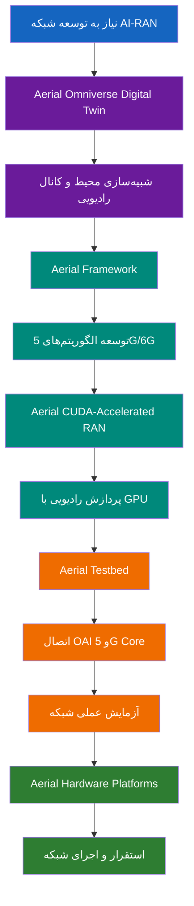

## اسلاید ۱۲ – تفاوت NVIDIA Aerial و Sionna چیست؟

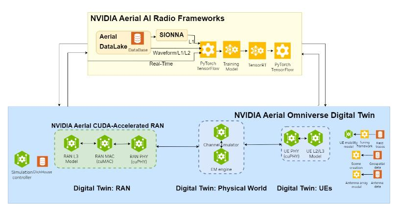

این دو ابزار را نباید یکسان در نظر گرفت؛ هرکدام بخشی از اکوسیستم توسعه شبکه را پوشش می‌دهند.

| ابزار | تمرکز اصلی |
| --- | --- |
| Sionna RT | شبیه‌سازی انتشار امواج و Ray Tracing |
| Sionna PHY | شبیه‌سازی لایه فیزیکی و پردازش سیگنال |
| Sionna SYS | شبیه‌سازی سطح سیستم شبکه |
| Aerial Digital Twin | محیط دیجیتال و شبیه‌سازی شبکه رادیویی |
| Aerial CUDA RAN | اجرای پردازش‌های واقعی RAN با GPU |
| Aerial Framework | ساخت و اجرای زنجیره پردازش |

**نکته مهم برای تدریس:** Sionna بیشتر ابزار تحقیق، شبیه‌سازی و توسعه الگوریتم است؛ Aerial علاوه بر شبیه‌سازی، مسیر توسعه و اجرای RAN شتاب‌یافته را نیز پوشش می‌دهد.

## اسلاید ۱۳ – جمع‌بندی

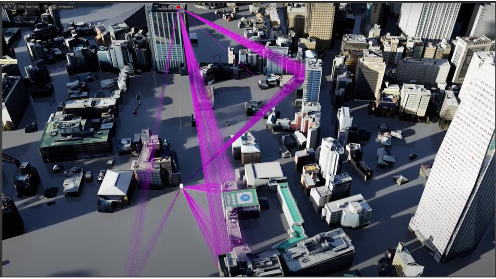

در این بخش دیدیم که NVIDIA AI Aerial چگونه نیازهای توسعه شبکه‌های نسل آینده را پوشش می‌دهد:

- شبیه‌سازی محیط شبکه با Digital Twin
- توسعه الگوریتم‌های مخابراتی
- پردازش سریع با GPU
- آزمایش شبکه با Testbed
- اجرای شبکه روی سخت‌افزار تخصصی

**پیام نهایی:** هدف AI-RAN فقط اضافه کردن هوش مصنوعی به شبکه نیست؛ بلکه ایجاد بستری است که در آن هوش مصنوعی، پردازش مخابراتی و زیرساخت محاسباتی در کنار هم کار کنند.

---

## اسلاید ۱۴ – منابع و مسیر مطالعه بیشتر

| موضوع | مستندات |
| --- | --- |
| Aerial CUDA RAN | [Documentation](https://docs.nvidia.com/aerial/cuda-accelerated-ran/latest/) |
| Aerial Digital Twin | [Documentation](https://docs.nvidia.com/aerial/omniverse-digital-twin/latest/) |
| Aerial Framework | [Documentation](https://docs.nvidia.com/aerial/framework/latest/) |
| Aerial Testbed | [Documentation](https://docs.nvidia.com/aerial/testbed/latest/text/intro.html) |
| Aerial Main Page | [NVIDIA AI Aerial](https://docs.nvidia.com/aerial/index.html) |

ساختار و معرفی محصولات بر اساس مستندات NVIDIA بررسی شده است. نسخه‌ها و امکانات هر زیرمجموعه ممکن است تغییر کنند. 

[NVIDIA Docs](https://docs.nvidia.com/aerial/index.html) · [Aerial Testbed](https://docs.nvidia.com/aerial/testbed/latest/text/intro.html)

---

## پیشنهاد برای جایگاه این مبحث در دوره AI-RAN

با توجه به اینکه در دوره شما Sionna، OpenAirInterface، FlexRIC و O-RAN هم مطرح می‌شوند، پیشنهاد می‌کنم ترتیب تدریس این بخش‌ها چنین باشد:

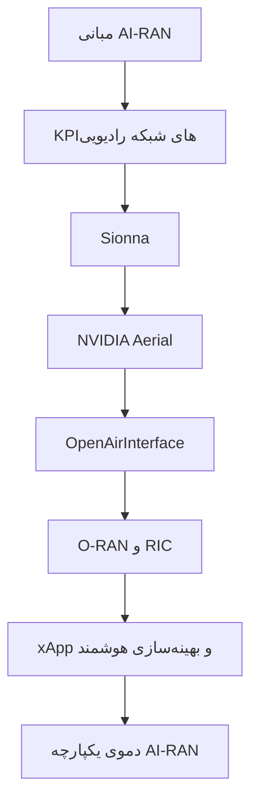

**یک نکته مهم درباره زمان تدریس:** برای این بخش Aerial حدود ۸ تا ۱۲ دقیقه کافی است. وارد جزئیات نصب و برنامه‌نویسی نشوید؛ هدف آشنایی با اکوسیستم و کاربرد هر زیرمجموعه است.

همچنین تمام اجزای Aerial نرم‌افزارهای مستقل قابل نصب روی هر کامپیوتری نیستند؛ برخی به GPUهای سازگار، سخت‌افزار تخصصی یا محیط اجرایی مشخص نیاز دارند.

برای مبحث بعدی، بهتر است از Aerial Digital Twin به Sionna RT و سپس از شبیه‌سازی به اجرای واقعی RAN با OpenAirInterface پل بزنید.