---
tags:
  - ai-ran

---

## 🔗 Knowledge Graph

### Next Steps
- [[nvidia-Aerial]]
- [[nvidia-cuPHY]]

[https://www.nvidia.com/en-us/glossary/ai-ran/](https://www.nvidia.com/en-us/glossary/ai-ran/)

[https://www.nvidia.com/en-us/industries/telecommunications/ai-ran/](https://www.nvidia.com/en-us/industries/telecommunications/ai-ran/)

* * *

# ارائه آموزشی: مفهوم AI-RAN و راهکار NVIDIA

AI-RAN | Artificial Intelligence for Radio Access Network

**منابع اصلی ارائه:**

- [nvidia.com](https://www.nvidia.com/en-us/glossary/ai-ran/)
- [nvidia.com](https://www.nvidia.com/en-us/industries/telecommunications/ai-ran/)

این بخش بعد از معرفی Sionna RT، PHY و SYS قرار می‌گیرد و هدف آن پاسخ به یک سؤال مهم است:

**چگونه هوش مصنوعی می‌تواند شبکه رادیویی را هوشمندتر کند و چگونه می‌توان منابع محاسباتی شبکه را برای اجرای هم‌زمان هوش مصنوعی و ارتباطات مخابراتی به کار گرفت؟**

---

## اسلاید ۱ — چرا به AI-RAN نیاز داریم؟

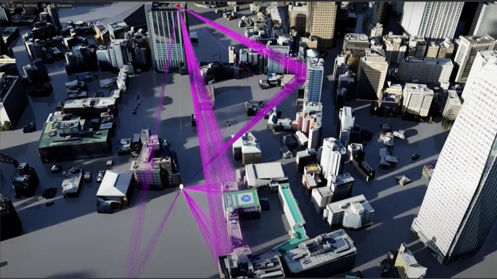

شبکه‌های مخابراتی با چند چالش مهم روبه‌رو هستند:

- افزایش مداوم ترافیک اطلاعات
- افزایش تعداد کاربران و دستگاه‌های متصل
- نیاز به سرعت بیشتر و تأخیر کمتر
- افزایش هزینه توسعه و نگهداری شبکه
- نیاز به استفاده بهینه از منابع رادیویی و سخت‌افزاری

از طرف دیگر، هوش مصنوعی به منابع محاسباتی قدرتمندی نیاز دارد.

**سؤال:** آیا می‌توانیم زیرساخت مخابراتی را به بستری برای اجرای هوش مصنوعی نیز تبدیل کنیم؟

این ایده یکی از پایه‌های شکل‌گیری AI-RAN است.

## اسلاید ۲ — AI-RAN چیست؟

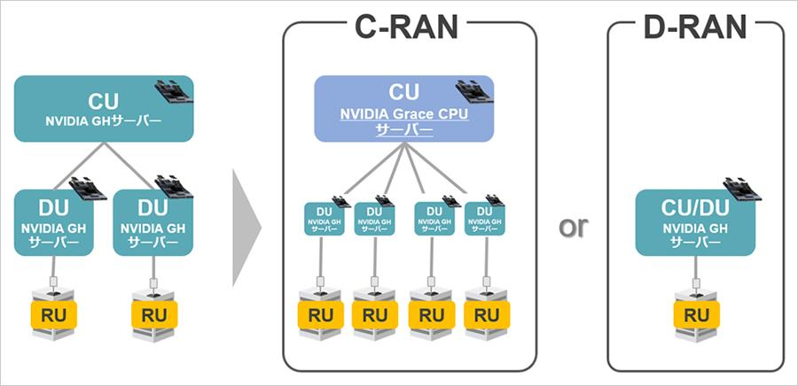

‏AI-RAN به معنی ادغام هوش مصنوعی با شبکه دسترسی رادیویی است.

در این معماری، هوش مصنوعی فقط یک ابزار جانبی نیست؛ بلکه می‌تواند در پردازش سیگنال، مدیریت شبکه و ارائه سرویس‌های جدید نقش داشته باشد.

سه هدف مهم:

1. بهبود عملکرد شبکه با استفاده از AI
2. اجرای سرویس‌های هوش مصنوعی در لبه شبکه
3. استفاده مشترک از زیرساخت محاسباتی برای AI و RAN

به زبان ساده:

**‏AI-RAN تلاش می‌کند شبکه مخابراتی را از یک زیرساخت صرفاً ارتباطی به یک زیرساخت ارتباطی و محاسباتی هوشمند تبدیل کند.**

## اسلاید ۳ — سه مفهوم اصلی AI-RAN

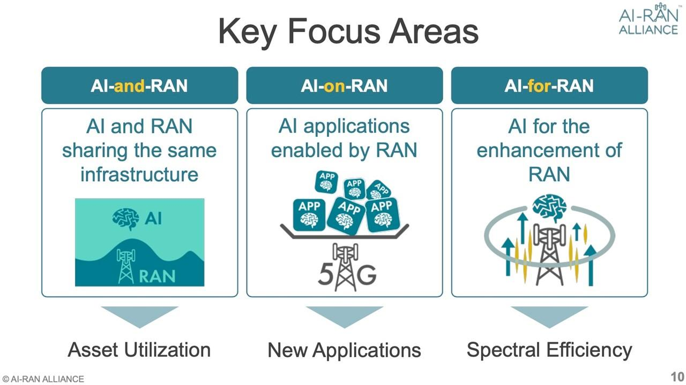

بر اساس تقسیم‌بندی AI-RAN Alliance، سه حوزه اصلی وجود دارد:

| حوزه | مفهوم |
| --- | --- |
| AI-for-RAN | استفاده از هوش مصنوعی برای بهبود عملکرد شبکه |
| AI-on-RAN | اجرای سرویس‌های هوش مصنوعی روی زیرساخت شبکه |
| AI-and-RAN | اجرای هم‌زمان پردازش AI و RAN روی زیرساخت مشترک |

این سه مفهوم با هم مرتبط هستند، اما کاربرد یکسانی ندارند.

در ادامه هر کدام را با یک مثال بررسی می‌کنیم.

[NVIDIA Glossary](https://www.nvidia.com/en-us/glossary/ai-ran/) · [Research](https://research.nvidia.com/publication/2025-01_ai-ran-transforming-ran-ai-driven-computing-infrastructure)

## اسلاید ۴ — AI-for-RAN: هوش مصنوعی برای بهبود شبکه

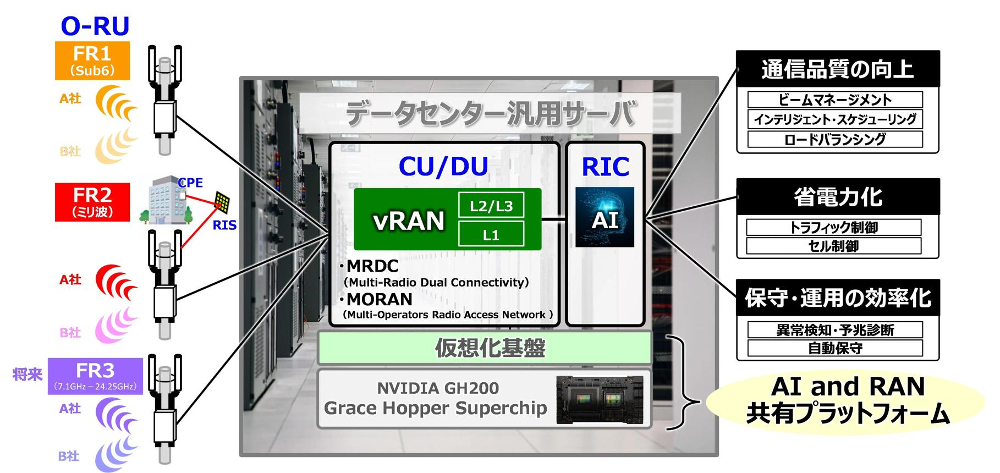

در این حالت، هوش مصنوعی داخل فرایندهای مخابراتی قرار می‌گیرد تا عملکرد شبکه بهتر شود.

مثال‌های کاربردی:

- پیش‌بینی تداخل بین سلول‌ها
- بهینه‌سازی توان ارسال
- بهبود تخمین کانال
- تخصیص هوشمند منابع رادیویی
- بهبود پوشش و ظرفیت شبکه
- کاهش مصرف انرژی

**مثال ساده:**

به‌جای اینکه تنظیمات توان یک سایت همیشه ثابت باشد، مدل هوش مصنوعی شرایط شبکه و ترافیک را تحلیل می‌کند و تنظیمات مناسب‌تری پیشنهاد می‌دهد.

هدف نهایی، افزایش کیفیت ارتباط و استفاده بهتر از منابع رادیویی است.

## اسلاید ۵ — AI-on-RAN: اجرای هوش مصنوعی روی شبکه

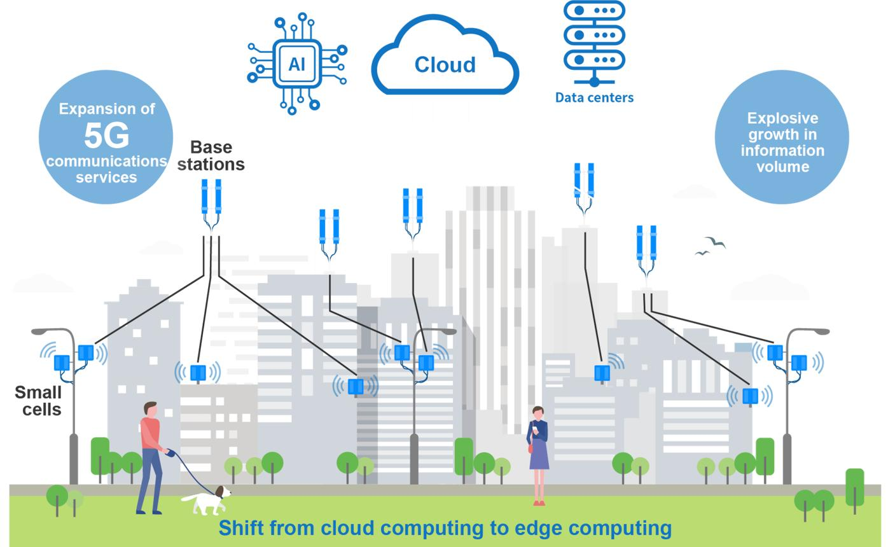

در این حالت، شبکه مخابراتی بستری برای ارائه سرویس‌های هوش مصنوعی به کاربران می‌شود.

به‌جای ارسال تمام اطلاعات به یک دیتاسنتر دوردست، پردازش AI می‌تواند در نزدیکی کاربر و در لبه شبکه انجام شود.

مثال‌ها:

- پردازش تصویر دوربین‌های شهری
- تشخیص اشیا برای خودروهای هوشمند
- دستیارهای هوش مصنوعی
- پردازش صوت و تصویر در لحظه
- سرویس‌های هوشمند صنعتی

**مثال ساده:**

یک کارخانه می‌تواند تصاویر دوربین‌های صنعتی خود را به یک سرور AI نزدیک به شبکه مخابراتی ارسال کند و نتیجه تحلیل را با تأخیر کمتر دریافت کند.

مزیت اصلی: کاهش نیاز به انتقال همه داده‌ها به مراکز پردازش دوردست و امکان ارائه سرویس‌های جدید.

## اسلاید ۶ — AI-and-RAN: اجرای هم‌زمان هوش مصنوعی و مخابرات

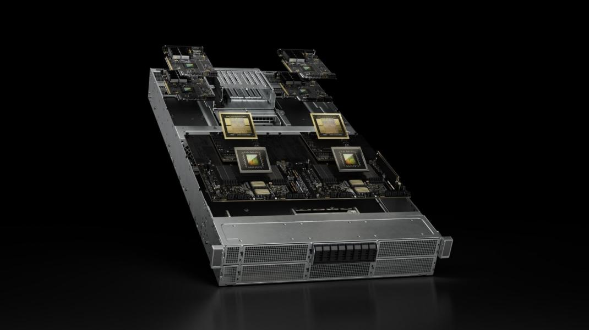

در این مدل، پردازش AI و پردازش مخابراتی از یک زیرساخت محاسباتی مشترک استفاده می‌کنند.

فرض کنید یک سرور قدرتمند GPU در اختیار اپراتور است.

این سرور می‌تواند:

- بخشی از منابع خود را به پردازش شبکه 5G اختصاص دهد.
- بخشی را برای اجرای مدل‌های هوش مصنوعی استفاده کند.
- در زمان کاهش بار مخابراتی، ظرفیت محاسباتی آزاد را به کارهای AI اختصاص دهد.

**هدف:** افزایش بهره‌وری سخت‌افزار و کاهش هزینه مالکیت زیرساخت (TCO).

نکته مهم این است که پردازش حساس و زمان‌واقعی RAN باید اولویت و تضمین عملکرد مشخص داشته باشد؛ نمی‌توان منابع آن را بدون کنترل در اختیار AI قرار داد.

## اسلاید ۷ — تفاوت سه حوزه با یک مثال واقعی

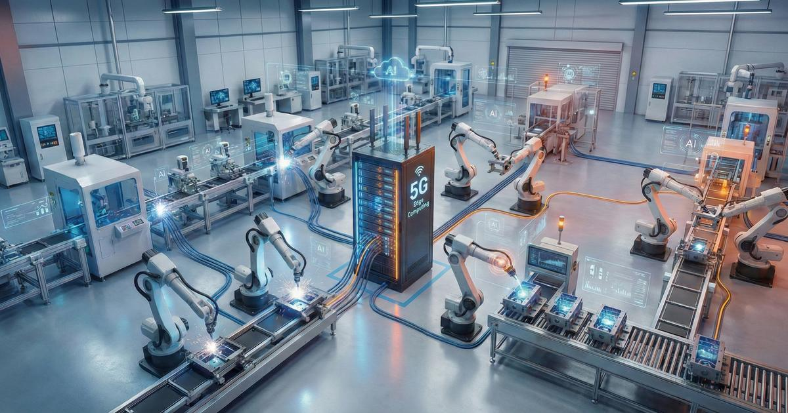

فرض کنیم یک کارخانه هوشمند از شبکه 5G استفاده می‌کند.

| حوزه | اتفاقی که رخ می‌دهد |
| --- | --- |
| AI-for-RAN | هوش مصنوعی کیفیت پوشش و تخصیص منابع شبکه را بهبود می‌دهد. |
| AI-on-RAN | تصاویر دوربین‌های کارخانه با AI در لبه شبکه تحلیل می‌شوند. |
| AI-and-RAN | همان زیرساخت محاسباتی، پردازش مخابراتی و AI را هم‌زمان اجرا می‌کند. |

این سه قابلیت می‌توانند در یک شبکه واحد وجود داشته باشند.

**نکته آموزشی:** برای به خاطر سپردن تفاوت‌ها:

- ‏FOR = بهبود خود شبکه
- ‏ON = ارائه سرویس AI روی شبکه
- ‏AND = اشتراک زیرساخت برای اجرای هر دو

## اسلاید ۸ — NVIDIA چگونه AI-RAN را پیاده‌سازی می‌کند؟

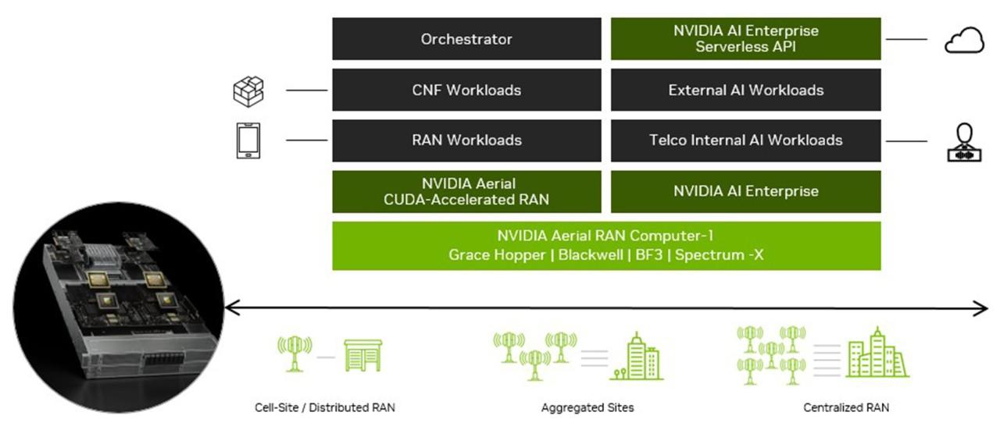

‏NVIDIA برای توسعه AI-RAN مجموعه‌ای از سخت‌افزارها و نرم‌افزارها را ارائه می‌کند.

یکی از مهم‌ترین مجموعه‌ها **NVIDIA AI Aerial** است.

این پلتفرم شامل اجزایی برای:

- پردازش شتاب‌یافته RAN
- توسعه شبکه‌های 5G و 6G
- شبیه‌سازی محیط‌های رادیویی
- اجرای مدل‌های هوش مصنوعی
- مدیریت منابع محاسباتی
- ایجاد زیرساخت مشترک برای AI و RAN

هدف این مجموعه، حرکت از شبیه‌سازی و تحقیق به سمت توسعه و استقرار شبکه‌های AI-RAN است.

[NVIDIA](https://www.nvidia.com/en-us/industries/telecommunications/ai-ran/) · [NVIDIA Docs](https://docs.nvidia.com/aerial/index.html)

## اسلاید ۹ — اجزای مهم NVIDIA AI Aerial

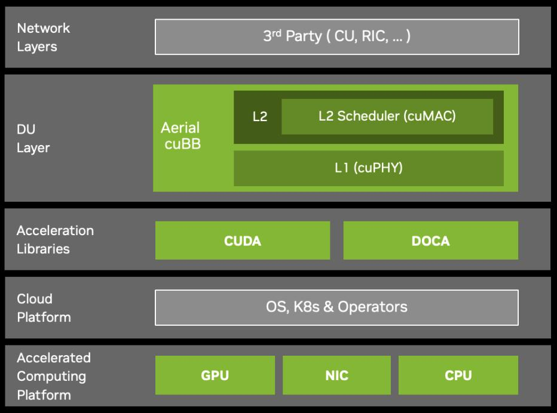

**۱. Aerial CUDA-Accelerated RAN**

کتابخانه‌های شتاب‌یافته با GPU برای پردازش لایه‌های مختلف RAN، به‌ویژه L1 و L2.

کاربرد: توسعه و اجرای پردازش رادیویی با استفاده از GPU.

---

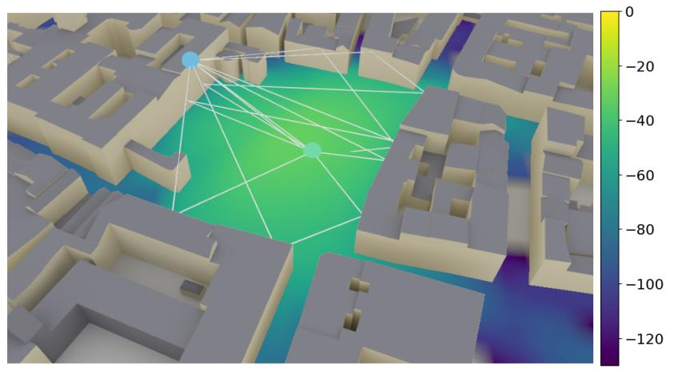

**۲. NVIDIA Sionna**

مجموعه ابزارهای متن‌باز برای تحقیق و شبیه‌سازی سیستم‌های مخابراتی.

کاربرد:

- ‏Ray Tracing
- شبیه‌سازی PHY
- شبیه‌سازی SYS
- تحقیق روی روش‌های مبتنی بر AI

---

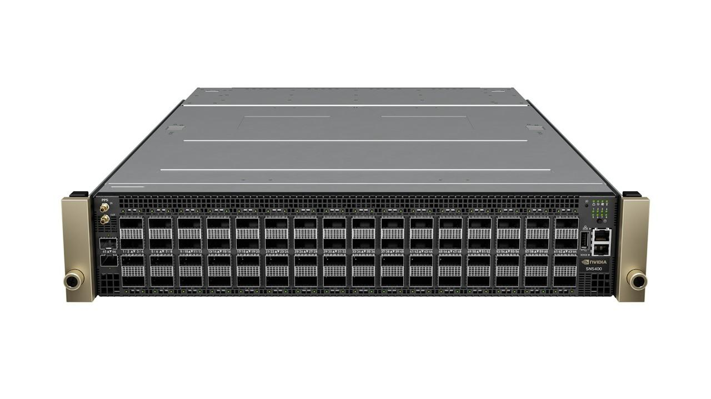

**۳. Software-Defined Networking**

استفاده از تجهیزات شبکه قابل برنامه‌ریزی برای اتصال سرورها و مدیریت ترافیک RAN و AI.

---

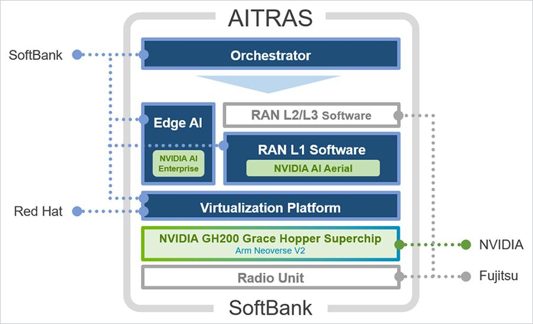

**۴. AI-RAN Orchestrator**

مدیریت و تخصیص منابع محاسباتی برای اجرای بارهای کاری مختلف AI و RAN.

هدف: استفاده مؤثرتر از منابع پردازشی و کاهش هزینه عملیاتی.

[NVIDIA](https://www.nvidia.com/en-us/industries/telecommunications/ai-ran/) · [NVIDIA](https://www.nvidia.com/en-us/industries/telecommunications/ai-ran/arc-family/)

## اسلاید ۱۰ — معماری مفهومی NVIDIA AI-RAN

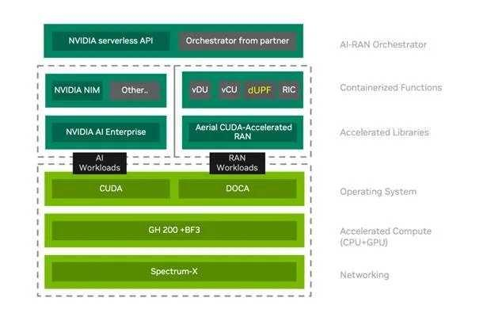

در معماری NVIDIA، اجزای مختلف روی یک زیرساخت محاسباتی شتاب‌یافته با یکدیگر کار می‌کنند.

اجزای مهم:

- **‏GPU:** اجرای پردازش‌های سنگین AI و RAN
- **‏CPU:** مدیریت و اجرای وظایف عمومی سیستم
- **‏DPU:** پردازش و مدیریت بخشی از وظایف زیرساخت شبکه و امنیت
- **‏Spectrum-X:** شبکه‌سازی سریع بین سرورها و منابع محاسباتی
- **‏Software Stack:** نرم‌افزارهای مخابراتی، AI و مدیریت زیرساخت

**نتیجه:** یک زیرساخت مشترک برای اجرای سرویس‌های مخابراتی و هوش مصنوعی ایجاد می‌شود.

## اسلاید ۱۱ — AI-RAN چه مزایایی برای اپراتور دارد؟

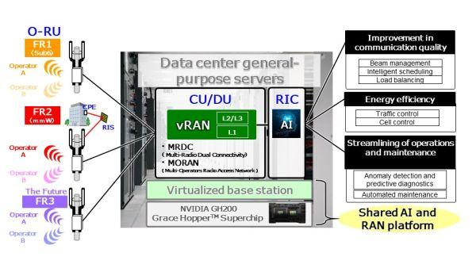

از دید اپراتور مخابراتی، AI-RAN چند مزیت مهم دارد:

| مزیت | توضیح |
| --- | --- |
| افزایش بهره‌وری | استفاده بهتر از منابع سخت‌افزاری |
| کاهش هزینه | کاهش هزینه مالکیت زیرساخت |
| افزایش ظرفیت | بهبود استفاده از منابع رادیویی |
| کاهش مصرف انرژی | مدیریت هوشمند منابع |
| درآمد جدید | ارائه سرویس‌های AI به مشتریان |
| آمادگی برای 6G | فراهم کردن زیرساخت محاسباتی انعطاف‌پذیر |

نکته مهم: این‌ها اهداف و مزایای مورد انتظار معماری AI-RAN هستند و میزان تحقق آن‌ها به طراحی، تجهیزات و شرایط استقرار بستگی دارد.

## اسلاید ۱۲ — AI-RAN چه ارتباطی با 6G دارد؟

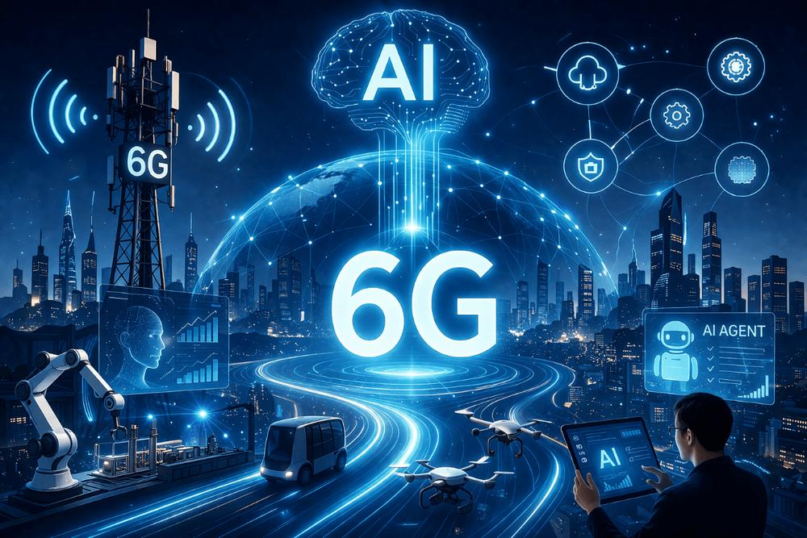

در نسل‌های آینده شبکه، هوش مصنوعی فقط برای مدیریت شبکه استفاده نخواهد شد؛ بلکه می‌تواند بخشی از طراحی و عملکرد اصلی شبکه باشد.

جهت‌گیری‌های مهم:

- شبکه‌های خودکار و خودبهینه‌شونده
- ارتباطات هوشمند مبتنی بر AI
- پردازش هوش مصنوعی در لبه شبکه
- اشتراک منابع محاسباتی و مخابراتی
- استفاده از Digital Twin برای آزمایش و بهینه‌سازی
- شبکه‌های AI-native

**پیام اصلی:** AI-RAN یکی از مسیرهای مهم صنعت مخابرات برای حرکت به سمت شبکه‌های هوشمند نسل ششم است؛ البته AI-native 6G مفهومی گسترده‌تر از AI-RAN دارد.

## اسلاید ۱۳ — نمودار کلی AI-RAN

این نمودار برای توضیح سه مفهوم اصلی و ارتباط آن‌ها با زیرساخت NVIDIA مناسب است.

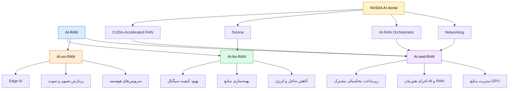

## اسلاید ۱۴ — جمع‌بندی: از RAN سنتی به AI-RAN

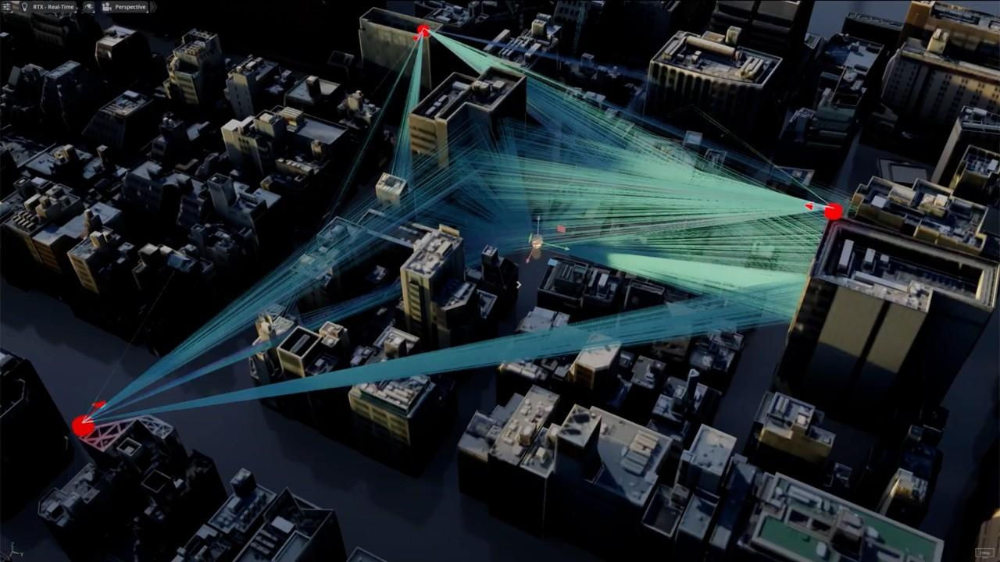

| شبکه سنتی | شبکه مبتنی بر AI-RAN |
| --- | --- |
| زیرساخت عمدتاً ارتباطی | زیرساخت ارتباطی و محاسباتی |
| تنظیمات عمدتاً مبتنی بر الگوریتم‌های ثابت | امکان استفاده از مدل‌های هوشمند |
| سخت‌افزارهای تخصصی و مجزا | امکان استفاده از زیرساخت محاسباتی مشترک |
| تمرکز بر ارائه سرویس ارتباطی | امکان ارائه سرویس‌های ارتباطی و AI |
| بهینه‌سازی محدودتر | امکان بهینه‌سازی هوشمند و پیوسته |

**پیام نهایی:**

AI-RAN فقط اضافه کردن یک مدل هوش مصنوعی به شبکه نیست؛ بلکه تغییر نگاه به معماری شبکه، منابع پردازشی، مدیریت رادیویی و مدل کسب‌وکار اپراتور است.

---

## اسلاید تکمیلی — تفاوت AI-RAN و O-RAN

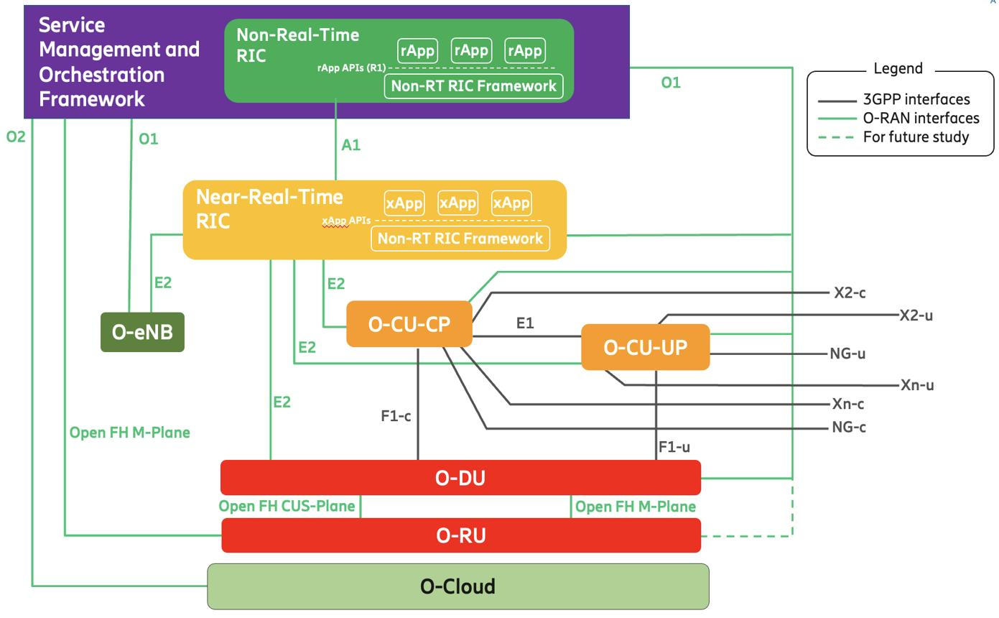

| مفهوم  | تمرکز اصلی                                                  |
| ------ | ----------------------------------------------------------- |
| AI-RAN | ادغام هوش مصنوعی و پردازش مخابراتی                          |
| O-RAN  | معماری باز، رابط‌های استاندارد و چندفروشندگی                |
| RIC    | کنترل و بهینه‌سازی هوشمند RAN                               |
| xApp   | برنامه‌ای برای اجرای منطق کنترلی در Near-RT RIC             |
| rApp   | برنامه‌ای برای کاربردهای مدیریتی و بهینه‌سازی در Non-RT RIC |

این فناوری‌ها رقیب یکدیگر نیستند؛ می‌توانند مکمل هم باشند.

برای مثال، یک xApp می‌تواند الگوریتم هوش مصنوعی برای بهینه‌سازی منابع رادیویی اجرا کند و این کاربرد در حوزه AI-for-RAN قرار بگیرد.

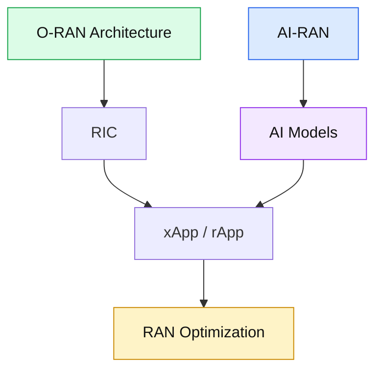

## پیشنهاد زمان‌بندی تدریس

(زمان پیشنهادی: ۱۲ تا ۱۵ دقیقه)

| بخش | زمان |
| --- | --- |
| نیاز به AI-RAN و معرفی مفهوم | ۲ دقیقه |
| سه حوزه AI-for/on/and-RAN | ۴ دقیقه |
| معرفی NVIDIA AI Aerial | ۴ دقیقه |
| معماری، مزایا و ارتباط با 6G | ۳ دقیقه |
| ارتباط با O-RAN | ۲ دقیقه |

## منابع رسمی برای تصاویر و مطالعه بیشتر

1. [NVIDIA AI-RAN Glossary](https://www.nvidia.com/en-us/glossary/ai-ran/) — تعریف AI-RAN و سه حوزه اصلی.
2. [NVIDIA AI-RAN Solutions](https://www.nvidia.com/en-us/industries/telecommunications/ai-ran/) — معرفی محصولات، معماری و کاربردها.
3. [AI-RAN: Transforming RAN with AI-driven Computing Infrastructure](https://research.nvidia.com/publication/2025-01_ai-ran-transforming-ran-ai-driven-computing-infrastructure) — مقاله پژوهشی NVIDIA.
4. [NVIDIA Aerial Documentation](https://docs.nvidia.com/aerial/) — مستندات فنی و ابزارهای اجرایی.
5. [Aerial RAN Computer](https://www.nvidia.com/en-us/industries/telecommunications/ai-ran/arc-family/) — پلتفرم سخت‌افزاری AI-RAN.

---
