## tags:
  - ai-ran

## 🔗 Knowledge Graph

### Next Steps
- [[OpenAirInterface]]

---

# NVIDIA Aerial CUDA-Accelerated RAN

معرفی چهار مؤلفه cuPHY، cuMAC، pyAerial و 5GModel 

هدف این بخش آشنایی با چهار ابزار اصلی NVIDIA برای پردازش سیگنال، زمان‌بندی منابع رادیویی، توسعه الگوریتم‌های هوش مصنوعی و اعتبارسنجی عملکرد PHY است.

---

## اسلاید ۱ – نمای کلی چهار مؤلفه

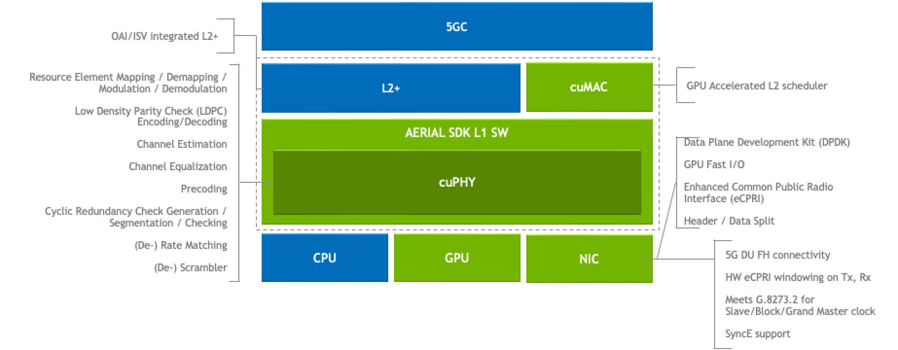

در شبکه 5G، چهار موضوع مهم داریم:

1. پردازش سیگنال و انتقال اطلاعات (PHY)
2. مدیریت منابع رادیویی و کاربران (MAC)
3. توسعه و آزمایش الگوریتم‌ها با هوش مصنوعی
4. تولید سیگنال مرجع و اعتبارسنجی عملکرد

انویدیا برای این نیازها چهار مؤلفه در Aerial ارائه کرده است:

| مؤلفه | مسئولیت |
| --- | --- |
| cuPHY | پردازش لایه فیزیکی |
| cuMAC | زمان‌بندی لایه MAC |
| pyAerial | توسعه و آزمایش با Python و AI |
| 5GModel | مدل مرجع و تولید داده آزمایشی |

[NVIDIA NGC](https://catalog.ngc.nvidia.com/orgs/nvidia/aerial/containers/aerial-cuda-accelerated-ran/-) · [Aerial CUDA-Accelerated RAN](https://docs.nvidia.com/aerial/cuda-accelerated-ran/latest/overview.html)

## اسلاید ۲ – cuPHY: پردازش لایه فیزیکی

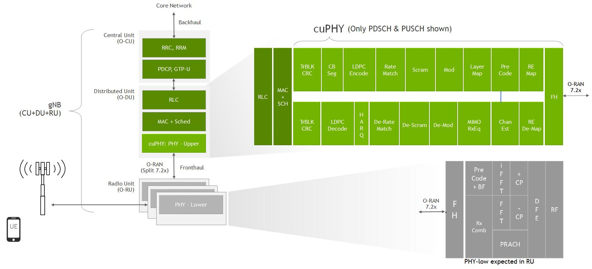

**نیاز (Problem)**

در شبکه 5G، اطلاعات کاربران باید به سیگنال رادیویی تبدیل شوند و در سمت گیرنده دوباره بازیابی شوند.

این عملیات شامل پردازش‌های سنگینی است که باید در زمان بسیار کوتاه انجام شوند.

**راه‌حل **

‏cuPHY کتابخانه پردازش لایه فیزیکی NVIDIA است که با استفاده از GPU و CUDA این عملیات را شتاب می‌دهد.

مهم‌ترین قابلیت‌ها:

- ‏Channel Coding و Decoding
- ‏Modulation و Demodulation
- ‏MIMO Processing
- ‏Channel Estimation
- پردازش کانال‌های PUSCH و PDSCH

**نتیجه **

پردازش سریع‌تر و امکان اجرای زنجیره PHY با استفاده از توان محاسباتی GPU.

منبع: [cuPHY Documentation](https://docs.nvidia.com/aerial/aerial-cuphy/current/text/overview.html)

## اسلاید ۳ – cuPHY در شبکه چه کاری انجام می‌دهد؟

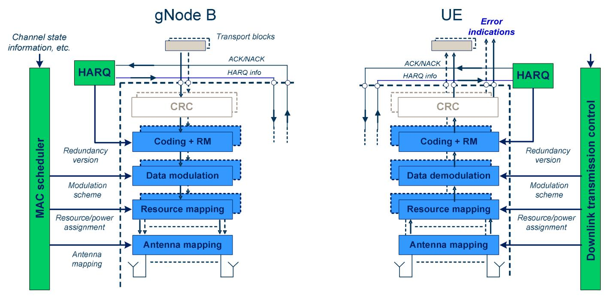

برای درک بهتر، ارسال اطلاعات از گوشی به دکل را در نظر بگیریم.

- اطلاعات کاربر دریافت می‌شود.
- اطلاعات برای ارسال آماده‌سازی و کدگذاری می‌شود.
- سیگنال از طریق کانال رادیویی منتقل می‌شود.
- در سمت گیرنده، سیگنال پردازش و اطلاعات بازیابی می‌شود.

‏cuPHY بخش مهمی از این زنجیره پردازش را روی GPU اجرا می‌کند.

**مثال کاربردی:** پردازش سیگنال ارسالی چندین کاربر در یک سلول 5G.

نمودار مفهومی ساده‌شده است؛ زنجیره واقعی PHY بسته به کانال و جهت ارسال متفاوت خواهد بود.

## اسلاید ۴ – cuMAC: زمان‌بندی هوشمند منابع رادیویی

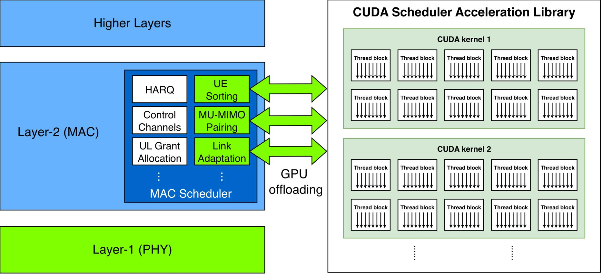

**نیاز (Problem)**

در یک سلول 5G ممکن است ده‌ها یا صدها کاربر هم‌زمان درخواست ارسال اطلاعات داشته باشند.

اما منابع رادیویی محدود هستند و باید مشخص شود:

- کدام کاربر ارسال داشته باشد؟
- چه مقدار منابع به او اختصاص داده شود؟
- کدام کاربران هم‌زمان روی منابع رادیویی قرار بگیرند؟

**راه‌حل (Solution)**

‏cuMAC کتابخانه زمان‌بندی MAC مبتنی بر CUDA است که بخشی از محاسبات سنگین Scheduler را از CPU به GPU منتقل می‌کند.

قابلیت‌های مهم:

- ‏UE Scheduling
- ‏PRB Allocation
- ‏Link Adaptation
- ‏MU-MIMO User Pairing
- محاسبه معیارهای Proportional Fairness

**نتیجه **

امکان اجرای الگوریتم‌های پیچیده‌تر زمان‌بندی و استفاده بهتر از منابع رادیویی.

[Aerial CUDA-Accelerated RAN](https://docs.nvidia.com/aerial/cuda-accelerated-ran/latest/cubb/cumac/overview.html) · [Aerial CUDA-Accelerated RAN](https://docs.nvidia.com/aerial/cuda-accelerated-ran/latest/overview.html)

## اسلاید ۵ – cuMAC چگونه منابع را مدیریت می‌کند؟

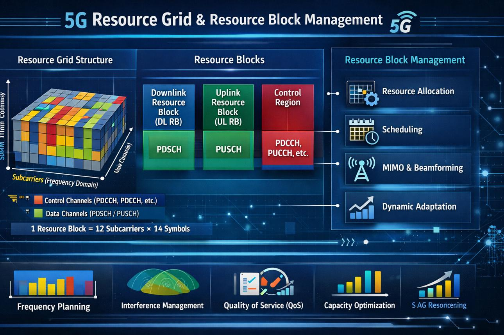

تصور کنید سه کاربر به‌طور هم‌زمان در حال استفاده از یک سلول هستند.

‏Scheduler باید تصمیم بگیرد منابع زمانی و فرکانسی چگونه بین آن‌ها تقسیم شوند.

- کاربر اول: نیاز به سرعت بالا
- کاربر دوم: نیاز به تأخیر پایین
- کاربر سوم: نیاز به ارتباط پایدار

‏cuMAC می‌تواند در انتخاب کاربران و تخصیص منابع به آن‌ها نقش داشته باشد.

**مثال:** تخصیص PRB به کاربران با توجه به شرایط کانال و نیازهای ارتباطی آن‌ها.

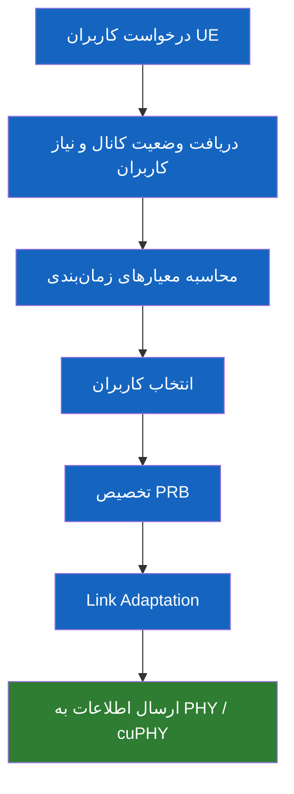

نکته: زمان‌بندی واقعی به سیاست Scheduler، وضعیت کانال و محدودیت‌های زمانی شبکه وابسته است.

## اسلاید ۶ – pyAerial: اتصال مخابرات و هوش مصنوعی

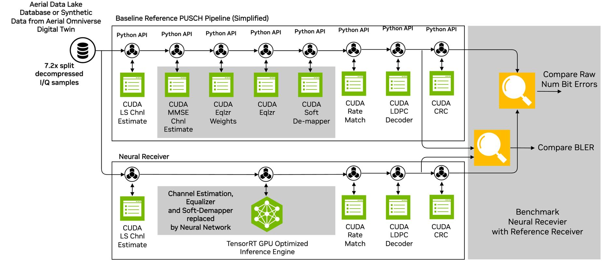

**نیاز **

توسعه الگوریتم‌های هوش مصنوعی برای شبکه رادیویی دشوار است.

پژوهشگر معمولاً مدل AI را با Python و ابزارهایی مثل PyTorch یا TensorFlow آموزش می‌دهد؛ اما شبکه واقعی از زنجیره پردازش PHY استفاده می‌کند.

چگونه این دو دنیا را به هم متصل کنیم؟

**راه‌حل **

‏pyAerial یک کتابخانه Python برای دسترسی به قابلیت‌های پردازش سیگنال cuPHY است.

قابلیت‌ها:

- استفاده از Python برای توسعه الگوریتم‌های PHY
- اتصال به مدل‌های AI/ML
- استفاده از PyTorch و TensorFlow در جریان توسعه
- تولید داده آموزشی
- آزمایش Neural Receiver
- ارزیابی الگوریتم قبل از اجرای واقعی

**نتیجه **

امکان توسعه، آزمایش و اعتبارسنجی الگوریتم‌های AI در کنار پردازش واقعی PHY.

[Aerial CUDA-Accelerated RAN](https://docs.nvidia.com/aerial/cuda-accelerated-ran/latest/pyaerial/overview.html) · [Aerial CUDA-Accelerated RAN](https://docs.nvidia.com/aerial/cuda-accelerated-ran/latest/pyaerial/index.html)

## اسلاید ۷ – یک مثال از کاربرد pyAerial

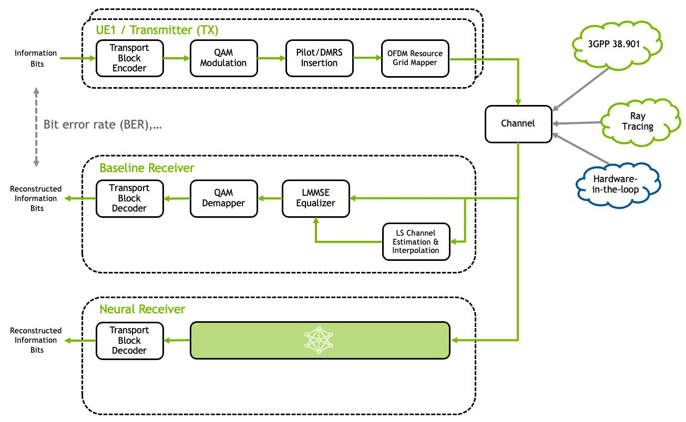

**مثال: Channel Estimation با هوش مصنوعی**

در شبکه رادیویی، گیرنده باید اثر کانال رادیویی را تخمین بزند تا اطلاعات ارسالی را بهتر بازیابی کند.

روش معمول از الگوریتم‌های پردازش سیگنال استفاده می‌کند.

با کمک AI می‌توان یک مدل یادگیری ماشین برای تخمین بهتر کانال توسعه داد.

مراحل کار:

1. دریافت داده‌های رادیویی
2. تولید داده آموزشی با pyAerial
3. آموزش مدل AI
4. اتصال مدل به زنجیره PHY
5. ارزیابی عملکرد مدل
6. بررسی امکان اجرای آن در شبکه واقعی

**نتیجه:** حرکت از الگوریتم‌های سنتی پردازش سیگنال به سمت پردازش ترکیبی PHY و AI.

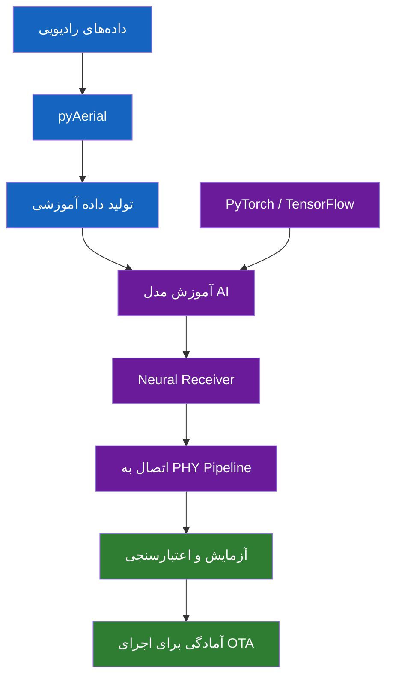

‏OTA یعنی Over The Air؛ آزمایش از طریق ارتباط رادیویی واقعی.

## اسلاید ۸ – 5GModel: مدل مرجع شبکه 5G

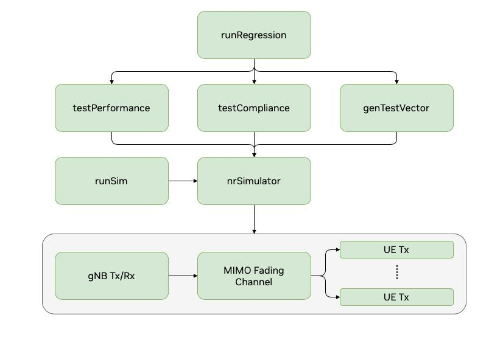

**نیاز **

از کجا مطمئن شویم الگوریتمی که برای PHY نوشته‌ایم مطابق استاندارد 3GPP کار می‌کند؟

همچنین چگونه خروجی GPU را با یک خروجی مرجع مقایسه کنیم؟

**راه‌حل **

‏5GModel مجموعه مدل‌های مرجع مخابراتی در Aerial است.

یکی از اجزای مهم آن `nr_sim` است که با MATLAB پیاده‌سازی شده و برای مقایسه و اعتبارسنجی عملکرد cuPHY استفاده می‌شود.

قابلیت‌ها:

- شبیه‌سازی فرستنده و گیرنده 5G
- شبیه‌سازی کانال MIMO
- تولید Waveform
- تولید Test Vector
- بررسی انطباق با استاندارد 3GPP
- ارزیابی عملکرد PHY

**نتیجه **

داشتن یک مرجع برای بررسی صحت عملکرد الگوریتم‌های پردازش سیگنال.

[NVIDIA Docs](https://docs.nvidia.com/aerial/aerial-cuphy/current/text/using_5g_model_for_testing_and_verification.html) · [Aerial CUDA-Accelerated RAN](https://docs.nvidia.com/aerial/cuda-accelerated-ran/latest/cubb/cuphy_developer_guide/5g_matlab_models_for_testing_and_validation.html)

## اسلاید ۹ – Test Vector چیست؟

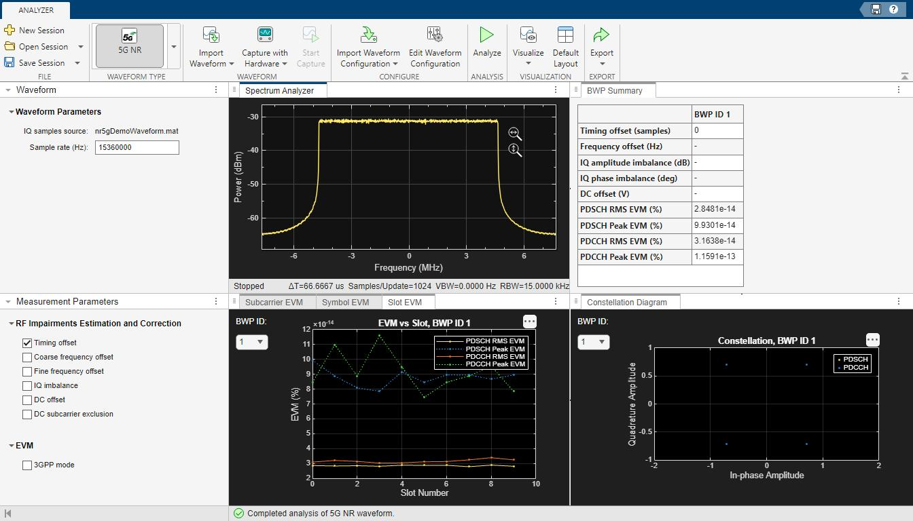

برای درک Test Vector، یک مثال ساده در نظر بگیرید:

فرض کنید یک الگوریتم وظیفه Decode کردن اطلاعات دریافتی را دارد.

برای اطمینان از صحت آن:

- یک ورودی آزمایشی مشخص تولید می‌کنیم.
- ورودی را به الگوریتم می‌دهیم.
- خروجی الگوریتم را دریافت می‌کنیم.
- خروجی را با نتیجه مرجع مقایسه می‌کنیم.

به مجموعه ورودی‌ها و خروجی‌های مرجع، Test Vector می‌گوییم.

در Aerial، این داده‌ها برای بررسی صحت عملکرد cuPHY و اجزای مختلف زنجیره پردازش استفاده می‌شوند.

**نتیجه:** به‌جای اینکه فقط امیدوار باشیم الگوریتم درست کار می‌کند، آن را با داده‌های مرجع آزمایش می‌کنیم.

## اسلاید ۱۰ – 5GModel چگونه کار می‌کند؟

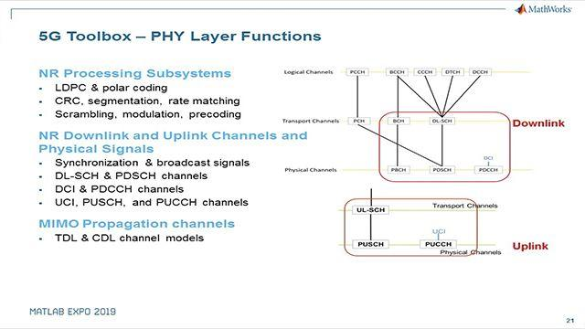

مدل شبیه‌سازی `nr_sim` سه بخش اصلی دارد:

1. فرستنده ایستگاه پایه (gNB Tx)
2. کانال رادیویی MIMO
3. گیرنده کاربر (UE Rx)

با اجرای سناریوهای مختلف می‌توان عملکرد زنجیره ارتباطی را بررسی کرد.

سه کاربرد اصلی:

- Waveform Compliance Test
- Test Vector Generation
- PHY Performance Simulation

**نتیجه:** امکان آزمایش الگوریتم‌ها در شرایط مختلف بدون نیاز به برقراری ارتباط رادیویی واقعی.

[NVIDIA Docs](https://docs.nvidia.com/aerial/aerial-cuphy/current/text/using_5g_model_for_testing_and_verification.html) · [NVIDIA Docs](https://docs.nvidia.com/aerial/archive/cuda-accelerated-ran/24-1/aerial_cubb/aerial_cuphy_developer_guide/using_5g_models_for_testing_and_verification.html)

## اسلاید ۱۱ – ارتباط چهار مؤلفه با یکدیگر

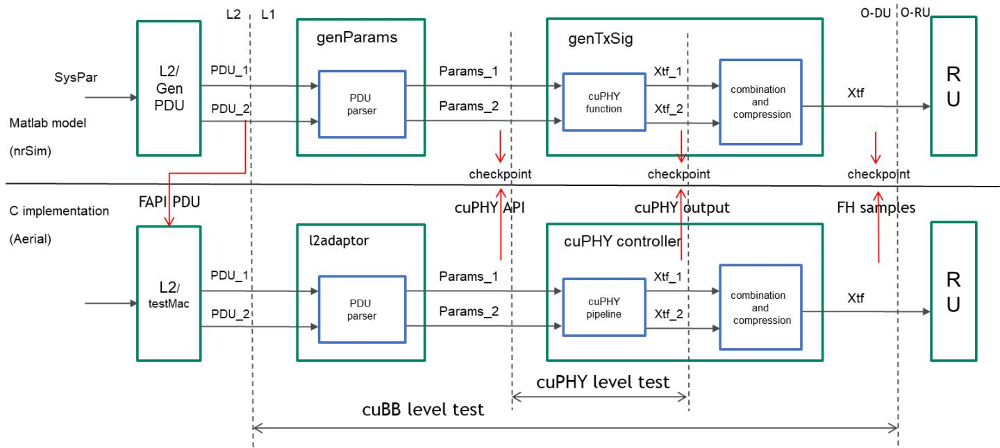

حالا ببینیم این چهار مؤلفه چگونه یک چرخه توسعه و اجرای شبکه را تشکیل می‌دهند.

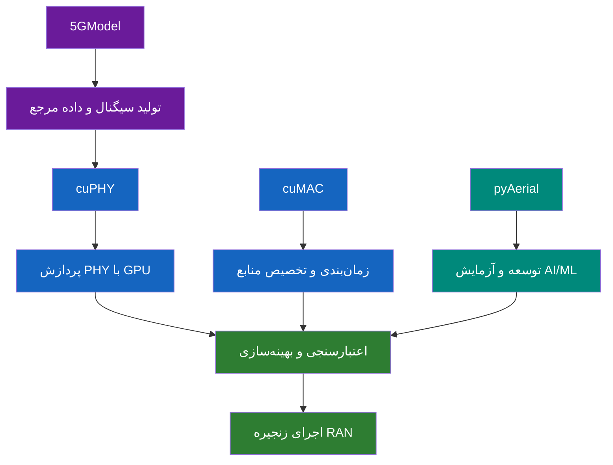

## اسلاید ۱۲ – مقایسه چهار ابزار

| مؤلفه | مسئله‌ای که حل می‌کند | خروجی اصلی |
| --- | --- | --- |
| cuPHY | پردازش سیگنال | پردازش PHY |
| cuMAC | مدیریت منابع | تصمیم زمان‌بندی |
| pyAerial | توسعه AI در PHY | مدل و Pipeline قابل آزمایش |
| 5GModel | صحت‌سنجی الگوریتم | سیگنال و داده مرجع |

## اسلاید ۱۳ – جمع‌بندی

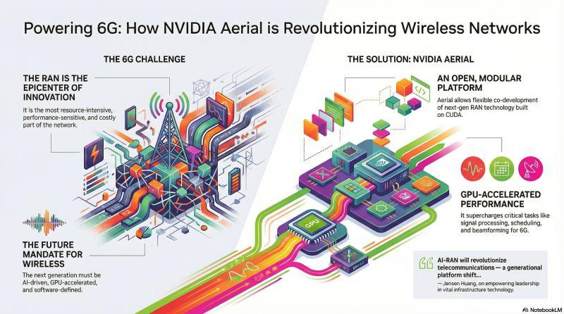

چهار مفهوم را به خاطر بسپارید:

- ‏**cuPHY:** سیگنال را پردازش می‌کند.
- ‏**cuMAC:** منابع رادیویی را بین کاربران تقسیم می‌کند.
- ‏**pyAerial:** امکان توسعه و آزمایش AI در PHY را فراهم می‌کند.
- ‏**5GModel:** مرجع تولید داده و اعتبارسنجی است.

**پیام نهایی:** NVIDIA تلاش می‌کند پردازش رادیویی، زمان‌بندی شبکه و هوش مصنوعی را روی یک زیرساخت محاسباتی شتاب‌یافته به هم متصل کند.

---

## منابع رسمی برای مطالعه و نمایش در کلاس

| موضوع | مستندات |
| --- | --- |
| cuPHY | [cuPHY Overview](https://docs.nvidia.com/aerial/aerial-cuphy/current/text/overview.html) |
| cuMAC | [cuMAC Overview](https://docs.nvidia.com/aerial/cuda-accelerated-ran/latest/cubb/cumac/overview.html) |
| pyAerial | [pyAerial Overview](https://docs.nvidia.com/aerial/cuda-accelerated-ran/latest/pyaerial/overview.html) |
| 5GModel | [5G MATLAB Models](https://docs.nvidia.com/aerial/cuda-accelerated-ran/latest/cubb/cuphy_developer_guide/5g_matlab_models_for_testing_and_validation.html) |
| Test Vector | [Generating Test Vectors](https://docs.nvidia.com/aerial/cuda-accelerated-ran/latest/quickstart_guide/generating_tv.html) |
| GitHub | [Aerial Source Code](https://github.com/NVIDIA/aerial-cuda-accelerated-ran) |

