---
tags:
  - oran
  - ric
  - implementation
---

## 🔗 Knowledge Graph

### Next Steps
- [[END]]

---

# ارائه آموزشی: توسعه xApp با استفاده از FlexRIC

منبع: وبینار رسمی OpenAirInterface – OAI Webinar Series, Chapter 5

این صفحه یک آموزش مقدماتی برای توسعه xApp در چارچوب FlexRIC است. تمرکز آن فقط معرفی O-RAN نیست؛ بلکه نشان می‌دهد چگونه می‌توانیم یک برنامه نرم‌افزاری برای کنترل و پایش شبکه رادیویی بسازیم.

**هدف آموزشی:** مخاطب بعد از این بخش متوجه شود که xApp یک مفهوم تئوری نیست و می‌توان آن را توسعه داد، اجرا کرد و به شبکه RAN متصل نمود.

ساختار ارائه:

1. نیاز به توسعه xApp
2. آشنایی با FlexRIC
3. معماری اجرای xApp
4. مراحل توسعه یک xApp
5. ارتباط xApp با شبکه از طریق E2
6. نتیجه و کاربرد عملی

---

## اسلاید ۱ ـ از مفهوم xApp به پیاده‌سازی واقعی

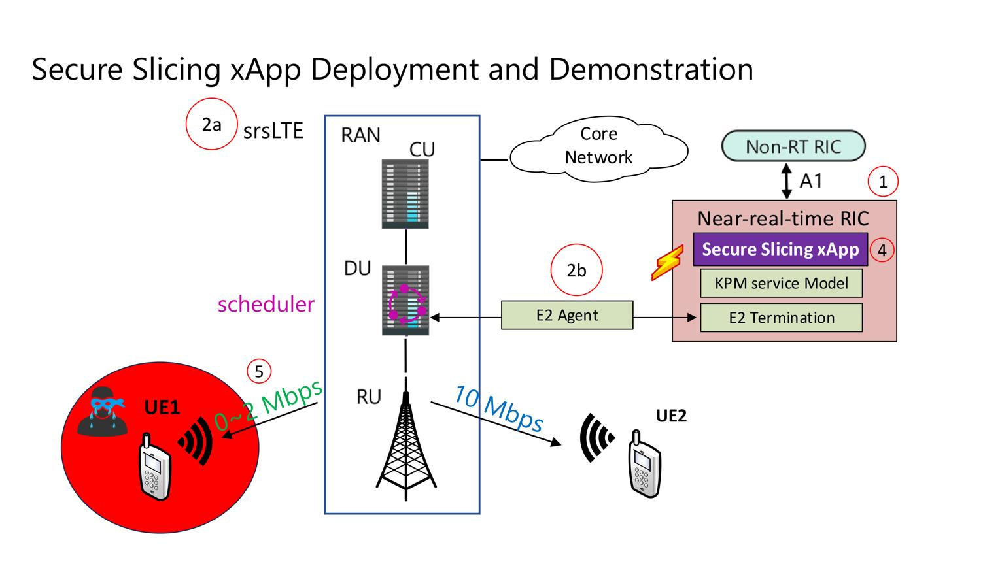

در بخش قبلی دیدیم که xApp می‌تواند قابلیت‌های هوشمند جدیدی به شبکه اضافه کند.

اما یک سؤال مهم باقی می‌ماند:

**چگونه یک xApp واقعی بسازیم؟**

برای پاسخ، پروژه FlexRIC را بررسی می‌کنیم؛ یک پیاده‌سازی متن‌باز از Near-RT RIC که برای توسعه و آزمایش برنامه‌های xApp استفاده می‌شود.

---

## اسلاید ۲ ـ FlexRIC چیست؟

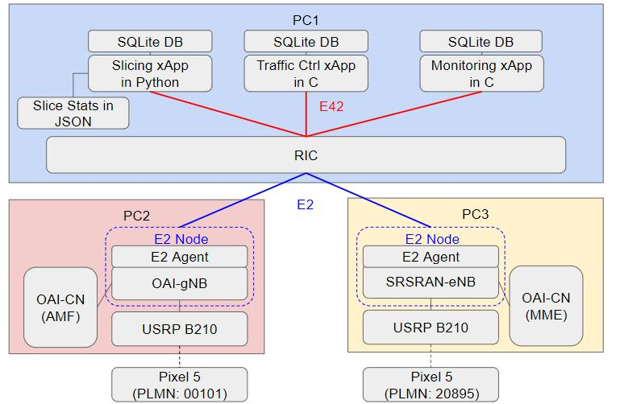

**FlexRIC** یک پیاده‌سازی متن‌باز از Near-RT RIC است.

وظایف اصلی:

- برقراری ارتباط با تجهیزات RAN
- دریافت اطلاعات عملکرد شبکه
- فراهم کردن محیط اجرای xApp
- پشتیبانی از سرویس‌های کنترلی و پایشی
- فراهم کردن API برای توسعه‌دهندگان

**نیاز:** توسعه‌دهنده نباید برای ساخت هر برنامه هوشمند، تمام سازوکار ارتباط با شبکه را از ابتدا پیاده‌سازی کند.

**راه‌حل:** FlexRIC بخش زیادی از زیرساخت ارتباطی و اجرایی را فراهم می‌کند.

[OpenAirInterface](https://openairinterface.org/flexric-tutorial-xapp-development/)

---

## اسلاید ۳ ـ ویژگی‌های مهم FlexRIC

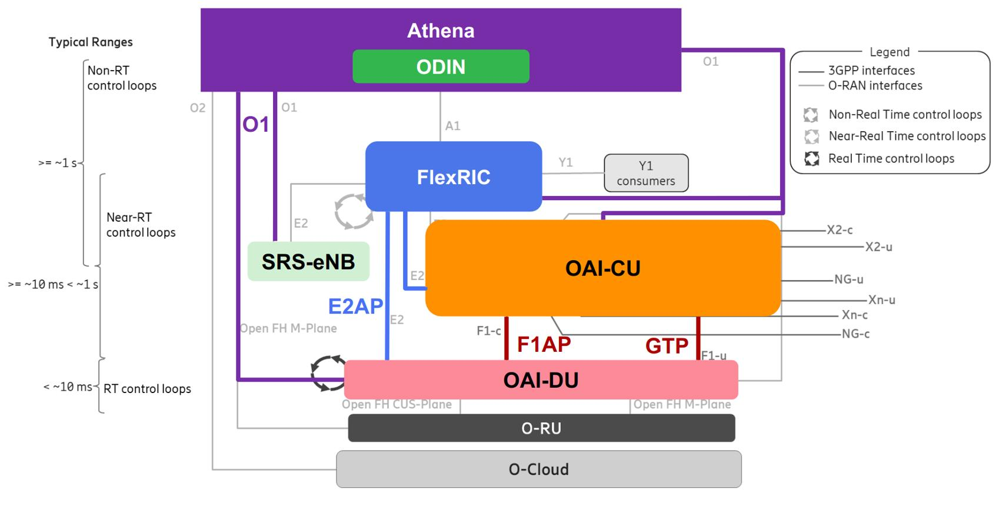

طبق ارائه رسمی، FlexRIC با چند ویژگی مهم طراحی شده است:

- **سبک و کم‌هزینه:** مناسب کاربردهایی که تأخیر کم و منابع محدود دارند.
- **چندفروشنده‌ای:** پشتیبانی از پیاده‌سازی‌هایی مانند OAI و srsRAN.
- **چندنسلی:** پشتیبانی از شبکه‌های 4G و 5G.
- **چندزبانه:** امکان توسعه با C/C++ و Python.
- **چندبرنامه‌ای:** امکان اجرای چند xApp.

**نتیجه:** FlexRIC فقط یک RIC برای مشاهده اطلاعات شبکه نیست؛ بستری برای توسعه برنامه‌های مختلف کنترل و مدیریت RAN است.

[OPEN AIR INTERFACE](https://openairinterface.org/wp-content/uploads/2025/10/OAI-Webinar-Series-Chapter-Five-FlexRIC-Tutorial-xApp-Development.pdf)

---

## اسلاید ۴ ـ xApp چگونه به FlexRIC متصل می‌شود؟

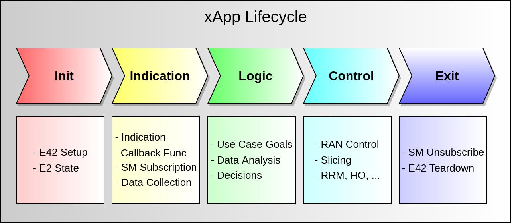

برای توسعه xApp دو روش کلی وجود دارد:

1. ارتباط مستقیم با APIهای شبکه
2. استفاده از SDK آماده

در FlexRIC از روش دوم استفاده می‌شود.

SDK کارهای تکراری را مدیریت می‌کند:

- برقراری ارتباط با RIC
- شناسایی گره‌های متصل به شبکه
- دریافت اطلاعات
- ثبت درخواست پایش
- ارسال فرمان کنترلی

**تشبیه ساده:** SDK مانند یک جعبه‌ابزار آماده است؛ توسعه‌دهنده به‌جای درگیر شدن با جزئیات ارتباطی، روی منطق برنامه تمرکز می‌کند.

---

## اسلاید ۵ ـ اجزای SDK در FlexRIC

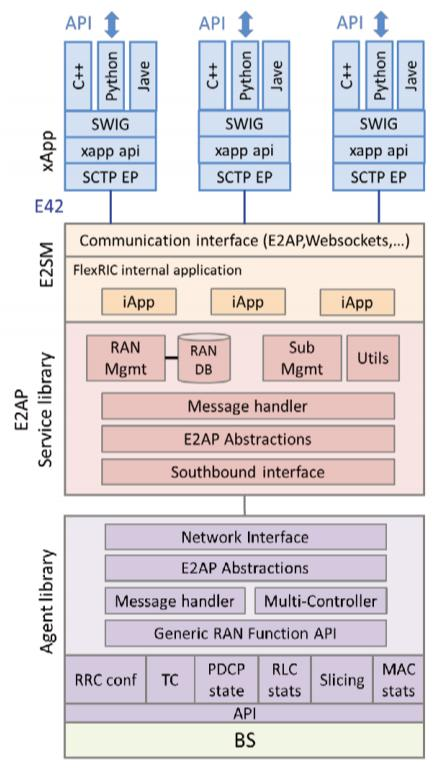

در معماری ارائه‌شده، چند جزء اصلی وجود دارد:

| جزء | کاربرد |
| --- | --- |
| xApp API | توابع آماده برای توسعه |
| E42 | ارتباط بین xApp و FlexRIC |
| SCTP | انتقال پیام‌ها |
| SQLite | ذخیره اطلاعات و امکان پرس‌وجو |
| SWIG | اتصال کتابخانه C/C++ به زبان‌های دیگر |

نکته مهم برای توسعه‌دهندگان Python:

بخش اصلی SDK می‌تواند با C/C++ پیاده‌سازی شود و از طریق SWIG، رابط Python در اختیار توسعه‌دهنده قرار گیرد.

**نتیجه:** می‌توانیم از کارایی C/C++ و سادگی Python در توسعه xApp استفاده کنیم. 

[OPEN AIR INTERFACE](https://openairinterface.org/wp-content/uploads/2025/10/OAI-Webinar-Series-Chapter-Five-FlexRIC-Tutorial-xApp-Development.pdf)

---

## اسلاید ۶ ـ چرخه کاری یک xApp

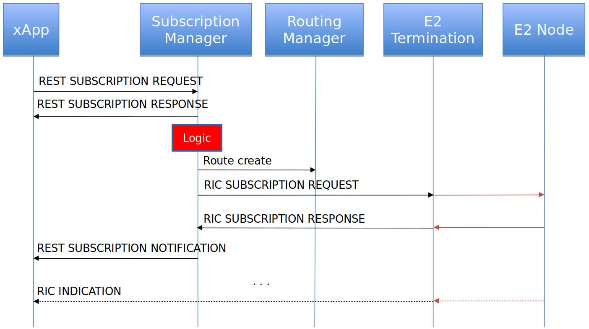

یک xApp معمولاً مراحل زیر را طی می‌کند:

1. **Initialization:** شروع برنامه و اتصال به FlexRIC
2. **Discovery:** شناسایی گره‌های RAN
3. **Subscription:** درخواست دریافت اطلاعات شبکه
4. **Monitoring:** دریافت اطلاعات و KPIها
5. **Decision:** تحلیل اطلاعات و تصمیم‌گیری
6. **Control:** ارسال فرمان کنترلی در صورت نیاز
7. **Stop:** لغو درخواست‌ها و خاتمه برنامه

برای مثال، xApp می‌تواند اطلاعات بار سلول را دریافت کند و در صورت مشاهده ازدحام، تصمیم مناسبی برای کنترل شبکه بگیرد.

---

## اسلاید ۷ ـ Subscription و دریافت اطلاعات شبکه

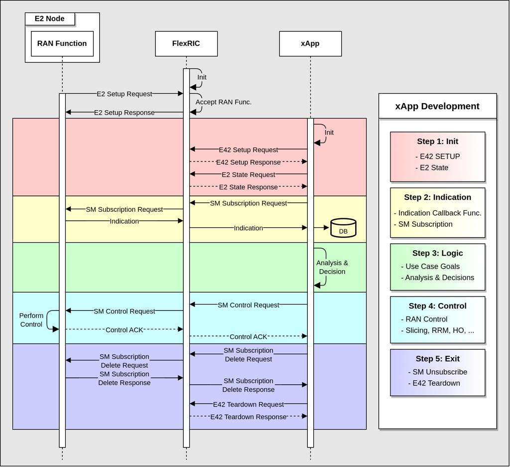

یکی از مهم‌ترین مفاهیم در توسعه xApp، Subscription است.

فرض کنید می‌خواهیم اطلاعات یک سلول را هر چند میلی‌ثانیه یا ثانیه دریافت کنیم.

- xApp درخواست پایش را ثبت می‌کند.
- RIC درخواست را به E2 Node منتقل می‌کند.
- E2 Node اطلاعات موردنظر را ارسال می‌کند.
- اطلاعات در یک تابع Callback به xApp تحویل داده می‌شود.

در نمونه ارائه‌شده، داده‌های دریافتی می‌توانند در پایگاه داده SQLite نیز ذخیره شوند.

**تشبیه ساده:** Subscription مانند اشتراک در یک سرویس دریافت اطلاعات است؛ لازم نیست هر بار از شبکه دستی درخواست اطلاعات کنیم.

[OPEN AIR INTERFACE](https://openairinterface.org/wp-content/uploads/2025/10/OAI-Webinar-Series-Chapter-Five-FlexRIC-Tutorial-xApp-Development.pdf)

---

## اسلاید ۸ ـ E2 و E42 چه تفاوتی دارند؟

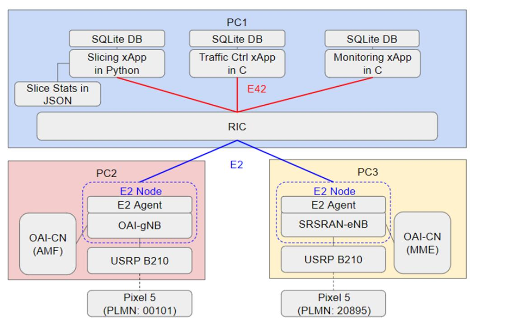

در ارائه FlexRIC یک نکته فنی مهم مطرح شده است:

- **E2:** رابط استاندارد O-RAN برای ارتباط Near-RT RIC با گره‌های RAN
- **E42:** پروتکل ارتباطی مورد استفاده در طراحی FlexRIC برای ارتباط SDK و xApp با RIC

در واقع، E42 به xApp اجازه می‌دهد از امکانات SDK استفاده کند و درخواست‌های خود را به FlexRIC ارسال کند.

(نکته مهم)

E42 را نباید با رابط استاندارد E2 در معماری O-RAN اشتباه گرفت. E42 یک توسعه اختصاصی در FlexRIC است، نه جایگزین استاندارد E2.

---

## اسلاید ۹ ـ توابع اصلی برای توسعه xApp

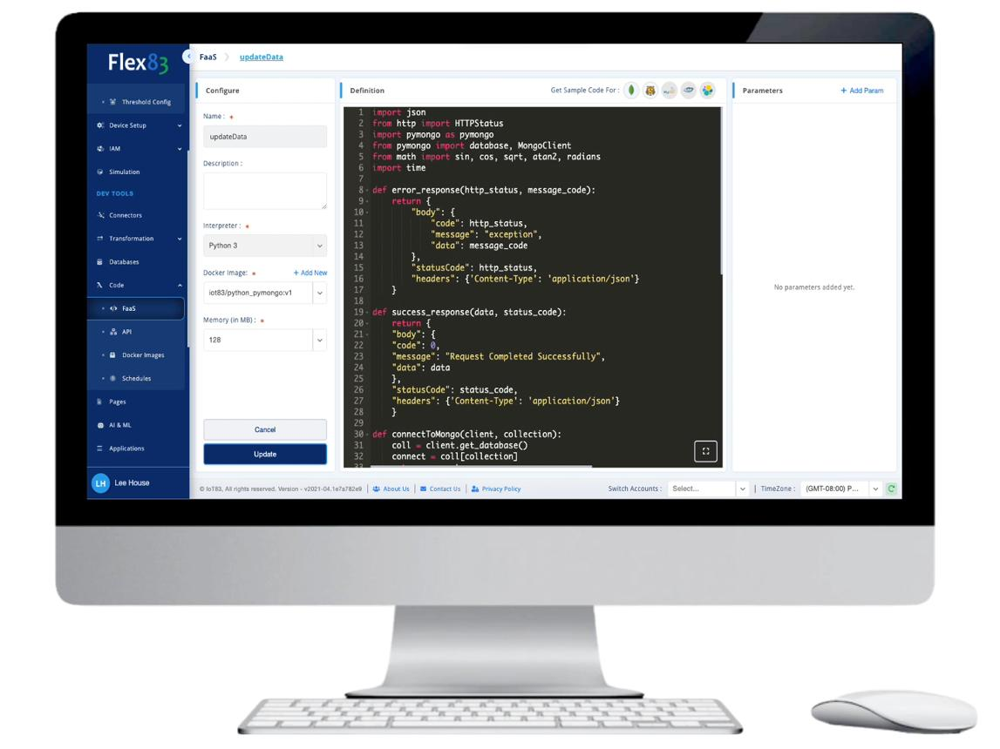

برای ساخت یک xApp، به چهار قابلیت اصلی نیاز داریم:

| قابلیت | وظیفه |
| --- | --- |
| Init / Stop | شروع و خاتمه برنامه |
| Get E2 Nodes | شناسایی تجهیزات متصل |
| Subscribe / Remove | دریافت و لغو اطلاعات شبکه |
| Control | ارسال فرمان کنترلی |

بنابراین برای ساخت یک برنامه پایش شبکه، لازم نیست تمام پروتکل‌های مخابراتی را از ابتدا بنویسیم.

**نکته تدریسی:** هدف SDK ساده کردن توسعه برنامه است، نه حذف نیاز به شناخت معماری RAN.

---

## اسلاید ۱۰ ـ آیا می‌توان xApp را با Python نوشت؟

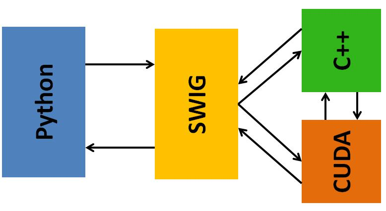

بله. یکی از قابلیت‌های مهم FlexRIC، فراهم کردن امکان استفاده از Python در کنار C/C++ است.

مزایای Python:

- توسعه سریع‌تر الگوریتم‌ها
- استفاده از کتابخانه‌های AI و ML
- ارتباط ساده با مدل‌های یادگیری ماشین
- تحلیل اطلاعات و KPIهای شبکه

اما یک نکته فنی وجود دارد:

در Python، هنگام اجرای Callback از سمت C به Python، محدودیت GIL وجود دارد. بنابراین بهتر است پردازش‌های سنگین را مستقیماً داخل Callback انجام ندهیم.

**پیشنهاد معماری:** Callback فقط اطلاعات را دریافت کند و در اختیار بخش پردازش جداگانه قرار دهد.

[OPEN AIR INTERFACE](https://openairinterface.org/wp-content/uploads/2025/10/OAI-Webinar-Series-Chapter-Five-FlexRIC-Tutorial-xApp-Development.pdf)

---

## اسلاید ۱۱ ـ Service Model چیست؟

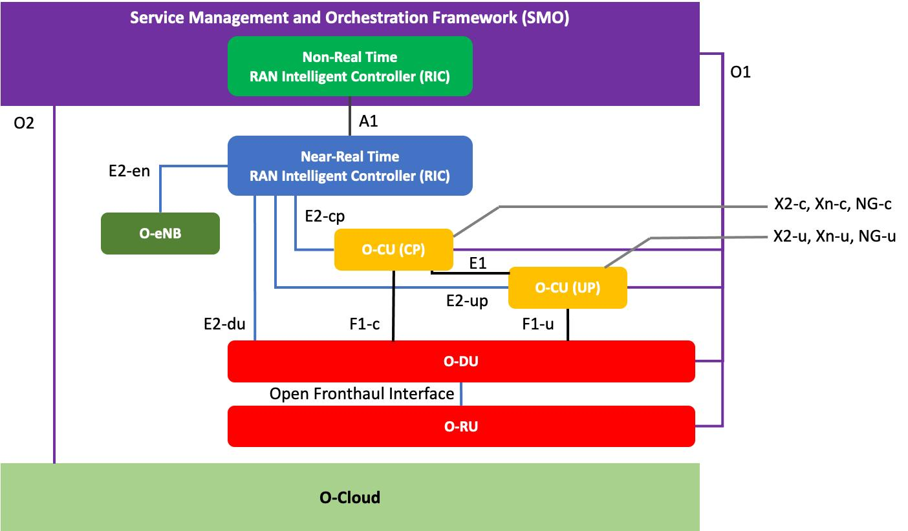

برای اینکه xApp بتواند اطلاعات شبکه را دریافت کند، باید بداند چه نوع اطلاعاتی از RAN قابل دریافت است.

این قابلیت از طریق Service Modelها (SM) ارائه می‌شود.

چند نمونه:

| Service Model | کاربرد |
| --- | --- |
| MAC | اطلاعات زمان‌بندی و منابع رادیویی |
| RLC | اطلاعات انتقال داده در لایه RLC |
| PDCP | اطلاعات لایه PDCP |
| KPM | پایش عملکرد شبکه |
| RC | کنترل منابع رادیویی |

به زبان ساده، Service Model مشخص می‌کند xApp چه نوع اطلاعات یا قابلیت کنترلی را می‌تواند از شبکه درخواست کند.

**نکته:** پشتیبانی واقعی هر Service Model به نسخه FlexRIC و پیاده‌سازی E2 Node بستگی دارد.

---

## اسلاید ۱۲ ـ نمودار کامل اجرای xApp در FlexRIC

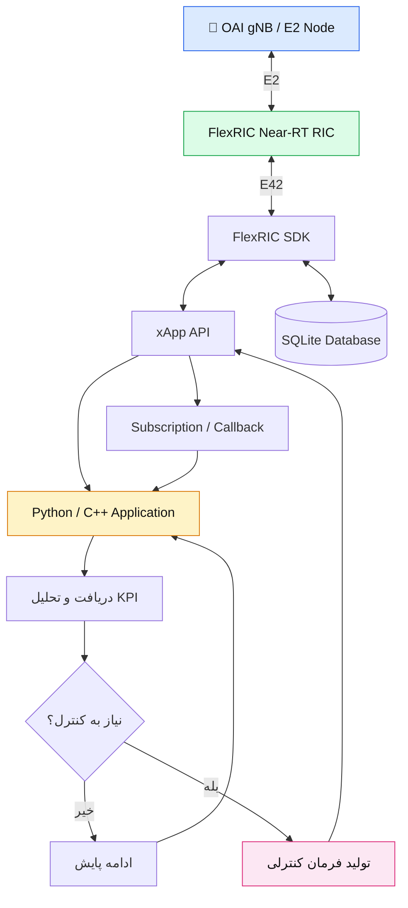

این نمودار یک نمایش مفهومی از ساختار ارائه‌شده در وبینار است.

---

## اسلاید ۱۳ ـ مثال عملی: ساخت xApp برای پایش شبکه

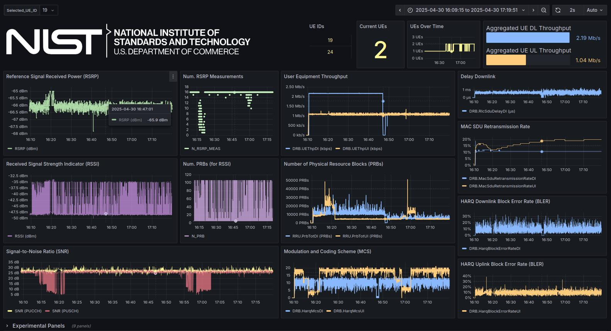

فرض کنید می‌خواهیم یک xApp برای پایش وضعیت سلول‌های 5G بسازیم.

**نیاز:** اپراتور باید بداند کدام سلول شلوغ است و چه زمانی عملکرد شبکه افت می‌کند.

**روش حل:**

1. اتصال xApp به FlexRIC
2. شناسایی gNB
3. ثبت Subscription برای دریافت KPI
4. دریافت اطلاعات از شبکه
5. ذخیره اطلاعات در SQLite
6. تحلیل داده‌ها با Python

**نتیجه:** ایجاد یک ابزار نرم‌افزاری برای مشاهده و تحلیل وضعیت شبکه.

در مرحله بعد می‌توانیم قابلیت تصمیم‌گیری و کنترل را به همین xApp اضافه کنیم.

---

## اسلاید ۱۴ ـ از xApp ساده تا xApp مبتنی بر AI

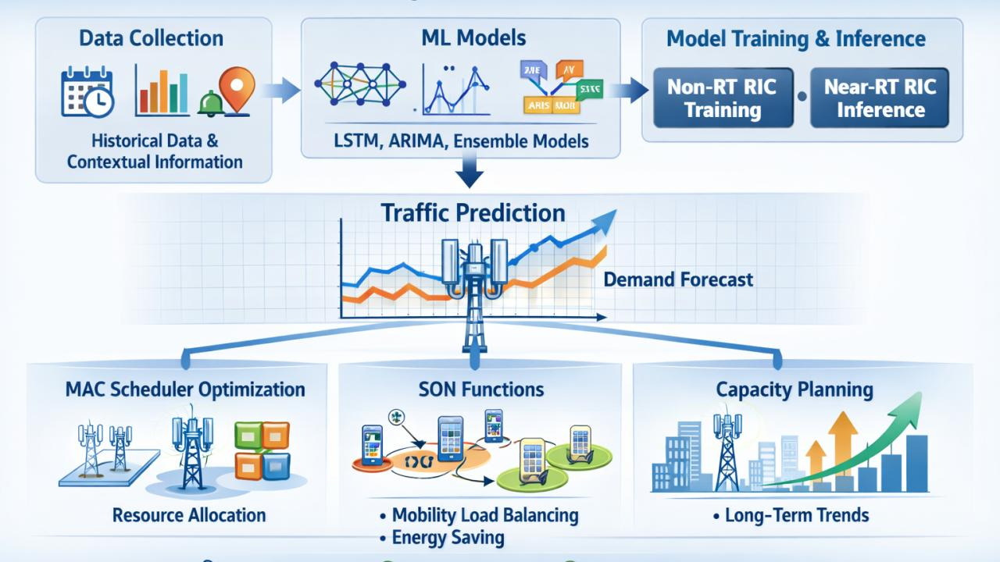

می‌توانیم توسعه را در سه مرحله انجام دهیم:

| مرحله | قابلیت |
| --- | --- |
| مرحله اول | دریافت و نمایش KPI |
| مرحله دوم | تحلیل و تشخیص ازدحام |
| مرحله سوم | استفاده از مدل AI برای تصمیم‌گیری و کنترل |

مثلاً:

- ورودی: تعداد کاربران، بار سلول و کیفیت سیگنال
- مدل AI: پیش‌بینی ازدحام
- خروجی: پیشنهاد جابه‌جایی کاربران یا تغییر سیاست منابع
- اجرا: ارسال فرمان از طریق xApp و RIC

**اینجا ارتباط FlexRIC با AI-RAN شکل می‌گیرد.**

---

## اسلاید ۱۵ ـ جمع‌بندی و نتیجه

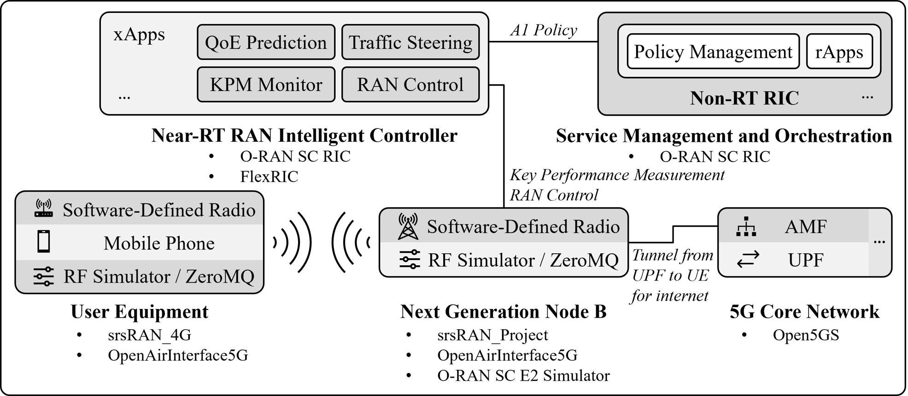

| سؤال | پاسخ |
| --- | --- |
| FlexRIC چیست؟ | پیاده‌سازی متن‌باز Near-RT RIC |
| xApp چیست؟ | برنامه توسعه‌یافته برای کنترل و پایش شبکه |
| SDK چه می‌کند؟ | ساده‌سازی ارتباط و توسعه برنامه |
| E42 چیست؟ | پروتکل ارتباط SDK و RIC در FlexRIC |
| Python چه نقشی دارد؟ | توسعه الگوریتم و AI/ML |
| Service Model چیست؟ | تعریف نوع اطلاعات و قابلیت‌های قابل استفاده از RAN |

**پیام نهایی:** با FlexRIC می‌توانیم از یک شبکه 5G صرفاً قابل اجرا، به شبکه‌ای قابل پایش، برنامه‌ریزی و کنترل هوشمند برسیم.

---

## پیشنهاد دموی زنده در کلاس

(دموی پیشنهادی)

به نظرم به‌جای نمایش کدهای طولانی، یک دموی سه‌مرحله‌ای بهتر است:

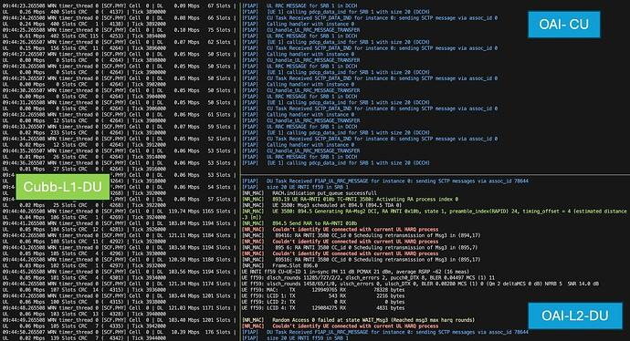 · **مرحله اول ـ اجرای شبکه**

اجرای OAI gNB و FlexRIC و مشاهده اتصال E2.

---

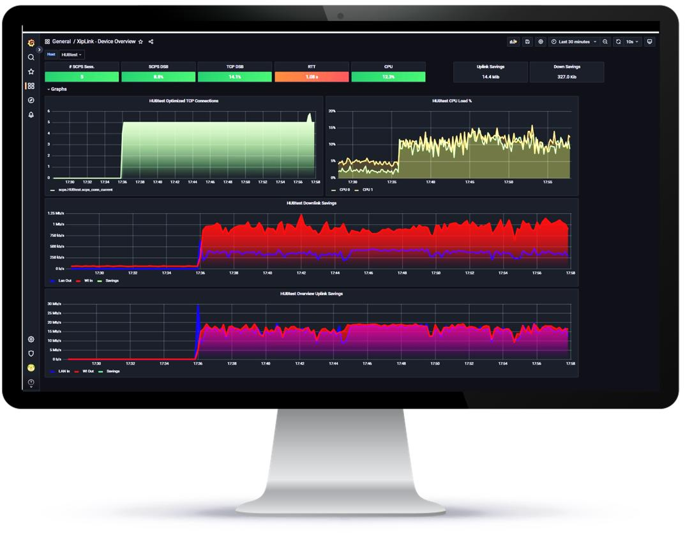 · **مرحله دوم ـ اجرای xApp**

دریافت اطلاعات شبکه و نمایش KPI.

---

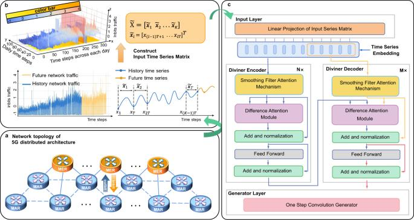 · **مرحله سوم ـ هوشمندسازی**

تحلیل اطلاعات با Python و نمایش نتیجه الگوریتم AI.

## منابع اصلی

- [صفحه رسمی وبینار FlexRIC – OpenAirInterface](https://openairinterface.org/flexric-tutorial-xapp-development/)
- [اسلایدهای رسمی وبینار (PDF، ۴۴ صفحه)](https://openairinterface.org/wp-content/uploads/2025/10/OAI-Webinar-Series-Chapter-Five-FlexRIC-Tutorial-xApp-Development.pdf)
- [وب‌سایت OpenAirInterface](https://openairinterface.org/)

اسلایدهای رسمی را هم پیشنهاد می‌کنم برای تصاویر فنی استفاده کنید؛ به‌خصوص صفحات ۳، ۵، ۷، ۱۶، ۱۸، ۱۹ و ۲۴ فایل PDF.

**نکته درباره نسخه:** مطالب جزئیات SDK و E42 در این ارائه مربوط به نسخه و طراحی شرح‌داده‌شده در همان وبینار است؛ برای نصب و اجرای عملی باید با نسخه فعلی مخزن FlexRIC تطبیق داده شود.

---

## اتصال این مبحث به NVIDIA AI-RAN

ترتیب آموزشی دوره تا اینجا به این شکل شده است:

این نقطه مناسبی برای ورود به مبحث بعدی یعنی **NVIDIA AI-RAN، Aerial، cuPHY و cuMAC** است.