## 🔗 Knowledge Graph

---
tags:
  - oran
  - ai-ran

---

# ارائه آموزشی: معماری O-RAN

منبع: مستندات رسمی O-RAN Software Community – F Release

**موضوع:** شناخت اجزای معماری O-RAN، تفکیک وظایف شبکه رادیویی و ارتباط بخش مدیریت با بخش کنترل هوشمند.

این مبحث مکمل دو قسمت قبلی است. در قسمت قبل با مفهوم O-RAN، RIC و xApp آشنا شدیم؛ اینجا دقیق‌تر بررسی می‌کنیم که اجزای مختلف O-RAN چگونه کنار هم قرار می‌گیرند.

**هدف آموزشی:** مخاطب بتواند معماری O-RAN را از سمت آنتن تا شبکه مرکزی و از سمت مدیریت تا کنترل هوشمند دنبال کند.

---

## اسلاید ۱ ـ چرا معماری O-RAN تغییر کرده است؟

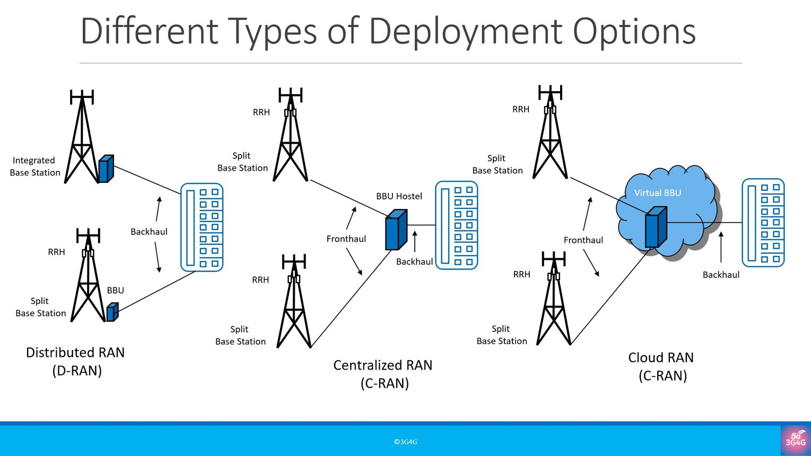

در معماری سنتی، بخش زیادی از عملکرد ایستگاه پایه در قالب یک مجموعه یکپارچه ارائه می‌شد.

این ساختار محدودیت‌هایی داشت:

- وابستگی زیاد به تولیدکننده تجهیزات
- دشواری توسعه و جایگزینی اجزا
- محدودیت در توسعه نرم‌افزارهای کنترلی
- انعطاف‌پذیری کمتر در تخصیص منابع پردازشی

**نیاز:** تفکیک وظایف ایستگاه پایه و ایجاد ارتباط استاندارد بین اجزای مختلف.

---

## اسلاید ۲ ـ نمای کلی معماری O-RAN

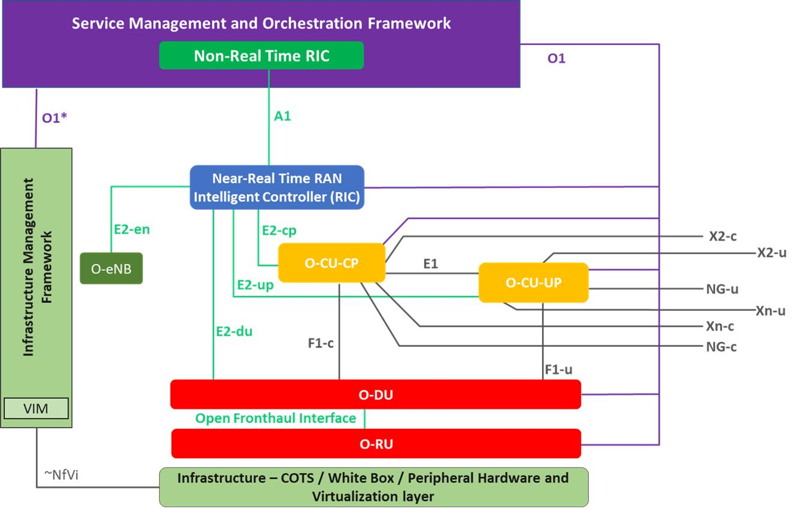

معماری O-RAN دو بخش اصلی دارد:

**۱. بخش شبکه رادیویی (Radio Side)**

- Near-RT RIC
- O-CU-CP
- O-CU-UP
- O-DU
- O-RU

**۲. بخش مدیریت و هماهنگ‌سازی (Management Side)**

- SMO
- Non-RT RIC
- مدیریت و نظارت بر اجزای شبکه

نکته مهم: RIC فقط یک بخش از معماری است؛ O-RAN مجموعه‌ای از اجزای رادیویی، کنترلی و مدیریتی را تعریف می‌کند.

[oran master documentation](https://docs.o-ran-sc.org/en/f-release/architecture/architecture.html)

---

## اسلاید ۳ ـ O-RU چیست؟

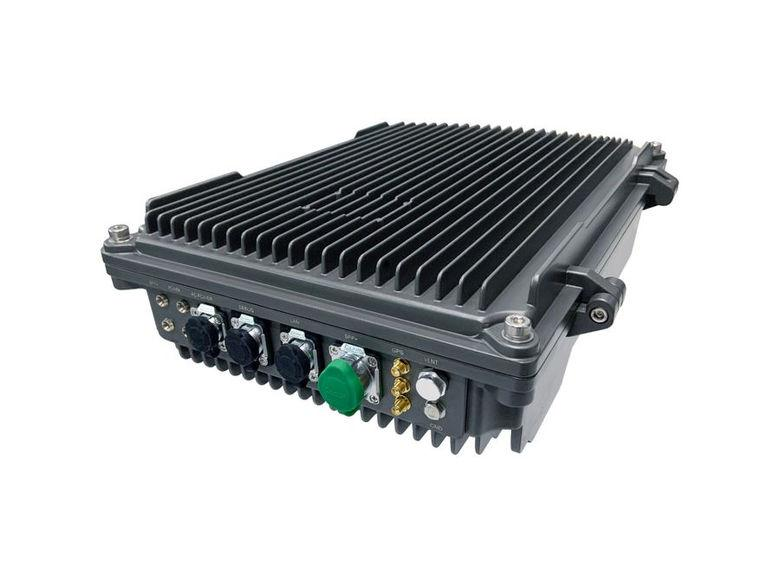

**O-RU = O-RAN Radio Unit**

این بخش نزدیک‌ترین جزء به آنتن است.

وظایف اصلی:

- ارسال و دریافت سیگنال رادیویی
- پردازش سیگنال‌های فرکانس رادیویی
- انجام بخشی از پردازش PHY در لایه پایین

به زبان ساده:

O-RU مسئول تبدیل اطلاعات دیجیتال به سیگنال رادیویی و برعکس است.

**مثال:** سیگنالی که گوشی ارسال می‌کند، ابتدا توسط آنتن و واحد رادیویی دریافت می‌شود.

---

## اسلاید ۴ ـ O-DU چیست؟

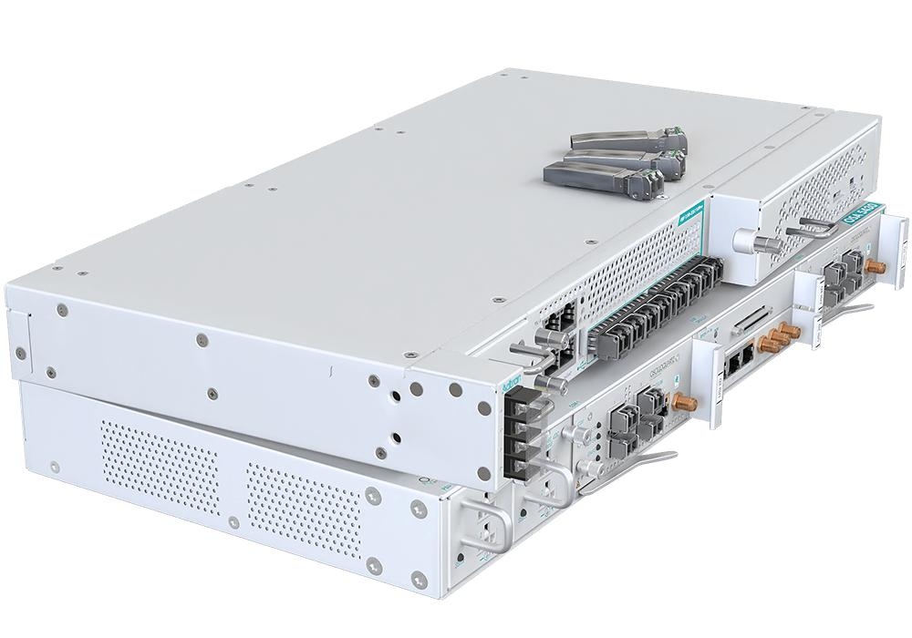

**O-DU = O-RAN Distributed Unit**

این بخش وظایف پردازشی نزدیک به لایه رادیویی را انجام می‌دهد.

وظایف اصلی:

- پردازش لایه MAC
- مدیریت زمان‌بندی منابع رادیویی
- پردازش لایه RLC
- بخشی از پردازش PHY

**مثال:** وقتی چندین کاربر هم‌زمان به یک سلول متصل هستند، O-DU در پردازش و زمان‌بندی منابع رادیویی نقش دارد.

---

## اسلاید ۵ ـ O-CU چیست؟

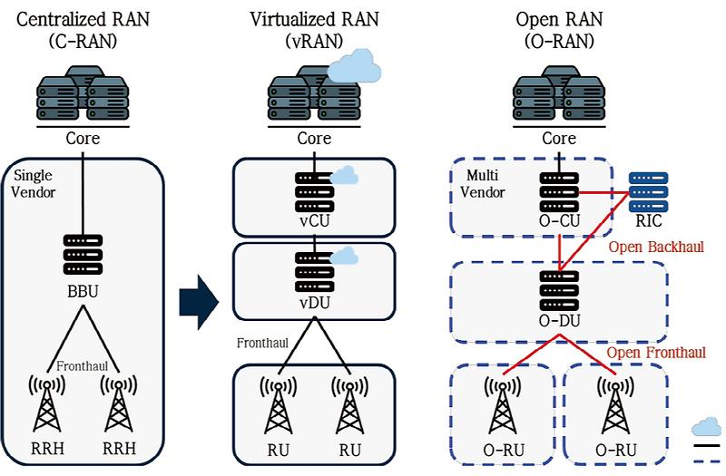

**O-CU = O-RAN Central Unit**

این بخش وظایف پردازشی لایه‌های بالاتر شبکه رادیویی را انجام می‌دهد.

O-CU به دو قسمت تقسیم می‌شود:

- **O-CU-CP:** مدیریت بخش کنترلی ارتباطات
- **O-CU-UP:** مدیریت انتقال اطلاعات کاربران

این تفکیک باعث می‌شود پردازش کنترل و انتقال داده از یکدیگر مستقل‌تر باشند.

---

## اسلاید ۶ ـ تفاوت O-CU-CP و O-CU-UP

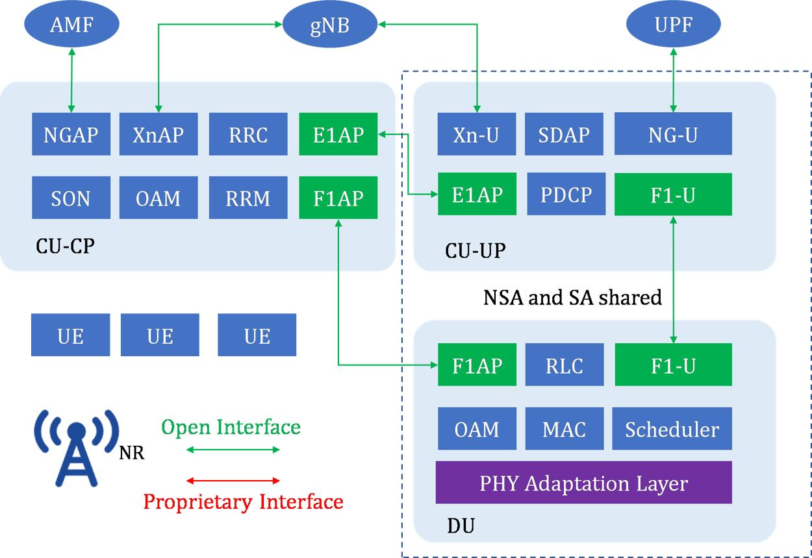

| جزء | وظیفه | مثال ساده |
| --- | --- | --- |
| O-CU-CP | کنترل ارتباط و مدیریت وضعیت کاربران | برقراری و مدیریت اتصال |
| O-CU-UP | انتقال داده کاربران | انتقال ویدئو و اطلاعات اینترنت |

**مثال آموزشی:**

وقتی کاربر به شبکه 5G متصل می‌شود، بخش کنترلی در مدیریت اتصال نقش دارد؛ وقتی ویدئو تماشا می‌کند، بخش User Plane در انتقال داده نقش دارد.

این دو بخش از طریق رابط **E1** با یکدیگر ارتباط دارند.

---

## اسلاید ۷ ـ ارتباط اجزای O-RAN با یکدیگر

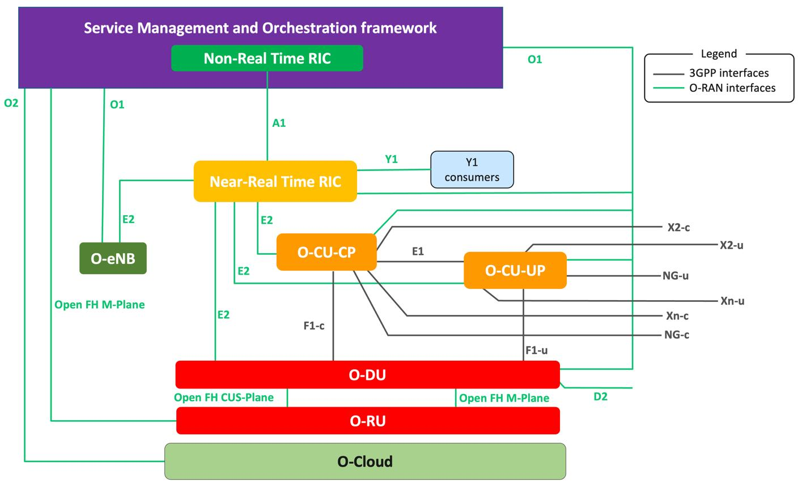

در معماری O-RAN، ارتباط بین اجزا از طریق رابط‌های مشخص انجام می‌شود.

| رابط | ارتباط | کاربرد |
| --- | --- | --- |
| E1 | CU-CP و CU-UP | ارتباط بخش کنترل و انتقال داده |
| F1 | CU و DU | ارتباط واحد مرکزی و توزیع‌شده |
| Open Fronthaul | DU و RU | انتقال اطلاعات رادیویی |
| E2 | Near-RT RIC و RAN | کنترل و پایش هوشمند |
| O1 | SMO و اجزای شبکه | مدیریت و نظارت |

**نکته تدریسی:** لازم نیست مخاطب جزئیات پروتکل‌ها را بداند؛ کافی است بداند هر رابط چه دو بخشی را به هم متصل می‌کند.

---

## اسلاید ۸ ـ SMO چیست؟

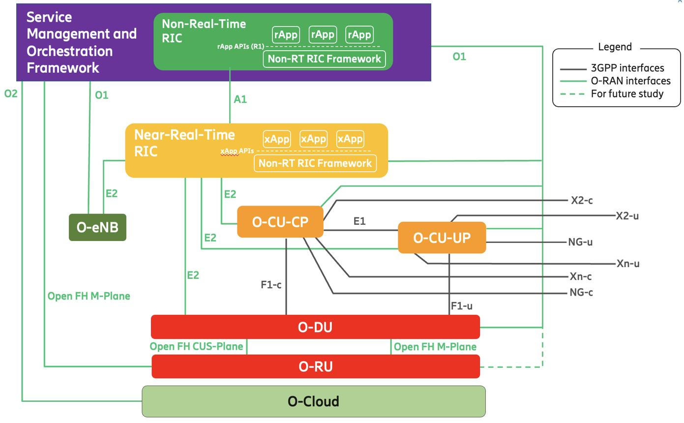

**‏SMO = Service Management and Orchestration**

‏SMO بخش مدیریت و هماهنگ‌سازی در معماری O-RAN است.

وظایف اصلی:

- مدیریت تجهیزات و نرم‌افزارهای شبکه
- پیکربندی اجزای RAN
- نظارت بر عملکرد و وضعیت تجهیزات
- مدیریت منابع زیرساخت ابری
- هماهنگ‌سازی سرویس‌ها و قابلیت‌های شبکه

**مثال:** اگر بخواهیم نرم‌افزار یک واحد رادیویی را به‌روزرسانی کنیم یا وضعیت عملکرد چندین سایت را بررسی کنیم، SMO می‌تواند در این فرایند نقش داشته باشد.

---

## اسلاید ۹ ـ Non-RT RIC چه ارتباطی با SMO دارد؟

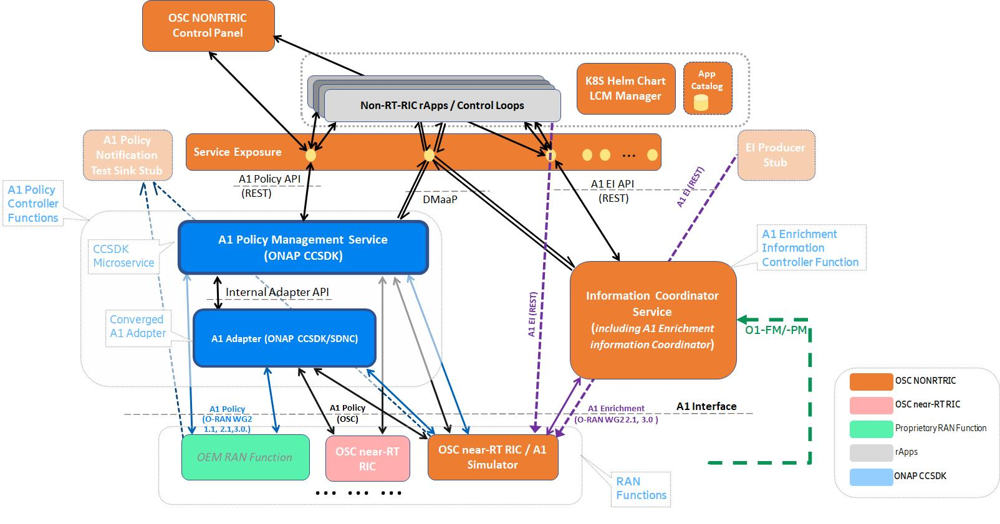

در معماری O-RAN، عملکرد Non-RT RIC در بخش مدیریتی SMO قرار می‌گیرد.

وظایف آن:

- تحلیل اطلاعات شبکه در بازه‌های بلندتر
- اجرای فرایندهای AI/ML
- آموزش و به‌روزرسانی مدل‌ها
- تولید سیاست‌های بهینه‌سازی
- هدایت برنامه‌های Near-RT RIC

**مثال:** مدل AI با بررسی تاریخچه ترافیک پیش‌بینی می‌کند که کدام سلول در ساعات آینده دچار ازدحام خواهد شد.

سپس سیاست مناسب را برای Near-RT RIC آماده می‌کند.

[oran master documentation](https://docs.o-ran-sc.org/en/f-release/architecture/architecture.html) · [oran master documentation](https://docs.o-ran-sc.org/en/f-release/)

---

## اسلاید ۱۰ ـ تفاوت SMO و RIC

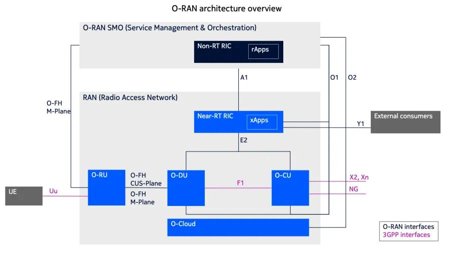

گاهی این دو مفهوم با هم اشتباه گرفته می‌شوند.

| مفهوم | مسئولیت اصلی |
| --- | --- |
| SMO | مدیریت و هماهنگ‌سازی کل زیرساخت RAN |
| Non-RT RIC | تحلیل، سیاست‌گذاری و هوشمندسازی بلندمدت |
| Near-RT RIC | کنترل و بهینه‌سازی نزدیک به زمان واقعی |

**تشبیه ساده:**

- SMO مدیر عملیات شبکه است.
- Non-RT RIC تحلیلگر و برنامه‌ریز است.
- Near-RT RIC مسئول تصمیم‌گیری‌های سریع‌تر است.
- xApp ابزار اجرای تصمیم‌های کنترلی است.

---

## اسلاید ۱۱ ـ رابط‌های مهم در معماری O-RAN

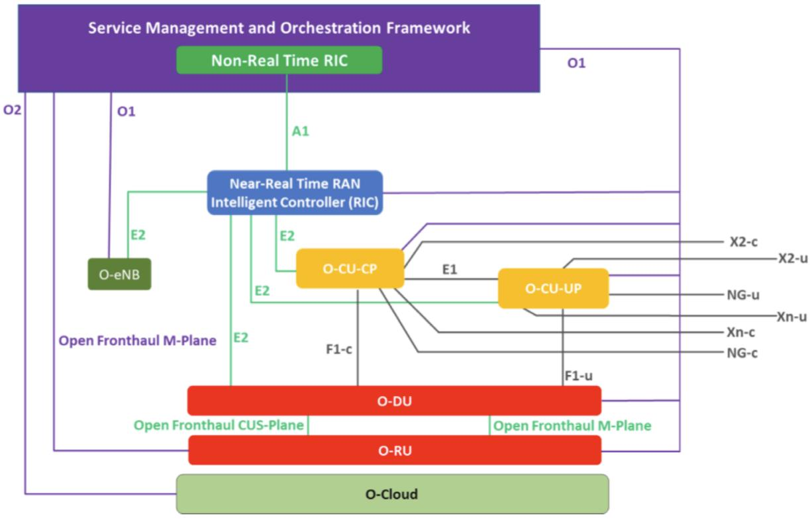

برای درک معماری، بهتر است رابط‌ها را در سه گروه ببینیم:

**گروه اول ـ کنترل و هوشمندسازی**

- A1: ارتباط Non-RT RIC با Near-RT RIC
- E2: ارتباط Near-RT RIC با گره‌های RAN

**گروه دوم ـ مدیریت**

- O1: مدیریت و نظارت بر اجزای RAN
- O2: مدیریت زیرساخت ابری O-Cloud

**گروه سوم ـ ارتباط اجزای رادیویی**

- E1: ارتباط CU-CP و CU-UP
- F1: ارتباط CU و DU
- Open Fronthaul: ارتباط DU و RU

---

## اسلاید ۱۲ ـ نمودار کامل معماری O-RAN

این نمودار را می‌توانید به‌عنوان اسلاید مرجع معماری استفاده کنید.

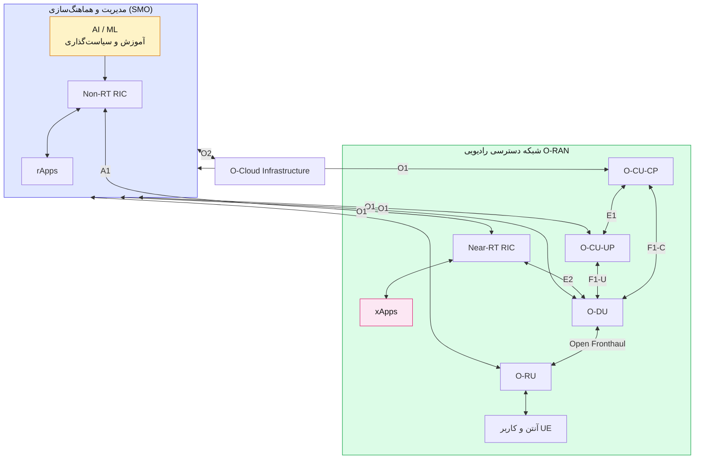

نمودار مفهومی و ساده‌شده است؛ در پیاده‌سازی واقعی، رابط E2 می‌تواند به گره‌ها و عملکردهای مختلف RAN متصل شود و تمام رابط‌های مدیریتی لزوماً به شکل نمایش‌داده‌شده در یک نصب فعال نیستند.

---

## اسلاید ۱۳ ـ یک سناریوی واقعی از ابتدا تا انتها

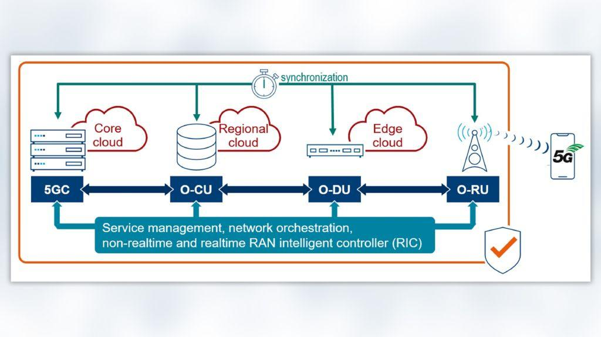

فرض کنید در یک شهر، چندین سایت 5G داریم و در ساعات شلوغی بعضی سلول‌ها دچار ازدحام می‌شوند.

**نیاز:** مدیریت هوشمند ظرفیت شبکه در سطح شهر.

**روش حل:**

1. O-RU و O-DU اطلاعات رادیویی را جمع‌آوری می‌کنند.
2. O-CU ارتباطات کاربران را مدیریت می‌کند.
3. Near-RT RIC اطلاعات را دریافت می‌کند.
4. xApp وضعیت سلول‌ها را تحلیل می‌کند.
5. Non-RT RIC الگوهای بلندمدت ترافیک را بررسی می‌کند.
6. SMO مدیریت و هماهنگ‌سازی زیرساخت را انجام می‌دهد.

**نتیجه:** شبکه‌ای قابل مدیریت، توسعه‌پذیر و آماده برای بهینه‌سازی هوشمند.

---

## اسلاید ۱۴ ـ جایگاه O-RAN در AI-RAN

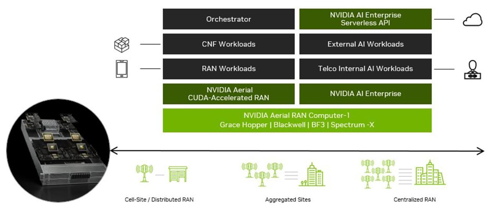

O-RAN زیرساخت مناسبی برای توسعه قابلیت‌های AI در شبکه فراهم می‌کند.

سه سطح کاربرد:

| سطح | کاربرد AI |
| --- | --- |
| مدیریت شبکه | پیش‌بینی ترافیک و برنامه‌ریزی |
| کنترل RAN | بهینه‌سازی منابع و جابه‌جایی کاربران |
| پردازش رادیویی | بهینه‌سازی الگوریتم‌های PHY و پردازش سیگنال |

نکته: AI-RAN صرفاً محدود به O-RAN و RIC نیست؛ می‌تواند پردازش‌های هوشمند را در لایه‌های مختلف شبکه نیز به کار بگیرد.

---

## اسلاید ۱۵ ـ جمع‌بندی معماری O-RAN

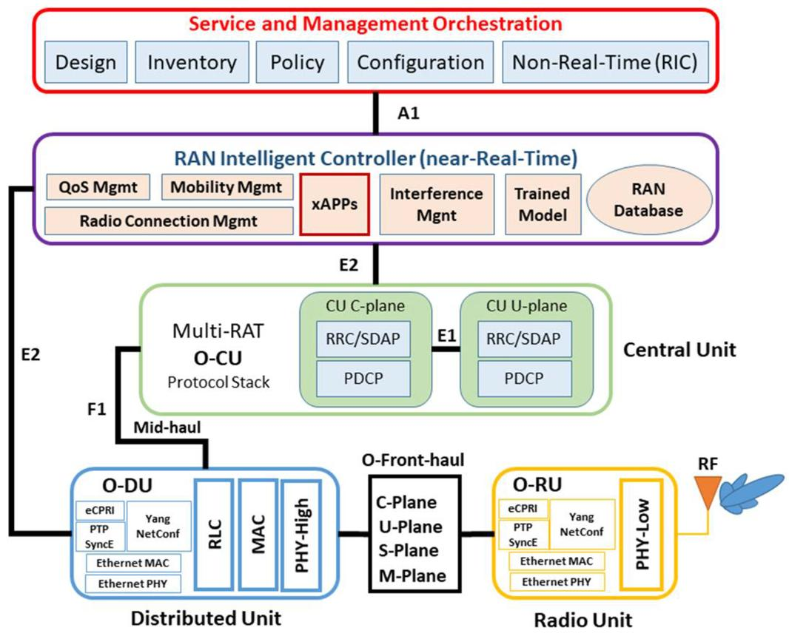

| جزء | مفهوم کلیدی |
| --- | --- |
| O-RU | ارسال و دریافت امواج |
| O-DU | پردازش نزدیک به لایه رادیویی |
| O-CU-CP | کنترل ارتباطات |
| O-CU-UP | انتقال داده کاربران |
| Near-RT RIC | کنترل نزدیک به زمان واقعی |
| Non-RT RIC | تحلیل و سیاست‌گذاری |
| xApp | برنامه کنترل و بهینه‌سازی |
| SMO | مدیریت و هماهنگ‌سازی |

**پیام اصلی:** O-RAN با تفکیک اجزای شبکه و تعریف رابط‌های استاندارد، امکان توسعه شبکه‌های چندفروشنده‌ای، برنامه‌پذیر و هوشمند را فراهم می‌کند.

---

## منابع و نکات تکمیلی

- [O-RAN SC – Architecture Overview (F Release)](https://docs.o-ran-sc.org/en/f-release/architecture/architecture.html)
- [مستندات اجزای نرم‌افزاری O-RAN SC](https://docs.o-ran-sc.org/en/f-release/)
- [O-RAN SC Projects](https://docs.o-ran-sc.org/en/latest/projects.html)
- [O-DU / O-RU Fronthaul Architecture](https://docs.o-ran-sc.org/projects/o-ran-sc-o-du-phy/en/latest/Architecture-Overview_fh.html)

توجه: لینک اصلی مربوط به مستندات شاخه F Release است و معماری مرجع را توضیح می‌دهد؛ نباید آن را به‌عنوان فهرست کامل قابلیت‌های نسخه‌های جدیدتر O-RAN SC تلقی کرد.

## پیشنهاد برای ترتیب ادامه تدریس

تا اینجا مسیر آموزشی شما به شکل زیر درآمده است:

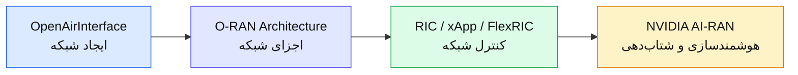

**پیشنهاد من:** از اینجا وارد NVIDIA AI-RAN شوید و ابتدا تصویر کلی AI-RAN را معرفی کنید؛ سپس به سراغ NVIDIA Aerial، cuPHY، cuMAC، pyAerial و 5GModel بروید. این ترتیب باعث می‌شود مخاطب ابتدا معماری شبکه را بشناسد و بعد نقش GPU و هوش مصنوعی را در آن درک کند.