tags:
  - ai-ran
## 🔗 Knowledge Graph

### Next Steps
- [[FlexRIC]]
- [[RIC-xApp]]
---

# ارائه آموزشی: OpenAirInterface (OAI)

---

## اسلاید ۱ ـ OpenAirInterface چیست؟

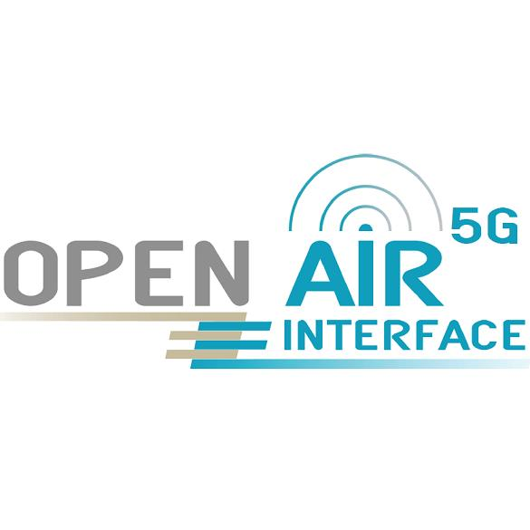

**‏OpenAirInterface (OAI)** یک پروژه متن‌باز برای پیاده‌سازی نرم‌افزاری شبکه‌های مخابراتی سلولی است.

با استفاده از آن می‌توانیم بخش‌های مختلف یک شبکه موبایل را اجرا کنیم:

- شبکه دسترسی رادیویی (RAN)
- شبکه هسته (Core Network)
- تجهیزات کاربر (UE)
- ابزارهای مدیریت و کنترل شبکه

**نکته مهم:** OAI صرفاً یک شبیه‌ساز نیست؛ می‌تواند با سخت‌افزار رادیویی واقعی به گوشی موبایل متصل شود.

منبع: [وب‌سایت رسمی OpenAirInterface](https://openairinterface.org/)

---

## اسلاید ۲ ـ چرا به OpenAirInterface نیاز داریم؟

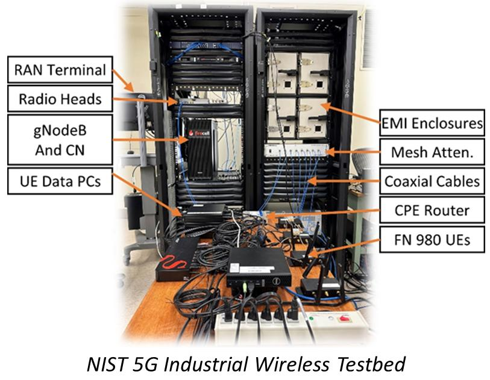

فرض کنید بخواهیم یک فناوری جدید در شبکه 5G را آزمایش کنیم.

در شبکه واقعی اپراتور:

- دسترسی به تجهیزات محدود است.
- آزمایش تغییرات شبکه پرهزینه است.
- تغییر نرم‌افزار تجهیزات تجاری ساده نیست.
- اجرای آزمایش‌های تکرارپذیر دشوار است.

**نیاز ما:** یک محیط آزمایشگاهی که بتوانیم شبکه موبایل را اجرا کنیم، تغییر دهیم و عملکرد آن را اندازه‌گیری کنیم.

‏OpenAirInterface این امکان را فراهم می‌کند.

---

## اسلاید ۳ ـ راه‌حل OAI چگونه کار می‌کند؟

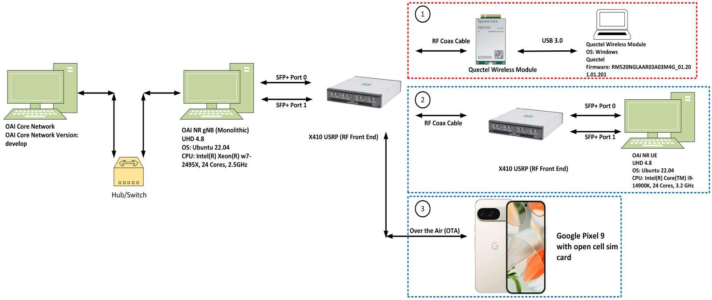

‏OAI اجزای اصلی شبکه موبایل را به شکل نرم‌افزاری پیاده‌سازی می‌کند.

سه جزء اصلی:

| جزء | وظیفه |
| --- | --- |
| gNB | ایستگاه پایه 5G |
| UE | گوشی یا مودم کاربر |
| 5G Core | مدیریت اتصال و انتقال داده |

این اجزا می‌توانند روی یک یا چند کامپیوتر اجرا شوند و با یکدیگر ارتباط برقرار کنند.

**نتیجه:** ایجاد یک شبکه 5G آزمایشگاهی بدون نیاز به تجهیزات کامل یک اپراتور.

---

## اسلاید ۴ ـ معماری ساده یک شبکه 5G با OAI

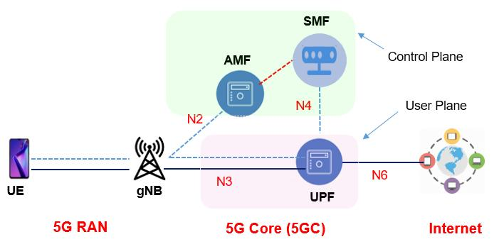

در یک ارتباط معمولی 5G:

1. گوشی (UE) به ایستگاه پایه متصل می‌شود.
2. ایستگاه پایه (gNB) ارتباط رادیویی را مدیریت می‌کند.
3. اطلاعات به شبکه هسته (5G Core) منتقل می‌شود.
4. شبکه هسته اتصال کاربر به اینترنت یا سرویس‌های دیگر را برقرار می‌کند.

**نکته تدریسی:** gNB مسئول ارتباط رادیویی است؛ Core مسئول مدیریت اتصال و انتقال اطلاعات در شبکه هسته است.

---

## اسلاید ۵ ـ اجزای اصلی OpenAirInterface

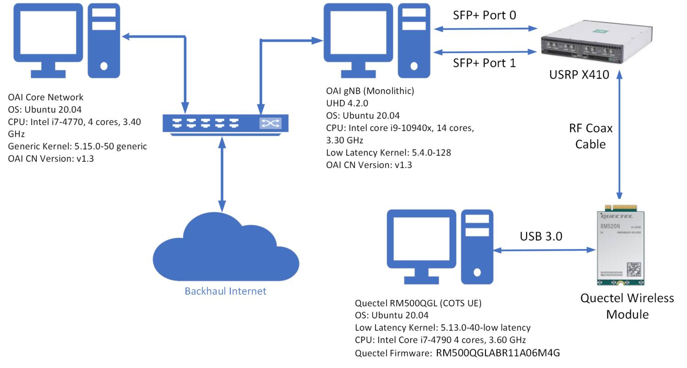

| بخش | کاربرد |
| --- | --- |
| OAI RAN | پیاده‌سازی شبکه رادیویی |
| OAI UE | شبیه‌سازی یا پیاده‌سازی تجهیزات کاربر |
| OAI Core | پیاده‌سازی شبکه هسته 5G |
| OAI OAM | مدیریت، کنترل و نظارت شبکه |

برای مثال می‌توانیم یک gNB را اجرا کنیم، یک UE به آن متصل کنیم و ترافیک واقعی IP را از شبکه عبور دهیم.

منبع: [OAI RAN](https://openairinterface.org/ran/)، [OAI Core](https://openairinterface.org/core-network/).

---

## اسلاید ۶ ـ آیا به سخت‌افزار رادیویی نیاز داریم؟

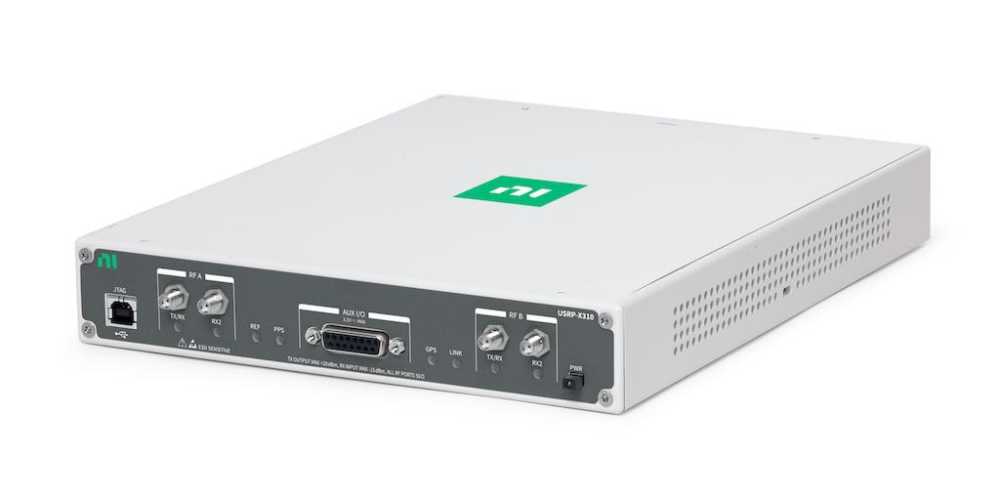

یکی از ویژگی‌های جذاب OAI این است که برای شروع الزاماً به تجهیزات رادیویی گران‌قیمت نیاز نداریم.

دو روش اجرا داریم:

**۱. اجرای نرم‌افزاری (RF Simulator)**

- اجرای gNB و UE روی کامپیوتر
- ارتباط رادیویی به‌صورت نرم‌افزاری شبیه‌سازی می‌شود.
- مناسب یادگیری، توسعه و تست اولیه

**۲. اجرای واقعی (SDR Hardware)**

- استفاده از تجهیزات SDR مانند USRP
- اتصال آنتن و ارسال و دریافت امواج واقعی
- امکان اتصال گوشی یا مودم 5G واقعی

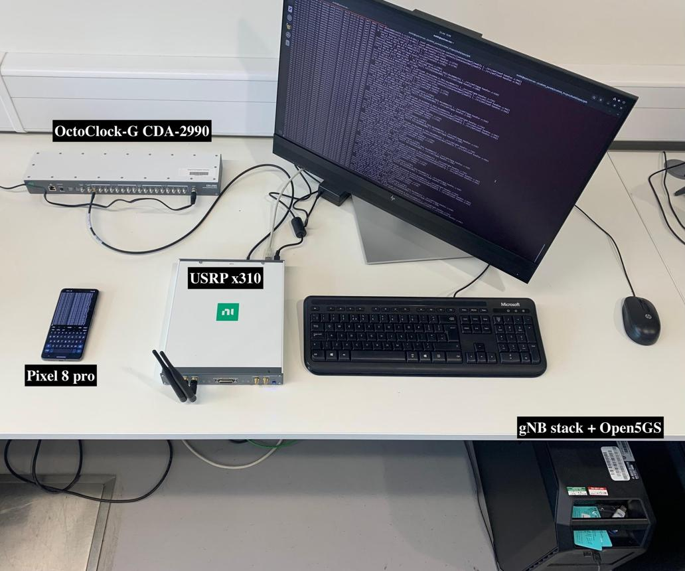

**نتیجه:** می‌توانیم از یک آزمایش نرم‌افزاری ساده شروع کنیم و به شبکه واقعی برسیم.

منبع: [مستندات رسمی اجرای OAI](https://github.com/OPENAIRINTERFACE/openairinterface5g/blob/develop/doc/README.md).

---

## اسلاید ۷ ـ مسیر اجرای یک شبکه 5G آزمایشگاهی

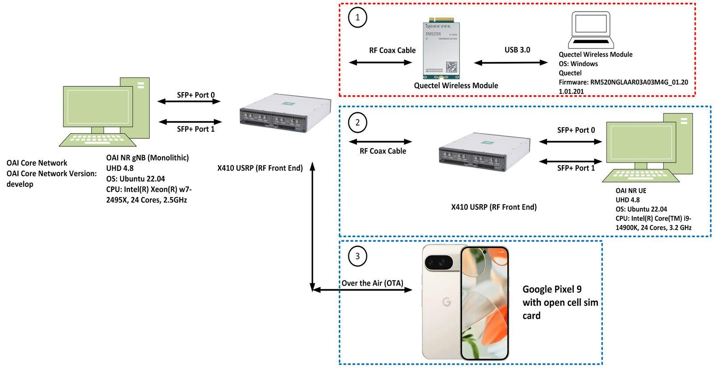

مراحل کلی راه‌اندازی:

1. آماده‌سازی سیستم‌عامل Linux
2. نصب و اجرای OAI 5G Core
3. اجرای OAI gNB
4. اجرای UE یا اتصال گوشی واقعی
5. برقراری ارتباط و انتقال داده
6. بررسی وضعیت اتصال و عملکرد شبکه

برای شروع حتی می‌توان از Docker و Docker Compose استفاده کرد.

**نتیجه قابل مشاهده در کلاس:** اتصال یک UE به شبکه 5G و مشاهده برقراری ارتباط و تبادل اطلاعات.

---

## اسلاید ۸ ـ ارتباط OpenAirInterface با AI-RAN

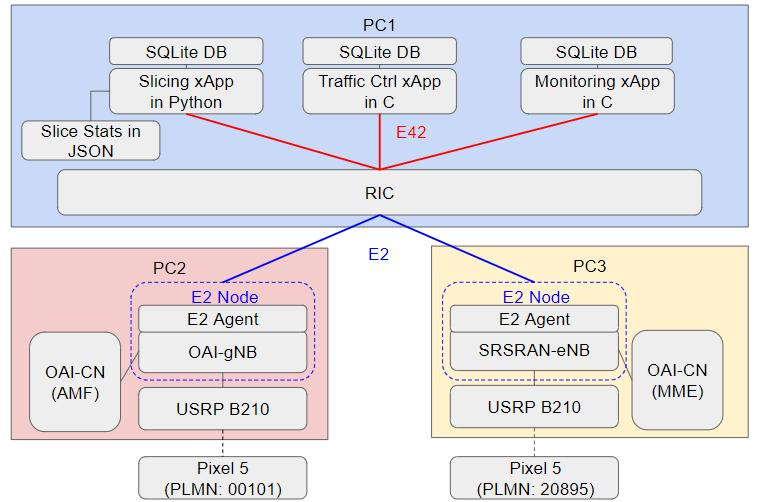

تا اینجا یک شبکه 5G نرم‌افزاری ایجاد کردیم؛ اما چگونه می‌توانیم این شبکه را هوشمند کنیم؟

در این مرحله، می‌توانیم از ابزارهای مدیریت و کنترل هوشمند استفاده کنیم.

- دریافت اطلاعات عملکرد شبکه (KPI)
- تحلیل وضعیت شبکه
- تشخیص مشکلات و ناهنجاری‌ها
- تصمیم‌گیری برای بهینه‌سازی شبکه
- اجرای سیاست‌های کنترلی

یکی از ابزارهای مرتبط با OAI، پروژه **FlexRIC** است که امکان ارتباط RIC با شبکه و اجرای برنامه‌های xApp را فراهم می‌کند.

منبع: [OAI OAM و FlexRIC](https://openairinterface.org/oam/)

---

## اسلاید ۹ ـ نمودار ارتباط اجزای OpenAirInterface

نمودار زیر مسیر کلی ارتباط اجزای شبکه و محل قرارگیری ابزارهای کنترل هوشمند را نشان می‌دهد.

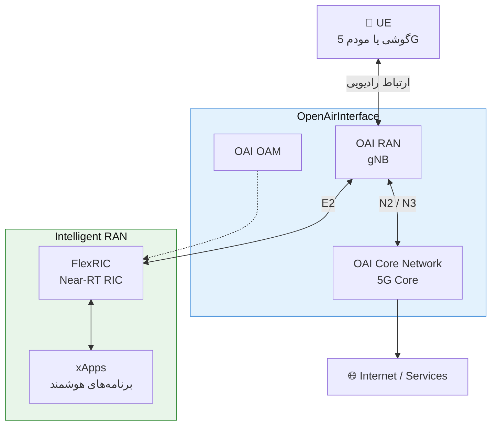

این نمودار یک نمایش مفهومی از ارتباط اجزاست؛ همه رابط‌ها و قابلیت‌ها الزاماً در هر نصب فعال نیستند.

---

## اسلاید ۱۰ ـ چه دستاوردی از OpenAirInterface داریم؟

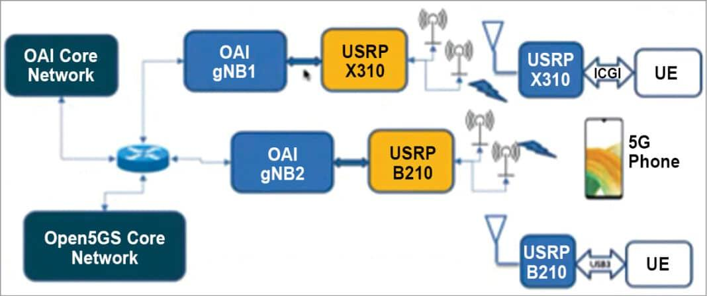

با استفاده از OAI می‌توانیم:

- یک شبکه 4G/5G آزمایشگاهی ایجاد کنیم.
- پروتکل‌های ارتباطی را بررسی و تغییر دهیم.
- عملکرد شبکه را اندازه‌گیری کنیم.
- فناوری‌های جدید را قبل از استفاده عملی آزمایش کنیم.
- الگوریتم‌های AI را در محیط واقعی‌تر شبکه ارزیابی کنیم.
- ارتباط با تجهیزات و راهکارهای O-RAN را بررسی کنیم.

**پیام اصلی:** OAI بستری برای تبدیل ایده‌های تحقیقاتی به آزمایش‌های عملی شبکه موبایل است.

---

## اسلاید ۱۱ ـ جمع‌بندی و ارتباط با مباحث بعدی

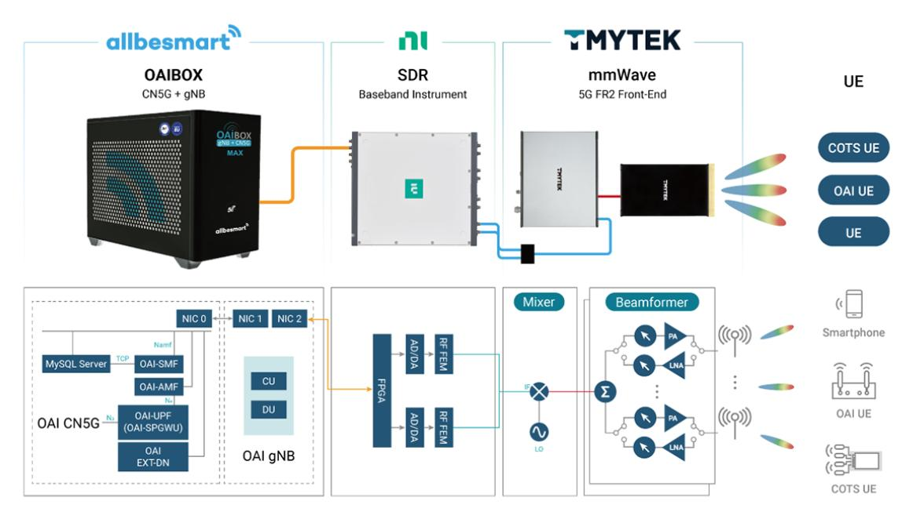

| سؤال | پاسخ |
| --- | --- |
| OpenAirInterface چیست؟ | پلتفرم متن‌باز شبکه موبایل |
| چه چیزی پیاده‌سازی می‌کند؟ | RAN، UE و Core |
| آیا شبکه واقعی اجرا می‌کند؟ | بله |
| آیا بدون سخت‌افزار قابل اجراست؟ | بله، با RF Simulator |
| چه ارتباطی با AI-RAN دارد؟ | بستر آزمایش و ارزیابی الگوریتم‌های هوشمند |

**پل ارتباطی به موضوع بعدی:**

حالا که شبکه را داریم، سؤال بعدی این است:

چگونه می‌توانیم رفتار شبکه را کنترل کنیم، اطلاعات آن را دریافت کنیم و با کمک هوش مصنوعی عملکرد آن را بهینه کنیم؟

در اینجا به سراغ RIC، FlexRIC و xApp می‌رویم.

---

## منابع و لینک‌های مناسب برای اسلاید و مطالعه بیشتر

- [وب‌سایت اصلی OpenAirInterface](https://openairinterface.org/)
- [OAI RAN و قابلیت‌های 5G](https://openairinterface.org/ran/)
- [OAI 5G Core](https://openairinterface.org/core-network/)
- [OAI OAM و FlexRIC](https://openairinterface.org/oam/)
- [مستندات نصب و اجرای OAI](https://github.com/OPENAIRINTERFACE/openairinterface5g/blob/develop/doc/README.md)

## پیشنهاد اجرایی برای تدریس

به نظرم برای این قسمت حدود **۱۲ تا ۱۵ دقیقه** زمان مناسب است:

| بخش | زمان |
| --- | --- |
| معرفی و نیاز به OAI | ۲ دقیقه |
| معماری و اجزا | ۴ دقیقه |
| روش اجرا و سخت‌افزار | ۴ دقیقه |
| ارتباط با AI-RAN | ۳ دقیقه |
| جمع‌بندی | ۱ دقیقه |
