tags:
  - oran
  - ai-ran
## 🔗 Knowledge Graph

### Next Steps
- [[FlexRIC]]

# ارائه آموزشی: O-RAN، RIC و xApp

---

## اسلاید ۱ ـ چرا به O-RAN نیاز داریم؟

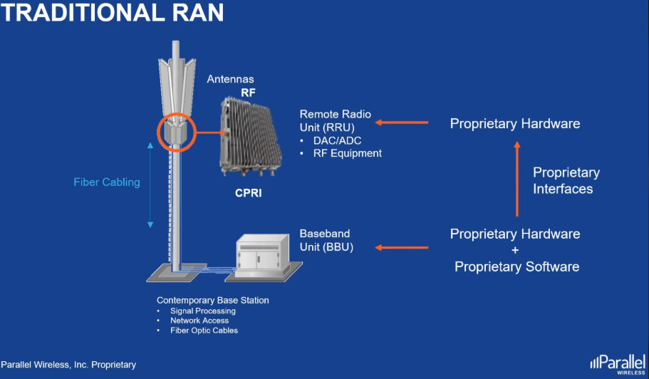

در معماری سنتی شبکه موبایل:

- تجهیزات رادیویی معمولاً وابستگی زیادی به یک تولیدکننده دارند.
- توسعه قابلیت‌های جدید ممکن است دشوار و پرهزینه باشد.
- اتصال تجهیزات تولیدکنندگان مختلف همیشه ساده نیست.
- توسعه الگوریتم‌های هوشمند محدود به امکانات سازنده تجهیزات است.

**نیاز اصلی:** شبکه‌ای بازتر، انعطاف‌پذیرتر و قابل برنامه‌ریزی که بتوان اجزای آن را از تولیدکنندگان مختلف انتخاب کرد.

---

## اسلاید ۲ ـ O-RAN چیست؟

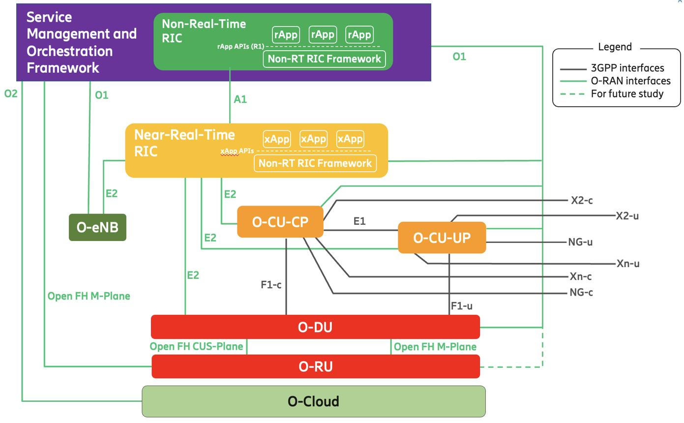

**‏O-RAN (Open Radio Access Network)** مجموعه‌ای از معماری‌ها و مشخصات فنی برای ایجاد شبکه دسترسی رادیویی باز و هوشمند است.

سه هدف اصلی:

- **‏Open:** استفاده از رابط‌های استاندارد و باز
- **‏Disaggregated:** تفکیک بخش‌های مختلف شبکه رادیویی
- ‏Intelligent: هوشمندسازی و کنترل شبکه با کمک RIC و برنامه‌های نرم‌افزاری

نکته مهم: O-RAN فقط به معنی استفاده از نرم‌افزار متن‌باز نیست؛ هدف آن ایجاد امکان تعامل بین اجزای مختلف شبکه با رابط‌های استاندارد است.

---

## اسلاید ۳ ـ معماری O-RAN چگونه است؟

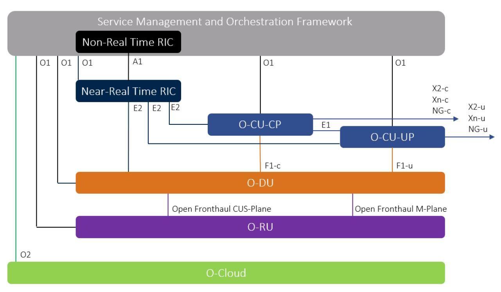

در معماری O-RAN، بخش‌های مختلف ایستگاه پایه از هم تفکیک می‌شوند:

| جزء         | وظیفه ساده                             |
| ----------- | -------------------------------------- |
| O-RU        | ارسال و دریافت امواج رادیویی           |
| O-DU        | پردازش بخش‌های نزدیک به لایه رادیویی   |
| O-CU        | پردازش بخش‌های بالاتر پروتکل شبکه      |
| Near-RT RIC | کنترل و بهینه‌سازی نزدیک به زمان واقعی |
| Non-RT RIC  | تحلیل بلندمدت و سیاست‌گذاری هوشمند     |

**مثال ساده:** به‌جای اینکه تمام قابلیت‌های یک ایستگاه پایه در یک جعبه بسته قرار داشته باشد، وظایف آن بین اجزای نرم‌افزاری و سخت‌افزاری تقسیم می‌شود.

---

## اسلاید ۴ ـ RIC چیست؟

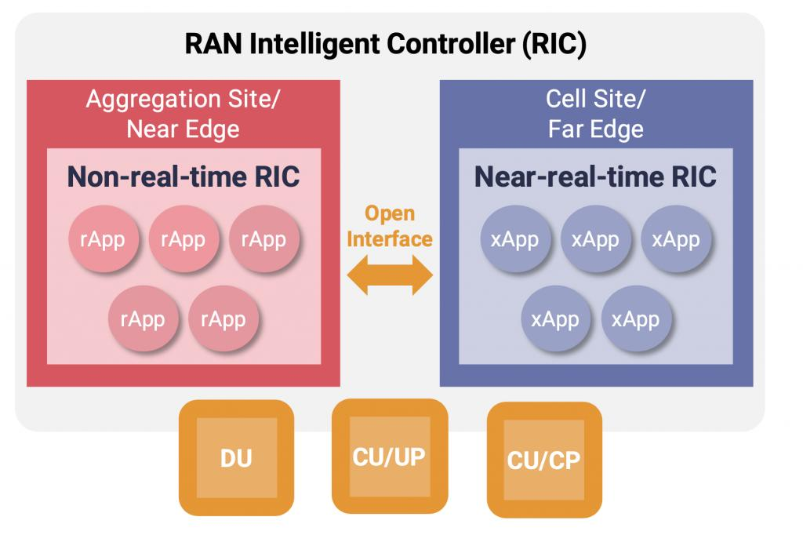

**‏RIC = RAN Intelligent Controller**

‏RIC مغز تصمیم‌گیری و کنترل هوشمند شبکه رادیویی است.

وظایف اصلی:

- دریافت اطلاعات عملکرد شبکه
- تحلیل وضعیت سلول‌ها و کاربران
- شناسایی مشکلات شبکه
- تصمیم‌گیری برای بهینه‌سازی
- ارسال فرمان‌های کنترلی به تجهیزات RAN

برای مثال، اگر یک سلول بیش از حد شلوغ شود، RIC می‌تواند شرایط را بررسی کند و برای توزیع بهتر کاربران تصمیم بگیرد.

**نکته:** RIC به‌تنهایی یک الگوریتم هوش مصنوعی نیست؛ بستری برای اجرای منطق کنترل، سیاست‌ها و برنامه‌های هوشمند است.

---

## اسلاید ۵ ـ دو نوع RIC داریم

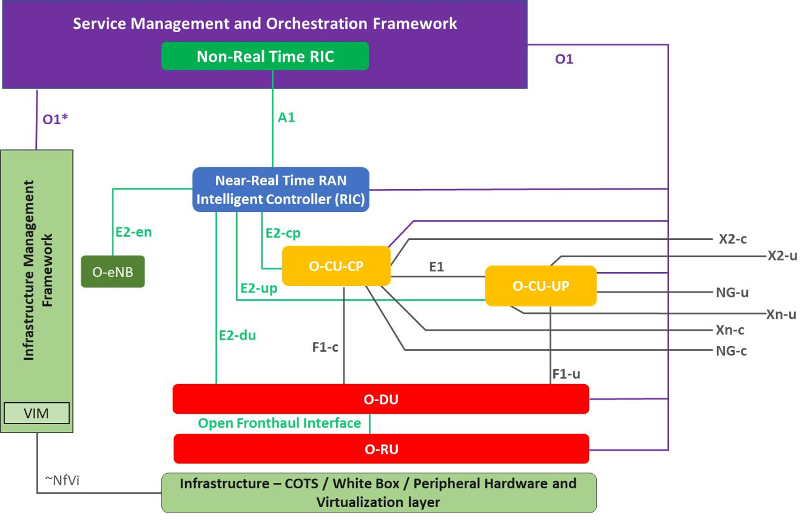

در O-RAN دو نوع RIC تعریف شده است:

**۱. Non-RT RIC (کنترل غیر بلادرنگ)**

- تحلیل اطلاعات در بازه‌های طولانی‌تر
- آموزش و به‌روزرسانی مدل‌های AI/ML
- تعیین سیاست‌های بهینه‌سازی
- اجرای برنامه‌های rApp

**۲. Near-RT RIC (کنترل نزدیک به زمان واقعی)**

- دریافت اطلاعات لحظه‌ای‌تر از شبکه
- اجرای تصمیم‌های کنترلی سریع‌تر
- مدیریت منابع رادیویی
- اجرای برنامه‌های xApp

| ویژگی | Non-RT RIC | Near-RT RIC |
| --- | --- | --- |
| بازه زمانی | بیش از ۱ ثانیه | حدود ۱۰ میلی‌ثانیه تا ۱ ثانیه |
| تمرکز | تحلیل و سیاست‌گذاری | کنترل و بهینه‌سازی |
| برنامه‌ها | rApp | xApp |
| مثال | پیش‌بینی ترافیک | جابه‌جایی کاربران بین سلول‌ها |

این بازه‌ها محدوده‌های معماری هستند، نه تضمین زمان اجرای هر الگوریتم. 

[v14.00)](https://www.etsi.org/deliver/etsi_ts/103900_103999/103982/14.00.00_60/ts_103982v140000p.pdf) · [oran master documentation](https://docs.o-ran-sc.org/en/f-release/architecture/architecture.html)

---

## اسلاید ۶ ـ xApp چیست؟

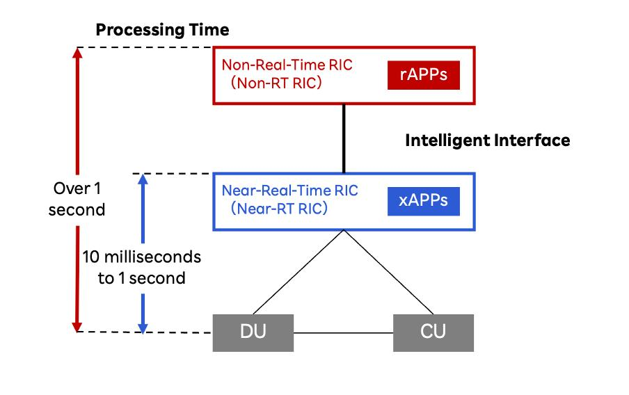

**‏xApp = Extensible Application**

‏xApp یک برنامه نرم‌افزاری است که روی Near-RT RIC اجرا می‌شود و قابلیت‌های کنترلی و هوشمند جدیدی به شبکه اضافه می‌کند.

به زبان ساده:

- ‏RIC بستر اجرای برنامه‌هاست.
- ‏xApp برنامه‌ای است که یک وظیفه مشخص انجام می‌دهد.
- ‏xApp اطلاعات شبکه را دریافت و در صورت مجاز بودن، فرمان کنترلی ارسال می‌کند.

چند نمونه xApp:

| نوع xApp              | وظیفه                      |
| --------------------- | -------------------------- |
| KPI Monitoring        | پایش شاخص‌های شبکه         |
| Traffic Steering      | توزیع کاربران بین سلول‌ها  |
| Anomaly Detection     | تشخیص رفتار غیرعادی        |
| QoE Prediction        | پیش‌بینی کیفیت تجربه کاربر |
| Resource Optimization | بهینه‌سازی منابع رادیویی   |

**نکته:** همه xAppها الزاماً مبتنی بر AI نیستند؛ بعضی از آن‌ها با قوانین و الگوریتم‌های معمولی کار می‌کنند.

---

## اسلاید ۷ ـ ارتباط RIC با شبکه از طریق چه رابط‌هایی است؟

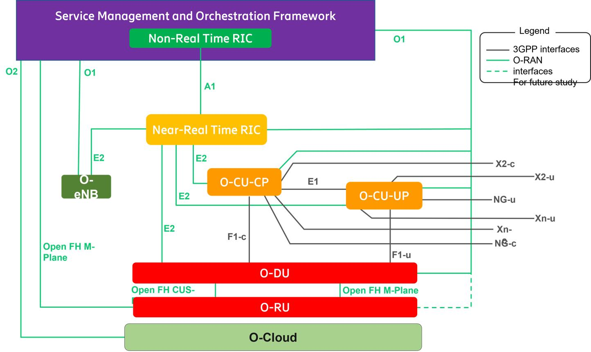

برای ارتباط اجزای مختلف O-RAN، رابط‌های استاندارد تعریف شده‌اند.

| رابط | ارتباط بین               | کاربرد                              |
| ---- | ------------------------ | ----------------------------------- |
| E2   | Near-RT RIC و RAN        | دریافت اطلاعات و ارسال فرمان کنترلی |
| A1   | Non-RT RIC و Near-RT RIC | ارسال سیاست‌ها و اطلاعات کمکی       |
| O1   | SMO و اجزای RAN          | مدیریت، پیکربندی و نظارت            |
| O2   | SMO و زیرساخت Cloud      | مدیریت زیرساخت و منابع ابری         |

برای تدریس، دو رابط مهم‌تر را به خاطر بسپارید:

- **‏E2:** ارتباط RIC با شبکه رادیویی
- ‏**A1:** ارتباط بین دو سطح هوشمندی RIC

---

## اسلاید ۸ ـ یک مثال عملی: مدیریت ازدحام شبکه

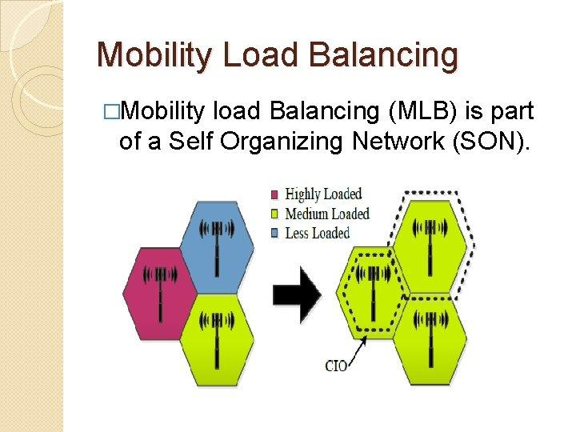

فرض کنید در یک منطقه، یک سلول 5G بیش از حد شلوغ شده است؛ در حالی که سلول مجاور ظرفیت خالی دارد.

**نیاز:** توزیع بهتر کاربران برای کاهش ازدحام و بهبود کیفیت سرویس.

**روش حل:**

1. ‏xApp اطلاعات تعداد کاربران و بار سلول‌ها را دریافت می‌کند.
2. وضعیت سلول‌های مجاور بررسی می‌شود.
3. الگوریتم تصمیم می‌گیرد کدام کاربران امکان انتقال دارند.
4. فرمان کنترلی از طریق RIC به شبکه ارسال می‌شود.
5. وضعیت شبکه دوباره اندازه‌گیری می‌شود.

**نتیجه:** استفاده بهتر از منابع شبکه، کاهش ازدحام و بهبود تجربه کاربران.

---

## اسلاید ۹ ـ نمودار عملکرد یک xApp

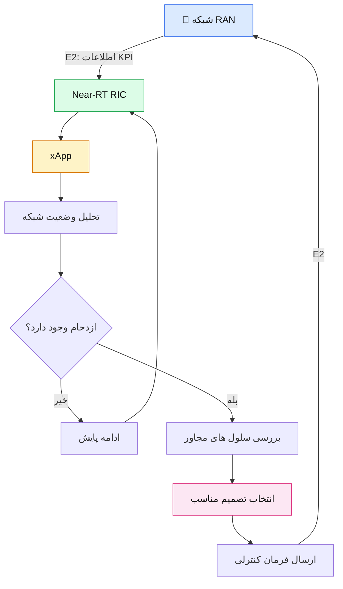

**پیام نمودار:** شبکه اطلاعات می‌دهد، xApp تحلیل می‌کند، RIC ارتباط کنترلی را برقرار می‌کند و نتیجه دوباره در شبکه ارزیابی می‌شود.

---

## اسلاید ۱۰ ـ نقش هوش مصنوعی در RIC

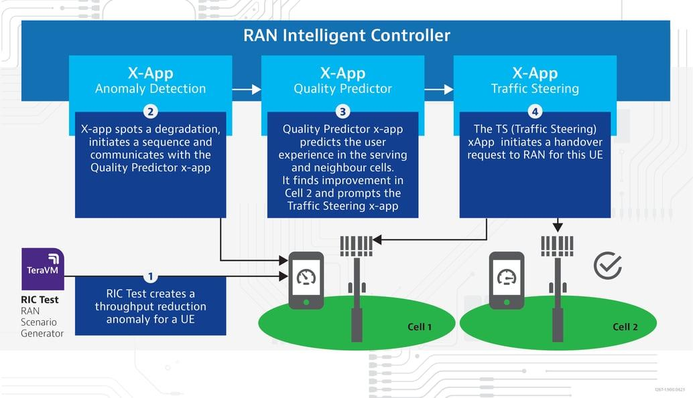

اینجا نقطه اتصال O-RAN به AI-RAN است.

می‌توانیم از هوش مصنوعی برای موارد زیر استفاده کنیم:

- پیش‌بینی ترافیک سلول‌ها
- پیش‌بینی ازدحام شبکه
- تشخیص ناهنجاری‌ها
- پیش‌بینی کیفیت تجربه کاربر
- انتخاب بهترین سلول برای کاربران
- بهینه‌سازی مصرف انرژی

یک سناریوی ساده:

مدل AI در Non-RT RIC الگوی ترافیک را تحلیل می‌کند و سیاست مناسب را پیشنهاد می‌دهد. سپس xApp در Near-RT RIC با استفاده از اطلاعات جدید شبکه، تصمیم‌های کنترلی را اجرا می‌کند.

**تفاوت مهم:** AI می‌تواند مغز تصمیم‌گیری باشد، اما RIC بستر اجرای تصمیم و ارتباط با شبکه است.

---

## اسلاید ۱۱ ـ ارتباط O-RAN با OpenAirInterface

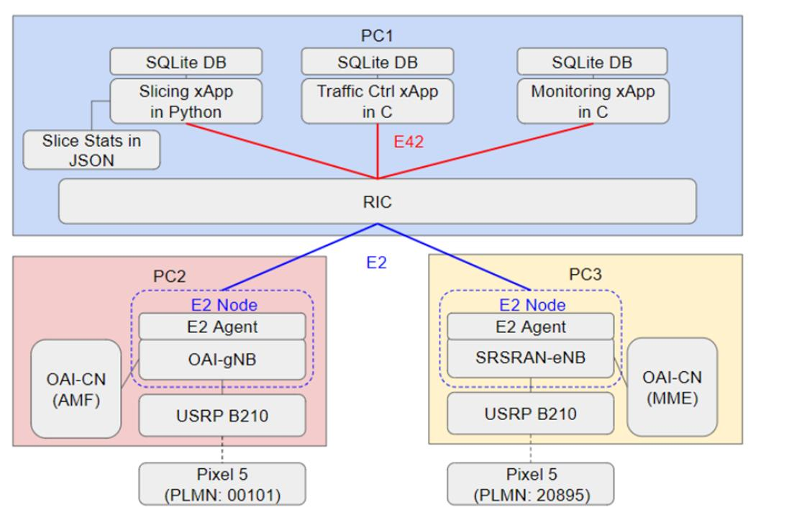

در بخش قبلی با OpenAirInterface آشنا شدیم. حالا این دو فناوری را کنار هم قرار می‌دهیم.

| فناوری           | نقش                       |
| ---------------- | ------------------------- |
| OpenAirInterface | ایجاد شبکه 4G/5G          |
| FlexRIC          | پیاده‌سازی Near-RT RIC    |
| E2 Agent         | برقراری ارتباط RAN با RIC |
| xApp             | اجرای الگوریتم‌های کنترلی |
| AI/ML Model      | تحلیل و تصمیم‌گیری هوشمند |

**‏FlexRIC** یکی از پیاده‌سازی‌های متن‌باز Near-RT RIC است که توسط جامعه OpenAirInterface توسعه داده شده و چارچوب توسعه xApp نیز دارد. 

[OpenAirInterface](https://openairinterface.org/oam/) · [OpenAirInterface](https://openairinterface.org/flexric-tutorial-xapp-development/)

---

## اسلاید ۱۲ ـ نمونه عملی قابل نمایش در کلاس

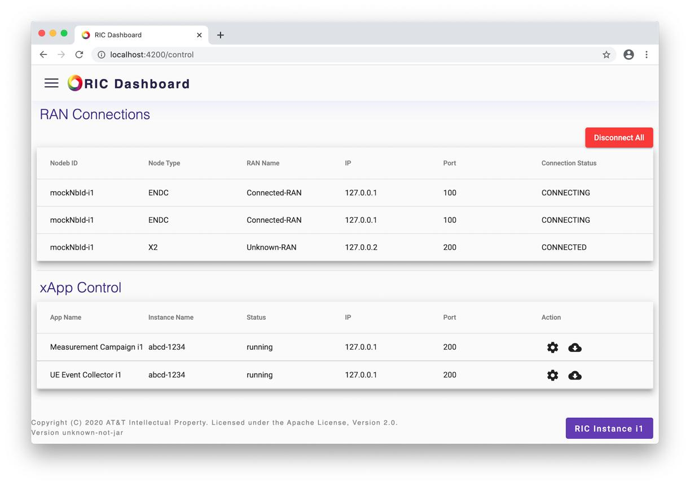

برای یک دموی آموزشی می‌توانیم این سناریو را اجرا کنیم:

1. راه‌اندازی OAI gNB
2. راه‌اندازی FlexRIC
3. اتصال RAN به RIC از طریق E2
4. اجرای یک xApp برای پایش KPI
5. مشاهده اطلاعات کاربران و سلول‌ها
6. بررسی تصمیم‌های کنترلی xApp

(دموی پیشنهادی)

**‏KPI Monitoring + Traffic Steering**

در این دمو ابتدا اطلاعات شبکه را مشاهده می‌کنیم و سپس نشان می‌دهیم چگونه یک برنامه می‌تواند از این اطلاعات برای بهینه‌سازی استفاده کند.

منبع آموزشی: [FlexRIC Tutorial: xApp Development – OpenAirInterface](https://openairinterface.org/flexric-tutorial-xapp-development/).

---

## اسلاید ۱۳ ـ جمع‌بندی

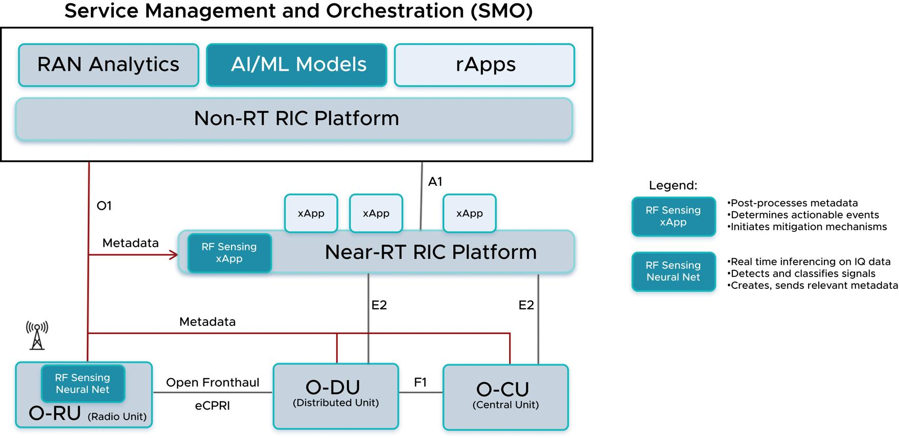

| مفهوم | تعریف یک‌خطی |
| --- | --- |
| O-RAN | معماری باز و هوشمند شبکه رادیویی |
| RIC | کنترل‌کننده هوشمند شبکه |
| Non-RT RIC | تحلیل و سیاست‌گذاری بلندمدت |
| Near-RT RIC | کنترل نزدیک به زمان واقعی |
| xApp | برنامه اجرایی روی Near-RT RIC |
| E2 | ارتباط RIC با RAN |
| A1 | ارتباط دو سطح RIC |

**سه جمله‌ای که باید مخاطب به خاطر بسپارد:**

- ‏O-RAN شبکه را باز و قابل توسعه می‌کند.
- ‏RIC امکان کنترل و بهینه‌سازی هوشمند شبکه را فراهم می‌کند.
- ‏xApp الگوریتم‌ها و قابلیت‌های جدید را به شبکه اضافه می‌کند.

---

## منابع تکمیلی برای ارائه

1. [O-RAN Architecture Overview](https://docs.o-ran-sc.org/en/f-release/architecture/architecture.html)
2. [O-RAN WG3 – Near-RT RIC and E2](https://www.o-ran.org/technical-groups/wg3)
3. [O-RAN Software Community – xApps](https://docs.o-ran-sc.org/en/latest/projects.html)
4. [OpenAirInterface FlexRIC](https://openairinterface.org/oam/)
5. [آموزش توسعه xApp با FlexRIC](https://openairinterface.org/flexric-tutorial-xapp-development/)

## زمان‌بندی پیشنهادی تدریس

| مبحث | زمان |
| --- | --- |
| نیاز به O-RAN و معماری آن | ۴ دقیقه |
| معرفی RIC و انواع آن | ۴ دقیقه |
| xApp و رابط‌های ارتباطی | ۴ دقیقه |
| مثال ازدحام و AI | ۳ دقیقه |
| دمو و جمع‌بندی | ۳ دقیقه |
| **مجموع** | **۱۸ دقیقه** |

