tags:
  - sionna
### Next Steps
- [[nvidia-ai-ran]]

[https://nvlabs.github.io/sionna/sys/index.html](https://nvlabs.github.io/sionna/sys/index.html)

# ارائه آموزشی: Sionna Research Kit (SRK)

موضوع: تبدیل الگوریتم‌های AI و ML به قابلیت‌های عملیاتی در شبکه واقعی 5G

1. **نیاز:** چرا به یک بستر آزمایش واقعی برای AI-RAN نیاز داریم؟
2. **راهکار:** Sionna Research Kit چگونه این نیاز را برطرف می‌کند؟
3. **اجرا:** چه اجزایی دارد و چگونه راه‌اندازی می‌شود؟
4. **نتیجه:** چه آزمایش‌هایی می‌توان انجام داد و چه خروجی‌هایی می‌گیریم؟

تمرکز بر مفهوم و کاربرد است؛ نه جزئیات کدنویسی، پیکربندی یا ریاضیات.

---

## اسلاید ۱ — مسئله اصلی: فاصله بین شبیه‌سازی و شبکه واقعی

**نیاز چیست؟**

- بسیاری از الگوریتم‌های AI در محیط شبیه‌سازی توسعه داده می‌شوند.
- اما عملکرد آن‌ها در شبکه واقعی ممکن است متفاوت باشد.
- اجرای الگوریتم‌های جدید در تجهیزات واقعی 5G دشوار است.
- به بستری نیاز داریم که امکان آزمایش الگوریتم‌های جدید را در شرایط نزدیک به شبکه واقعی فراهم کند.

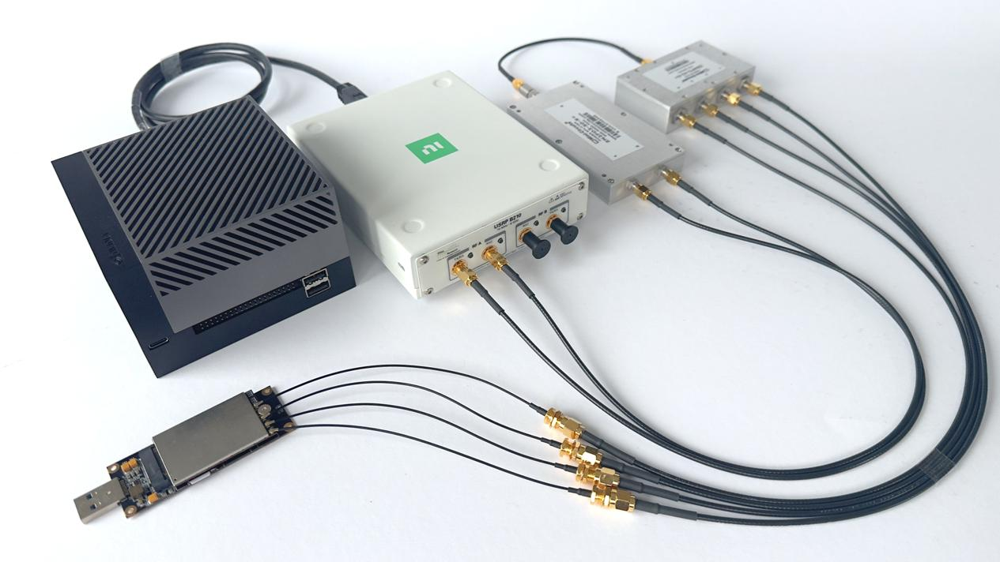

**پیام اصلی اسلاید:** فقط طراحی الگوریتم کافی نیست؛ باید بتوانیم آن را در یک شبکه واقعی نیز آزمایش کنیم.

---

## اسلاید ۲ — راهکار: Sionna Research Kit چیست؟

‏**Sionna Research Kit یا SRK** یک بستر تحقیقاتی و آزمایشگاهی برای توسعه و آزمایش الگوریتم‌های ارتباطات بی‌سیم و AI-RAN است.

قابلیت‌های اصلی:

- اجرای یک شبکه نرم‌افزارمحور 5G
- استفاده از OpenAirInterface
- پردازش شتاب‌یافته با GPU
- آزمایش الگوریتم‌های AI و ML
- اتصال به تجهیزات رادیویی واقعی
- اجرای آزمایش از شبیه‌سازی تا محیط رادیویی واقعی

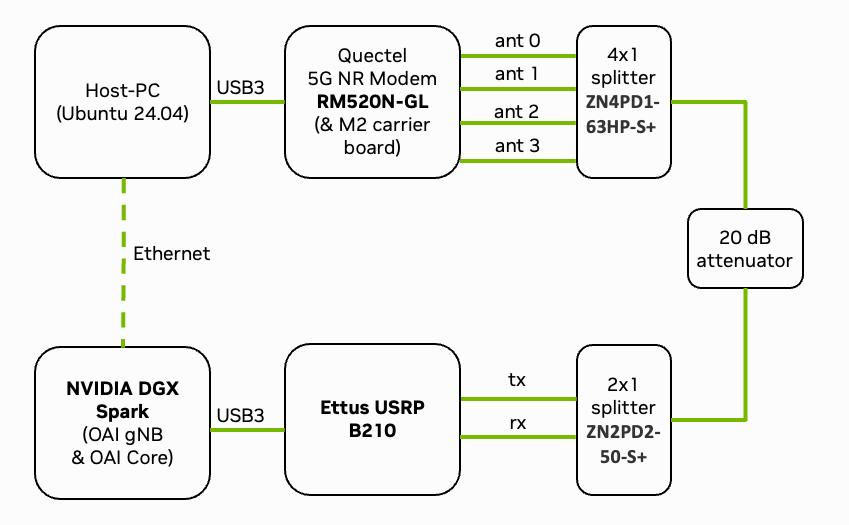

**پیام اصلی:** SRK پلی بین تحقیقات هوش مصنوعی و پیاده‌سازی آن در شبکه واقعی 5G است. 

[Sionna 2.2.0](https://nvlabs.github.io/sionna/rk/index.html) · [Sionna 2.2.0](https://nvlabs.github.io/sionna/rk/)

---

## اسلاید ۳ — معماری کلی Sionna Research Kit

‏SRK چند فناوری را در یک محیط یکپارچه کنار هم قرار می‌دهد:

- **‏DGX Spark:** بستر پردازشی و شتاب‌دهنده هوش مصنوعی
- **‏OpenAirInterface:** پیاده‌سازی نرم‌افزاری شبکه 5G
- **‏USRP:** تجهیزات رادیویی برای ارسال و دریافت سیگنال
- **‏Sionna:** ابزارهای توسعه و آزمایش الگوریتم‌های مخابراتی
- **‏AI/ML:** الگوریتم‌های یادگیری و بهینه‌سازی

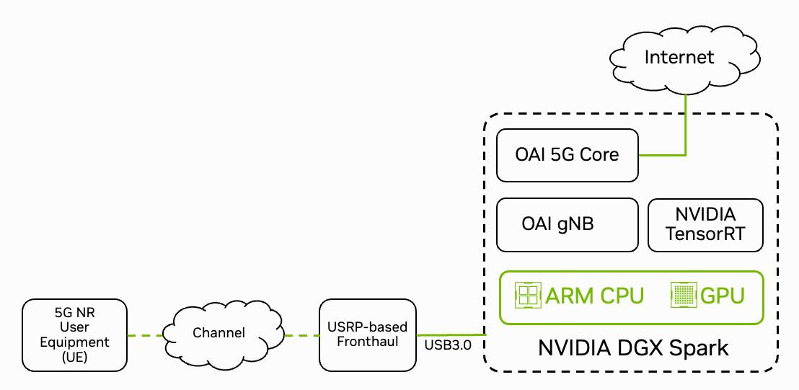

**پیام اصلی:** به‌جای ساخت یک آزمایشگاه از صفر، اجزای اصلی در قالب یک پلتفرم تحقیقاتی کنار هم قرار گرفته‌اند.

## اسلاید ۴ — اجزای سخت‌افزاری مورد نیاز

برای اجرای آزمایش‌های رادیویی واقعی، به چند قطعه اصلی نیاز داریم:

| تجهیز | وظیفه |
| --- | --- |
| NVIDIA DGX Spark | پردازش AI و اجرای الگوریتم‌ها |
| USRP B210 | ارسال و دریافت سیگنال رادیویی |
| مودم Quectel 5G | شبیه‌سازی یا اتصال تجهیزات کاربر |
| سیم‌کارت قابل برنامه‌ریزی | احراز هویت در شبکه خصوصی |
| آنتن و تجهیزات RF | ارتباط رادیویی |

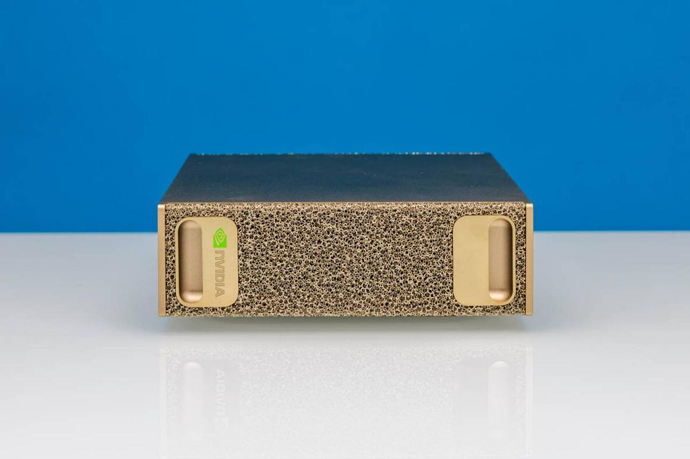

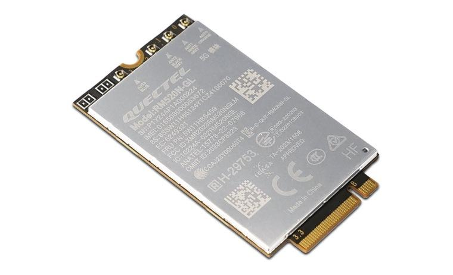

**نکته :** SRK صرفاً یک نرم‌افزار نیست؛ برای آزمایش واقعی از سخت‌افزار پردازشی و رادیویی استفاده می‌کند. در مستندات فعلی NVIDIA، DGX Spark و USRP از تجهیزات پیشنهادی اصلی هستند. 

[Sionna 2.2.0](https://nvlabs.github.io/sionna/rk/quickstart.html) · [Sionna 2.2.0](https://nvlabs.github.io/sionna/rk/index.html)

---

## اسلاید ۵ — معماری نرم‌افزاری

در بخش نرم‌افزار، SRK از چند لایه تشکیل شده است:

- **‏5G Core:** مدیریت هسته شبکه
- **‏5G RAN:** پیاده‌سازی ایستگاه پایه
- **‏OpenAirInterface:** اجرای اجزای شبکه 5G
- **‏FlexRIC:** نظارت و کنترل هوشمند RAN
- **‏AI/ML Plugins:** اضافه کردن الگوریتم‌های یادگیری ماشین
- **‏Sionna:** توسعه و آزمایش الگوریتم‌های مخابراتی

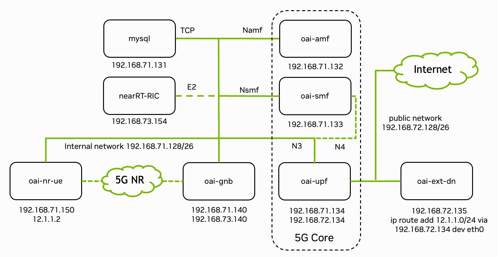

**نکته مهم:** OpenAirInterface زیرساخت شبکه را فراهم می‌کند و SRK امکان توسعه و آزمایش الگوریتم‌های جدید را روی این زیرساخت فراهم می‌کند. 

[Sionna 2.2.0](https://nvlabs.github.io/sionna/rk/index.html) · [Sionna 2.2.0](https://nvlabs.github.io/sionna/rk/tutorials/ric_xapps/index.html)

---

## اسلاید ۶ — روند کلی اجرای یک آزمایش

برای درک بهتر، مسیر اجرای یک آزمایش را در نظر بگیریم:

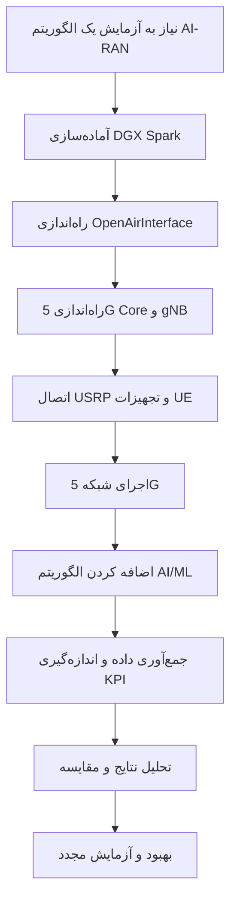

**پیام اصلی:** الگوریتم را توسعه می‌دهیم، وارد شبکه می‌کنیم، عملکرد آن را اندازه می‌گیریم و سپس بهبود می‌دهیم.

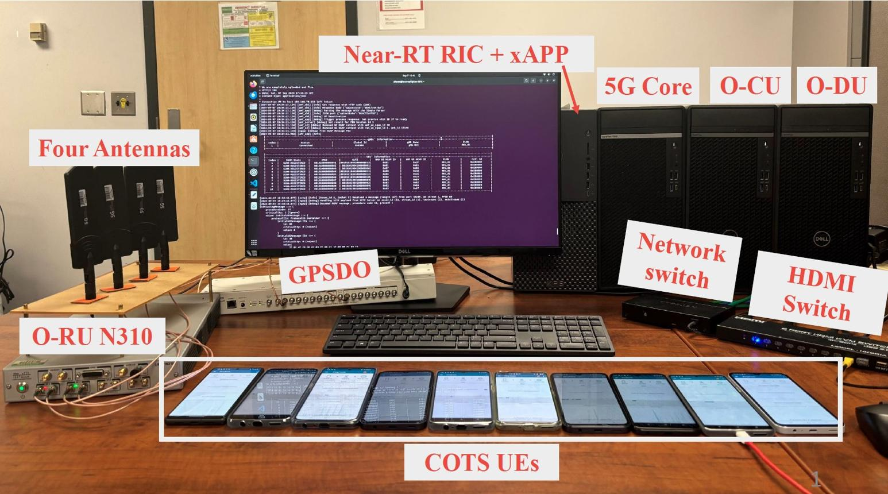

---

## اسلاید ۷ — سه روش آزمایش در SRK

یکی از ویژگی‌های مهم SRK امکان آزمایش در شرایط مختلف است.

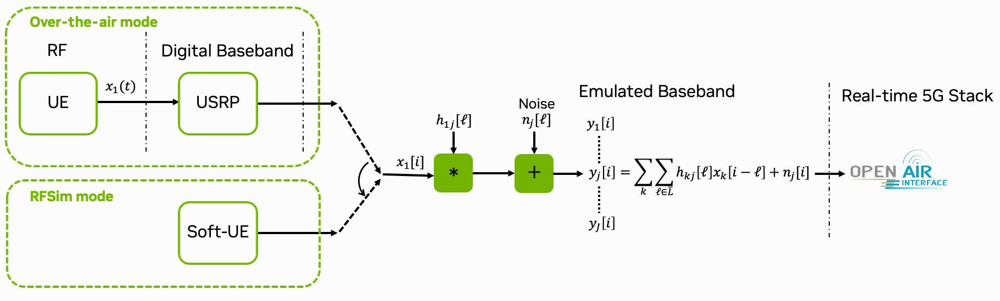 
‏ **۱. شبیه‌سازی رادیویی

بدون نیاز به ارسال واقعی امواج رادیویی، اجزای شبکه را اجرا و بررسی می‌کنیم.

---

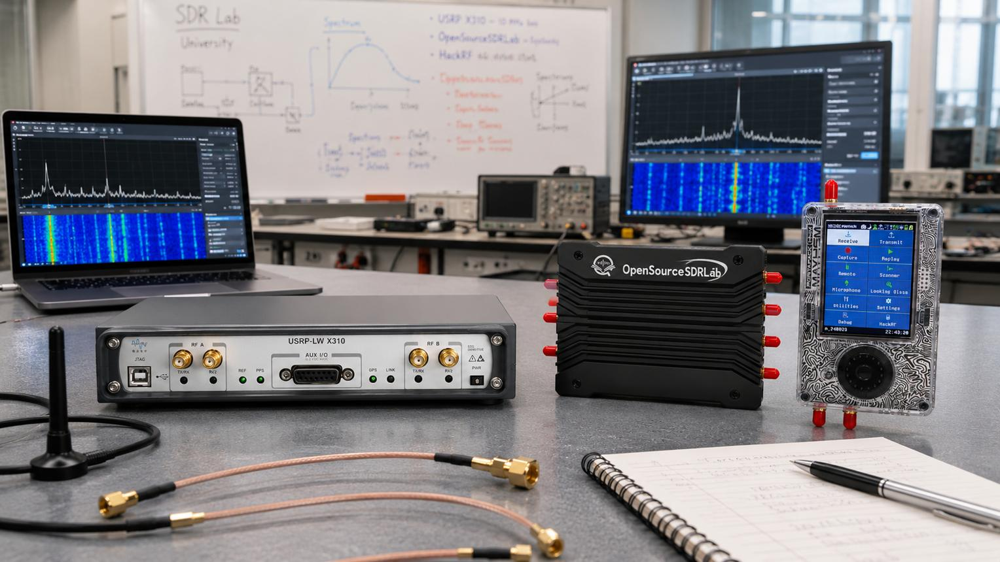

‏ ‏۲. آزمایش کابلی

تجهیزات رادیویی از طریق کابل RF به یکدیگر متصل می‌شوند؛ مناسب آزمایش کنترل‌شده.

---

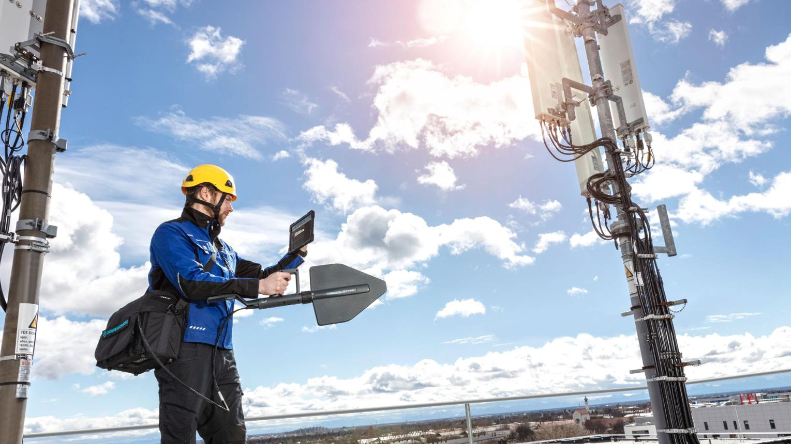 · **۳. آزمایش بی‌سیم واقعی (Over-the-Air)**

ارسال و دریافت واقعی امواج رادیویی با تجهیزات و آنتن انجام می‌شود.

**پیام اصلی:** می‌توان از محیط کنترل‌شده شروع کرد و به‌تدریج به آزمایش واقعی رادیویی رسید.

توجه: آزمایش Over-the-Air باید مطابق مقررات فرکانسی و مجوزهای محلی انجام شود.

 

[Sionna 2.2.0](https://nvlabs.github.io/sionna/rk/quickstart.html) · [Sionna 2.2.0](https://nvlabs.github.io/sionna/rk/tutorials/channel_emulation/channel_emulation.html)

---

## اسلاید ۸ — قابلیت‌های AI در SRK

مهم‌ترین کاربرد این پلتفرم، امکان جایگزین کردن یا بهبود بخش‌هایی از پردازش سنتی مخابرات با الگوریتم‌های هوش مصنوعی است.

چند نمونه:

- **‏Neural Receiver:** استفاده از شبکه عصبی در بخش گیرنده
- **‏Neural Demapper:** استفاده از یادگیری ماشین برای تشخیص داده دریافتی
- **‏GPU-Accelerated LDPC:** افزایش سرعت پردازش کدهای تصحیح خطا
- **‏Link Adaptation:** بهینه‌سازی پارامترهای ارسال بر اساس شرایط کانال

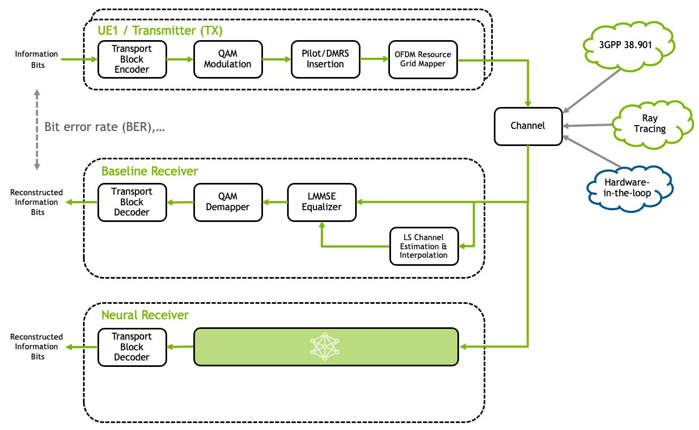

**مثال ساده:** به‌جای استفاده صرف از الگوریتم‌های سنتی برای تشخیص سیگنال دریافتی، یک مدل آموزش‌دیده می‌تواند این وظیفه را انجام دهد.

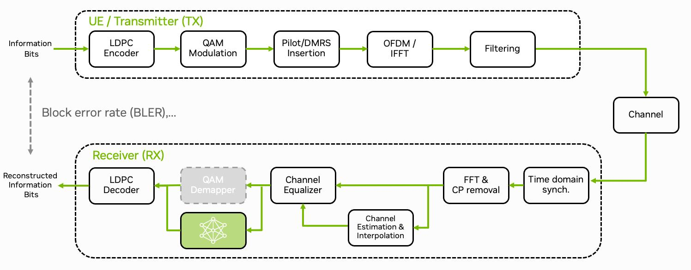

**نتیجه:** امکان مقایسه پردازش سنتی و پردازش مبتنی بر AI در یک شبکه 5G فراهم می‌شود. 

[Sionna 2.1.0](https://nvlabs.github.io/sionna/rk/tutorials.html) · [NVIDIA Technical Blog](https://developer.nvidia.com/blog/?p=107565)

---

## اسلاید ۹ — اتصال AI به شبکه واقعی

یکی از مهم‌ترین مثال‌های SRK، انتقال یک مدل آموزش‌دیده از محیط توسعه به شبکه واقعی است.

روند کار:

1. آموزش مدل در محیط توسعه و شبیه‌سازی
2. آماده‌سازی مدل برای اجرا
3. استفاده از TensorRT برای استنتاج سریع
4. اتصال مدل به زنجیره پردازش 5G
5. بررسی عملکرد مدل در شبکه واقعی

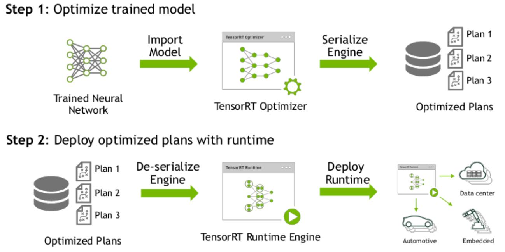

**مثال کاربردی:** یک Neural Receiver آموزش می‌بیند و سپس در زنجیره گیرنده شبکه 5G قرار می‌گیرد تا سیگنال‌های واقعی را پردازش کند.

این موضوع یکی از نمونه‌های مهم AI-in-RAN است. 

[Research](https://research.nvidia.com/publication/2025-05_sionna-research-kit-gpu-accelerated-research-platform-ai-ran) · [NVIDIA Technical Blog](https://developer.nvidia.com/blog/?p=107565)

---

## اسلاید ۱۰ — ارتباط SRK با RIC و xApp

‏SRK فقط برای پردازش سیگنال نیست؛ امکان کار با معماری O-RAN و کنترل هوشمند شبکه را هم فراهم می‌کند.

در این بخش از FlexRIC استفاده می‌شود.

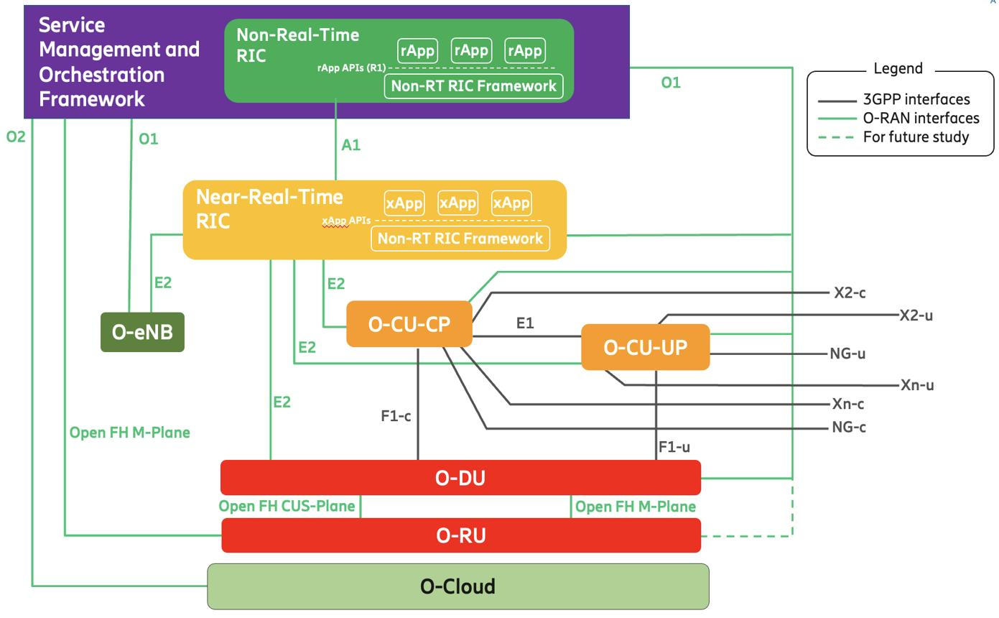

**مثال آموزشی در مستندات SRK:**

یک xApp طراحی می‌شود که دو شاخص شبکه را از gNB دریافت می‌کند:

- ‏MCS: وضعیت روش مدولاسیون و کدگذاری
- ‏BLER: نرخ خطای بلوک‌ها

سپس اطلاعات برای پایش و تحلیل وضعیت شبکه استفاده می‌شود.

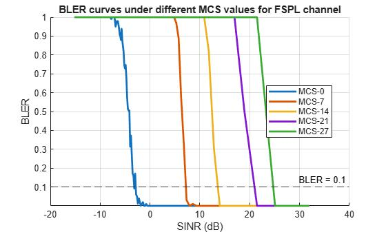

**پیام اصلی:** می‌توان علاوه بر پردازش هوشمند سیگنال، از AI برای پایش و کنترل هوشمند RAN نیز استفاده کرد. 

[Sionna 2.2.0](https://nvlabs.github.io/sionna/rk/tutorials/ric_xapps/index.html)

---

## اسلاید ۱۱ — نمونه آزمایش‌های آماده SRK

در مستندات NVIDIA چند آزمایش کاربردی ارائه شده است:

| آزمایش | هدف |
| --- | --- |
| Neural Demapper | جایگزینی پردازش سنتی با مدل عصبی |
| Neural Receiver | پردازش سیگنال با شبکه عصبی |
| LDPC Decoding | شتاب‌دهی تصحیح خطا |
| Link Adaptation | تنظیم تطبیقی پارامترهای ارسال |
| RIC & xApps | پایش و کنترل شبکه |
| Channel Emulator | شبیه‌سازی کانال رادیویی |

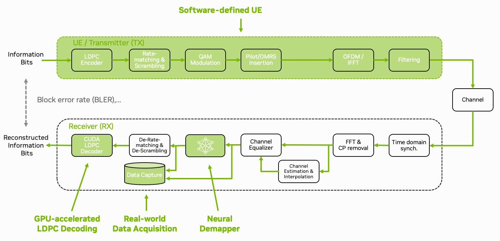

**نکته:** این موارد صرفاً ایده‌های تحقیقاتی نیستند؛ برای آن‌ها آموزش‌ها و نمونه‌های اجرایی در مستندات SRK وجود دارد. 

[Sionna 2.1.0](https://nvlabs.github.io/sionna/rk/tutorials.html) · [Sionna 2.2.0](https://nvlabs.github.io/sionna/rk/index.html)

---

## اسلاید ۱۲ — خروجی نهایی چه خواهد بود؟

پس از راه‌اندازی SRK می‌توانیم:

- یک شبکه خصوصی 5G راه‌اندازی کنیم.
- تجهیزات کاربر را به شبکه متصل کنیم.
- ارتباط Downlink و Uplink را آزمایش کنیم.
- ‏Throughput و عملکرد شبکه را اندازه‌گیری کنیم.
- الگوریتم‌های AI را در زنجیره پردازش شبکه اجرا کنیم.
- عملکرد الگوریتم‌های سنتی و هوشمند را مقایسه کنیم.

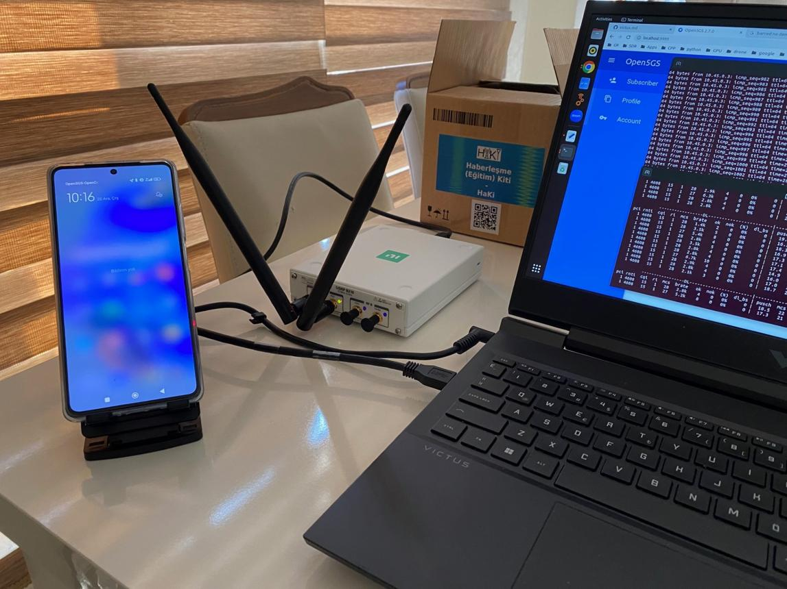

**نتیجه مهم:** به‌جای مشاهده صرف نتایج شبیه‌سازی، می‌توان عملکرد الگوریتم را در یک شبکه 5G عملیاتی ارزیابی کرد. 

[Sionna 2.2.0](https://nvlabs.github.io/sionna/rk/quickstart.html) · [NVIDIA Technical Blog](https://developer.nvidia.com/blog/?p=107565)

---

## اسلاید ۱۳ — محدودیت‌ها و پیش‌نیازها

‏SRK یک آزمایشگاه تحقیقاتی است و برای اجرای کامل آن باید پیش‌نیازهای سخت‌افزاری و نرم‌افزاری را در نظر گرفت.

- نیاز به سخت‌افزار پردازشی مناسب
- نیاز به تجهیزات SDR مانند USRP برای آزمایش واقعی
- نیاز به آشنایی با OpenAirInterface و Docker
- نیاز به تنظیمات شبکه و تجهیزات 5G
- رعایت مقررات فرکانسی در آزمایش‌های بی‌سیم

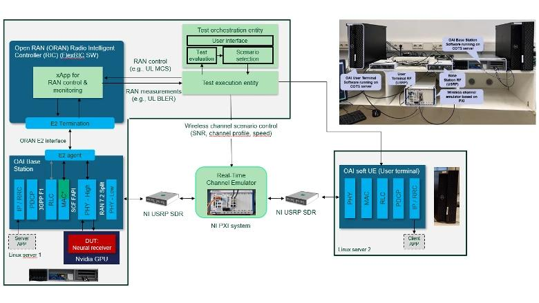

**نکته مدرس:** SRK را نباید با یک نرم‌افزار ساده قابل نصب روی هر لپ‌تاپ اشتباه گرفت. می‌توان برخی آموزش‌ها و بخش‌های نرم‌افزاری را جداگانه بررسی کرد، اما اجرای کامل آزمایشگاه به تجهیزات سازگار نیاز دارد. 

[Sionna 2.2.0](https://nvlabs.github.io/sionna/rk/quickstart.html) · [Sionna 2.2.0](https://nvlabs.github.io/sionna/rk/setup/spark.html)

---

## اسلاید ۱۴ — جمع‌بندی: جایگاه SRK در اکوسیستم AI-RAN

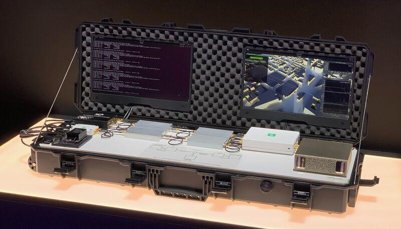

| فناوری | نقش |
| --- | --- |
| Sionna RT | مدل‌سازی انتشار امواج رادیویی |
| Sionna PHY | شبیه‌سازی پردازش لایه فیزیکی |
| Sionna SYS | شبیه‌سازی عملکرد سیستم |
| OpenAirInterface | پیاده‌سازی شبکه 5G |
| FlexRIC | کنترل و پایش هوشمند RAN |
| Sionna Research Kit | آزمایش و استقرار الگوریتم‌ها در شبکه واقعی |

**جمع‌بندی نهایی:**

Sionna Research Kit کمک می‌کند مسیر توسعه یک الگوریتم هوش مصنوعی را از مرحله تحقیق و شبیه‌سازی تا آزمایش در شبکه واقعی 5G طی کنیم.

---

## نمودار نهایی برای ارائه

این نمودار ارتباط اجزای مختلف را به‌صورت خلاصه نشان می‌دهد:

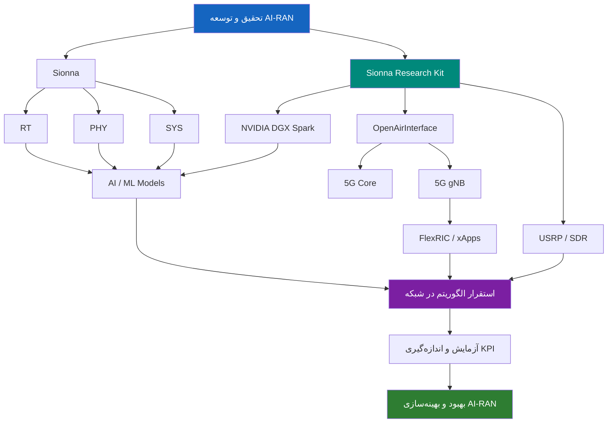

## پیشنهاد نحوه ارائه و نمایش عملی

برای اینکه این بخش از ارائه صرفاً تئوری نباشد، پیشنهاد می‌کنم سه خروجی را به مخاطب نشان دهید:

1. تصویر معماری سخت‌افزار SRK و اتصال USRP.
2. نمودار معماری OAI و FlexRIC.
3. ویدئو یا اجرای نمونه Neural Receiver و نمایش نتیجه پردازش.

**منابع اصلی برای مطالعه و تصاویر بیشتر:**

- [Sionna Research Kit – Documentation](https://nvlabs.github.io/sionna/rk/index.html)
- [Quickstart – راه‌اندازی اولیه](https://nvlabs.github.io/sionna/rk/quickstart.html)
- [RIC & xApps Tutorial](https://nvlabs.github.io/sionna/rk/tutorials/ric_xapps/index.html)
- [فهرست آموزش‌های SRK](https://nvlabs.github.io/sionna/rk/tutorials.html)
- [GitHub – Source Code](https://github.com/NVlabs/sionna-rk)

---
