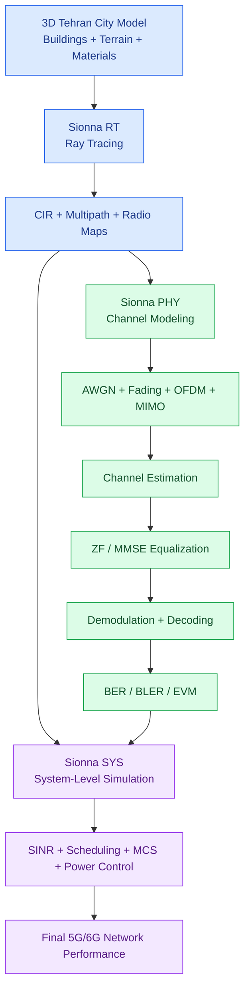

#  فیدینگ در مخابرات چیست؟

**‏Fading یا محوشدگی سیگنال** یکی از پدیده‌های مهم در مخابرات بی‌سیم (Wireless Communications) است که باعث می‌شود قدرت یا دامنه سیگنال رادیویی در زمان، مکان یا فرکانس تغییر کند.

به زبان ساده، فرض کن یک فرستنده (Base Station) سیگنالی را به سمت گوشی موبایل ارسال می‌کند. این سیگنال در مسیر خود با ساختمان‌ها، دیوارها، زمین، خودروها و سایر موانع برخورد می‌کند. در نتیجه، سیگنالی که به گیرنده می‌رسد ممکن است قدرت بسیار کمتری نسبت به سیگنال ارسالی داشته باشد یا حتی در لحظاتی تقریباً محو شود.


## ۱. چرا Fading اتفاق می‌افتد؟

مهم‌ترین دلایل ایجاد Fading عبارت‌اند از:

1. **‏Reflection (بازتاب):** برخورد امواج رادیویی با سطوحی مانند ساختمان‌ها و دیوارها.
2. **‏Diffraction (پراش):** خم شدن موج در اطراف موانع و لبه ساختمان‌ها.
3. **‏Scattering (پراکندگی):** برخورد موج با اجسام کوچک و سطوح ناهموار.
4. **‏Multipath Propagation (انتشار چندمسیری):** رسیدن نسخه‌های مختلف یک سیگنال از مسیرهای متفاوت به گیرنده.
5. **‏Mobility (تحرک):** حرکت فرستنده، گیرنده یا موانع که باعث تغییر شرایط انتشار می‌شود.

نکته بسیار مهم این است که در محیط شهری ممکن است چند نسخه از یک سیگنال در زمان‌های متفاوت و با فازهای متفاوت به گیرنده برسند.

این نسخه‌ها ممکن است یکدیگر را تقویت کنند (Constructive Interference) یا تضعیف کنند (Destructive Interference).


---


## ۲. انواع Fading

در مخابرات بی‌سیم معمولاً Fading را از دو دیدگاه بررسی می‌کنیم.

### الف) Large-Scale Fading

تغییرات توان سیگنال در مقیاس‌های مکانی نسبتاً بزرگ.

دو عامل مهم آن:

- **Path Loss:** کاهش توان سیگنال با افزایش فاصله از فرستنده.
- **Shadowing:** تضعیف سیگنال به دلیل وجود موانع بزرگ مانند ساختمان‌ها، تپه‌ها و سازه‌ها.


### ب) Small-Scale Fading

تغییرات سریع دامنه و فاز سیگنال در فاصله‌های کوتاه یا بازه‌های زمانی کوتاه، عمدتاً به دلیل تداخل چندمسیری و حرکت.


این نوع Fading برای طراحی و تحلیل سیستم‌های 4G و 5G بسیار مهم است.

## ۳. مدل‌های آماری Fading

برای شبیه‌سازی رفتار کانال رادیویی، چند مدل آماری متداول داریم:

 · **Rayleigh Fading**

زمانی استفاده می‌شود که مسیر مستقیم بین فرستنده و گیرنده وجود ندارد یا مؤلفه مستقیم غالبی نداریم (NLOS).

مثال: ارتباط موبایل در خیابان‌های باریک و متراکم شهری.

---

 · **Rician Fading**

زمانی اتفاق می‌افتد که علاوه بر مسیرهای بازتابی، یک مسیر مستقیم و نسبتاً قوی (LOS) نیز وجود داشته باشد.

مثال: ارتباط بین دو آنتن با دید مستقیم.

---

 · **Nakagami-m Fading**

یک مدل آماری انعطاف‌پذیر برای توصیف شرایط مختلف محوشدگی است که با پارامتر m کنترل می‌شود.

برای مطالعه بیشتر: 

[Stanford University](https://web.stanford.edu/class/ee359/pdfs/lecture6_handout.pdf) · [MATLAB & Simulink](https://www.mathworks.com/help/comm/ug/fading-channels.html) · [ee.iitm.ac.in](https://www.ee.iitm.ac.in/~giri/pdfs/EE5141/book1-tse.pdf)

## ۴. تقسیم‌بندی بر اساس سرعت تغییرات

دو دسته مهم دیگر داریم:

| نوع | توضیح |
| --- | --- |
| Slow Fading | تغییرات کانال نسبت به سرعت ارسال سمبل‌ها آهسته است. |
| Fast Fading | کانال در مقیاس زمانی ارسال سمبل‌ها سریع تغییر می‌کند. |

این موضوع به پارامتری به نام **Doppler Spread** وابسته است.

وقتی موبایل حرکت می‌کند، فرکانس دریافتی به دلیل اثر داپلر تغییر می‌کند:

$$
f_D=\frac{v}{\lambda}\cos(\theta)
$$

که در آن:

- $$
  v
  $$
  : سرعت حرکت گیرنده
- $$
  \lambda
  $$
  : طول موج
- $$
  \theta
  $$
  : زاویه حرکت نسبت به جهت انتشار موج

هرچه سرعت حرکت یا فرکانس حامل بیشتر باشد، معمولاً تغییرات زمانی کانال سریع‌تر خواهد بود.

## ۵. تقسیم‌بندی بر اساس پهنای باند

| نوع | مفهوم |
| --- | --- |
| Flat Fading | تقریباً تمام پهنای باند سیگنال به شکل مشابه تضعیف می‌شود. |
| Frequency Selective Fading | بخش‌های مختلف فرکانسی سیگنال تضعیف متفاوتی تجربه می‌کنند. |

این تفاوت به Delay Spread و Coherence Bandwidth وابسته است.

- تأخیرهای متفاوت مسیرهای انتشار می‌توانند باعث تداخل بین سمبل‌ها (ISI) شوند.
- در سیستم‌های OFDM مانند LTE و 5G، از تکنیک‌هایی برای مقابله با این مسئله استفاده می‌شود. 
  [University of Stuttgart](https://www.inue.uni-stuttgart.de/teaching/WirelessComms/) · [IEEE Technology Navigator](https://technav.ieee.org/area/communication-channels/) · [CMU School of Computer Science](https://www.cs.cmu.edu/~dpwu/books/EE/wireless/FadingChannel.html)

---

## ۶. تفاوت Fading و Path Loss و Shadowing

این سه مفهوم بسیار به هم مرتبط‌اند اما یکسان نیستند.


| مفهوم | عامل اصلی | مقیاس تغییر |
| --- | --- | --- |
| Path Loss | فاصله فرستنده و گیرنده | بزرگ |
| Shadowing | موانع بزرگ مانند ساختمان | متوسط تا بزرگ |
| Small-Scale Fading | تداخل امواج چندمسیری | کوچک و سریع |

برای مثال، در یک خیابان تهران:

- با دور شدن از BTS، Path Loss افزایش می‌یابد.
- پشت یک ساختمان قرار گرفتن باعث Shadowing می‌شود.
- حرکت چند سانتی‌متری موبایل ممکن است به دلیل تداخل چندمسیری باعث تغییر شدید توان دریافتی شود.

---

## ۷. ارتباط Fading با پروژه Radio Map و Ray Tracing

این قسمت برای پروژه بازسازی سه‌بعدی شهر تهران و شبیه‌سازی انتشار امواج اهمیت ویژه‌ای دارد.

در پروژه شما می‌توان مسئله را به سه لایه تقسیم کرد:

**Radio Propagation Modeling**

**Layer 1 – Large-Scale Propagation**

Path Loss + Shadowing

فاصله، ساختمان‌ها، زمین و موانع

↓

**Layer 2 – Deterministic Ray Tracing**

Reflection + Diffraction + Scattering

محاسبه مسیر، تأخیر، دامنه و فاز پرتوها

↓

**Layer 3 – Small-Scale Fading / Channel Modeling**

Multipath Interference + Doppler

محاسبه تغییرات سریع دامنه و فاز کانال

↓

**Final Radio Map / Channel Map**

RSRP، SINR، SNR، Coverage و Channel Characteristics

### Ray Tracing چگونه به Fading کمک می‌کند؟

فرض کن از یک BTS سه پرتو به گیرنده برسند:

| مسیر | دامنه | فاز |
| --- | --- | --- |
| مسیر مستقیم | 0.8 | 0° |
| بازتاب از ساختمان | 0.4 | 120° |
| بازتاب دوم | 0.2 | 240° |

سیگنال دریافتی حاصل جمع مختلط این پرتوهاست:

$$
h(t)=\sum_{i=1}^{N}a_i(t)e^{j\phi_i(t)}
$$

و توان کانال متناسب است با:

$$
P_r(t)\propto |h(t)|^2
$$

بنابراین فقط دانستن تعداد پرتوها یا توان هر پرتو کافی نیست؛ فاز و تأخیر آن‌ها نیز اهمیت دارند.

**نکته مهم:** Ray Tracing می‌تواند ساختار فیزیکی کانال چندمسیری را پیش‌بینی کند؛ اما برای مدل‌سازی دقیق Fading زمانی باید حرکت فرستنده، گیرنده یا محیط و تغییرات فاز مسیرها نیز لحاظ شود.

### پیشنهاد برای توسعه پروژه

با توجه به استفاده از OpenAirTwin و شبیه‌سازی سه‌بعدی، پیشنهاد می‌کنم این قابلیت‌ها را به ترتیب بررسی کنید:

1. **Rayleigh / Rician Channel:** شبیه‌سازی آماری Fading.
2. **Doppler Modeling:** بررسی تأثیر سرعت خودرو و موبایل.
3. **Delay Spread:** بررسی تأخیر مسیرهای مختلف.
4. **Frequency Selective Fading:** بررسی تأثیر Fading روی زیرحامل‌های OFDM.
5. **Channel Impulse Response (CIR):** استخراج پاسخ ضربه‌ای کانال از مسیرهای Ray Tracing.

برای مطالعه تخصصی، منابع زیر مناسب‌اند:

- [University of Stuttgart – Wireless Communications](https://www.inue.uni-stuttgart.de/teaching/WirelessComms/)
- [MathWorks – Fading Channels](https://www.mathworks.com/help/comm/ug/fading-channels.html)
- [Fundamentals of Wireless Communication – Tse & Viswanath](https://web.stanford.edu/~dntse/papers/book121004.pdf)

**یک تمایز کلیدی برای پروژه شما:** Radio Map معمولی عمدتاً نقشه توان دریافتی در نقاط مختلف است؛ اما Channel Map می‌تواند علاوه بر توان، اطلاعاتی مانند CIR، Delay Spread، Doppler و Fading را نیز در هر نقطه ارائه کند. این توسعه می‌تواند پروژه را از یک سیستم ساده پیش‌بینی پوشش رادیویی به یک محیط شبیه‌سازی پیشرفته کانال مخابراتی تبدیل کند.

* * *

**:**

# AWGN در مخابرات چیست؟

**AWGN مخفف Additive White Gaussian Noise** به معنی «نویز سفید گوسی افزایشی» است.

یکی از بنیادی‌ترین مدل‌های نویز در سیستم‌های مخابراتی دیجیتال و بی‌سیم است که برای شبیه‌سازی اختلالات موجود در کانال ارتباطی استفاده می‌شود.

به زبان ساده، فرض کن یک فرستنده (Base Station) سیگنالی را برای موبایل ارسال می‌کند. در مسیر انتقال، علاوه بر اثرات انتشار رادیویی، نویزهای الکترونیکی و حرارتی نیز روی سیگنال اثر می‌گذارند. AWGN یک مدل ریاضی برای توصیف این نویز است.


## ۱. معنی اجزای AWGN

نام AWGN از چهار بخش تشکیل شده است:

| اصطلاح | معنی | توضیح |
| --- | --- | --- |
| Additive | افزایشی | نویز به سیگنال اضافه می‌شود. |
| White | سفید | چگالی طیفی توان نویز در پهنای باند موردنظر ثابت است. |
| Gaussian | گوسی | دامنه نویز از توزیع نرمال پیروی می‌کند. |
| Noise | نویز | سیگنال ناخواسته و تصادفی |

مدل ریاضی AWGN به شکل زیر است:

$$
y(t)=x(t)+n(t)
$$

که در آن:

- $$
  x(t)
  $$
  : سیگنال ارسالی
- $$
  n(t)
  $$
  : نویز AWGN
- $$
  y(t)
  $$
  : سیگنال دریافتی

نویز معمولاً دارای میانگین صفر است:

$$
E[n(t)]=0
$$

و چگالی طیفی توان دوطرفه آن در مدل ایده‌آل برابر است با:

$$
S_n(f)=\frac{N_0}{2}
$$

که 

$$
N_0
$$

 چگالی طیفی توان نویز است.

## ۲. چرا به آن White Gaussian Noise می‌گویند؟

### Gaussian (گوسی)

دامنه نمونه‌های نویز از توزیع نرمال پیروی می‌کند.


تابع چگالی احتمال آن:

$$
p(n)=\frac{1}{\sqrt{2\pi\sigma^2}}
e^{-\frac{n^2}{2\sigma^2}}
$$

در این رابطه، 

$$
\sigma^2
$$

 واریانس نویز است.

### White (سفید)

یعنی توان نویز در واحد پهنای باند، در تمام فرکانس‌های مدل‌شده یکسان است.


این مفهوم مشابه نور سفید است که از ترکیب فرکانس‌های مختلف تشکیل شده است.

البته نویز سفید ایده‌آل در تمام فرکانس‌ها تعریف می‌شود؛ در سیستم واقعی پهنای باند گیرنده محدود است.

### Additive (افزایشی)

نویز به سیگنال اصلی اضافه می‌شود و مدل آن به شکل جمع ریاضی است، نه ضرب.

---

## ۳. تفاوت AWGN و Fading

این دو مفهوم بسیار مهم‌اند و نباید با یکدیگر اشتباه گرفته شوند.

| ویژگی | AWGN | Fading |
| --- | --- | --- |
| ماهیت | نویز افزایشی | تغییرات کانال |
| علت | نویز حرارتی و الکترونیکی | انتشار چندمسیری و حرکت |
| اثر | ایجاد اختلال در سیگنال | تغییر دامنه و فاز |
| مدل متداول | Gaussian Distribution | Rayleigh / Rician |
| وابستگی به محیط | عمدتاً مستقل از هندسه انتشار | وابسته به کانال و محیط |

> Interactive content unavailable: AsyncImageGroup

نکته مهم: AWGN و Fading می‌توانند هم‌زمان وجود داشته باشند.

در واقع یک مدل واقعی‌تر کانال مخابراتی می‌تواند به شکل زیر باشد:

$$
y(t)=h(t)*x(t)+n(t)
$$

که در آن:

- $$
  h(t)
  $$
  : پاسخ کانال شامل اثرات Fading
- $$
  *
  $$
  : عملگر کانولوشن
- $$
  n(t)
  $$
  : نویز AWGN

---

## ۴. ارتباط AWGN با SNR و SINR

یکی از مهم‌ترین پارامترهای بررسی کیفیت ارتباط، نسبت سیگنال به نویز است.

**SNR = Signal-to-Noise Ratio**

$$
SNR=\frac{P_{signal}}{P_{noise}}
$$

برحسب دسی‌بل:

$$
SNR_{dB}=10\log_{10}
\left(\frac{P_{signal}}{P_{noise}}\right)
$$

مثلاً:

| SNR | وضعیت کلی |
| --- | --- |
| 0 dB | توان سیگنال و نویز برابر |
| 5 dB | نویز قابل‌توجه |
| 10 dB | نسبت سیگنال به نویز مناسب‌تر |
| 20 dB | کیفیت بهتر |
| 30 dB | نویز نسبتاً کم |

البته کیفیت واقعی ارتباط به نوع مدولاسیون، کدینگ و شرایط کانال نیز بستگی دارد.

تفاوت SNR و SINR:

- SNR فقط نویز را در نظر می‌گیرد.
- SINR علاوه بر نویز، تداخل سایر فرستنده‌ها را نیز لحاظ می‌کند.

$$
SINR=\frac{P_{signal}}
{P_{interference}+P_{noise}}
$$

در شبکه‌های سلولی 4G و 5G، SINR اهمیت بسیار زیادی دارد.

## ۵. ارتباط AWGN با مدولاسیون دیجیتال

AWGN برای ارزیابی عملکرد روش‌های مدولاسیون استفاده می‌شود.

برای مثال:


**QPSK بدون نویز**


**QPSK همراه نویز**

در حالت بدون نویز، نقاط صورت فلکی (Constellation) در موقعیت‌های مشخص قرار دارند.

با اضافه شدن AWGN، نقاط اطراف موقعیت اصلی پخش می‌شوند.

اگر نویز زیاد شود، احتمال تشخیص اشتباه سمبل‌ها افزایش می‌یابد.

این موضوع با پارامتر BER سنجیده می‌شود:

**BER = Bit Error Rate**

$$
BER=\frac{N_{error}}{N_{total}}
$$

---

## ۶. کاربرد AWGN در پروژه OpenAirTwin و Radio Map

برای پروژه شبیه‌سازی انتشار امواج و بررسی رفتار کانال در محیط سه‌بعدی تهران، می‌توان AWGN را در کنار Fading و Ray Tracing بررسی کرد.

معماری پیشنهادی:

**Transmitter**

QPSK / QAM / OFDM

↓

**Radio Propagation Channel**

Ray Tracing + Path Loss + Multipath + Fading

↓

**AWGN Noise Addition**

Noise Power + SNR Configuration

↓

**Receiver**

Channel Estimation + Equalization + Demodulation

↓

**Performance Evaluation**

BER + BLER + SNR + SINR + EVM

### یک مثال عملی

فرض کن در یک محیط شهری سه حالت را بررسی می‌کنیم:

1. ارتباط مستقیم (LOS) بدون Fading قابل‌توجه.
2. ارتباط غیرمستقیم (NLOS) با Rayleigh Fading.
3. ارتباط با Rician Fading و وجود مسیر مستقیم.

در هر سه حالت، AWGN اضافه می‌کنیم و سپس BER را در SNRهای مختلف اندازه‌گیری می‌کنیم.

به این ترتیب می‌توانیم بررسی کنیم که ساختمان‌ها، مسیرهای چندگانه و نویز چگونه بر کیفیت ارتباط اثر می‌گذارند.

## ۷. ارتباط با Sionna

در چارچوب شبیه‌سازی مخابراتی Sionna، ماژول‌های مختلفی برای این موضوع وجود دارند:

- `AWGN`: اضافه کردن نویز سفید گوسی.
- `RayleighBlockFading`: شبیه‌سازی Rayleigh Fading.
- `TDL`: مدل کانال چندمسیری با تأخیرهای مختلف.
- `CDL`: مدل کانال مبتنی بر ساختار خوشه‌ای مسیرها.
- `OFDM`: شبیه‌سازی سیستم انتقال چندحاملی.

مستندات: [Sionna Documentation](https://nvlabs.github.io/sionna/)

---

## جمع‌بندی: تفاوت سه مفهوم کلیدی

**Path Loss**

چرا با دور شدن از فرستنده، توان سیگنال کاهش پیدا می‌کند؟

---

**Fading**

چرا سیگنال به دلیل تداخل مسیرهای مختلف، دچار تغییرات دامنه و فاز می‌شود؟

---

**AWGN**

چرا حتی در حضور یک کانال مناسب، نویز روی سیگنال دریافتی وجود دارد؟

**پیشنهاد من:** برای درک عمیق‌تر OpenAirTwin، بهتر است این سه مفهوم را در کنار مفاهیم Channel Impulse Response (CIR)، Doppler Spread و OFDM مطالعه کنی؛ چون این مجموعه به تو کمک می‌کند از پیش‌بینی صرف پوشش رادیویی به شبیه‌سازی واقعی‌تر عملکرد لینک مخابراتی (Physical Layer) برسی.

* * *

**:**

# Equalization (اکولایز کردن) در مخابرات چیست؟

**Equalization یا هم‌سطح‌سازی کانال** یکی از مهم‌ترین تکنیک‌های پردازش سیگنال در مخابرات دیجیتال است که برای جبران اثرات نامطلوب کانال ارتباطی استفاده می‌شود.

به زبان ساده، وقتی فرستنده یک سیگنال را ارسال می‌کند، این سیگنال ممکن است در مسیر انتشار دچار موارد زیر شود:

- تضعیف دامنه (Attenuation)
- تغییر فاز (Phase Distortion)
- انتشار چندمسیری (Multipath Propagation)
- تداخل بین سمبل‌ها (Inter-Symbol Interference یا ISI)
- محوشدگی فرکانس‌گزین (Frequency Selective Fading)

اکولایزر تلاش می‌کند اثر این اختلالات را جبران کند تا گیرنده بتواند اطلاعات اصلی را با خطای کمتری بازیابی کند.


## ۱. چرا به Equalization نیاز داریم؟

فرض کن فرستنده دنباله‌ای از سمبل‌ها را ارسال می‌کند:

$$
x=[1,0,1,1,0,1]
$$

اما به دلیل انتشار چندمسیری، نسخه‌های تأخیردار سیگنال نیز به گیرنده می‌رسند.

در نتیجه، سمبل‌های قبلی روی سمبل‌های بعدی اثر می‌گذارند.

این پدیده را ISI می‌نامیم.


برای مثال، اگر سمبل اول با تأخیر به گیرنده برسد، ممکن است با سمبل دوم تداخل پیدا کند و گیرنده نتواند مقدار واقعی سمبل دوم را به‌درستی تشخیص دهد.

**وظیفه Equalizer کاهش این تداخل و بازیابی سمبل‌های اصلی است.**

## ۲. اکولایزر چگونه کار می‌کند؟

فرض کنیم سیگنال ارسالی از یک کانال عبور می‌کند:

$$
y(t)=h(t)*x(t)+n(t)
$$

که در آن:

- $$
  x(t)
  $$
  : سیگنال ارسالی
- $$
  h(t)
  $$
  : پاسخ ضربه‌ای کانال
- $$
  n(t)
  $$
  : نویز
- $$
  y(t)
  $$
  : سیگنال دریافتی

اکولایزر تلاش می‌کند با استفاده از تخمین کانال، اثر 

$$
h(t)
$$

 را جبران کند.

در یک مدل ساده:

$$
\hat{x}(t)=w(t)*y(t)
$$

که 

$$
w(t)
$$

 پاسخ اکولایزر است.

هدف این است که:

$$
w(t)*h(t)\approx \delta(t)
$$

یعنی ترکیب کانال و اکولایزر تا حد امکان مانند یک کانال ایده‌آل با کمترین تداخل بین سمبل‌ها رفتار کند.


## ۳. انواع روش‌های Equalization

چند روش مهم در سیستم‌های مخابراتی وجود دارد:

### ۱. Zero Forcing (ZF)

در این روش اکولایزر تلاش می‌کند اثر کانال را به‌طور کامل معکوس کند.

در حوزه فرکانس:

$$
W_{ZF}(f)=\frac{1}{H(f)}
$$

مزیت:

- حذف تداخل کانال در شرایط ایده‌آل.

محدودیت:

- اگر کانال در یک فرکانس دارای تضعیف شدید باشد، معکوس کردن آن باعث تقویت شدید نویز می‌شود.

### ۲. Minimum Mean Square Error (MMSE)

این روش علاوه بر جبران اثر کانال، نویز را نیز در نظر می‌گیرد.

در یک مدل اسکالر ساده:

$$
W_{MMSE}=
\frac{H^*}{|H|^2+\frac{N_0}{E_s}}
$$

که در آن:

- $$
  H^*
  $$
  : مزدوج مختلط پاسخ کانال
- $$
  N_0
  $$
  : چگالی طیفی نویز
- $$
  E_s
  $$
  : انرژی سمبل

مزیت:

- ایجاد تعادل بین حذف تداخل و جلوگیری از تقویت بیش‌ازحد نویز.

### ۳. Decision Feedback Equalizer (DFE)

در این روش از تصمیم‌های قبلی گیرنده برای حذف تداخل سمبل‌های قبلی استفاده می‌شود.

مزیت:

- عملکرد مناسب در کانال‌های دارای ISI شدید.

محدودیت:

- تصمیم اشتباه می‌تواند به سمبل‌های بعدی منتقل شود (Error Propagation).


### ۴. Adaptive Equalization

در این روش ضرایب اکولایزر به‌صورت پویا تغییر می‌کنند تا با تغییر شرایط کانال سازگار شوند.

دو الگوریتم شناخته‌شده:

- LMS (Least Mean Squares)
- RLS (Recursive Least Squares)

این روش در محیط‌های متحرک که کانال دائماً تغییر می‌کند اهمیت زیادی دارد.

---

## ۴. Equalization در LTE و 5G چگونه انجام می‌شود؟

در فناوری‌های LTE و 5G NR از OFDM استفاده می‌شود.

در OFDM، اطلاعات روی تعداد زیادی زیرحامل (Subcarrier) منتقل می‌شوند.

به جای اینکه یک اکولایزر پیچیده برای کل سیگنال اعمال شود، در بسیاری از ساختارهای OFDM، اکولایزر روی هر زیرحامل انجام می‌شود.


اگر کانال در زیرحامل شماره 

$$
k
$$

 برابر 

$$
H[k]
$$

 باشد:

**Zero Forcing:**

$$
\hat{X}[k]=\frac{Y[k]}{H[k]}
$$

**MMSE:**

$$
\hat{X}[k]=
\frac{H^*[k]}
{|H[k]|^2+\sigma_n^2/E_s}
Y[k]
$$

این کار باعث می‌شود اثر تضعیف و تغییر فاز کانال روی هر زیرحامل جبران شود.

البته این روش معمولاً با فرض تخمین مناسب کانال و حذف کافی ISI بین بلوک‌های OFDM انجام می‌شود؛ برای همین از Cyclic Prefix نیز استفاده می‌کنند.

## ۵. تفاوت Channel Estimation و Equalization

این دو مفهوم به‌شدت به هم وابسته‌اند، اما وظایف متفاوتی دارند.

| مفهوم | وظیفه |
| --- | --- |
| Channel Estimation | تخمین رفتار و مشخصات کانال |
| Equalization | جبران اثرات کانال بر سیگنال دریافتی |

برای مثال:

1. فرستنده سیگنال‌های مرجع (Pilot Signals) ارسال می‌کند.
2. گیرنده با بررسی این سیگنال‌ها، پاسخ کانال را تخمین می‌زند.
3. اکولایزر از تخمین کانال استفاده می‌کند.
4. سیگنال اصلاح‌شده وارد Demodulator می‌شود.


## ۶. ارتباط Equalization با AWGN و Fading

این سه مفهوم در کنار هم عملکرد گیرنده را تعیین می‌کنند:

| پدیده | اثر | راهکار |
| --- | --- | --- |
| AWGN | اضافه شدن نویز | Filtering و روش‌های مقاوم در برابر نویز |
| Fading | تغییر دامنه و فاز | Channel Estimation و Equalization |
| ISI | تداخل بین سمبل‌ها | Equalization و Cyclic Prefix |

یک نکته مهم: Equalization نویز AWGN را به‌طور جادویی حذف نمی‌کند. حتی بعضی اکولایزرها، مانند ZF، ممکن است در فرکانس‌هایی که کانال تضعیف زیادی دارد نویز را تقویت کنند.

---

## ۷. ارتباط با پروژه OpenAirTwin و Ray Tracing

در پروژه شبیه‌سازی سه‌بعدی تهران، می‌توان یک زنجیره کامل شبیه‌سازی لایه فیزیکی طراحی کرد.

**Physical Layer Simulation Pipeline**

01 · **3D Environment**

ساختمان‌ها، زمین و مواد فیزیکی

↓

02 · **Ray Tracing**

محاسبه Reflection، Diffraction و Multipath

↓

03 · **Channel Modeling**

ساخت CIR، Fading و Doppler

↓

04 · **AWGN**

اضافه کردن نویز با SNR مشخص

↓

05 · **Channel Estimation**

تخمین کانال با استفاده از Pilot Signals

↓

06 · **Equalization**

جبران اثر کانال با ZF یا MMSE

↓

07 · **Demodulation**

بازیابی سمبل‌ها و محاسبه BER

### یک آزمایش پیشنهادی

برای درک عملی تفاوت اکولایزرها می‌توان یک آزمایش تعریف کرد:

- مدولاسیون: 16-QAM
- کانال: Multipath Fading
- نویز: AWGN
- اکولایزر اول: ZF
- اکولایزر دوم: MMSE

سپس BER را برای SNRهای مختلف اندازه‌گیری کرد.


## ۸. چند مفهوم مرتبط که ارزش مطالعه دارند

| مفهوم | کاربرد |
| --- | --- |
| Channel Impulse Response (CIR) | نمایش رفتار زمانی کانال |
| Channel Estimation | تخمین مشخصات کانال |
| Pilot Signals | سیگنال مرجع برای تخمین کانال |
| OFDM | انتقال اطلاعات روی زیرحامل‌ها |
| Cyclic Prefix | مقابله با ISI در OFDM |
| ZF / MMSE | الگوریتم‌های اکولایز کردن |
| MIMO Equalization | جبران تداخل بین آنتن‌های متعدد |

**نکته مهم برای ادامه یادگیری:** در OpenAirTwin و Sionna بهتر است بعد از شناخت AWGN و Fading، سراغ سه موضوع Channel Estimation، OFDM و MIMO Equalization بروی. این سه موضوع حلقه اتصال شبیه‌سازی انتشار امواج در محیط سه‌بعدی به شبیه‌سازی واقعی ارسال و دریافت داده در شبکه‌های 4G و 5G هستند.

* * *

**:**

بله. اتفاقاً **Sionna یکی از گزینه‌های بسیار مناسب برای پیاده‌سازی زنجیره‌ای است که درباره آن صحبت کردیم؛ از Ray Tracing و استخراج مشخصات کانال گرفته تا AWGN، Fading، Channel Estimation، Equalization و محاسبه BER.**

اما یک نکته مهم وجود دارد: این قابلیت‌ها بین سه بخش Sionna تقسیم شده‌اند و هر بخش مسئولیت متفاوتی دارد.

- **Sionna RT:** شبیه‌سازی فیزیکی انتشار امواج در محیط سه‌بعدی.
- **Sionna PHY:** شبیه‌سازی لایه فیزیکی مخابرات، شامل مدولاسیون، کانال، نویز، تخمین کانال و اکولایز کردن.
- **Sionna SYS:** شبیه‌سازی و ارزیابی عملکرد سیستم مخابراتی در سطح سیستم و شبکه.

برای پروژه سه‌بعدی تهران، ترکیب RT و PHY اهمیت ویژه‌ای دارد.

## ۱. مقایسه قابلیت‌های سه بخش Sionna

 · **

> Interactive content unavailable: Entity

**

(محیط انتشار امواج)

Ray Tracing، CIR، Radio Map و Multipath

---

 · **Sionna PHY**

(پردازش سیگنال و لایه فیزیکی)

AWGN، Fading، OFDM، MIMO، Estimation، Equalization و BER

---

 · **Sionna SYS**

(شبیه‌سازی سطح سیستم و شبکه)

SINR، BLER، MCS، Scheduling، Power Control و Link Adaptation

این تفکیک مطابق معماری مستندات رسمی نسخه 2.2 است. 

[Sionna 2.2.0](https://nvlabs.github.io/sionna/) · [GitHub](https://github.com/NVlabs/sionna)

## ۲. بررسی تک‌تک قابلیت‌هایی که مطرح کردیم

در جدول زیر مشخص کرده‌ام هر قابلیت در کدام بخش وجود دارد:

| قابلیت | RT | PHY | SYS |
| --- | --- | --- | --- |
| Ray Tracing | (اصلی) | — | — |
| Path Loss | (بله) | مدل کانال | (بله) |
| Multipath | (بله) | (بله) | انتزاعی |
| Rayleigh Fading | خروجی قابل استخراج از CIR | (بله) | مدل انتزاعی |
| Rician Fading | خروجی قابل استخراج از CIR | (بله) | مدل انتزاعی |
| AWGN | — | (بله) | در SINR/BLER |
| Channel Estimation | — | (بله) | انتزاعی |
| ZF Equalization | — | (بله) | محاسبه SINR متناظر |
| MMSE Equalization | — | (بله) | محاسبه SINR متناظر |
| OFDM | — | (بله) | منابع OFDM |
| MIMO | الگوهای آنتن و آرایه | (بله) | (بله) |
| BER | — | (بله) | معمولاً BLER |
| BLER | — | امکان ارزیابی لینک | (اصلی) |
| Scheduling | — | — | (بله) |
| Link Adaptation | — | — | (بله) |

نکته: بعضی قابلیت‌ها در بیش از یک بخش قابل استفاده‌اند، اما نحوه مدل‌سازی و سطح جزئیاتشان متفاوت است.

## ۳. قابلیت‌های مهم Sionna PHY

در نسخه جدید، ماژول PHY امکانات مشخصی برای پیاده‌سازی زنجیره پردازش سیگنال دارد.

### الف) نویز و کانال

| کلاس یا مدل | کاربرد |
| --- | --- |
| `AWGN` | اضافه کردن نویز گوسی |
| `RayleighBlockFading` | شبیه‌سازی Rayleigh |
| `TDL` | مدل کانال چندمسیری مبتنی بر 3GPP |
| `CDL` | مدل کانال خوشه‌ای 3GPP |
| `UMi` | مدل Urban Microcell |
| `UMa` | مدل Urban Macrocell |
| `RMa` | مدل Rural Macrocell |

مدل‌های TDL، CDL و مدل‌های 3GPP برای شبیه‌سازی کانال‌های واقعی‌تر بسیار کاربردی هستند. همچنین می‌توان CIR خارجی را به سیستم وارد کرد. 

[GitHub](https://github.com/NVlabs/sionna/blob/main/doc/source/phy/api/channel/wireless/index.rst) · [GitHub](https://github.com/NVlabs/sionna/releases)

### ب) Channel Estimation

قابلیت‌های مهم:

- LS Channel Estimation
- LMMSE Channel Estimation
- تخمین کانال در سیستم OFDM
- درون‌یابی تخمین کانال در زمان و فرکانس

در نسخه‌های جدید، `LMMSEChannelEstimator` نیز وجود دارد. 

[GitHub](https://github.com/NVlabs/sionna/releases)

### ج) Equalization

Sionna PHY اکولایزرهای زیر را ارائه می‌کند:

| اکولایزر | کاربرد |
| --- | --- |
| `ZFEqualizer` | حذف تداخل کانال با Zero Forcing |
| `LMMSEEqualizer` | تعادل بین تداخل و نویز |
| `lmmse_equalizer` | تابع اکولایز خطی MMSE |
| `zf_equalizer` | تابع اکولایز Zero Forcing |
| `mf_equalizer` | Matched Filter |

این قابلیت‌ها برای OFDM و MIMO قابل استفاده‌اند. 

[Sionna 2.2.0](https://nvlabs.github.io/sionna/_modules/sionna/phy/ofdm/equalization.html) · [Sionna 2.2.0](https://nvlabs.github.io/sionna/v2.2.0/_modules/sionna/phy/mimo/detection.html)

نکته جالب اینکه اکولایزرهای OFDM علاوه بر سمبل تخمین‌زده‌شده، تخمینی از واریانس نویز مؤثر را نیز ارائه می‌کنند که برای Demapping و محاسبه LLR مفید است.

## ۴. Sionna RT چگونه به PHY متصل می‌شود؟

این بخش از همه برای پروژه تهران مهم‌تر است.

Sionna RT می‌تواند از محیط سه‌بعدی، اطلاعات کانال را استخراج کند؛ از جمله:

- Channel Impulse Response (CIR)
- مسیرهای انتشار (Propagation Paths)
- دامنه و فاز مسیرها
- تأخیر انتشار (Path Delay)
- زاویه ورود و خروج موج
- Radio Maps

سپس می‌توان این اطلاعات را به Sionna PHY منتقل کرد و رفتار سیگنال را در لایه فیزیکی بررسی کرد. 

[Research](https://research.nvidia.com/publication/2025-04_sionna-rt-technical-report) · [Sionna 2.2.0](https://nvlabs.github.io/sionna/rt/index.html)


برای این اتصال، NVIDIA یک آموزش رسمی با عنوان **Sionna SYS meets Sionna RT** نیز دارد که تولید CIR با RT و استفاده از آن در شبیه‌سازی سطح سیستم را نشان می‌دهد. 

[Sionna 2.1.0](https://nvlabs.github.io/sionna/v2.1.0/sys/tutorials/notebooks/SYS_Meets_RT.html)

## ۵. Sionna SYS چه کاری انجام می‌دهد؟

SYS برای پاسخ به پرسش‌هایی در سطح شبکه طراحی شده است:

- اگر تعداد زیادی کاربر در شهر حضور داشته باشند، کیفیت ارتباطشان چگونه خواهد بود؟
- کدام کاربر باید منابع رادیویی بیشتری دریافت کند؟
- چه زمانی باید Modulation و Coding Scheme تغییر کند؟
- با تغییر SINR، نرخ خطای بلوک چقدر خواهد شد؟
- چگونه توان ارسال و منابع بین کاربران توزیع شوند؟

برخی قابلیت‌های مهم آن:

| قابلیت | توضیح |
| --- | --- |
| Link Adaptation | انتخاب MCS مناسب |
| Scheduling | تخصیص منابع به کاربران |
| Power Control | کنترل توان ارسال |
| Post-Equalization SINR | محاسبه SINR بعد از اکولایزر |
| PHY Abstraction | تخمین BLER از SINR |
| HARQ Feedback | استفاده از ACK/NACK در تطبیق لینک |

نکته مهم: SYS معمولاً برای شبیه‌سازی تک‌تک نمونه‌های سیگنال و اجرای Equalizer در هر سمبل طراحی نشده است؛ بلکه از انتزاع عملکرد PHY استفاده می‌کند. 

[Sionna 2.2.0](https://nvlabs.github.io/sionna/sys/index.html) · [Sionna 2.2.0](https://nvlabs.github.io/sionna/v2.2.0/sys/api/abstraction.html)

---

## ۶. معماری پیشنهادی برای پروژه سه‌بعدی تهران

من پیشنهاد می‌کنم به جای استفاده مستقل از هر سه ماژول، آن‌ها را در یک معماری یکپارچه قرار دهی.




## ۷. یک نکته مهم درباره نسخه جدید Sionna

مستندات فعلی مربوط به Sionna 2.2 هستند. در این نسخه:

- PHY و SYS بر پایه PyTorch هستند.
- RT بر پایه Mitsuba 3 و Dr.Jit است.
- PHY و SYS به Python 3.11 و PyTorch 2.9 یا جدیدتر نیاز دارند.
- برای اجرای RT روی CPU به LLVM نیاز است. 
  [Sionna 2.2.0](https://nvlabs.github.io/sionna/) · [Sionna 2.2.0](https://nvlabs.github.io/sionna/installation.html) · [GitHub](https://github.com/NVlabs/sionna-rt)

لینک‌های رسمی:

- [Sionna RT Documentation](https://nvlabs.github.io/sionna/rt/)
- [Sionna PHY Documentation](https://nvlabs.github.io/sionna/phy/)
- [Sionna SYS Documentation](https://nvlabs.github.io/sionna/sys/)
- [Sionna GitHub](https://github.com/NVlabs/sionna)

---

## ۸. پیشنهاد من برای اولویت پیاده‌سازی

برای پروژه‌ای که هدف آن ساخت Digital Twin مخابراتی تهران است، این ترتیب را پیشنهاد می‌کنم:

| اولویت | قابلیت | ماژول |
| --- | --- | --- |
| ۱ | 3D Ray Tracing و CIR | RT |
| ۲ | Path Loss و Multipath | RT |
| ۳ | AWGN و Fading | PHY |
| ۴ | OFDM و MIMO | PHY |
| ۵ | Channel Estimation | PHY |
| ۶ | ZF و MMSE Equalization | PHY |
| ۷ | BER و BLER | PHY |
| ۸ | SINR و MCS | SYS |
| ۹ | Scheduling و Power Control | SYS |

**یک پیشنهاد مهم‌تر:** برای پروژه تو، بهتر است دو سطح خروجی داشته باشیم:

1. **Radio Map:** نمایش پوشش رادیویی، Path Loss، RSRP و SINR روی مدل سه‌بعدی شهر.
2. **Communication Performance Map:** نمایش کیفیت واقعی لینک شامل BER، BLER، EVM، Delay Spread و تأثیر Fading و Equalization.

این دو خروجی مکمل یکدیگر هستند و تفاوت مهمی بین نقشه پوشش رادیویی و شبیه‌سازی عملکرد واقعی ارتباط ایجاد می‌کنند.

به نظرم این معماری می‌تواند پایه مناسبی برای تبدیل پروژه تهران به یک **3D Wireless Digital Twin برای تحقیق و توسعه شبکه‌های 5G/6G** باشد.

* * *

**:**

برای اینکه نوت‌های Obsidian در **Graph View** رنگ‌بندی شوند، باید به آن‌ها Tag اضافه کنی و سپس برای هر Tag یک رنگ تعریف کنی.

برای مطالب مربوط به Sionna، مخابرات و AI-RAN، پیشنهاد می‌کنم از ساختار زیر استفاده کنی.

## ۱. تگ‌های پیشنهادی

این تگ‌ها را در ابتدای نوت‌ها قرار بده:

| موضوع | Tag | رنگ پیشنهادی |
| --- | --- | --- |
| Sionna RT | `#sionna/rt` | آبی |
| Sionna PHY | `#sionna/phy` | سبز |
| Sionna SYS | `#sionna/sys` | بنفش |
| Fading | `#wireless/fading` | نارنجی |
| AWGN | `#wireless/awgn` | زرد |
| Equalization | `#wireless/equalization` | قرمز |
| OFDM | `#wireless/ofdm` | فیروزه‌ای |
| MIMO | `#wireless/mimo` | صورتی |
| Channel Estimation | `#wireless/channel-estimation` | آبی روشن |
| Ray Tracing | `#wireless/ray-tracing` | خاکستری |

## ۲. تگ آماده برای نوت‌ها

مثلاً برای نوت Fading:

```yaml
---
tags:
  - wireless/fading
  - wireless/channel-modeling
  - sionna/phy
---
```

برای AWGN:

```yaml
---
tags:
  - wireless/awgn
  - wireless/noise
  - sionna/phy
---
```

برای Equalization:

```yaml
---
tags:
  - wireless/equalization
  - wireless/ofdm
  - sionna/phy
---
```

## ۳. تنظیم رنگ در Graph View


1. وارد Graph View شو.
2. روی آیکون تنظیمات (چرخ‌دنده) کلیک کن.
3. بخش **Groups** را باز کن.
4. گزینه New Group را انتخاب کن.
5. برای هر گروه یک Query و رنگ تعیین کن.

مثلاً:

| Query | Color |
| --- | --- |
| `tag:#sionna/rt` | آبی |
| `tag:#sionna/phy` | سبز |
| `tag:#sionna/sys` | بنفش |
| `tag:#wireless/fading` | نارنجی |
| `tag:#wireless/awgn` | زرد |
| `tag:#wireless/equalization` | قرمز |

## ۴. پیشنهاد ساختار کلی تگ‌ها

برای اینکه Graph View مرتب و قابل توسعه باقی بماند، این ساختار را پیشنهاد می‌کنم:

```text
sionna/
    rt
    phy
    sys

wireless/
    fading
    awgn
    equalization
    ofdm
    mimo
    channel-estimation
    ray-tracing

ran/
    ai-ran
    o-ran
    ric
    xapp

telecom/
    kpi
    5g
    6g
    propagation
```

**نکته:** در Obsidian، تگ‌های تو در تو مثل `#sionna/phy` به‌صورت سلسله‌مراتبی شناخته می‌شوند.

پیشنهاد من این است که برای نوت‌های دوره AI-RAN از همین سیستم رنگ‌بندی استفاده کنی تا در Graph View ارتباط بین مفاهیم RT، PHY، SYS و مفاهیم مخابراتی به‌وضوح دیده شود.