tags:
  - sionna
## 🔗 Knowledge Graph

## next
[[RSK]]

---

# ارائه آموزشی: آشنایی با Sionna PHY

‏Physical Layer Simulation | NVIDIA Sionna 2.2.0

**موضوع ارائه:** شبیه‌سازی و بهینه‌سازی لایه فیزیکی شبکه‌های مخابراتی با استفاده از هوش مصنوعی

**منبع اصلی:** [nvlabs.github.io](https://nvlabs.github.io/sionna/phy/index.html)

این بخش را به‌عنوان ادامه مباحث Sionna RT در نظر می‌گیریم:

- **‏Sionna RT:** بررسی انتشار امواج در محیط واقعی، ساختمان‌ها و موانع.
- **‏Sionna PHY:** بررسی انتقال اطلاعات بین فرستنده و گیرنده و عملکرد لایه فیزیکی.
- **‏Sionna SYS:** بررسی عملکرد سیستم مخابراتی در سطح شبکه.

در این قسمت تمرکز ما روی PHY است؛ یعنی ببینیم اطلاعات چگونه ارسال می‌شوند، در مسیر انتقال چه اتفاقی برای آن‌ها می‌افتد و گیرنده چگونه اطلاعات را بازیابی می‌کند.

---

## اسلاید ۱ — مسئله چیست؟ چرا به Sionna PHY نیاز داریم؟

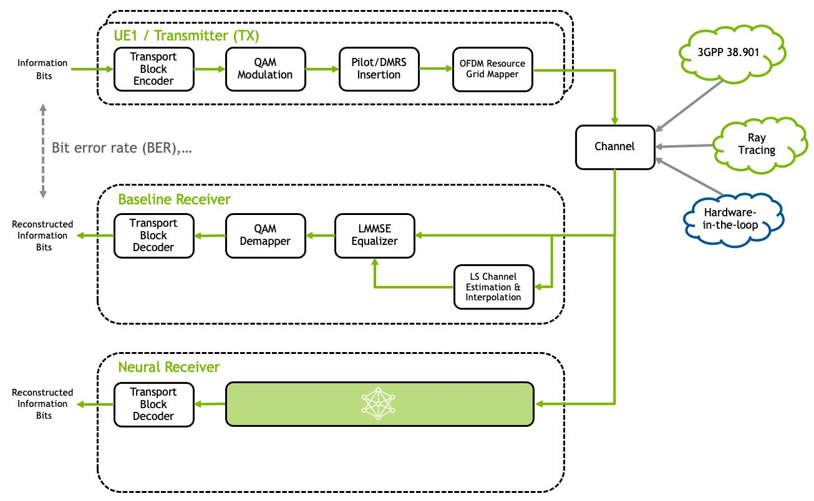

فرض کنید یک ایستگاه پایه 5G اطلاعاتی را برای یک گوشی ارسال می‌کند.

در مسیر انتقال ممکن است مشکلات مختلفی رخ دهد:

- تضعیف سیگنال
- تداخل از سلول‌های مجاور
- انعکاس و چندمسیری شدن امواج
- خطا در دریافت اطلاعات
- حرکت کاربر و تغییر شرایط کانال

**سؤال اصلی:** چگونه قبل از پیاده‌سازی واقعی شبکه، عملکرد ارتباط رادیویی را بررسی و بهینه کنیم؟

## اسلاید ۲ — راهکار چیست؟

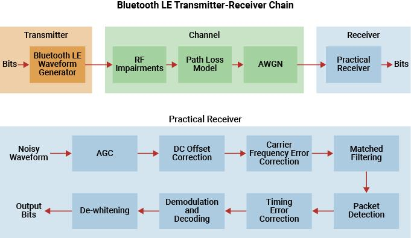

‏Sionna PHY یک محیط شبیه‌سازی برای بررسی ارتباطات مخابراتی در سطح لینک است.

به کمک آن می‌توانیم:

- فرستنده و گیرنده را مدل‌سازی کنیم.
- شرایط مختلف کانال رادیویی را شبیه‌سازی کنیم.
- روش‌های ارسال و دریافت اطلاعات را آزمایش کنیم.
- عملکرد الگوریتم‌های مختلف را مقایسه کنیم.
- از هوش مصنوعی برای بهبود عملکرد ارتباط استفاده کنیم.

**نکته:** به‌جای آزمایش پرهزینه روی شبکه واقعی، سناریوهای مختلف را در محیط شبیه‌سازی بررسی می‌کنیم.

## اسلاید ۳ — Sionna PHY چه بخش‌هایی دارد؟

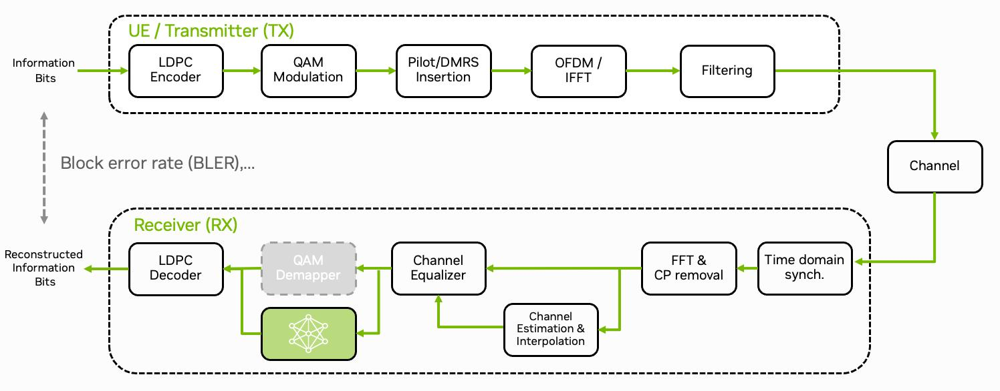

در مستندات NVIDIA چند قابلیت مهم در کنار یکدیگر قرار گرفته‌اند:

| بخش            | کاربرد ساده                              |
| -------------- | ---------------------------------------- |
| Channel Models | شبیه‌سازی شرایط مسیر انتقال              |
| FEC            | کاهش خطاهای اطلاعات دریافتی              |
| OFDM           | تقسیم اطلاعات روی زیرحامل‌های متعدد      |
| MIMO           | استفاده از چند آنتن برای ارسال و دریافت  |
| Modulation     | تبدیل بیت‌ها به سیگنال قابل ارسال        |
| Detection      | تشخیص اطلاعات دریافت‌شده                 |
| 5G NR          | پشتیبانی از برخی قابلیت‌های استاندارد 5G |

این اجزا به ما اجازه می‌دهند یک ارتباط مخابراتی را از ابتدا تا انتها بررسی کنیم.

## اسلاید ۴ — فرایند شبیه‌سازی در Sionna PHY

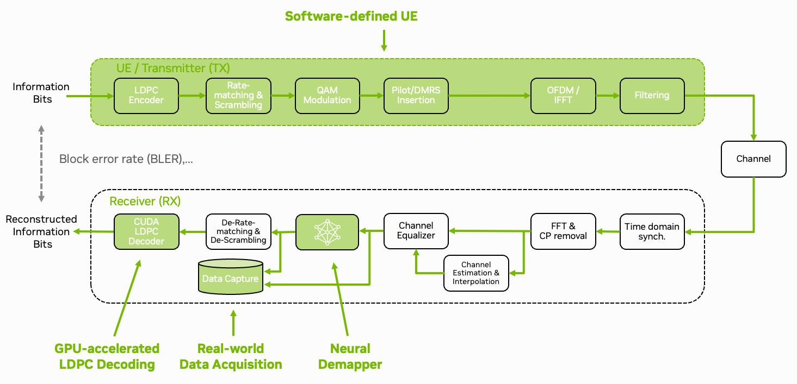

برای درک ساده، کل فرایند را می‌توان در پنج مرحله خلاصه کرد:

1. تولید اطلاعات در فرستنده
2. تبدیل اطلاعات به سیگنال قابل ارسال
3. عبور سیگنال از کانال رادیویی
4. دریافت و پردازش سیگنال
5. بازیابی اطلاعات و اندازه‌گیری خطا

**هدف:** بررسی کنیم در چه شرایطی ارتباط بهتر یا ضعیف‌تر می‌شود.

## اسلاید ۵ — مدل‌سازی کانال رادیویی (Channel Models)

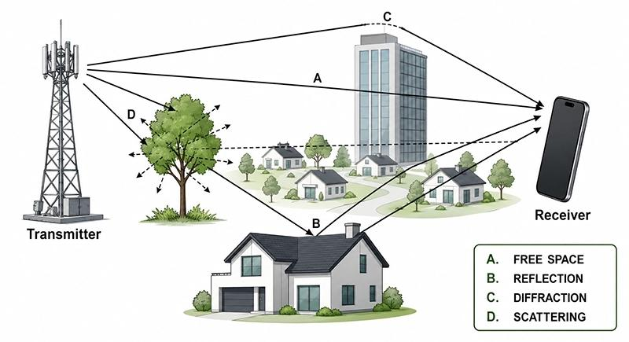

یکی از مهم‌ترین مشکلات ارتباطات بی‌سیم، تغییر شرایط مسیر انتقال است.

برای مثال، وقتی سیگنال به ساختمان برخورد می‌کند، ممکن است از چند مسیر مختلف به گیرنده برسد.

‏Sionna می‌تواند شرایط مختلف کانال را شبیه‌سازی کند:

- ‏AWGN: نویز تصادفی در مسیر انتقال
- ‏Rayleigh: شرایط انتشار چندمسیری
- ‏CDL و TDL: مدل‌های کانال مورد استفاده در شبیه‌سازی مخابراتی
- مدل‌های 3GPP: سناریوهای مختلف انتشار در شبکه‌های سلولی

**نتیجه:** می‌توانیم بررسی کنیم یک روش مخابراتی در محیط‌های مختلف چقدر قابل اعتماد است.

## اسلاید ۶ — MIMO و OFDM چه نقشی دارند؟

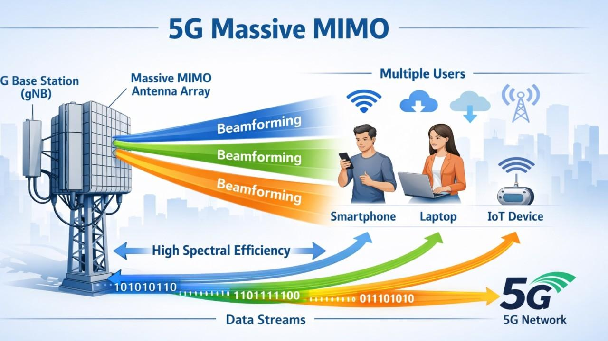

دو فناوری مهم در شبکه‌های 4G و 5G:

**‏MIMO**

به‌جای استفاده از یک آنتن، از چند آنتن برای ارسال و دریافت اطلاعات استفاده می‌کنیم.

مزایا:

- افزایش ظرفیت ارتباط
- بهبود کیفیت دریافت
- استفاده بهتر از منابع رادیویی

**‏OFDM**

اطلاعات روی تعداد زیادی زیرحامل فرکانسی تقسیم می‌شوند.

مزایا:

- مقابله بهتر با چندمسیری شدن
- استفاده مؤثر از پهنای باند
- انعطاف‌پذیری در انتقال اطلاعات

‏Sionna امکان شبیه‌سازی و آزمایش این فناوری‌ها را فراهم می‌کند.

## اسلاید ۷ — تصحیح خطا (FEC)

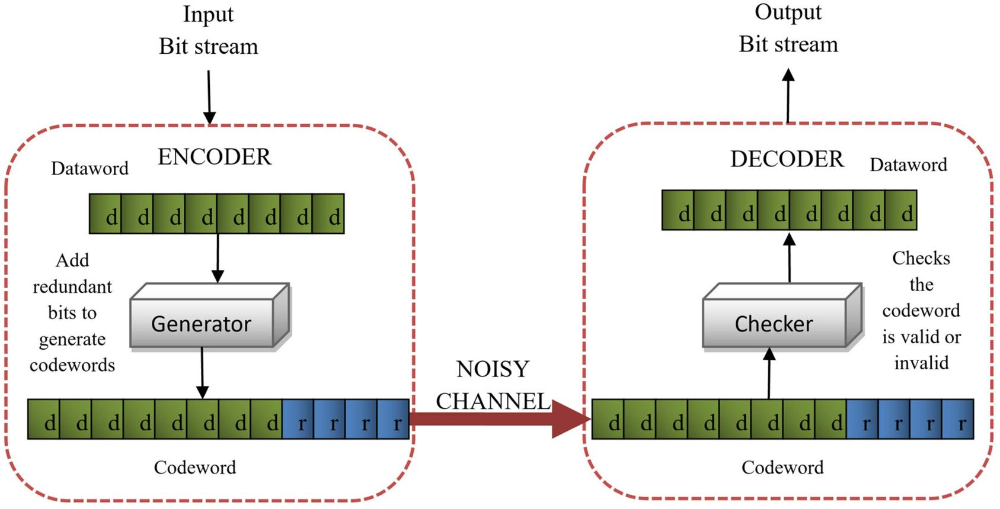

در ارتباط بی‌سیم ممکن است تعدادی از بیت‌های اطلاعات در مسیر انتقال خراب شوند.

برای کاهش این مشکل، فرستنده اطلاعات کنترلی اضافه‌ای به داده‌ها می‌افزاید تا گیرنده بتواند بخشی از خطاها را تشخیص داده و اصلاح کند.

‏Sionna از روش‌های مهم کدگذاری و تصحیح خطا پشتیبانی می‌کند:

- ‏LDPC
- ‏Polar Codes
- ‏Turbo Codes
- ‏Convolutional Codes

**ارتباط با 5G:** کدهای LDPC و Polar از فناوری‌های مهم مورد استفاده در 5G NR هستند.

## اسلاید ۸ — نقش هوش مصنوعی در لایه فیزیکی

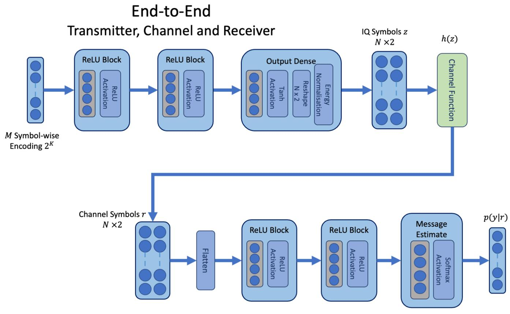

یکی از جذاب‌ترین قابلیت‌های Sionna، امکان ترکیب شبیه‌سازی مخابراتی با یادگیری ماشین است.

در روش سنتی، بسیاری از بخش‌های گیرنده با الگوریتم‌های ریاضی طراحی می‌شوند.

در روش مبتنی بر یادگیری ماشین، می‌توان یک مدل هوش مصنوعی را آموزش داد تا وظایف مشخصی را بهتر انجام دهد.

برای مثال:

- طراحی گیرنده عصبی (Neural Receiver)
- تخمین و پردازش کانال
- تشخیص سیگنال
- بهینه‌سازی عملکرد ارتباط

**مثال کاربردی:** می‌توانیم یک گیرنده سنتی را با یک گیرنده مبتنی بر شبکه عصبی مقایسه کنیم و ببینیم کدام‌یک در شرایط مشخص عملکرد بهتری دارد.

## اسلاید ۹ — معیارهای ارزیابی عملکرد

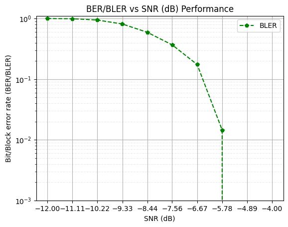

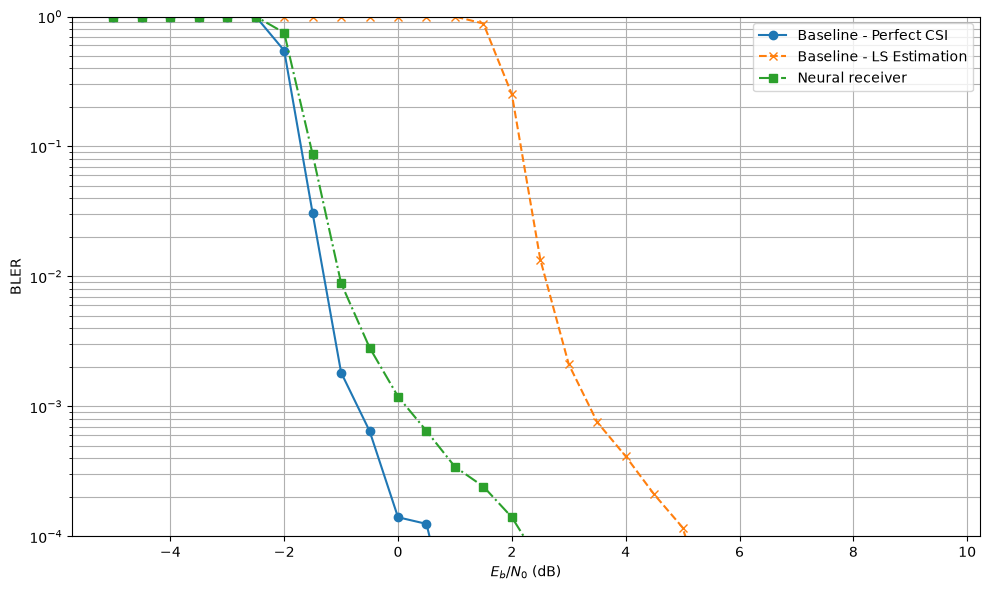

پس از اجرای شبیه‌سازی، باید بدانیم نتیجه خوب بوده یا خیر.

مهم‌ترین معیارها:

| معیار      | مفهوم                                |
| ---------- | ------------------------------------ |
| BER        | نسبت بیت‌های اشتباه دریافت‌شده       |
| BLER       | نسبت بلوک‌های اطلاعاتی دارای خطا     |
| SER        | نسبت سمبل‌های اشتباه                 |
| SINR       | نسبت سیگنال به تداخل و نویز          |
| Throughput | میزان اطلاعات منتقل‌شده در واحد زمان |

یک مثال ساده:

اگر BER برابر با 0.001 باشد، یعنی به‌طور متوسط از هر ۱۰۰۰ بیت، یک بیت اشتباه دریافت شده است.

**هدف:** کاهش خطا و افزایش کیفیت ارتباط.

## اسلاید ۱۰ — چه آزمایش‌هایی می‌توانیم انجام دهیم؟

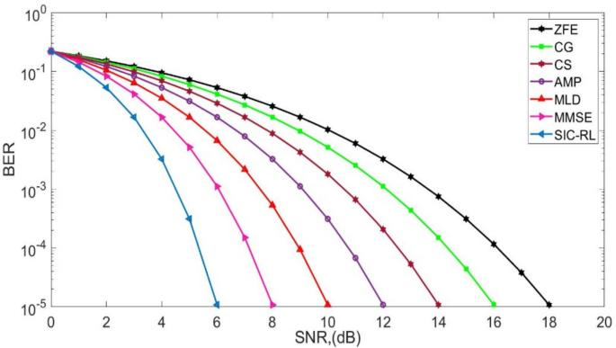

با استفاده از Sionna PHY می‌توانیم سناریوهای مختلفی را آزمایش کنیم:

- مقایسه گیرنده سنتی و گیرنده هوشمند
- بررسی تأثیر نویز بر کیفیت ارتباط
- مقایسه روش‌های مختلف کدگذاری
- بررسی عملکرد MIMO در شرایط مختلف
- آزمایش روش‌های مختلف تخمین کانال
- بررسی عملکرد سیستم در شرایط مختلف SNR

برای مثال، می‌توانیم بررسی کنیم با افزایش نویز، عملکرد گیرنده چقدر افت می‌کند و آیا یک گیرنده مبتنی بر AI می‌تواند این افت را کاهش دهد.

## اسلاید ۱۱ — نمونه‌های آماده NVIDIA

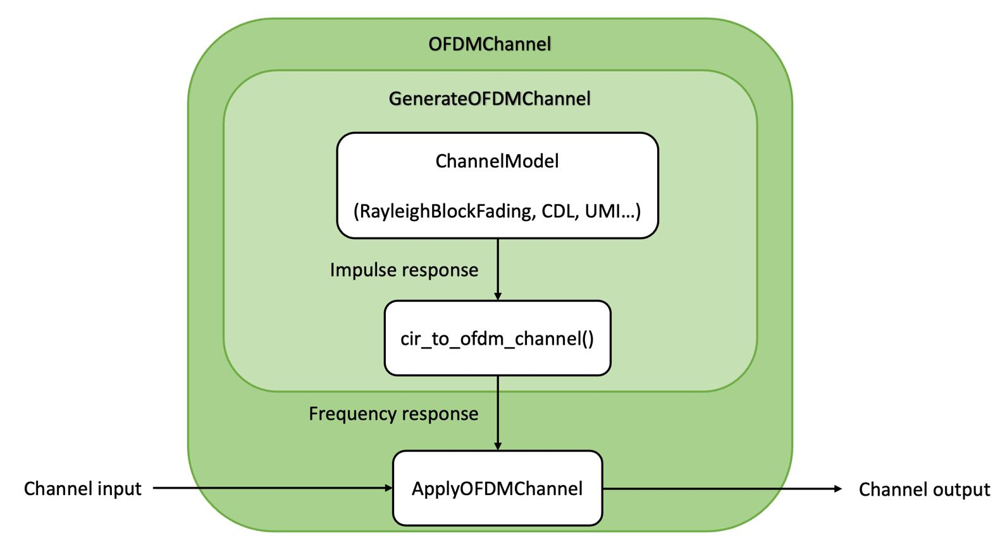

‏NVIDIA برای یادگیری و آزمایش، مجموعه‌ای از Notebookها و مثال‌های اجرایی ارائه کرده است.

چند نمونه مهم:

| مثال | موضوع |
| --- | --- |
| Basic MIMO Simulations | شبیه‌سازی ارتباط چندآنتنه |
| 5G NR PUSCH | بررسی کانال ارسال اطلاعات در 5G |
| Neural Receiver | گیرنده مبتنی بر شبکه عصبی |
| OFDM MIMO | شبیه‌سازی OFDM و MIMO |
| End-to-end Learning | یادگیری سرتاسری در سیستم مخابراتی |

منابع:

- [nvlabs.github.io](https://nvlabs.github.io/sionna/phy/tutorials.html)
- [nvlabs.github.io](https://nvlabs.github.io/sionna/phy/tutorials.html)
- [nvlabs.github.io](https://nvlabs.github.io/sionna/phy/index.html)

## اسلاید ۱۲ — نمودار کلی عملکرد Sionna PHY

این نمودار نشان می‌دهد اطلاعات چگونه از فرستنده عبور می‌کنند و در نهایت در گیرنده ارزیابی می‌شوند.

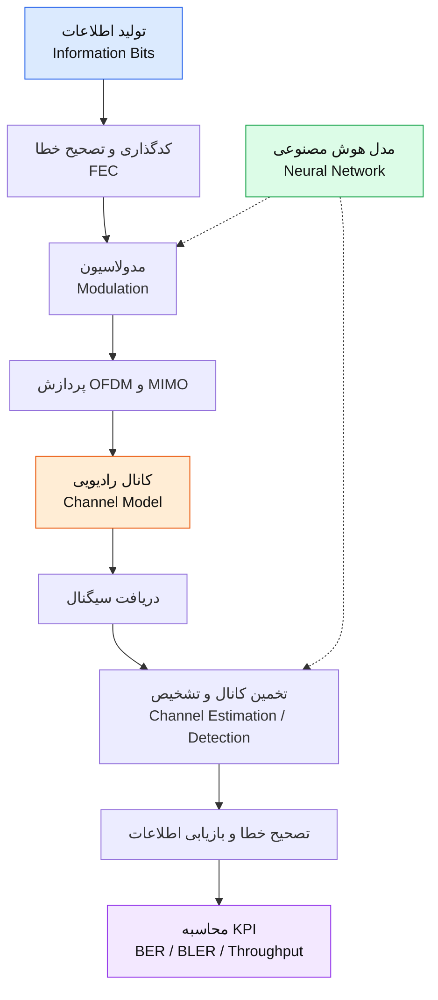

## اسلاید ۱۳ — جمع‌بندی: Sionna PHY چه مشکلی را حل می‌کند؟

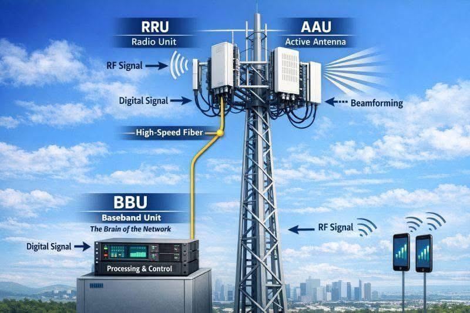

| نیاز | راهکار Sionna PHY |
| --- | --- |
| بررسی کیفیت انتقال اطلاعات | شبیه‌سازی لینک مخابراتی |
| بررسی اثر نویز و تداخل | مدل‌سازی کانال |
| آزمایش فناوری‌های چندآنتنه | MIMO |
| بررسی انتقال اطلاعات در 5G | OFDM و 5G NR |
| کاهش خطای دریافت | FEC |
| توسعه روش‌های هوشمند | Neural Receiver و یادگیری ماشین |

**پیام اصلی این بخش:**

‏Sionna PHY به ما اجازه می‌دهد به‌جای اینکه فقط درباره الگوریتم‌های مخابراتی صحبت کنیم، آن‌ها را شبیه‌سازی کنیم، آموزش دهیم، آزمایش کنیم و نتایج واقعی شبیه‌سازی را با یکدیگر مقایسه کنیم.

---

## ارتباط Sionna RT و PHY در معماری کلی

این نمودار برای جمع‌بندی و اتصال مباحث قبلی به این بخش مناسب است:

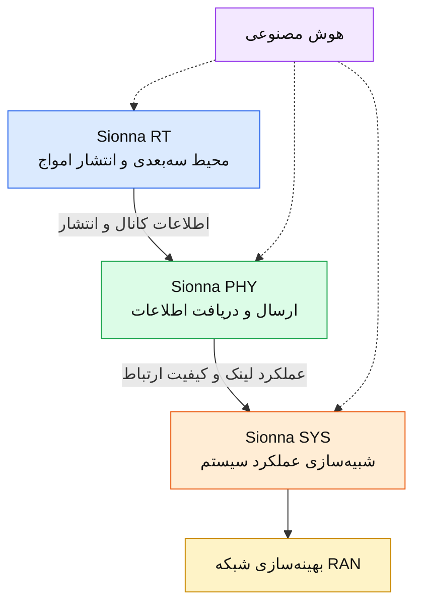

*توجه: این نمودار معماری مفهومی ارتباط این سه حوزه است، نه الزاماً زنجیره اتصال مستقیم و اجباری نرم‌افزارها.*

---

(زمان پیشنهادی: ۱۳ دقیقه)

**نکته آموزشی:** وارد جزئیات LDPC، ماتریس‌های MIMO، فرمول‌های OFDM و ساختار شبکه عصبی نشو. فقط توضیح بده هرکدام چه مشکلی را حل می‌کنند.

در ادامه می‌توانیم با مباحث دیگر Sionna، یک داستان آموزشی پیوسته بسازیم: ابتدا محیط و انتشار امواج با RT، سپس کیفیت انتقال اطلاعات با PHY و در نهایت عملکرد شبکه با SYS.

منبع: [مستندات رسمی Sionna PHY نسخه 2.2.0](https://nvlabs.github.io/sionna/phy/index.html). این صفحه معرفی قابلیت‌ها و API است؛ بنابراین بعضی تصاویر بالا تصاویر مفهومی آموزشی هستند، نه تصاویر استخراج‌شده از خود مستندات.