tags:
  - sionna
### Next Steps
- [[RSK]]

[https://nvlabs.github.io/sionna/sys/index.html](https://nvlabs.github.io/sionna/sys/index.html)

* * *

**:**

# ارائه آموزشی: آشنایی با Sionna SYS

System-Level Simulation | NVIDIA Sionna 2.2.0

**موضوع:** شبیه‌سازی، تحلیل و بهینه‌سازی عملکرد شبکه‌های سلولی در سطح سیستم

منبع اصلی: [nvlabs.github.io](https://nvlabs.github.io/sionna/sys/index.html)

در دو بخش قبلی دیدیم که:

- **‏RT:** امواج رادیویی چگونه در محیط و بین ساختمان‌ها منتشر می‌شوند؟
- **‏PHY:** اطلاعات چگونه از فرستنده به گیرنده منتقل می‌شوند؟
- **‏SYS:** عملکرد کل شبکه با چندین سایت، سلول و کاربر چگونه است؟

در واقع SYS ما را از بررسی یک ارتباط رادیویی به بررسی رفتار یک شبکه سلولی می‌برد.

---

## اسلاید ۱ — مسئله چیست؟ چرا به Sionna SYS نیاز داریم؟

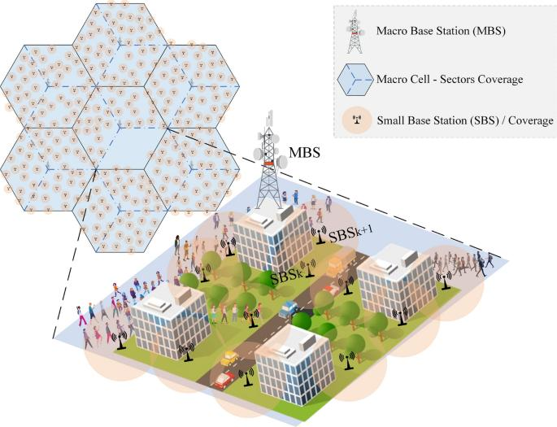

فرض کنید یک اپراتور در یک شهر چندین سایت مخابراتی دارد و هزاران کاربر به این سایت‌ها متصل هستند.

در این شرایط مشکلات جدیدی ایجاد می‌شود:

- کاربران بین سلول‌های مختلف توزیع شده‌اند.
- بعضی سلول‌ها شلوغ و بعضی خلوت هستند.
- کاربران کیفیت سیگنال متفاوتی دارند.
- سلول‌های مجاور روی یکدیگر تداخل ایجاد می‌کنند.
- منابع رادیویی محدود هستند و باید بین کاربران تقسیم شوند.

**سؤال اصلی:** چگونه می‌توانیم عملکرد کل شبکه را بررسی و منابع آن را بهینه کنیم؟

## اسلاید ۲ — راهکار چیست؟

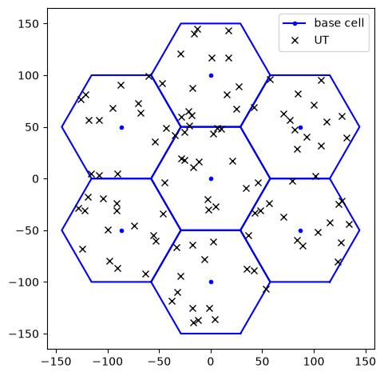

‏Sionna SYS محیطی برای شبیه‌سازی عملکرد شبکه‌های چندسلولی است.

به کمک آن می‌توانیم:

- تعداد زیادی ایستگاه پایه و کاربر را شبیه‌سازی کنیم.
- موقعیت کاربران و سایت‌ها را تعریف کنیم.
- کیفیت ارتباط کاربران را بررسی کنیم.
- منابع رادیویی را بین کاربران تقسیم کنیم.
- توان ارسال را مدیریت کنیم.
- الگوریتم‌های مختلف مدیریت شبکه را مقایسه کنیم.

**تفاوت مهم:** در PHY بیشتر روی جزئیات انتقال اطلاعات تمرکز داریم؛ در SYS روی عملکرد مجموعه‌ای از لینک‌ها و سلول‌ها تمرکز می‌کنیم.

## اسلاید ۳ — تفاوت PHY و SYS چیست؟

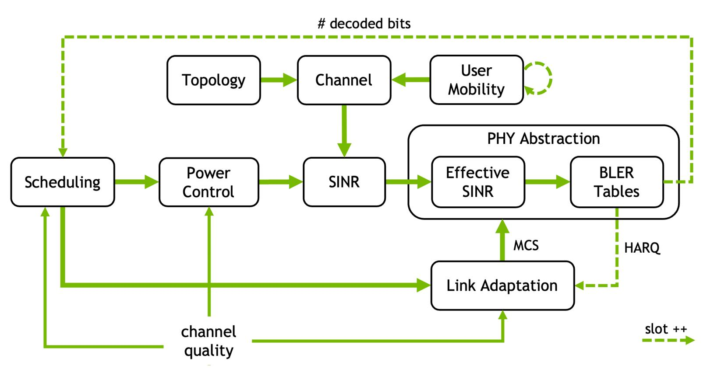

| ویژگی | PHY | SYS |
| --- | --- | --- |
| محدوده بررسی | یک لینک ارتباطی | چندین سلول و کاربر |
| تمرکز | ارسال و دریافت اطلاعات | عملکرد شبکه |
| موضوع اصلی | سیگنال و خطا | ظرفیت و تخصیص منابع |
| کاربران | معمولاً یک یا تعداد محدود | تعداد زیادی کاربر |
| خروجی | BER، BLER، SINR | Throughput، SINR، عدالت و بار سلول |

یک مثال ساده:

- ‏PHY بررسی می‌کند یک گوشی با یک ایستگاه پایه چگونه ارتباط برقرار می‌کند.
- ‏SYS بررسی می‌کند صدها گوشی چگونه از منابع چندین ایستگاه پایه استفاده می‌کنند.

## اسلاید ۴ — ساخت توپولوژی شبکه (Network Topology)

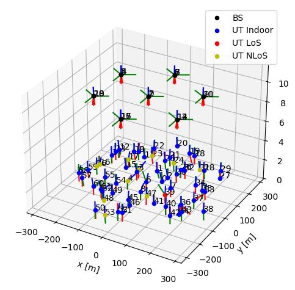

اولین قدم، ساخت محیط شبکه است.

در Sionna SYS می‌توانیم:

- ایستگاه‌های پایه را در موقعیت‌های مختلف قرار دهیم.
- برای هر سایت چند سکتور تعریف کنیم.
- کاربران را در محدوده پوشش شبکه توزیع کنیم.
- فاصله کاربران تا ایستگاه‌های پایه را مشخص کنیم.
- سناریوهای مختلف شهری و روستایی را بررسی کنیم.

سناریوهای مهم مبتنی بر مدل‌های 3GPP:

| سناریو | مفهوم |
| --- | --- |
| UMi | محیط شهری متراکم |
| UMa | محیط شهری بزرگ |
| RMa | محیط روستایی |

**نتیجه:** می‌توانیم یک شبکه فرضی بسازیم و قبل از اجرای واقعی، رفتار آن را بررسی کنیم.

## اسلاید ۵ — مدیریت کاربران و تخصیص منابع (Scheduling)

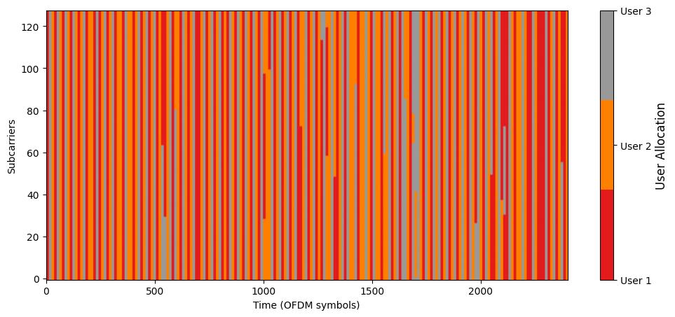

یکی از مهم‌ترین مسائل شبکه این است که منابع محدود رادیویی را چگونه بین کاربران تقسیم کنیم.

فرض کنید ۲۰ کاربر به یک سلول متصل هستند، اما همه آن‌ها نمی‌توانند هم‌زمان از تمام منابع استفاده کنند.

‏Scheduler تصمیم می‌گیرد:

- کدام کاربر در چه زمانی سرویس بگیرد؟
- چه مقدار از منابع به هر کاربر اختصاص پیدا کند؟
- چگونه بین کاربران عدالت برقرار شود؟
- چگونه ظرفیت شبکه افزایش پیدا کند؟

در Sionna SYS یک نمونه مهم از این قابلیت، **Proportional Fair Scheduler** است.

این روش تلاش می‌کند بین دو هدف تعادل برقرار کند:

1. استفاده از کاربران دارای شرایط رادیویی مناسب

2. جلوگیری از محروم شدن کاربران دیگر

## اسلاید ۶ — کنترل توان ارسال (Power Control)

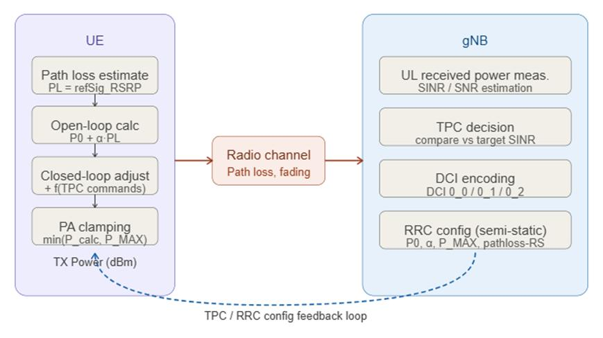

اگر همه گوشی‌ها با حداکثر توان ارسال کنند، ممکن است تداخل شبکه افزایش پیدا کند.

از طرف دیگر، توان بسیار کم می‌تواند باعث افت کیفیت ارتباط شود.

‏
‏Power Control برای مدیریت این مسئله استفاده می‌شود.

در Sionna SYS امکان بررسی موارد زیر وجود دارد:

- کنترل توان ارسال کاربران در Uplink
- مدیریت توان ارسال ایستگاه پایه در Downlink
- بررسی تأثیر توان روی تداخل و کیفیت ارتباط

**هدف:** رسیدن به کیفیت مناسب ارتباط با مصرف توان و ایجاد تداخل کمتر.

## اسلاید ۷ — تطبیق لینک (Link Adaptation)

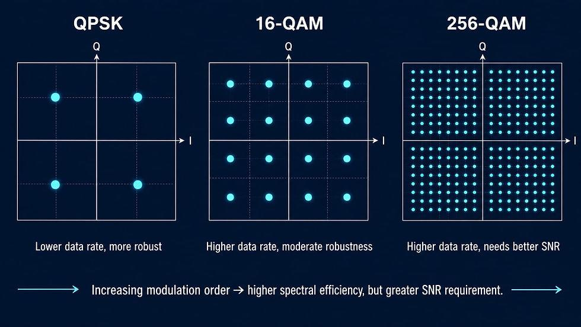

کیفیت ارتباط کاربران همیشه یکسان نیست.

برای مثال، کاربری که نزدیک سایت قرار دارد ممکن است ارتباط بسیار خوبی داشته باشد؛ اما کاربر دورتر با افت کیفیت مواجه شود.

‏Link Adaptation به شبکه اجازه می‌دهد با توجه به شرایط کانال، روش انتقال اطلاعات را تغییر دهد.

برای این کار از MCS استفاده می‌شود:

**‏Modulation and Coding Scheme**

- شرایط مناسب: استفاده از روش انتقال سریع‌تر
- شرایط نامناسب: استفاده از روش مقاوم‌تر در برابر خطا

در نتیجه شبکه تلاش می‌کند سرعت انتقال و قابلیت اطمینان را متعادل کند.

## اسلاید ۸ — SINR و BLER در مدیریت شبکه

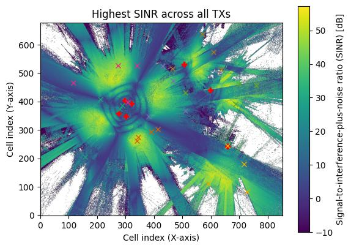

دو معیار مهم در تصمیم‌گیری شبکه:

**‏SINR**

نسبت قدرت سیگنال مفید به مجموع تداخل و نویز است.

هرچه SINR بهتر باشد، معمولاً امکان استفاده از MCS بالاتر و انتقال اطلاعات سریع‌تر فراهم می‌شود.

**BLER**

نسبت بلوک‌های اطلاعاتی دریافت‌شده با خطا به کل بلوک‌های دریافتی است.

در Sionna SYS از یک مدل ساده‌شده لایه فیزیکی استفاده می‌شود تا با توجه به SINR پس از اکولایزر، BLER تخمین زده شود.

به این ترتیب لازم نیست برای تمام کاربران و تمام زمان‌ها، شبیه‌سازی کامل بیت‌به‌بیت PHY اجرا شود.

**نتیجه:** شبیه‌سازی شبکه‌های بزرگ با هزینه محاسباتی کمتر امکان‌پذیر می‌شود.

## اسلاید ۹ — چگونه SYS عملکرد شبکه را ارزیابی می‌کند؟

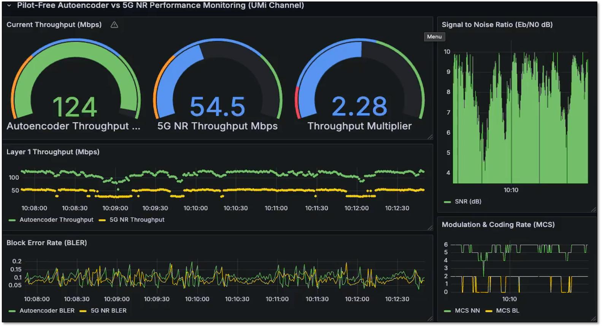

بعد از شبیه‌سازی، باید بدانیم شبکه چه عملکردی داشته است.

معیارهای مهم عبارت‌اند از:

| معیار | مفهوم |
| --- | --- |
| Throughput | سرعت انتقال اطلاعات |
| Effective SINR | کیفیت مؤثر کانال |
| TBLER | نرخ خطای بلوک انتقال |
| MCS | روش مدولاسیون و کدگذاری انتخاب‌شده |
| Transmit Power | توان ارسال |
| Cell Load | میزان استفاده از منابع سلول |
| Spectral Efficiency | میزان استفاده مؤثر از پهنای باند |

**مثال:** اگر یک سلول تعداد زیادی کاربر داشته باشد، می‌توانیم بررسی کنیم آیا تخصیص منابع به‌درستی انجام شده یا خیر.

## اسلاید ۱۰ — مثال عملی NVIDIA: شبیه‌سازی یک شبکه چندسلولی

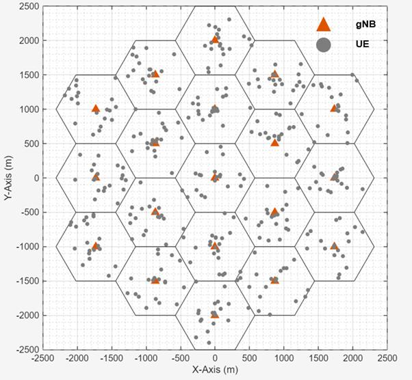

یکی از مثال‌های مهم مستندات NVIDIA، شبیه‌سازی یک شبکه چندسلولی است.

در این مثال:

- ایستگاه‌های پایه در یک ساختار شش‌ضلعی قرار می‌گیرند.
- کاربران در سکتورهای مختلف توزیع می‌شوند.
- مدل کانال 3GPP استفاده می‌شود.
- ‏Scheduler کاربران را انتخاب می‌کند.
- توان ارسال مدیریت می‌شود.
- ‏MCS متناسب با شرایط کانال انتخاب می‌شود.
- عملکرد شبکه در طول زمان اندازه‌گیری می‌شود.

در خروجی می‌توان رابطه بین SINR، MCS و Throughput را بررسی کرد.

منبع: NVIDIA — System-Level Simulations

 [مشاهده Notebook اجرایی](https://nvlabs.github.io/sionna/v2.2.0/sys/tutorials/notebooks/End-to-End_Example.html)

## اسلاید ۱۱ — ارتباط Sionna SYS با هوش مصنوعی

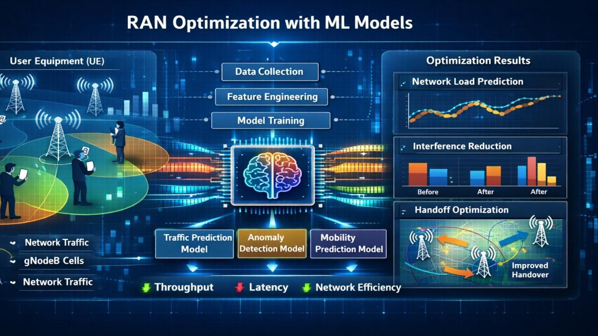

یکی از کاربردهای مهم SYS، فراهم کردن محیطی برای آزمایش الگوریتم‌های هوشمند مدیریت شبکه است.

برای مثال می‌توانیم از AI برای موارد زیر استفاده کنیم:

- پیش‌بینی بار سلول‌ها
- تخصیص هوشمند منابع رادیویی
- بهینه‌سازی توان ارسال
- انتخاب هوشمند پارامترهای شبکه
- بهبود زمان‌بندی کاربران
- پیش‌بینی کیفیت ارتباط

یک نکته مهم: این قابلیت‌ها لزوماً به این معنی نیست که تمام این الگوریتم‌ها به‌صورت آماده و خودکار در Sionna SYS وجود دارند؛ بلکه SYS محیط مناسبی برای توسعه و ارزیابی آن‌ها فراهم می‌کند.

## اسلاید ۱۲ — اتصال Sionna RT و SYS؛ یک قابلیت بسیار مهم

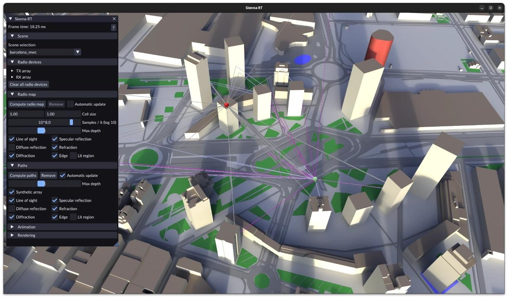

اینجا یکی از جذاب‌ترین بخش‌های Sionna مشخص می‌شود.

می‌توانیم محیط سه‌بعدی واقعی را با RT مدل‌سازی کنیم و سپس خروجی کانال رادیویی آن را در SYS به کار بگیریم.

مثلاً:

1. با RT ساختمان‌ها و محیط شهری را مدل می‌کنیم.

2. مسیر انتشار امواج از سایت به کاربران را محاسبه می‌کنیم.

3. اطلاعات کانال را استخراج می‌کنیم.

4. با SYS تخصیص منابع، کنترل توان و زمان‌بندی کاربران را انجام می‌دهیم.

5. عملکرد شبکه را در شرایط مختلف بررسی می‌کنیم.

این قابلیت در Notebook رسمی **Sionna SYS meets Sionna RT** نمایش داده شده است.

[مشاهده مثال رسمی SYS meets RT](https://nvlabs.github.io/sionna/v2.1.0/sys/tutorials/notebooks/SYS_Meets_RT.html)

## اسلاید ۱۳ — نمودار کلی عملکرد Sionna SYS

این نمودار را می‌توان به‌عنوان اسلاید اصلی برای توضیح معماری SYS استفاده کرد.

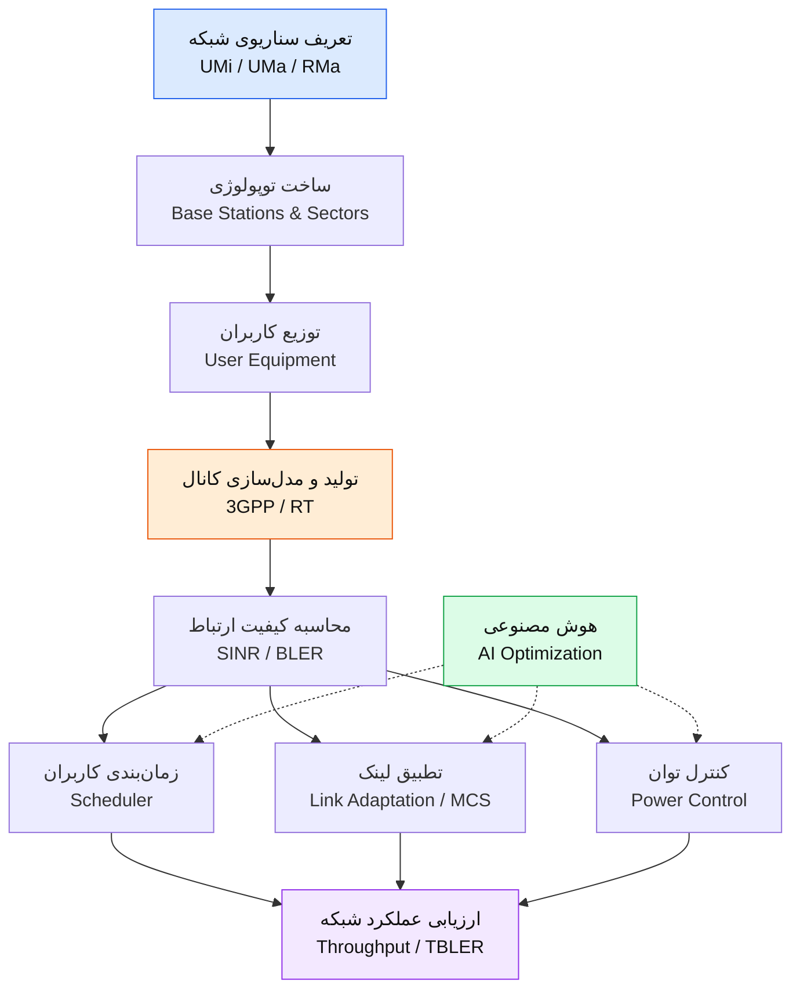

## اسلاید ۱۴ — جمع‌بندی: Sionna SYS چه مشکلی را حل می‌کند؟

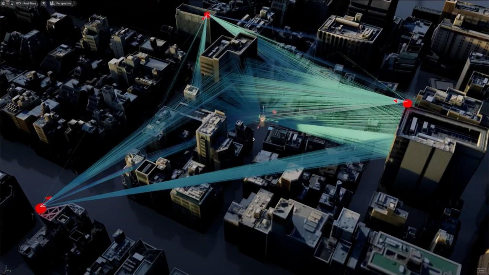

| نیاز شبکه | راهکار Sionna SYS |
| --- | --- |
| شبیه‌سازی چندین سایت | Network Topology |
| بررسی کاربران متعدد | User Distribution |
| مدیریت منابع رادیویی | Scheduling |
| تنظیم توان ارسال | Power Control |
| انتخاب سرعت مناسب | Link Adaptation |
| بررسی تداخل و کیفیت | SINR / BLER |
| ارزیابی عملکرد شبکه | System-Level Simulation |

**پیام اصلی این بخش:**

‏Sionna SYS به ما کمک می‌کند به‌جای بررسی یک ارتباط رادیویی، عملکرد یک شبکه سلولی شامل چندین سایت و تعداد زیادی کاربر را شبیه‌سازی و بهینه‌سازی کنیم.

---

## اسلاید ۱۵ — تصویر نهایی از خانواده Sionna

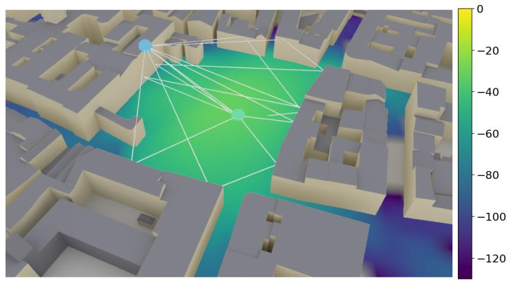

| ماژول | به چه سؤالی پاسخ می‌دهد؟ |
| --- | --- |
| RT | امواج در محیط چگونه منتشر می‌شوند؟ |
| PHY | اطلاعات چگونه منتقل و دریافت می‌شوند؟ |
| SYS | کل شبکه چگونه عمل می‌کند؟ |

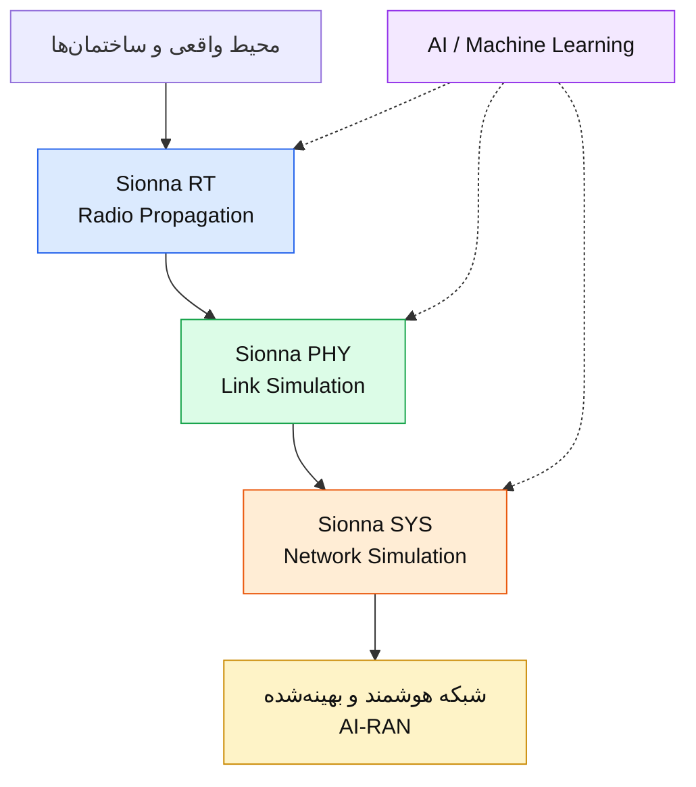

*این نمودار یک تصویر مفهومی از ارتباط ماژول‌هاست؛ در پیاده‌سازی می‌توان هر ماژول را مستقل نیز استفاده کرد.*

---
