---
tags:
  - sionna
---

## 🔗 Knowledge Graph

### Next Steps
- [[fadding]]
- [[nvidia-sionna-rt-MOBILITY]]
- [[nvidia-sionna-rt-radio-map]]
------
### اسلاید ۱ — اعتبار علمی NVIDIA Sionna

# ‏Sionna در جامعه علمی چه جایگاهی دارد؟

(آمار اعلام‌شده توسط NVIDIA در اکتبر ۲۰۲۵)

**540+**

**مقاله علمی**

دارای ارجاع به Sionna

**200,000+**

**بار دانلود**

کد منبع پروژه

‏Sionna فقط یک ابزار نرم‌افزاری نیست؛ بستری پژوهشی برای توسعه و ارزیابی روش‌های جدید در مخابرات، یادگیری ماشین و شبکه‌های نسل آینده است.

[NVIDIA Technical Blog](https://developer.nvidia.com/blog/?p=107565)

---

### اسلاید ۲ — حضور Sionna در انتشارات علمی معتبر

چند نمونه از مقالات علمی مرتبط با این پروژه:

| سال | عنوان مقاله | محل انتشار |
| --- | --- | --- |
| ۲۰۲۲ | Sionna: An Open-Source Library for Next-Generation Physical Layer Research | arXiv |
| ۲۰۲۳ | Sionna RT: Differentiable Ray Tracing for Radio Propagation Modeling | IEEE GLOBECOM Workshops |
| ۲۰۲۵ | Sionna Research Kit: A GPU-Accelerated Research Platform for AI-RAN | IEEE ICMLCN 2025 |

[Research](https://research.nvidia.com/index.php/publication/2022-03_sionna-open-source-library-next-generation-physical-layer-research) · [IEEE Xplore](https://ieeexplore.ieee.org/document/10465179/) · [doi.org](https://doi.org/10.1109/ICMLCN64995.2025.11140427)

**نکته مهم:** مقاله سال ۲۰۲۵، پلتفرم Sionna Research Kit را در یک شبکه 5G واقعی و با استفاده از گیرنده عصبی اجرا می‌کند؛ بنابراین ارتباط پژوهش با پیاده‌سازی عملی نیز نشان داده شده است. 

[Research](https://research.nvidia.com/publication/2025-05_sionna-research-kit-gpu-accelerated-research-platform-ai-ran) · [doi.org](https://doi.org/10.1109/ICMLCN64995.2025.11140427)

---

### اسلاید ۳ — جوایز علمی توسعه‌دهندگان

 · **

Sebastian Cammerer

**

پژوهشگر NVIDIA و از توسعه‌دهندگان اصلی Sionna

برخی از جوایز علمی او:

- ۲۰۲۲
   جایزه رساله دکتری VDE ITG آلمان
- ۲۰۱۹
   جایزه IEEE SPS Young Author Best Paper
- ۲۰۱۹
   رتبه سوم Nokia Bell Labs Prize
- جوایز بهترین مقاله دانشگاه اشتوتگارت در سال‌های ۲۰۱۸ و ۲۰۲۱

[Research](https://research.nvidia.com/person/sebastian-cammerer) · [Universität Stuttgart](https://www.inue.uni-stuttgart.de/de/institut/aktuelles/news/Sebastian-Cammerer-awarded-VDE-ITG-Dissertation-Prize/) · [vde.com](https://www.vde.com/de/itg/preise-ehrungen/foerderpreis)

توجه: این جوایز متعلق به سوابق علمی شخصی پژوهشگر هستند، نه جوایزی که مستقیماً به پروژه Sionna اهدا شده باشند.

---

# ارائه آموزشی: آشنایی با Sionna RT

---

## اسلاید ۱ — عنوان

# Sionna RT

### شبیه‌سازی انتشار امواج رادیویی در محیط واقعی با استفاده از Ray Tracing

- شبیه‌سازی رفتار امواج رادیویی در محیط سه‌بعدی
- بررسی اثر ساختمان‌ها و موانع
- محاسبه مسیرهای انتشار سیگنال
- تولید نقشه پوشش رادیویی

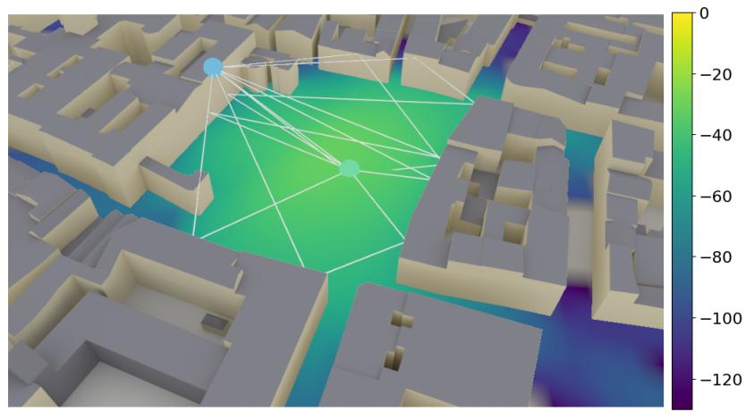

---

## اسلاید ۲ — مسئله چیست؟

# چرا به شبیه‌سازی انتشار امواج نیاز داریم؟

در طراحی شبکه موبایل، صرفاً دانستن فاصله آنتن تا کاربر کافی نیست.

سیگنال رادیویی در مسیر خود با موانع مختلف روبه‌رو می‌شود:

- ساختمان‌ها و دیوارها
- انعکاس از سطوح مختلف
- عبور از برخی موانع
- پراکندگی امواج

**نیاز:** پیش‌بینی رفتار واقعی سیگنال در محیط شهری، قبل از اجرای عملی شبکه.

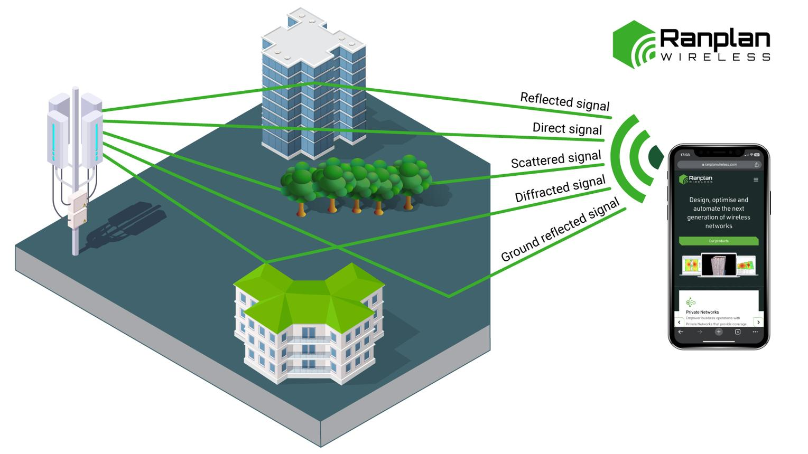

---

## اسلاید ۳ — راهکار چیست؟

# استفاده از Ray Tracing

‏Ray Tracing روشی برای شبیه‌سازی مسیر حرکت امواج در یک محیط سه‌بعدی است.

به‌جای اینکه فقط فاصله بین فرستنده و گیرنده را محاسبه کنیم، مسیرهای مختلف انتشار را بررسی می‌کنیم:

- مسیر مستقیم (LoS)
- انعکاس (Reflection)
- شکست موج (Refraction)
- انتشار غیرمستقیم در محیط

**ایده اصلی:** محیط واقعی را به مدل سه‌بعدی تبدیل کنیم و رفتار امواج را در آن شبیه‌سازی کنیم.

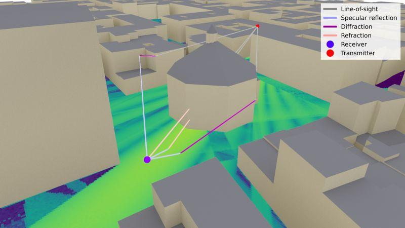

---

## اسلاید ۴ — Sionna RT چیست؟

# معرفی Sionna RT

‏Sionna RT یکی از ابزارهای متن‌باز NVIDIA برای شبیه‌سازی انتشار امواج رادیویی است.

ویژگی‌های اصلی:

- استفاده از مدل سه‌بعدی محیط
- شبیه‌سازی مسیرهای انتشار امواج
- استفاده از پردازنده گرافیکی برای شتاب محاسبات
- امکان محاسبه پارامترهای کانال مخابراتی
- قابلیت استفاده از روش‌های بهینه‌سازی مبتنی بر گرادیان

نکته مهم: این ابزار صرفاً یک نرم‌افزار نمایش سه‌بعدی نیست؛ محاسبات فیزیکی انتشار امواج را نیز انجام می‌دهد.

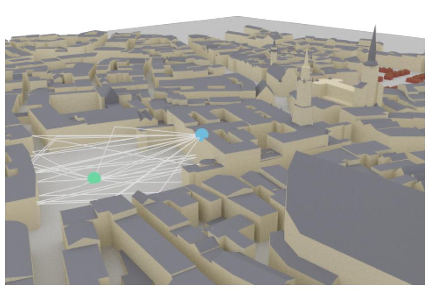

---

## اسلاید ۵ — ساخت محیط سه‌بعدی

# اولین قدم: ساخت Scene

برای شبیه‌سازی، ابتدا باید محیط واقعی را به یک مدل سه‌بعدی تبدیل کنیم.

این محیط می‌تواند شامل موارد زیر باشد:

- ساختمان‌ها
- زمین و عوارض محیطی
- دیوارها و سطوح
- مشخصات فیزیکی مواد

در مثال NVIDIA، از محیط شهری مونیخ (Munich) استفاده شده است.

تصویر ۱ — محیط سه‌بعدی نمونه در آموزش رسمی NVIDIA

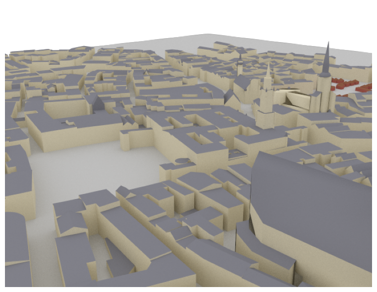

**نتیجه:** محیطی داریم که می‌توانیم انتشار امواج را در آن بررسی کنیم.

---

## اسلاید ۶ — اهمیت جنس ساختمان‌ها

# آیا تمام ساختمان‌ها رفتار یکسانی دارند؟

خیر!

موج رادیویی هنگام برخورد با سطوح مختلف، رفتار متفاوتی دارد.

برای مثال:

- بتن: بخشی از موج را منعکس یا جذب می‌کند.
- شیشه: رفتار متفاوتی نسبت به بتن دارد.
- فلز: معمولاً انعکاس قابل‌توجهی ایجاد می‌کند.

در Sionna RT برای هر سطح می‌توان مشخصات ماده (Radio Material) تعریف کرد.

همچنین رفتار مواد می‌تواند به فرکانس سیگنال وابسته باشد.

**نیاز:** برای پیش‌بینی دقیق‌تر، فقط شکل ساختمان کافی نیست؛ جنس سطوح نیز اهمیت دارد.

---

## اسلاید ۷ — تعریف فرستنده و گیرنده

# سیگنال از کجا به کجا می‌رود؟

پس از ساخت محیط، باید تجهیزات مخابراتی را در آن قرار دهیم.

دو عنصر اصلی داریم:

- ‏**Transmitter (TX):** فرستنده، مانند سایت BTS
- ‏**Receiver (RX):** گیرنده، مانند گوشی موبایل

برای هرکدام می‌توان موقعیت و مشخصات آنتن را تعریف کرد.

در نتیجه، یک سناریوی مخابراتی واقعی‌تر ایجاد می‌شود.

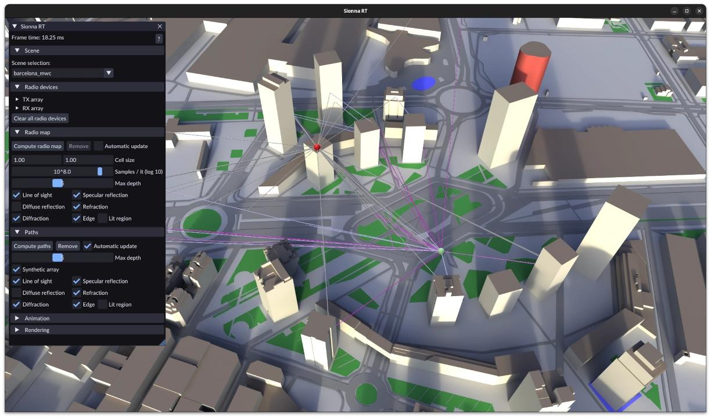

---

## اسلاید ۸ — محاسبه مسیرهای انتشار

# ‏Ray Tracing چگونه کار می‌کند؟

حالا Sionna RT مسیرهای احتمالی انتشار سیگنال را محاسبه می‌کند.

برای مثال:

1. موج مستقیماً به گیرنده می‌رسد.
2. موج به ساختمان برخورد کرده و منعکس می‌شود.
3. موج از یک سطح عبور می‌کند.
4. چند مسیر مختلف به گیرنده می‌رسند.

تعداد برخوردها و نوع تعاملات موج با محیط قابل تنظیم است.

**نکته:** ممکن است گیرنده حتی بدون دید مستقیم به آنتن، سیگنال دریافت کند.

تصویر ۲ — مسیرهای محاسبه‌شده توسط Sionna RT

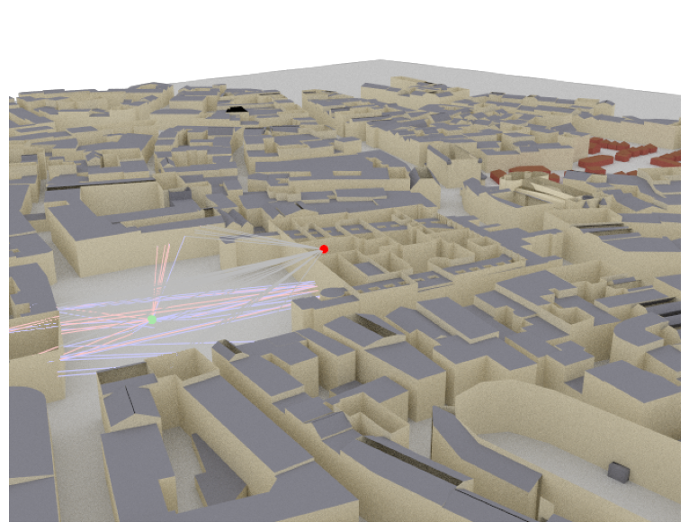

---

## اسلاید ۹ — خروجی محاسبه مسیرها چیست؟

# شناخت رفتار کانال مخابراتی

وقتی مسیرهای انتشار مشخص شدند، می‌توانیم اطلاعات مهمی درباره کانال مخابراتی استخراج کنیم.

سه خروجی مهم عبارت‌اند از:

| خروجی        | مفهوم ساده                                |
| ------------ | ----------------------------------------- |
| CIR          | قدرت و زمان رسیدن سیگنال از مسیرهای مختلف |
| CFR          | رفتار کانال در فرکانس‌های مختلف           |
| Channel Taps | نمایش گسسته اثر مسیرهای مختلف کانال       |

**چرا مهم است؟**

چون کیفیت دریافت سیگنال فقط به قدرت آن وابسته نیست؛ تأخیر و تداخل مسیرهای مختلف نیز اهمیت دارند.

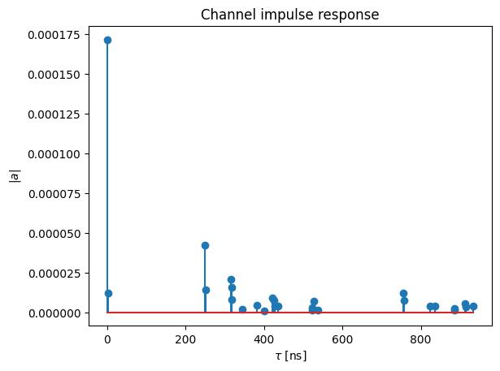

---

## اسلاید ۱۰ — اثر حرکت در شبکه موبایل

# وقتی فرستنده یا گیرنده حرکت می‌کند چه اتفاقی می‌افتد؟

در شبکه موبایل، تجهیزات ثابت نیستند.

حرکت باعث تغییر شرایط انتشار موج و ایجاد اثر داپلر (Doppler Effect) می‌شود.

‏Sionna RT می‌تواند:

- سرعت و جهت حرکت را در مدل وارد کند.
- تغییرات مسیرهای انتشار را محاسبه کند.
- تغییرات کانال در طول زمان را شبیه‌سازی کند.

**کاربرد:** بررسی رفتار کانال در شرایط تحرک کاربران و خودروها.

تصویر ۳ — تغییرات زمانی کانال در سناریوی متحرک

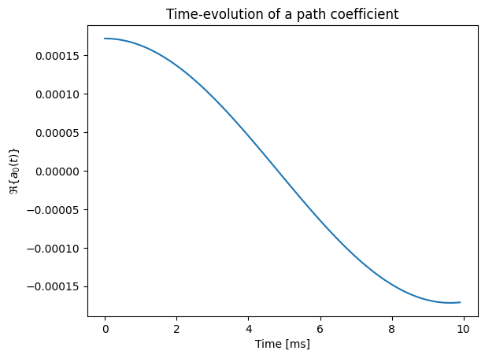

---

## اسلاید ۱۱ — تولید Radio Map

# از محاسبه یک مسیر تا تحلیل کل منطقه

تا اینجا رفتار سیگنال را بین فرستنده و گیرنده بررسی کردیم.

اینجاست که مفهوم Radio Map مطرح می‌شود.

‏Radio Map می‌تواند برای هر نقطه از محیط مقادیری مانند این‌ها را نشان دهد:

- ‏Path Gain
- ‏RSS
- ‏SINR

**هدف:** مشاهده وضعیت پوشش رادیویی در سطح یک منطقه، نه فقط در یک نقطه.

تصویر ۴ — نمونه Radio Map در محیط شهری NVIDIA

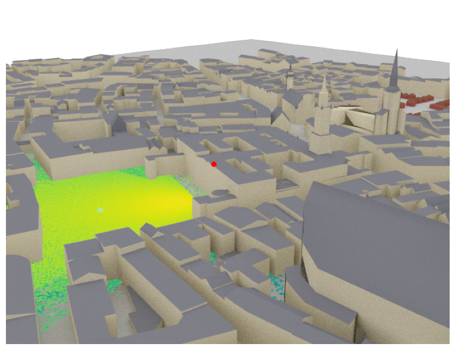

---

## اسلاید ۱۲ — خروجی نهایی چه کمکی می‌کند؟

# تبدیل شبیه‌سازی به ابزار تصمیم‌گیری

با داشتن مدل سه‌بعدی و Radio Map می‌توانیم:

- نقاط دارای پوشش ضعیف را شناسایی کنیم.
- اثر موانع ساختمانی را بررسی کنیم.
- موقعیت مناسب آنتن را ارزیابی کنیم.
- پارامترهای آنتن را بهینه کنیم.
- سناریوهای مختلف شبکه را با هم مقایسه کنیم.

به این ترتیب، به‌جای اتکا به تخمین‌های ساده، تصمیم‌گیری بر اساس شبیه‌سازی محیط واقعی انجام می‌شود.

---

## اسلاید ۱۳ — قابلیت ویژه: Differentiable Ray Tracing

# آیا می‌توان مدل شبکه را بهینه کرد؟

یکی از قابلیت‌های مهم Sionna RT، محاسبه خودکار گرادیان (Automatic Gradient Computation) است.

به زبان ساده:

می‌توانیم بررسی کنیم اگر موقعیت آنتن، جهت آن یا مشخصات مواد تغییر کند، کیفیت سیگنال چه تغییری خواهد کرد.

این قابلیت زمینه را برای استفاده از الگوریتم‌های بهینه‌سازی و هوش مصنوعی فراهم می‌کند.

**مثال کاربردی:**
پیدا کردن موقعیت یا زاویه مناسب آنتن برای بهبود پوشش شبکه.

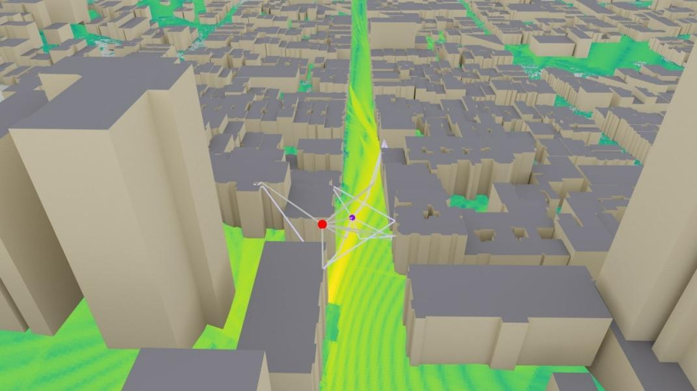

---

## اسلاید ۱۴ — نمای کلی فرآیند Sionna RT

# از محیط واقعی تا نقشه پوشش رادیویی

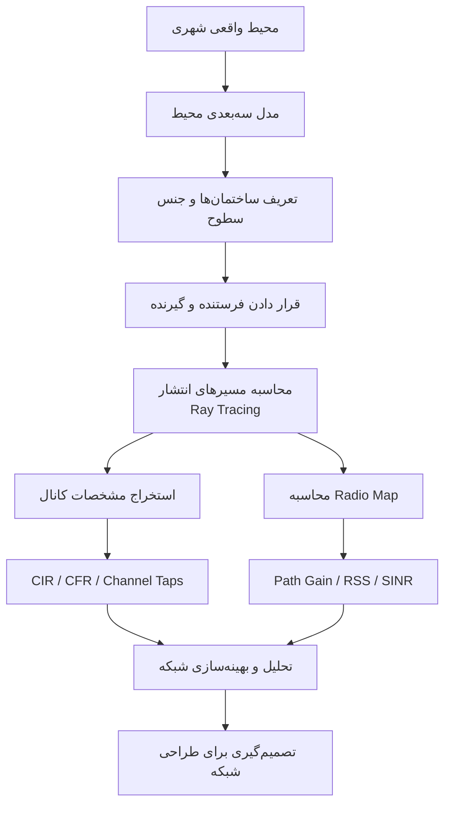

---

## اسلاید ۱۵ — جمع‌بندی

# در این آموزش چه چیزی یاد گرفتیم؟

| مرحله             | دستاورد                |
| ----------------- | ---------------------- |
| Scene             | ساخت محیط سه‌بعدی      |
| Radio Materials   | تعریف مشخصات سطوح      |
| TX / RX           | تعیین فرستنده و گیرنده |
| Ray Tracing       | محاسبه مسیرهای انتشار  |
| Channel           | استخراج مشخصات کانال   |
| Mobility          | بررسی اثر حرکت         |
| Radio Map         | نمایش پوشش رادیویی     |
| Differentiability | امکان بهینه‌سازی       |

(نتیجه نهایی)

‏Sionna RT امکان شبیه‌سازی انتشار امواج رادیویی در محیط سه‌بعدی و استخراج اطلاعاتی نزدیک‌تر به شرایط واقعی شبکه را فراهم می‌کند.

---

## اسلاید ۱۶ — ارتباط با AI-RAN

# چرا این فناوری برای AI-RAN اهمیت دارد؟

‏Sionna RT می‌تواند داده‌های ارزشمندی برای الگوریتم‌های هوش مصنوعی تولید کند.

برای مثال:

- تولید داده آموزشی برای پیش‌بینی پوشش رادیویی
- بررسی اثر تغییر موقعیت آنتن
- آموزش مدل‌های تخمین Path Loss
- کمک به بهینه‌سازی خودکار شبکه
- ایجاد محیط شبیه‌سازی برای آزمایش الگوریتم‌های هوشمند

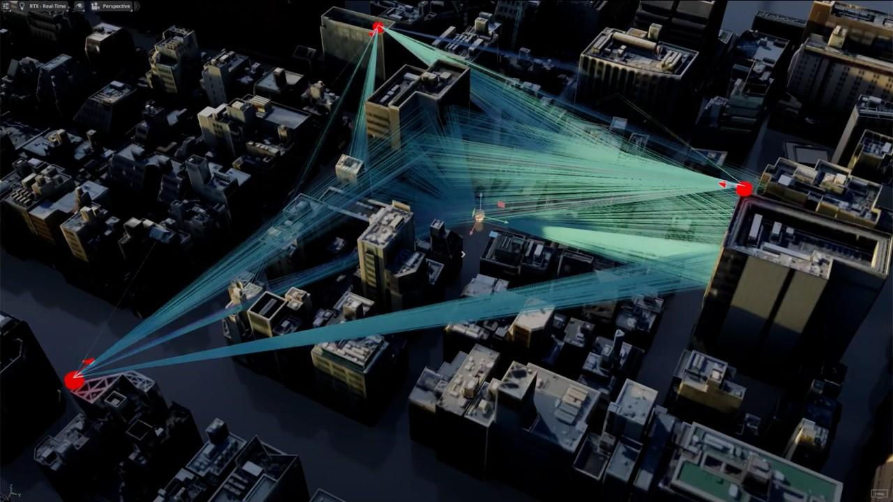

**پل ارتباطی با مبحث بعدی:**

در ادامه می‌توانیم بررسی کنیم چگونه از Radio Map و اطلاعات کانال برای آموزش مدل‌های هوش مصنوعی و پیش‌بینی پوشش شبکه استفاده کنیم.

---

## پیشنهاد نحوه اجرای این بخش در کلاس

برای اینکه مخاطب درگیر مفاهیم شود، پیشنهاد می‌کنم این بخش را حدود ۱۲ تا ۱۵ دقیقه ارائه کنید.

| بخش | زمان پیشنهادی |
| --- | --- |
| مسئله و معرفی Ray Tracing | ۳ دقیقه |
| محیط سه‌بعدی و مواد | ۲ دقیقه |
| فرستنده، گیرنده و مسیرها | ۳ دقیقه |
| کانال و Mobility | ۲ دقیقه |
| Radio Map و کاربرد | ۳ دقیقه |
| ارتباط با AI-RAN | ۲ دقیقه |

