---
tags:
  - sionna
  ---
  
## 🔗 Knowledge Graph

### Next Steps
- [[nvidia-sionna-rt-radio-map]]

[https://nvlabs.github.io/sionna/rt/tutorials/Mobility.html](https://nvlabs.github.io/sionna/rt/tutorials/Mobility.html)

* * *

# ارائه آموزشی: شبیه‌سازی تحرک در Sionna RT (Mobility)

ادامه مبحث Sionna RT | مناسب Obsidian Slides | سطح مقدماتی تا فنی

**منبع:** [nvlabs.github.io](https://nvlabs.github.io/sionna/rt/tutorials/Mobility.html)

## هدف این بخش چیست؟

در مبحث قبلی یاد گرفتیم که Sionna RT چگونه مسیر انتشار امواج را در یک محیط سه‌بعدی محاسبه می‌کند.

اما یک مسئله مهم باقی مانده است:

**اگر خودروها، کاربران یا حتی فرستنده و گیرنده حرکت کنند، رفتار سیگنال چه تغییری می‌کند؟**

در شبکه موبایل، محیط دائماً در حال تغییر است. بنابراین فقط شبیه‌سازی یک وضعیت ثابت کافی نیست.

در این آموزش سه موضوع اصلی را بررسی می‌کنیم:

1. تغییر موقعیت و جهت تجهیزات و اشیای محیط
2. اثر سرعت حرکت بر فرکانس سیگنال (Doppler)
3. شبیه‌سازی تغییرات کانال در طول زمان

---

## اسلاید ۱ — مسئله تحرک در شبکه موبایل

# چرا Mobility اهمیت دارد؟

در شبکه موبایل، کاربران و خودروها دائماً حرکت می‌کنند.

با حرکت آن‌ها:

- فاصله از آنتن تغییر می‌کند.
- مسیرهای انتشار سیگنال تغییر می‌کنند.
- برخی مسیرها مسدود یا آزاد می‌شوند.
- قدرت و کیفیت سیگنال تغییر می‌کند.

**نیاز:** بررسی رفتار شبکه در شرایط واقعی و متحرک، نه فقط در یک محیط ثابت.

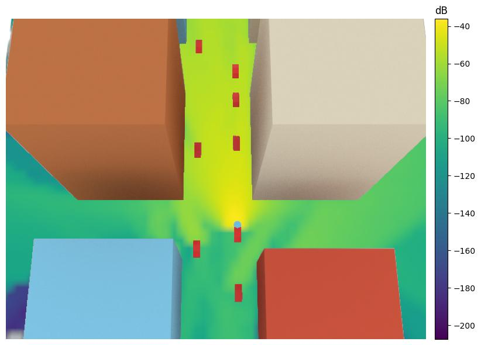

---

## اسلاید ۲ — راهکار اول: جابه‌جایی واقعی اشیا

# حرکت دادن اجزای محیط سه‌بعدی

در Sionna RT می‌توان موقعیت و جهت اشیای موجود در محیط را تغییر داد.

برای مثال:

- حرکت دادن خودروها
- تغییر موقعیت فرستنده
- تغییر موقعیت گیرنده
- چرخاندن آنتن یا اشیا

در آموزش NVIDIA یک خیابان سه‌بعدی با چند خودرو شبیه‌سازی شده است.

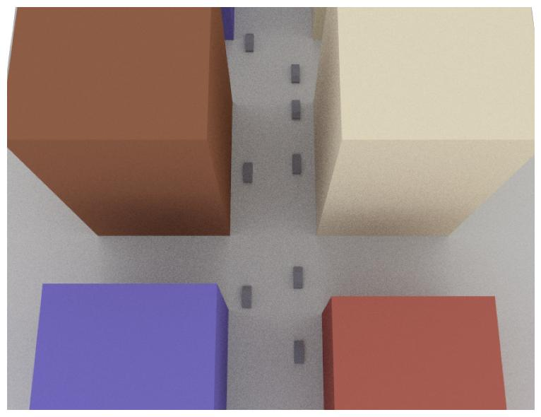

**نتیجه:** می‌توانیم یک محیط متحرک بسازیم و اثر حرکت اجزای آن را بررسی کنیم.

---

## اسلاید ۳ — مشاهده تغییر پوشش شبکه

# حرکت خودروها چه اثری بر پوشش دارد؟

در مثال آموزشی، یک فرستنده روی خودرو قرار داده شده است.

سپس:

1. موقعیت خودروها تغییر می‌کند.
2. موقعیت فرستنده همراه خودرو تغییر می‌کند.
3. در هر موقعیت، Radio Map مجدداً محاسبه می‌شود.
4. نقشه‌های پوشش با یکدیگر مقایسه می‌شوند.

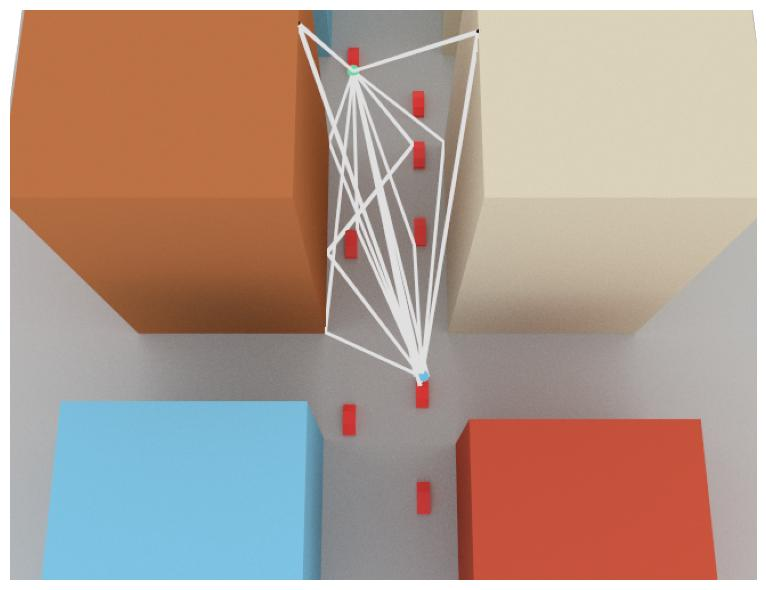

**نتیجه:** حتی با ثابت بودن ساختمان‌ها، حرکت خودروها می‌تواند وضعیت پوشش رادیویی را تغییر دهد.

---

## اسلاید ۴ — چالش روش اول

# آیا باید در هر لحظه Ray Tracing را تکرار کنیم؟

اگر بخواهیم حرکت یک خودرو را در صدها موقعیت بررسی کنیم، باید در هر موقعیت مسیرهای انتشار را دوباره محاسبه کنیم.

این کار:

- دقت بالایی دارد.
- تغییر واقعی مسیرهای انتشار را نشان می‌دهد.
- اما محاسبات زیادی نیاز دارد.

**سؤال:** آیا می‌توانیم تغییرات کانال را بدون اجرای مجدد Ray Tracing در هر لحظه محاسبه کنیم؟

پاسخ NVIDIA: استفاده از Doppler Shift.

---

## اسلاید ۵ — اثر داپلر (Doppler Effect)

# حرکت چگونه فرکانس سیگنال را تغییر می‌دهد؟

وقتی فرستنده، گیرنده یا اجسام منعکس‌کننده حرکت می‌کنند، فرکانس دریافتی می‌تواند با فرکانس ارسالی متفاوت شود.

به این پدیده **Doppler Shift** می‌گوییم.

یک مثال آشنا:

صدای آژیر آمبولانس هنگام نزدیک شدن و دور شدن از ما تغییر می‌کند.

در مخابرات نیز حرکت باعث تغییر فرکانس مؤثر سیگنال دریافتی می‌شود.

- نزدیک شدن: افزایش فرکانس دریافتی
- دور شدن: کاهش فرکانس دریافتی

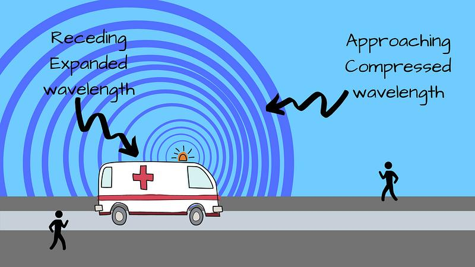

**کاربرد مخابراتی:** تحلیل تغییرات کانال در کاربران متحرک، به‌خصوص در سرعت‌های بالا.

---

## اسلاید ۶ — محاسبه Doppler در Sionna RT

# ‏Sionna سرعت اجسام را چگونه در نظر می‌گیرد؟

در Sionna RT برای اشیای متحرک می‌توان بردار سرعت (Velocity Vector) تعریف کرد.

این سرعت می‌تواند متعلق به موارد زیر باشد:

- فرستنده (TX)
- گیرنده (RX)
- ساختمان یا جسم منعکس‌کننده متحرک
- خودرو

‏Sionna با استفاده از سرعت و مسیر انتشار، تغییر داپلر هر مسیر را محاسبه می‌کند.

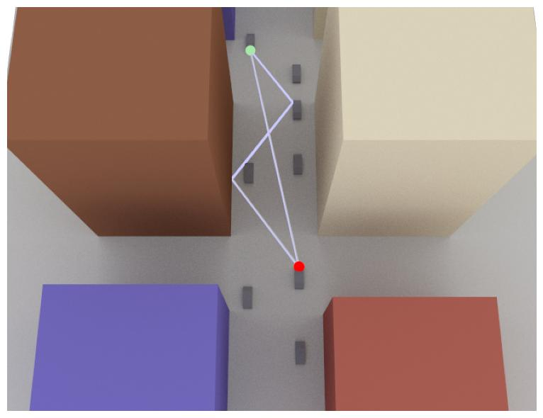

**نکته مهم:** هر مسیر انتشار می‌تواند مقدار Doppler متفاوتی داشته باشد؛ چون مسیرها از جهت‌ها و اجسام متفاوتی عبور می‌کنند.

---

## اسلاید ۷ — راهکار دوم: شبیه‌سازی تغییرات کانال با Doppler

# بدون محاسبه مجدد تمام مسیرها!

در روش دوم، ابتدا مسیرهای انتشار و تغییر داپلر آن‌ها محاسبه می‌شوند.

سپس Sionna از این اطلاعات برای شبیه‌سازی تغییرات کانال در طول زمان استفاده می‌کند.

مزیت این روش:

- سرعت محاسبات بالاتر
- مناسب برای بازه‌های زمانی کوتاه
- امکان مشاهده تغییرات کانال در طول حرکت

**تفاوت اصلی:** به‌جای جابه‌جایی فیزیکی اشیا و اجرای مجدد Ray Tracing در هر لحظه، تغییرات زمانی کانال از روی Doppler تخمین زده می‌شود.

---

## اسلاید ۸ — Delay-Doppler Spectrum

# کانال را در دو بُعد بررسی کنیم

تا اینجا با دو مفهوم آشنا شدیم:

- **‏Delay:** سیگنال با چه تأخیری به گیرنده می‌رسد؟
- **‏Doppler:** فرکانس سیگنال به دلیل حرکت چقدر تغییر کرده است؟

با ترکیب این دو مفهوم می‌توانیم Delay-Doppler Spectrum بسازیم.

در این نمودار:

- محور افقی: تأخیر رسیدن سیگنال
- محور دیگر: تغییر فرکانس ناشی از حرکت
- ارتفاع نمودار: شدت مؤلفه کانال

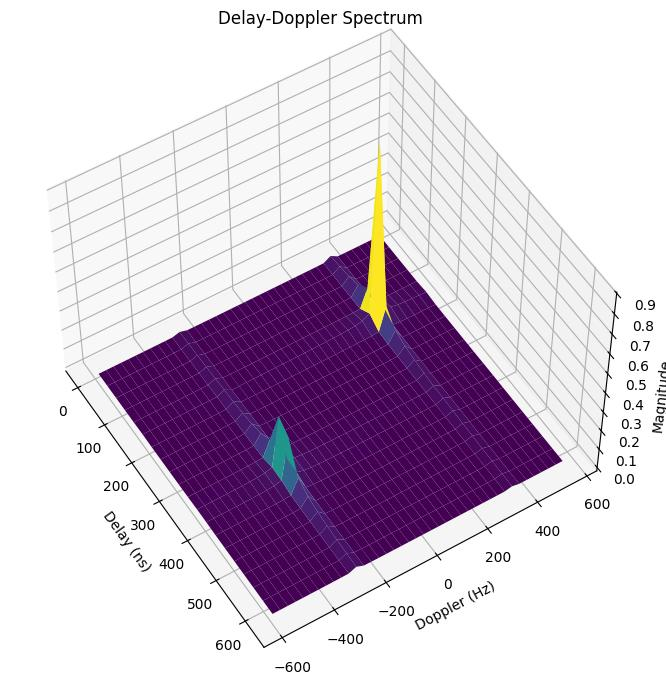

**نتیجه:** می‌توانیم مسیرهای مختلف سیگنال را هم از نظر تأخیر و هم از نظر اثر حرکت بررسی کنیم.

---

## اسلاید ۹ — چند مسیر، چند مقدار Doppler

# چرا هر مسیر رفتار متفاوتی دارد؟

فرض کنید یک سیگنال از دو مسیر به گیرنده برسد:

1. مسیر مستقیم (LoS)
2. مسیر منعکس‌شده از یک جسم متحرک

این دو مسیر ممکن است:

- تأخیر متفاوتی داشته باشند.
- تغییر فرکانس متفاوتی داشته باشند.
- شدت متفاوتی در گیرنده ایجاد کنند.

در مثال NVIDIA، دو قله در نمودار Delay-Doppler مشاهده می‌شود که به دو مسیر مستقیم و انعکاسی مربوط هستند.

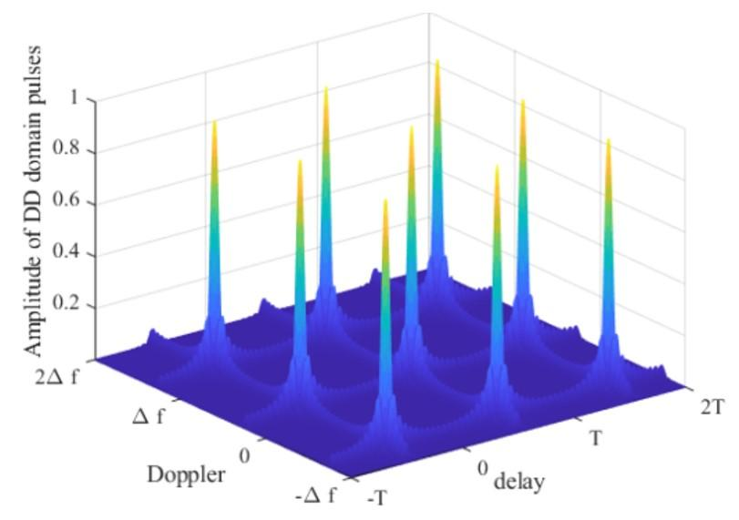

**نتیجه:** تحلیل کانال در شبکه متحرک پیچیده‌تر از بررسی صرف قدرت سیگنال است.

---

## اسلاید ۱۰ — مقایسه دو روش شبیه‌سازی Mobility

# کدام روش بهتر است؟

| ویژگی               | حرکت واقعی اشیا                   | روش Doppler     |
| ------------------- | --------------------------------- | --------------- |
| دقت در تغییر مسیرها | بالاتر                            | وابسته به شرایط |
| سرعت محاسبات        | کمتر                              | بیشتر           |
| محاسبه مجدد مسیرها  | بله                               | معمولاً خیر     |
| تغییر مسیرهای موجود | قابل شبیه‌سازی                    | محدودتر         |
| کاربرد              | بازه‌های طولانی‌تر و تغییرات محیط | بازه‌های کوتاه  |

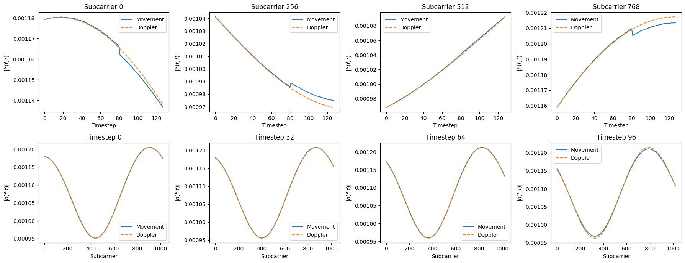

نکته علمی مهم: روش Doppler برای بازه‌های کوتاه و جابه‌جایی‌های کوچک مناسب است. اگر مسیرها به دلیل حرکت اجسام ایجاد یا حذف شوند، یا تغییرات محیط زیاد باشد، دقت آن کاهش می‌یابد.

---

## اسلاید ۱۱ — نتیجه آزمایش NVIDIA

# آیا روش Doppler به‌اندازه حرکت واقعی دقیق است؟

در آزمایش پایانی آموزش، NVIDIA دو روش را با هم مقایسه می‌کند:

- روش اول: جابه‌جایی واقعی خودروها و محاسبه مجدد مسیرها
- روش دوم: محاسبه تغییرات کانال با استفاده از Doppler

نتیجه آزمایش نشان می‌دهد که در سناریوی انتخاب‌شده، اختلاف قابل‌توجهی بین دو روش مشاهده نمی‌شود.

اما این نتیجه برای تمام شرایط صدق نمی‌کند؛ در بازه‌های طولانی‌تر یا با تغییرات شدید محیط، روش Doppler ممکن است دقت کمتری داشته باشد.

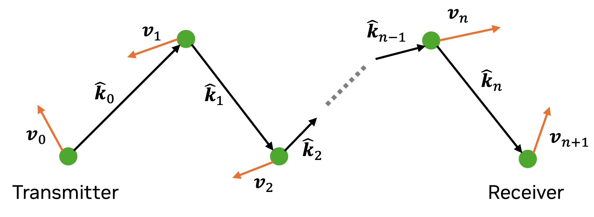

---

## اسلاید ۱۲ — نمودار کلی فرآیند Mobility

# از حرکت خودرو تا تحلیل کانال

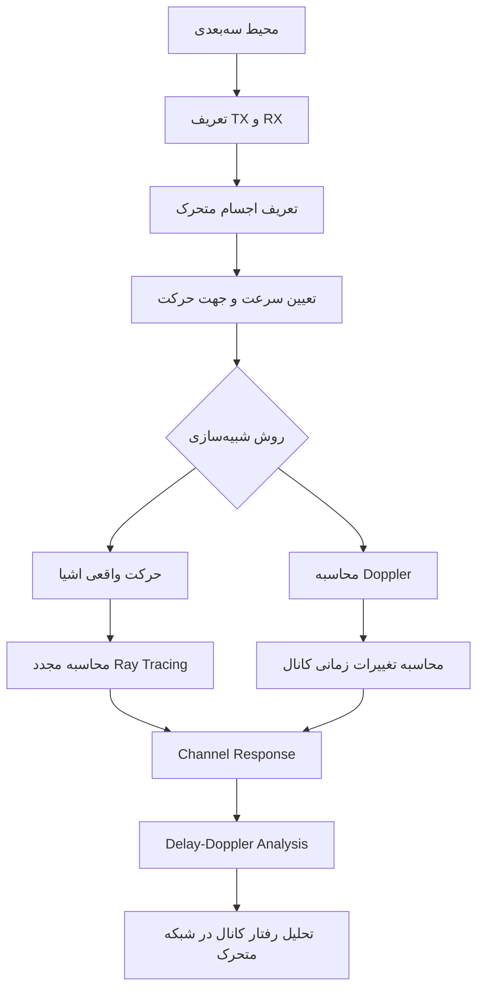

---

## اسلاید ۱۳ — کاربرد در شبکه‌های موبایل

# این قابلیت کجا استفاده می‌شود؟

| کاربرد             | توضیح                                      |
| ------------------ | ------------------------------------------ |
| شبکه‌های خودرویی   | بررسی ارتباط خودروها در حال حرکت           |
| شبکه 5G و 6G       | تحلیل کانال در سرعت‌های بالا               |
| Handover Analysis  | بررسی تغییر شرایط رادیویی هنگام حرکت کاربر |
| Channel Estimation | بررسی تغییرات کانال در طول زمان            |
| AI-RAN             | تولید داده برای آموزش مدل‌های هوشمند       |

**مثال:** می‌توانیم بررسی کنیم خودرویی که با سرعت ۱۰۰ کیلومتر بر ساعت در خیابان حرکت می‌کند، چه تغییراتی در کانال رادیویی تجربه خواهد کرد.

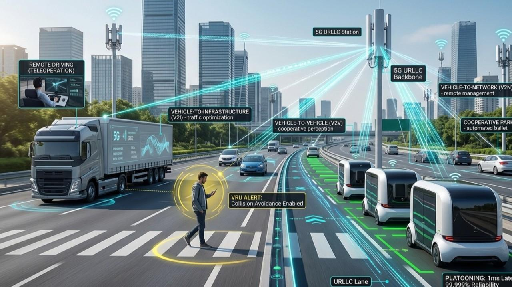

---

## اسلاید ۱۴ — جمع‌بندی

# از شبکه ثابت به شبکه متحرک

| موضوع | چیزی که یاد گرفتیم |
| --- | --- |
| Object Mobility | امکان جابه‌جایی اشیا |
| Position / Orientation | تغییر مکان و جهت |
| Velocity | تعریف سرعت حرکت |
| Doppler Shift | تغییر فرکانس ناشی از حرکت |
| Time-Varying Channel | بررسی تغییرات کانال در زمان |
| Delay-Doppler | تحلیل تأخیر و داپلر مسیرها |

(نتیجه نهایی)

‏Sionna RT فقط محیط ثابت را شبیه‌سازی نمی‌کند؛ می‌تواند اثر حرکت کاربران، خودروها و تجهیزات را بر انتشار امواج و رفتار کانال مخابراتی نیز بررسی کند.

---

## اسلاید ۱۵ — ارتباط با مبحث بعدی

# از Mobility به Radio Maps

در این دو مبحث یاد گرفتیم:

- چگونه محیط سه‌بعدی را شبیه‌سازی کنیم.
- چگونه مسیرهای انتشار را محاسبه کنیم.
- چگونه اثر حرکت بر کانال را بررسی کنیم.

حالا یک سؤال مهم‌تر داریم:

**آیا می‌توانیم به‌جای بررسی یک گیرنده متحرک، وضعیت سیگنال را در تمام نقاط یک منطقه محاسبه کنیم؟**

این موضوع ما را به مبحث بعدی یعنی Radio Maps می‌رساند.

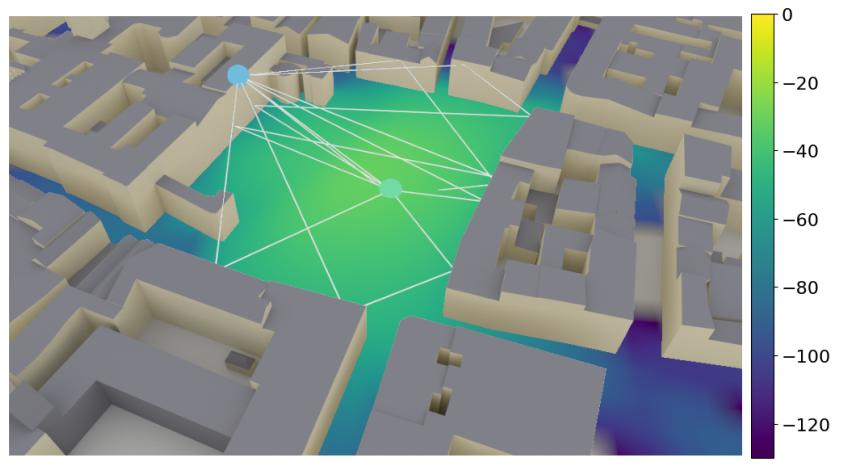

---

## زمان‌بندی پیشنهادی تدریس

| بخش | زمان |
| --- | --- |
| مسئله Mobility | ۱ دقیقه |
| حرکت اشیا و تغییر پوشش | ۳ دقیقه |
| مفهوم Doppler | ۳ دقیقه |
| Delay-Doppler | ۲ دقیقه |
| مقایسه دو روش | ۲ دقیقه |
| کاربرد و جمع‌بندی | ۲ دقیقه |
| **مجموع** | **۱۳ دقیقه** |

