tags:
  - sionna
## 🔗 Knowledge Graph

### Next Steps
- [[nvidia-sionna-PHY]]
- [[nvidia-sionna-SYS]]

- ---
- 

## اسلاید ۱ — مسئله چیست؟

# آیا پوشش یک سایت در تمام نقاط یکسان است؟

فرض کنید یک سایت موبایل در مرکز یک منطقه شهری قرار دارد.

آیا تمام کاربران اطراف آن کیفیت سیگنال یکسانی دارند؟

خیر!

- فاصله از سایت متفاوت است.
- ساختمان‌ها مسیر سیگنال را مسدود می‌کنند.
- انعکاس امواج باعث ایجاد مسیرهای غیرمستقیم می‌شود.
- جهت آنتن بر پوشش تأثیر می‌گذارد.

**نیاز:** به‌جای بررسی یک گیرنده، وضعیت رادیویی تمام منطقه را مشاهده کنیم.

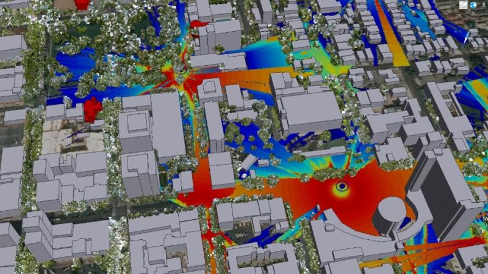

---

## اسلاید ۲ — راهکار: Radio Map

# نقشه رادیویی چیست؟

‏Radio Map نقشه‌ای است که برای هر نقطه از یک منطقه، یک معیار مخابراتی را نمایش می‌دهد.

به زبان ساده، محیط را به تعداد زیادی سلول کوچک تقسیم می‌کنیم و برای هر سلول مقدار سیگنال را محاسبه می‌کنیم.

برای مثال:

- نقاط زیر: وضعیت سیگنال مناسب
- نقاط سبز: وضعیت متوسط
- نقاط بنفش: وضعیت ضعیف

**نتیجه:** به‌جای بررسی یک نقطه، تصویر کاملی از وضعیت پوشش منطقه خواهیم داشت.

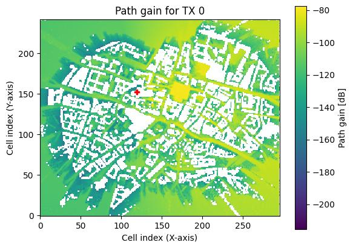

---

## اسلاید ۳ — سه معیار اصلی Radio Map

# چه چیزی را روی نقشه نمایش می‌دهیم؟

سه معیار مهم در آموزش NVIDIA وجود دارد:

| معیار | مفهوم ساده |
| --- | --- |
| Path Gain | چه مقدار از قدرت موج در مسیر انتقال حفظ شده است؟ |
| RSS | چه مقدار توان سیگنال به گیرنده می‌رسد؟ |
| SINR | سیگنال دریافتی نسبت به تداخل و نویز چقدر قوی است؟ |

**تفاوت مهم:**

ممکن است یک نقطه سیگنال دریافتی مناسبی داشته باشد، اما به دلیل تداخل از سایت‌های دیگر، کیفیت ارتباط آن مطلوب نباشد.

به همین دلیل RSS به‌تنهایی برای ارزیابی کیفیت شبکه کافی نیست.

---

## اسلاید ۴ — اولین Radio Map در Sionna

# از یک فرستنده تا نقشه پوشش

در مثال اول NVIDIA:

- یک محیط ساده ایجاد می‌شود.
- یک فرستنده در محیط قرار می‌گیرد.
- توان ارسال و مشخصات آنتن تعیین می‌شود.
- محدوده موردنظر به سلول‌های کوچک تقسیم می‌شود.
- مقدار سیگنال برای هر سلول محاسبه می‌شود.

در نمونه آموزش، منطقه‌ای به ابعاد ۴۰۰ در ۴۰۰ متر با سلول‌های ۵ متری بررسی می‌شود.

**نتیجه:** برای هر نقطه از منطقه، مقدار Path Gain، RSS و SINR قابل محاسبه است.

تصویر ۱ — Path Gain محاسبه‌شده در مثال رسمی NVIDIA

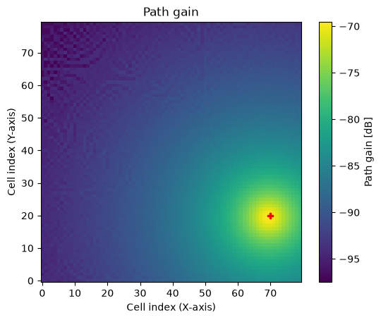

---

## اسلاید ۵ — بررسی RSS

# توان سیگنال دریافتی چقدر است؟

 ‏RSS نشان می‌دهد در هر نقطه چه مقدار توان سیگنال از فرستنده دریافت می‌شود.

در مثال NVIDIA، توان فرستنده ابتدا ۴۴ dBm است و سپس به ۲۴ dBm کاهش پیدا می‌کند.

در نتیجه، مقدار RSS نیز ۲۰ دسی‌بل کاهش پیدا می‌کند.

**نکته آموزشی:** اگر توان ارسال سایت را کاهش دهیم، نقشه RSS نیز تغییر می‌کند.

تصویر ۲ — نقشه RSS برای فرستنده در مثال اولیه

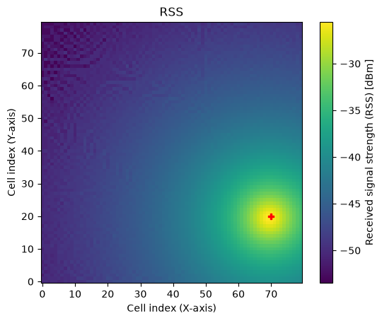

---

## اسلاید ۶ — بررسی SINR

# چرا قدرت سیگنال به‌تنهایی کافی نیست؟

فرض کنید دو کاربر RSS یکسانی دارند.

اما یکی از آن‌ها تداخل زیادی از سایت‌های مجاور دریافت می‌کند.

در این شرایط کیفیت ارتباط آن‌ها یکسان نخواهد بود.

‏SINR نسبت توان سیگنال مطلوب به مجموع توان تداخل و نویز است.

بنابراین:

- ‏RSS برای بررسی قدرت دریافتی مناسب است.
- ‏SINR برای بررسی کیفیت سیگنال در حضور تداخل و نویز مناسب‌تر است.

در Sionna RT، پهنای باند و دمای محیط نیز در محاسبه نویز حرارتی لحاظ می‌شوند.

تصویر ۳ — نقشه SINR در مثال اولیه

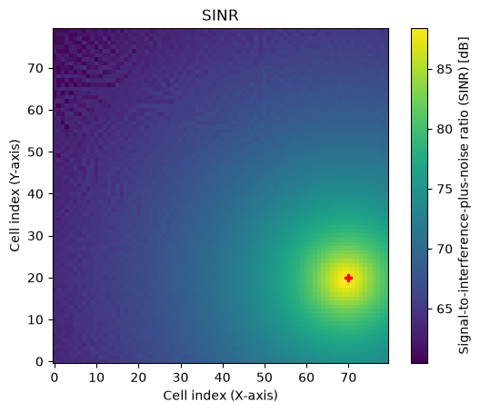

---

## اسلاید ۷ — چند سایت مخابراتی

# وقتی چند فرستنده در منطقه داشته باشیم چه اتفاقی می‌افتد؟

در شبکه واقعی، معمولاً چند سایت یا سلول در یک منطقه فعالیت می‌کنند.

در مثال NVIDIA سه فرستنده دیگر به محیط اضافه می‌شوند تا اثر هم‌زمان چند سایت بررسی شود.

حالا می‌توانیم دو حالت را مشاهده کنیم:

1. ‏SINR مربوط به یک فرستنده مشخص
2. بهترین SINR قابل دریافت از میان تمام فرستنده‌ها

این قابلیت برای تحلیل شبکه‌های سلولی اهمیت زیادی دارد.

تصویر ۴ — SINR مربوط به فرستنده شماره صفر

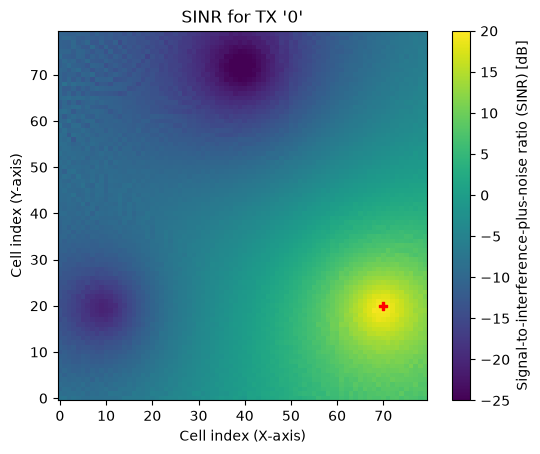

---

## اسلاید ۸ — بهترین سایت برای هر نقطه

# Best SINR Across All Transmitters

در این مرحله Sionna بررسی می‌کند که هر نقطه از منطقه از کدام فرستنده بهترین SINR را دریافت می‌کند.

به زبان ساده:

فرض کنید کاربر در یک منطقه سه سایت در دسترس دارد.

‏Sionna می‌تواند مشخص کند کدام سایت در آن نقطه کیفیت بهتری ارائه می‌دهد.

این موضوع به مفهوم انتخاب سلول مناسب (Cell Selection) و User Association مرتبط است.

تصویر ۵ — بهترین SINR در میان تمام فرستنده‌ها

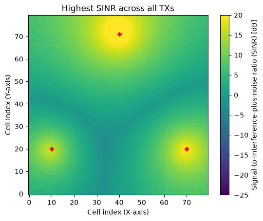

---

## اسلاید ۹ — User Association

# هر نقطه به کدام سایت متصل می‌شود؟

در شبکه موبایل، هر کاربر باید به یک سلول یا سایت سرویس‌دهنده متصل شود.

‏Sionna RT می‌تواند بر اساس معیار انتخاب‌شده، مشخص کند هر نقطه به کدام فرستنده تعلق دارد.

در مثال این آموزش، معیار SINR استفاده شده است.

در نقشه:

- هر رنگ نماینده یک فرستنده است.
- مرز رنگ‌ها نشان‌دهنده تغییر ناحیه انتخاب سایت است.
- محل علامت‌های قرمز، موقعیت فرستنده‌ها را نشان می‌دهد.

تصویر ۶ — نقشه ارتباط هر سلول با فرستنده منتخب

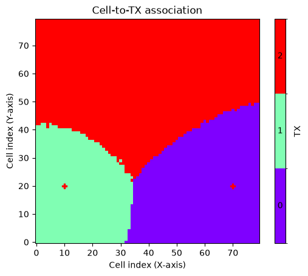

**کاربرد:** شناسایی نواحی سرویس‌دهی سایت‌ها و بررسی تداخل و هم‌پوشانی پوشش.

---

## اسلاید ۱۰ — انتخاب تصادفی موقعیت کاربران

# چگونه کاربران را در محیط شبیه‌سازی کنیم؟

یکی از قابلیت‌های جالب Sionna، انتخاب موقعیت کاربران بر اساس شرایط رادیویی است.

برای مثال می‌توانیم تعیین کنیم:

- ‏SINR کاربر حداقل ۳ دسی‌بل باشد.
- فاصله کاربر از سایت بین ۱۰ تا ۲۰۰ متر باشد.
- کاربر به سایتی اختصاص پیدا کند که بهترین SINR را ارائه می‌دهد.

‏Sionna سپس موقعیت‌های مناسب را به‌صورت تصادفی انتخاب می‌کند.

**نتیجه:** می‌توانیم تعداد زیادی کاربر مجازی در موقعیت‌های مختلف ایجاد کنیم.

تصویر ۷ — موقعیت‌های نمونه‌برداری‌شده بر اساس SINR و فاصله

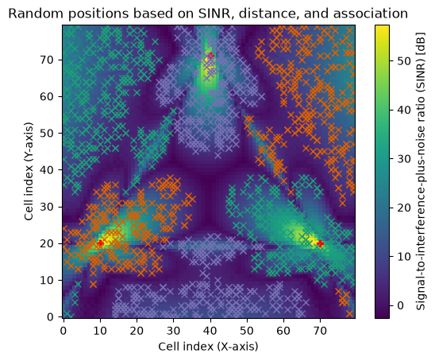

---

## اسلاید ۱۱ — تأثیر الگوی آنتن

# آیا جهت آنتن در پوشش تأثیر دارد؟

تا اینجا فرض کردیم آنتن‌ها رفتار نسبتاً ساده‌ای دارند.

اما در شبکه واقعی، آنتن‌ها معمولاً جهت‌دار هستند و انرژی را در همه جهات به یک اندازه منتشر نمی‌کنند.

در Sionna می‌توانیم:

- الگوی تشعشعی آنتن را تعریف کنیم.
- جهت قرارگیری آنتن را تغییر دهیم.
- آرایه آنتنی را شبیه‌سازی کنیم.
- اثر آن را روی Radio Map مشاهده کنیم.

تصویر ۸ — تأثیر الگوی آنتن بر RSS

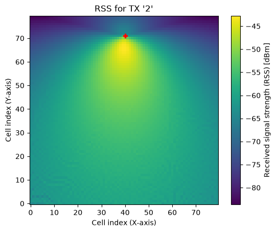

**نتیجه:** تغییر الگوی آنتن می‌تواند مناطق تحت پوشش را به شکل قابل‌توجهی تغییر دهد.

---

## اسلاید ۱۲ — Beamforming و Precoding

# هدایت انرژی به سمت کاربران

در فناوری‌های جدید شبکه موبایل، مانند 5G، از آرایه‌های آنتنی و Beamforming استفاده می‌شود.

‏Beamforming به زبان ساده یعنی هدایت انرژی رادیویی به سمت جهت یا ناحیه موردنظر.

در آموزش NVIDIA، تعداد عناصر آرایه آنتنی افزایش پیدا می‌کند و یک Precoding Vector برای آن تعریف می‌شود.

سپس Radio Map مجدداً محاسبه می‌شود.

**نتیجه:** نقشه پوشش نسبت به حالت آنتن ساده تغییر می‌کند و ممکن است نواحی با سیگنال قوی و ضعیف به شکل متفاوتی ظاهر شوند.

تصویر ۹ — تأثیر آرایه آنتنی و Precoding بر SINR

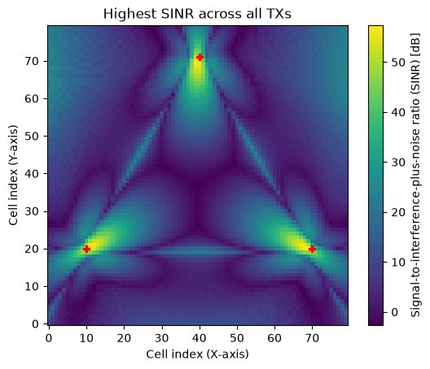

---

## اسلاید ۱۳ — تغییر نواحی انتخاب سایت با Beamforming

# آیا Beamforming فقط قدرت سیگنال را تغییر می‌دهد؟

خیر.

وقتی الگوی آنتن و Precoding تغییر می‌کند، ممکن است بهترین سایت برای یک نقطه نیز تغییر کند.

بنابراین حتی نواحی User Association نیز می‌توانند متفاوت شوند.

این موضوع در طراحی و بهینه‌سازی شبکه‌های دارای Massive MIMO اهمیت دارد.

تصویر ۱۰ — تغییر نواحی انتخاب فرستنده بعد از اعمال Precoding

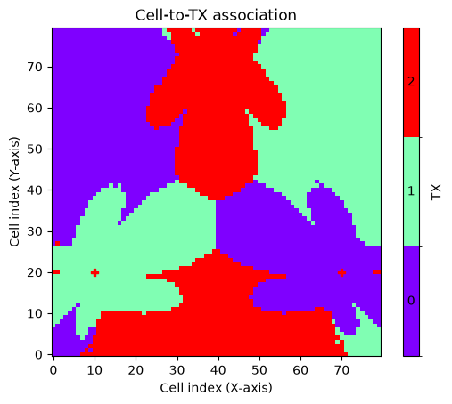

---

## اسلاید ۱۴ — Radio Map در محیط شهری واقعی‌تر

# از محیط ساده به شهر سه‌بعدی

تا اینجا بیشتر مثال‌ها در محیط خالی و ساده انجام شده بودند.

در مرحله بعد، NVIDIA از یک محیط شهری سه‌بعدی با نام Etoile استفاده می‌کند.

در این سناریو:

- ساختمان‌های واقعی‌نما در محیط وجود دارند.
- هفت فرستنده در نقاط مختلف قرار می‌گیرند.
- آرایه‌های آنتنی تعریف می‌شوند.
- اثر موانع و ساختمان‌ها در محاسبات لحاظ می‌شود.
- نقشه SINR روی محیط سه‌بعدی نمایش داده می‌شود.

**این مرحله به شرایط طراحی واقعی شبکه نزدیک‌تر است.**

تصویر ۱۱ — Radio Map روی مدل سه‌بعدی شهری Etoile

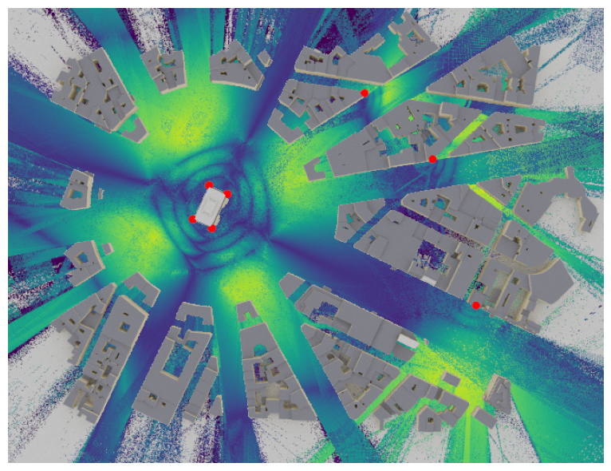

---

## اسلاید ۱۵ — تحلیل User Association در محیط واقعی‌تر

# تقسیم منطقه بین هفت سایت

در محیط Etoile، می‌توانیم ببینیم هر بخش از منطقه به کدام فرستنده اختصاص پیدا می‌کند.

این بار به‌جای سه فرستنده، هفت فرستنده داریم.

نواحی رنگی، مناطق سرویس‌دهی هر سایت را نشان می‌دهند.

این خروجی برای بررسی موارد زیر مفید است:

- محدوده پوشش سایت‌ها
- هم‌پوشانی نواحی سرویس‌دهی
- تغییرات انتخاب سلول
- بررسی اولیه توزیع کاربران

تصویر ۱۲ — User Association در سناریوی هفت فرستنده

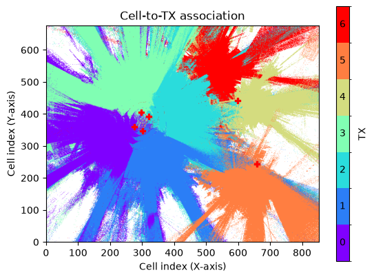

---

## اسلاید ۱۶ — استخراج Channel Impulse Response برای کاربران

# از Radio Map به اطلاعات دقیق کانال

یک قابلیت مهم دیگر این است که پس از تولید Radio Map، می‌توانیم موقعیت کاربران را انتخاب کنیم و برای آن‌ها مسیرهای انتشار را محاسبه کنیم.

به این ترتیب:

1. ‏Radio Map تولید می‌شود.
2. موقعیت کاربران انتخاب می‌شود.
3. گیرنده‌ها در آن موقعیت‌ها قرار می‌گیرند.
4. ‏Ray Tracing برای آن کاربران انجام می‌شود.
5. ‏Channel Impulse Response استخراج می‌شود.

**نتیجه:** Radio Map برای تحلیل کلی منطقه و CIR برای بررسی دقیق کانال کاربران استفاده می‌شود.

تصویر ۱۳ — نمونه Channel Impulse Response برای یک گیرنده

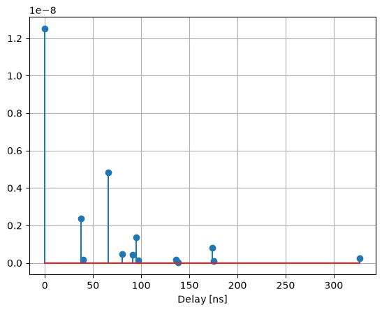

---

## اسلاید ۱۷ — Radio Map روی سطوح سه‌بعدی

# آیا Radio Map فقط یک نقشه دوبعدی است؟

خیر.

در مثال پایانی آموزش، NVIDIA نشان می‌دهد که می‌توان Radio Map را روی یک Mesh دلخواه نیز محاسبه کرد.

برای مثال:

- سطح یک کره
- سطوح سه‌بعدی پیچیده
- سطوحی که از مثلث‌های کوچک تشکیل شده‌اند

در این روش، هر مثلث از Mesh می‌تواند یک سلول محاسباتی باشد.

**کاربرد:** نمایش الگوی تشعشعی آنتن و بررسی انتشار سیگنال روی سطوح سه‌بعدی.

تصویر ۱۴ — نمایش الگوی آنتن روی سطح یک کره

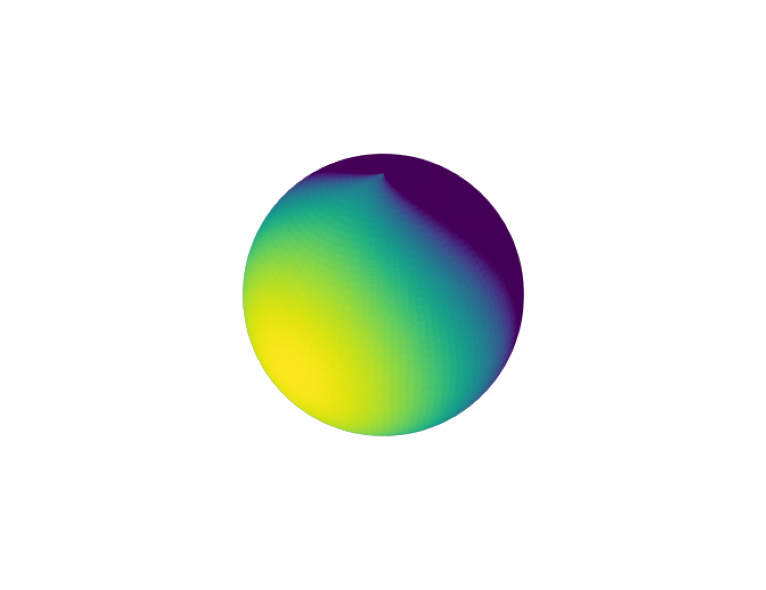

---

## اسلاید ۱۸ — نمودار کلی فرآیند Radio Map

# از سایت مخابراتی تا تحلیل پوشش شبکه

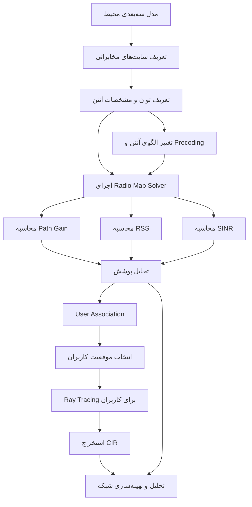

---

## اسلاید ۱۹ — جمع‌بندی

# در این آموزش چه چیزی یاد گرفتیم؟

| قابلیت | کاربرد |
| --- | --- |
| Radio Map | نمایش وضعیت رادیویی منطقه |
| Path Gain | بررسی افت مسیر |
| RSS | بررسی قدرت سیگنال دریافتی |
| SINR | بررسی کیفیت سیگنال با لحاظ تداخل و نویز |
| Multiple TX | بررسی چند سایت مخابراتی |
| User Association | تعیین سایت مناسب برای هر نقطه |
| User Sampling | ایجاد کاربران مجازی |
| Antenna Pattern | بررسی تأثیر الگوی آنتن |
| Precoding | بررسی هدایت انرژی آنتن |
| CIR | استخراج مشخصات کانال کاربران |

(نتیجه نهایی)

‏Sionna RT می‌تواند از یک مدل سه‌بعدی شهری، نقشه پوشش رادیویی تولید کند و امکان بررسی هم‌زمان چند سایت، تداخل، انتخاب سلول و اثر آرایه‌های آنتنی را فراهم کند.

---

## اسلاید ۲۰ — ارتباط با AI-RAN

# ‏Radio Map چه کمکی به هوش مصنوعی می‌کند؟

‏Radio Map می‌تواند یکی از منابع داده برای آموزش مدل‌های هوش مصنوعی باشد.

برای مثال:

- پیش‌بینی پوشش رادیویی با Neural Network
- تخمین Path Loss بدون اجرای Ray Tracing در هر بار
- شناسایی نقاط کور شبکه
- پیشنهاد موقعیت مناسب سایت
- بهینه‌سازی پارامترهای آنتن
- پیش‌بینی کیفیت ارتباط کاربران

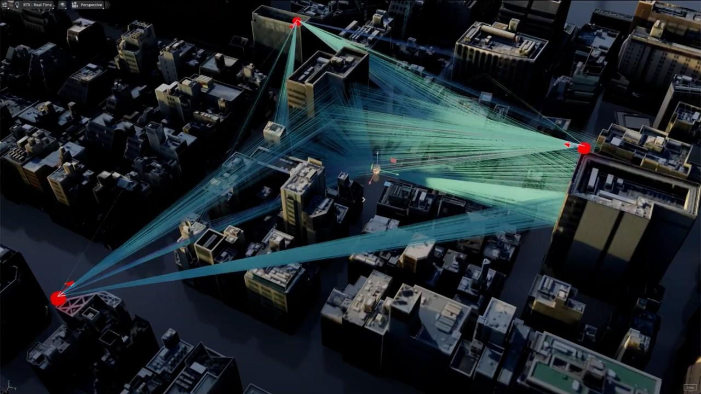

**پل ارتباطی با مبحث بعدی:**

حالا که می‌توانیم با Sionna RT داده‌های رادیویی تولید کنیم، می‌توانیم بررسی کنیم چگونه شبکه‌های عصبی این داده‌ها را یاد می‌گیرند و برای پیش‌بینی و بهینه‌سازی شبکه استفاده می‌شوند.

---

## زمان‌بندی پیشنهادی تدریس

| بخش | زمان |
| --- | --- |
| مفهوم Radio Map | ۲ دقیقه |
| Path Gain، RSS و SINR | ۳ دقیقه |
| چند سایت و User Association | ۳ دقیقه |
| نمونه‌برداری کاربران و CIR | ۲ دقیقه |
| آنتن و Beamforming | ۳ دقیقه |
| محیط شهری و جمع‌بندی | ۲ دقیقه |
| **مجموع** | **۱۵ دقیقه** |

## نکات مهم برای ارائه

سه موضوع را حتماً برای مخاطب روشن کن:

1. **Radio Map با Coverage Map ساده متفاوت است.** در اینجا محاسبات مبتنی بر انتشار امواج در محیط سه‌بعدی و ویژگی‌های آنتن انجام می‌شود.
2. **RSS و SINR یکسان نیستند.** ممکن است قدرت سیگنال مناسب باشد ولی به دلیل تداخل، کیفیت ارتباط پایین باشد.
3. **User Association در این آموزش یک تحلیل بر اساس معیار انتخاب‌شده است.** لزوماً معادل اجرای کامل الگوریتم‌های زمان‌بندی و تصمیم‌گیری Handover در شبکه عملیاتی نیست.

همچنین دقت کن که Radio Map در این آموزش روی یک شبکه سلولی گسسته محاسبه می‌شود؛ بنابراین اندازه سلول‌ها روی جزئیات و هزینه محاسبات اثر دارد. 

[Sionna 2.2.0](https://nvlabs.github.io/sionna/rt/tutorials/Radio-Maps.html)

**منبع:** [NVIDIA Sionna RT – Tutorial on Radio Maps](https://nvlabs.github.io/sionna/rt/tutorials/Radio-Maps.html).

---

## ارتباط سه مبحثی که تاکنون ارائه کردیم

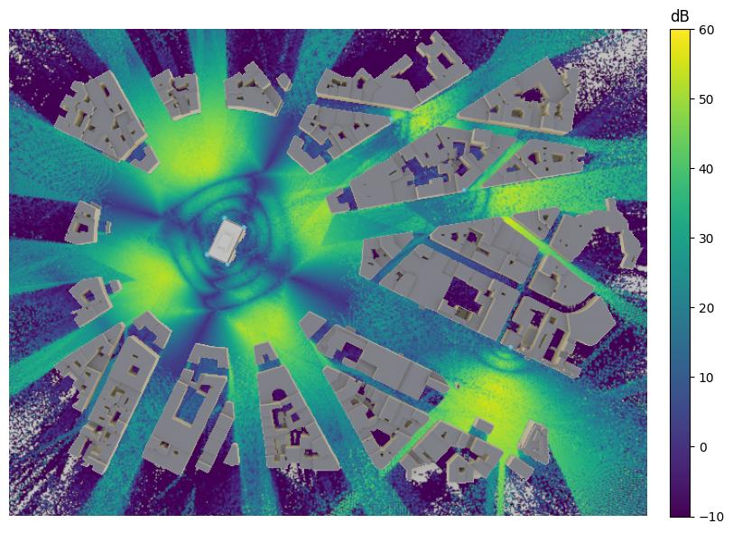 · **۱. Introduction**

ساخت محیط سه‌بعدی و محاسبه مسیر انتشار امواج

---

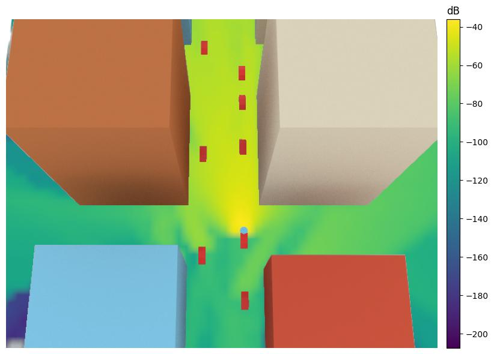 · **۲. Mobility**

بررسی حرکت کاربران و اثر Doppler بر کانال

---

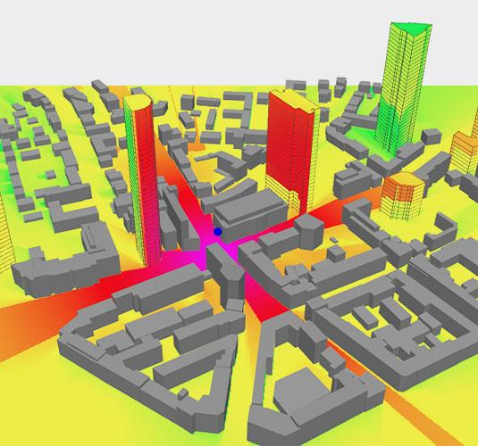 · **۳. Radio Maps**

تبدیل محاسبات انتشار به نقشه پوشش و تحلیل چند سایت

به نظرم بعد از این سه مبحث، مخاطب تصویر نسبتاً کاملی از توانایی Sionna RT خواهد داشت. بهتر است در ادامه به‌جای ورود به جزئیات بیشتر RT، به سراغ ارتباط آن با یادگیری ماشین و سپس Sionna PHY برویم.